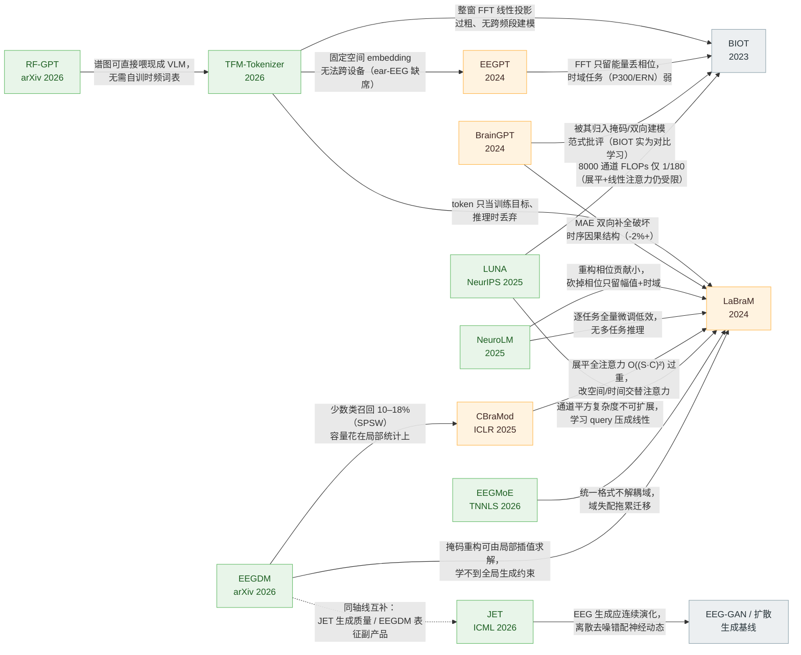

# 十二篇方法对比

> 全站横向对照的**枢纽页**：一张战绩图 + 一页速览给十二篇定位；九个对比维度的核心分歧在[分维度导读](#dimension-guide)里各用几句话说清，**详细拆解下放到六个主题专题**（数据 / tokenization / 预训练目标 / 通道异构 / 下游适配 / 基座来源），其中暂无专题归属的三个维度（模型设计 / 频域 / 规模效率）全文保留在本页；最后是演进脉络、benchmark 战绩表与论文互怼链。数字均引自各论文自报结果。

十二篇 = 核心六篇（[BIOT](papers/2026-09/0918-biot.md) / [LaBraM](papers/2026-09/0918-labram.md) / [EEGPT](papers/2026-09/0918-eegpt.md) / [BrainGPT](papers/2026-09/0918-braingpt.md) / [NeuroLM](papers/2026-09/0918-neurolm.md) / [TFM-Tokenizer](papers/2026-09/0918-tfm-tokenizer.md)，回答「token 该是什么、怎么预训练」）+ 2025–2026 扩展六篇（[CBraMod](papers/2026-09/0928-cbramod.md) / [LUNA](papers/2026-09/0924-luna.md) / [EEGMoE](papers/2026-09/0924-eegmoe.md) / [JET](papers/2026-09/0923-jet.md) / [EEGDM](papers/2026-10/1017-eegdm.md) / [RF-GPT](papers/2026-09/0921-rf-gpt.md)，把问题推向异构管理、生成与跨模态）。

## 📊 TUEV Cohen's Kappa 横向对比（多数据集预训练设定）

数据来源：TFM-Tokenizer 论文 Table 1（统一评测口径）。† 表示在四个 EEG 数据集上复现预训练。

<canvas id="kappa-chart" height="130"></canvas>

## 一页速览

| 论文 | 发表 | 一句话定位 | 参数量 | 预训练数据 | 代码 |
|---|---|---|---|---|---|
| [BIOT](papers/2026-09/0918-biot.md) | NeurIPS 2023 | 逐通道切段 + 线性注意力的跨格式生物信号编码器 | 3.2M | ~1000 万样本（PREST + SHHS + ECG） | ✅ |
| [LaBraM](papers/2026-09/0918-labram.md) | ICLR 2024 | VQ 神经词表 + 频谱重构 + 掩码码字预测的大规模 EEG 基座 | 5.8M / 46M / 369M（tokenizer 另 8.6M） | ~2500h · 约 20 数据集 | ✅ |
| [EEGPT](papers/2026-09/0918-eegpt.md) | NeurIPS 2024 | 对齐 + 重构双自监督的通用特征提取器，linear probing 即 SOTA | ~10M（变体 0.4M–101M） | 5 个多范式数据集 | ✅ |
| [BrainGPT](papers/2026-09/0918-braingpt.md) | arXiv 2024 | 电极级自回归 + 任务共享电极图的首个 EEG generalist | 1.46M–**1.09B** | 3750 万单电极样本（~1B token） | 未放 |
| [NeuroLM](papers/2026-09/0918-neurolm.md) | ICLR 2025 | 把 EEG 当外语接进 GPT-2：指令微调单模型多任务 | 254M / 500M / 1696M | ~25000h（TUEG 为主） | ✅ |
| [TFM-Tokenizer](papers/2026-09/0918-tfm-tokenizer.md) | ICLR 2026 | 单通道时频 motif 词表，离散 token 真正作下游输入 | **~1.9M**（tokenizer 1.2M + 下游 0.7M） | 4 个 EEG 数据集 + ear-EEG 跨设备验证 | ✅ |
| [CBraMod](papers/2026-09/0928-cbramod.md) | ICLR 2025 | 十字交叉注意力 + ACPE：4M 参数 10 任务全 SOTA | 4.0M | TUEG 清洗版 **>9000h**（110 万样本） | ✅ |
| [LUNA](papers/2026-09/0924-luna.md) | NeurIPS 2025 | 学习 query 压进固定隐空间：拓扑无关 + 通道数线性复杂度 | 7M / 43M / 311.4M | TUEG + Siena **21,900h**（3 种拓扑） | ✅ |
| [EEGMoE](papers/2026-09/0924-eegmoe.md) | TNNLS 2026 | Specific + Shared 双专家组解耦域差异：解耦保留异构 | 1.68M（激活 0.89M） | 9 数据集 ~142h（认知域） | 未放 |
| [JET](papers/2026-09/0923-jet.md) | ICML 2026 | 条件流匹配 + 三条生理约束的原始 EEG 生成器 | 129.9M | TUH 三子集（生成器训练即全部） | 项目页 |
| [EEGDM](papers/2026-10/1017-eegdm.md) | arXiv 2026 | 潜扩散生成目标做表征学习：encoder 表示作条件（不 detach） | 25M（下游 encoder） | TUEG 19ch（30s 样本） | ✅ |
| [RF-GPT](papers/2026-09/0921-rf-gpt.md) | arXiv 2026 | 射频谱图 + 现成 VLM：零预训练、纯合成 SFT（跨域参照） | 3B / 7B（借 Qwen2.5-VL） | 合成 0.625M 指令对（零人工） | 未附 |

## 分维度导读 {: #dimension-guide }

十二篇的异同拆成九个维度：前六个各有专题页深读（每页都覆盖十二篇、含扩展六篇的最新进展），后三个暂无专题归属、全文保留在本页。

| 维度 | 核心分歧一句话 | 深读 |
|---|---|---|
| ① 预训练数据 | 规模 / 域距离 / 清洗哲学：TUEG 系语料越报越大（2500h→25000h），但清洗质量 > 堆量、域邻近 > 规模、1000h 后边际递减 | [数据全景专题](topics/data-landscape.md) |
| ② 信号 Tokenization | 切多细（40 点 → 1s）、离不离散（连续 vs VQ 词表）、词表用在哪（预处理 → 训练目标 → 模型输入）——三步跃迁 + 2025–2026 连续派的加固 | [Tokenization 专题](topics/tokenization.md) |
| ③ 预训练目标 | 对比 / 掩码 / 自回归 / **生成**（2026 新增）四条路线；掩码派内部「掩什么 × 预测什么」的设计空间；对掩码重构的三条批评线 | [预训练范式专题](topics/pretraining.md) |
| ④ 空间与通道异构 | 六种解法：通道表 / 10-20 编码 / 单通道 / 图结构 / 解耦路由 / query 统一——几何轴抹平、任务轴解耦 | [通道异构专题](topics/spatial.md) |
| ⑤ 下游适配与多任务 | 逐任务微调 / 联合训练 / 指令微调三条路线之外的新变量：冻结探针 vs 微调的两个极端、生成增强、组件可插拔 | [多任务专题](topics/multi-task.md) |
| ⑥ 基座来源 | 十二篇里十篇从零训练，仅两例借底座——NeuroLM 接 GPT-2，RF-GPT 更彻底（连信号编码器都不训，直接复用 VLM） | [基座来源专题](topics/base-model.md) |
| ⑦ 模型设计 | 注意力计算图如何匹配 EEG 的（通道 × 时间）结构：展平全注意力 → 线性 → 十字交叉 → query 压缩 → MoE 条件计算；「架构 > 规模」的证据 | [本页下文](#mod-architecture) |
| ⑧ 频域信息 | 频域角色的六级递进：特征工程 → 重构目标 → 输入表示 → 建模对象 → 输入即全部 → 无显式；相位处理的暗线 | [本页下文](#mod-frequency) |
| ⑨ 规模、效率与开源 | 参数量 1.68M–1.09B 的排序、效率代表成绩（LUNA 1/180、JET 67× 实时）、算力三档、开源与权重坑 | [本页下文](#mod-scale) |

## 本页保留维度

### 模型设计：注意力结构与位置编码 {: #mod-architecture }

**① 注意力结构谱系**（EEG 的 C×n patch 网格到底怎么数）

- **全注意力一锅炖**：LaBraM / EEGPT 把 C·n 个 patch 展平进标准 ViT——CBraMod 的消融里全注意力在四种变体中垫底（19 通道 × 30s = 570 patch 已超出舒适区）；
- **线性注意力**：BIOT（Linformer 式 E/F 低秩投影，注意力图 N×N→N×d）、TFM 下游模型（~0.7M）——牺牲细粒度 token 间路由换效率；
- **十字交叉**：CBraMod 把 8 个注意力头劈成 4 头 S-Attention（同一时刻跨通道）+ 4 头 T-Attention（同一通道跨时间）并行，复杂度 O(Cn² + nC²)；消融 4:4 最优，偏科 6:2 / 2:6 都掉——空间与时间依赖同等重要；
- **隐空间压缩**：LUNA 用 Q 个学习 query 的交叉注意力把任意 C 个通道压进固定 Q×E 隐空间（置换不变 → 拓扑无关），时间注意力只在隐空间做，序列长度 S·C→S；
- **条件计算**：EEGMoE 把 Transformer 的 FFN 换成 SSMoE 块（Top-K Specific 专家 + 软路由 Shared 专家，相加融合）——MoE 在这里不是用来 scale，是用来管理异构性（消融：与总参数等价 / 激活参数等价的稠密模型都更差）；
- **时空分治**：BrainGPT 用 ETE（causal attention + SwiGLU 前馈）管时间、TEG（GAT 图注意力 + 子图激活）管空间——把时空拆到两个模块，预训练只学前者的设计最激进；
- **借来底座**：NeuroLM（GPT-2）与 RF-GPT（Qwen2.5-VL）的骨干完全不在 EEG 上设计——这条线的完整对比见[基座来源专题](topics/base-model.md)；
- **生成骨干**：JET 标准 Transformer + adaLN 条件注入；EEGDM = EEG-ViT encoder（8 层）+ DiT 去噪器（8 块，adaLN-Zero，ρ 零初始化）。

**② 「架构 > 规模」的最强证据**：CBraMod 附录 G——把 BIOT / LaBraM 的架构搬到 CBraMod 的 9000h 清洗语料上重训，BIOT(ours) ≈ BIOT(original)、LaBraM(ours) 仅小涨，而 CBraMod 全面碾压两者：**4.0M 参数在 TUEV 打过 369M 的 LaBraM-Huge**（0.6671 vs 0.6616）。固定数据换架构，把贡献归因做成了可证伪的对照。

**③ 位置编码谱系**：正弦相对（BIOT）→ 可学习时空绝对（LaBraM / NeuroLM）→ RoPE（EEGPT predictor、LUNA 时间轴、RF-GPT 底座）→ 电极词表 prefix（BrainGPT）→ **无**（TFM tokenizer 内，消融支持）→ **卷积动态生成**（CBraMod ACPE，核 (19,7) 空间长边 + 时间短边）→ **连续 3D 坐标 NeRF 编码**（LUNA 空间）。趋势明确：从「查表绑定」走向「动态生成 / 连续坐标」，动因都是跨 montage 泛化（TFM 的「无」是另一面的同一个月亮：拒绝一切位置绑定）。

**维度小结**：模型设计的演进不是「更大」，而是**注意力计算图的形状逐渐匹配 EEG 的 (通道 × 时间) 结构**——展平全注意力 → 线性注意力 → 十字交叉 → query 压缩，每一步都在回答「哪些 patch 天生该互相看」。

### 频域信息：从特征工程到建模对象 {: #mod-frequency }

频域的角色在这批论文里经历了六级递进：

- **特征工程**：BIOT 把 FFT 能量向量过 FCN 进 segment embedding——EEGPT 附录 F 批评其丢相位、1s 窗 FFT 过粗，导致 P300 等时域任务弱（PhysioP300 仅 0.5485）；
- **重构目标**：LaBraM 重构 DFT 幅值 + 相位（直接重构原始波形 loss 不收敛的关键替代）；NeuroLM 发现**相位贡献小**，砍掉相位改为时域 + DFT 幅值双 decoder；TFM 掩码重构频谱图；
- **输入表示**：CBraMod（rFFT 能量支路与时域 conv 相加，消融：时+频 > 纯时 > 纯频）、LUNA（FFT 幅相支路——消融里**频域特征是去掉后掉分最多的组件**，AUROC 至 -0.011~0.012）；
- **建模对象**：TFM 走得最远——频率轴本身切 patch、Frequency Transformer 建模窗内跨频段依赖、sigmoid 门控聚合决定「哪些频段重要」，配合频带掩码训练；
- **输入即全部**：EEGMoE（5 频带脑地图是唯一输入，波形细节让位给拓扑统一）、RF-GPT（STFT dB 谱图当图片，幅值就够了——其任务是波形的多对一映射，不依赖逐样本相位）；
- **无显式频域**：EEGPT / BrainGPT / EEGDM 的 encoder 走纯时域；JET 生成纯时域波形、只在损失里间接控制频谱（TV 正则 + 统计一致性）。

**相位的处理是一条暗线**：重构它（LaBraM 幅值 + 相位）→ 砍它（NeuroLM：贡献小；TFM：STFT 只取幅值；RF-GPT：论证任务属性是幅值决定的）→ 又要它（LUNA 的 FFT 支路幅相都投）。没有定论，但「相位对表示学习有用、对判别式任务可省」是目前的经验边界。

**维度小结**：社区共识在 2025–2026 收敛为**显式的时频结构建模优于隐式期望模型自己学**——CBraMod / LUNA / TFM 三家的消融从不同方向互证，且三家都把频域放在 patch embedding 这一层（性价比最高的位置）。

### 规模、效率、算力与开源 {: #mod-scale }

**① 参数量排序**（下游可用模型口径）

EEGMoE 1.68M（激活 0.89M）< TFM ~1.9M < BIOT 3.2M < CBraMod 4.0M < LaBraM-Base 5.8M < LUNA-Base 7M < EEGPT ~10M < EEGDM 25M < LUNA-Large 43M ≈ LaBraM-Large 46M < JET 129.9M < BrainGPT-Huge 183.8M < LUNA-Huge 311.4M < LaBraM-Huge 369M < NeuroLM-XL 1696M < BrainGPT-Giant **1.09B** < RF-GPT 3B/7B（借 Qwen2.5-VL）。

**② 效率代表成绩**

- **LUNA**：8000 通道时 23 GFLOPs / 2GB（BIOT 4156 GFLOPs / 12.3GB，约 1/180）；LUNA-Base 16-bit 约 14MB，可塞进可穿戴 SoC 实时预算；
- **CBraMod**：CHB-MIT 16ch×10s 输入 318.9M FLOPs，比 BIOT / LaBraM-Base（均 483M）省 1/3，四种注意力变体里最省；
- **JET**：推理 149ms/条（约 67× 实时），单张 B200、训练显存 21.5GB；
- **EEGMoE**：激活参数 0.89M——条件计算省的是每一次前向。

**③ 算力门槛两极分化**

| 档位 | 论文 | 配置 |
|---|---|---|
| 消费级单卡 | TFM、EEGMoE | tokenizer / 模型极小 |
| 单机多卡 | BIOT（8×A6000）、EEGPT（8×3090）、CBraMod（4×A5000×5 天）、LUNA（8×A100≈1 天）、EEGDM（4×A100×113h）、JET（单 B200） | 实验室可复现 |
| 多机旗舰 | LaBraM（8×A800）、BrainGPT（8×A800-80G + DeepSpeed）、NeuroLM（8×A100-80G）、RF-GPT（8×H200） | 预训练成本高 |

**④ 开源与可复现性**

- **有官方代码**：BIOT、LaBraM、EEGPT、NeuroLM、TFM、CBraMod（已进 Braindecode）、LUNA（pulp-bio/biofoundation）、EEGDM；
- **声明将放出 / 未附**：BrainGPT（未见仓库）、EEGMoE（声明将放出）、RF-GPT（组件全公开但无官方仓库）、JET（以项目页为准）；
- **权重细节坑**：LaBraM 的 Large/Huge 权重未开源——CBraMod 作者也只复现了 LaBraM-Base，各家论文里「打过 LaBraM-Huge」的数字多引自 LaBraM 原文。

**维度小结**：规模轴上真正被验证过的规律只有两条——**结构先验可以替代规模**（CBraMod 4M、TFM 1.9M、EEGMoE 1.68M 的成绩），以及**效率在特定场景是硬需求**（LUNA 面向可穿戴、JET 面向实时生成）；「大模型 + 大数据」的 scaling 叙事在 EEG 上至今没有被干净地兑现（见[数据全景专题](topics/data-landscape.md)）。

## 演进脉络一句话

**BIOT**（2023）解决了「异构信号如何统一编码」（连续 token + 线性注意力）→ **LaBraM**（2024）证明「低信噪比 EEG 能学出离散语义码且大规模预训练有效」（VQ+频谱目标，但 token 只当靶子）→ **EEGPT**（2024）指出掩码目标不该是原始信号而应是高质量表示（双自监督+线性探针）→ **BrainGPT**（2024）把范式从掩码补全扭向自回归并冲到十亿参数 → **NeuroLM**（2025）把 token 真正接进 LLM 实现单模型多任务指令推理 → **TFM-Tokenizer**（2026）回到 tokenization 本身，给出第一个「学词表、可解释、跨设备、即插即用」的完整答案。此后问题重心转移：**CBraMod**（2025）证明结构先验（十字交叉注意力 + ACPE）比规模更值钱，**LUNA**（2025）与 **EEGMoE**（2026）分别从「统一拓扑」与「解耦域」两端吃异构性，**JET**（2026）开辟连续生成轴线，**EEGDM**（2026）把生成目标反过来喂养表征学习，**RF-GPT**（2026）证明「时频图 + 大模型」范式跨模态通用——从「怎么表示 EEG」走向「怎么管理 EEG 的异构性、以及能否直接生成它」。

---

*十二篇总结自各论文原文与站内精读笔记；实验数字均引自各论文报告值。*

## 🏆 跨论文 Benchmark 战绩表 {: #benchmarks }

所有数字均引自各论文自报结果（⚠️ 各论文预处理/数据划分存在差异，仅作量级参考）。`—` 表示该论文未报告该任务。

### TUAB（异常检测 · Balanced Accuracy）

| 模型 | Balanced Acc. | AUROC | 出处 |
|---|---|---|---|
| BIOT（多数据集预训练） | 0.7959 | 0.8815 | BIOT Table 4 |
| LaBraM-Huge | **0.8258** | **0.9162** | LaBraM Table 1 |
| EEGPT（linear probing, 25M） | 0.7983 | 0.8718 | EEGPT Table 2 |
| NeuroLM-XL（多任务） | 0.7969 | 0.7884 | NeuroLM Table 2 |
| BrainGPT-Giant | — | — | 未评测 |
| TFM-Tokenizer | 0.8032 | 0.8870 | TFM Table 1 |
| LUNA-Huge | 0.8157 | 0.8957 | LUNA Table 1（311.4M） |
| CBraMod | **0.8289** | **0.9227** | CBraMod Table 14（4.0M；防泄漏重训版 0.8249 / 0.9156） |
| EEGDM | 0.8180 | 0.8922 | EEGDM Table IV（25M，微调；全场第二，CBraMod 仍第一；线性探针 0.7813） |

### TUEV（事件分类）

| 模型 | Balanced Acc. | Cohen's Kappa | 出处 |
|---|---|---|---|
| BIOT（多数据集预训练） | 0.5281 | 0.5273 | BIOT Table 5 |
| LaBraM-Huge | 0.6616 | 0.6745 | LaBraM Table 2 |
| EEGPT（linear probing, 25M） | 0.6232 | 0.6351 | EEGPT Table 3 |
| NeuroLM-XL（多任务） | 0.4679 | 0.4570 | NeuroLM Table 2 |
| BrainGPT-Giant | — | — | 未评测 |
| TFM-Tokenizer | **0.5974** | **0.6189** | TFM Table 1 |
| CBraMod | 0.6671 | **0.6772** | CBraMod Table 13（4.0M 打过 LaBraM-Huge 369M；防泄漏重训版 0.6659 / 0.6744） |
| EEGDM | **0.6826** | 0.5357 | EEGDM Table II（25M，微调；Bal Acc 最佳 / G-Mean 0.6443 / Macro AUC 0.9169 也最佳，Kappa 落后——少数类召回换来的口径分歧） |

### 其他任务代表成绩

| 模型 | 任务与成绩 |
|---|---|
| LaBraM-Huge | SEED-V acc 0.4102；MoBI R² 0.3145 |
| NeuroLM-XL | TUSL balanced acc 0.6845；SEED balanced acc 0.6034 |
| BrainGPT-Giant | 12 基准 generalist：SS +11.2% / MW +8.5% / MI +6.05%（相对最优 specialist） |
| TFM-Tokenizer | IIIC Kappa 0.4979（+36% vs LaBraM）；CHB-MIT AUROC 0.8839；ear-EEG Kappa 0.3883（+14%） |
| EEGMoE | DEAP-V/A ACC 59.40 / 62.73；BCIC4-2a 47.92；STEW 72.41（LOSO ACC%，全面超复现的 EEGNet/BIOT/LaBraM 等） |
| LUNA | TUAR AUROC **0.921**、TUSL AUROC **0.802**（双 SOTA）；SEED-V Bal Acc 0.3900（未见 62 通道拓扑，落后 CBraMod） |
| CBraMod | 10 任务 12 数据集全 SOTA（4.0M 参数）：FACED Kappa 0.5041 · ISRUC 睡眠分期 Kappa 0.7442 · CHB-MIT Bal Acc 0.7398 · PhysioNet-MI Kappa 0.5222；TUAB/TUEV 做了防泄漏重训仍第一 |
| EEGDM | 6 任务全面有竞争力（全部最佳或第二）：TUEV 最稀有类 SPSW 召回 50.3%（掩码基线 10–18%）；DMER 情绪分布预测五指标最佳；扩散合成增强 CL-Drive +5.4pp |
| JET⚙ 生成 | TS-FID 188.27 / 235.86 / 151.27（TUAB/TUEV/TUSZ，基线 274–449）；Silhouette 0.983–0.995；下游增强 ΔAcc +0.017~+0.032（CBraMod 裁判） |
| RF-GPT⚙ 跨域 | WTR joint 99.6%；WBMC 82.4 / 74.2 / 47.8（E/M/H）；通用 VLM 基线 ≤7%——射频域「时频图 + LLM」参照 |

!!! note "数据快照"
    本表数字整理于 **2026-10-17**（覆盖十二篇：六篇核心 + LUNA / EEGMoE / JET / RF-GPT / CBraMod / EEGDM）。⚙ 标记行的指标口径与上方分类基准不同（生成质量 / 跨领域任务），仅供量级参考。新论文入库时请在对应行追加，并更新此日期。

## 🔗 论文互怼链 {: #critique-chain }

箭头方向 = 批评/改进指向。每条边标注批评点。

**解读**：BIOT 是公共对照组；LaBraM 承接其位置但转向离散码；EEGPT 坚持连续表示但改进自监督目标；BrainGPT 掀翻掩码范式；NeuroLM 把 token 接入 LLM；TFM 对前作做「输入表示」的终审。**扩展四篇的加入改变了图的形状**：CBraMod/LUNA/EEGMoE 三条边都指向 LaBraM——「展平全注意力 + 不解耦域」成了 2025–2026 被攻击最密集的设计；JET 把战火烧到生成范式（EEG-GAN/扩散），RF-GPT 则从跨域视角质疑「自训词表」的必要性。完整论述见各篇笔记的「与其他论文的关系」与「自问自答」板块。
