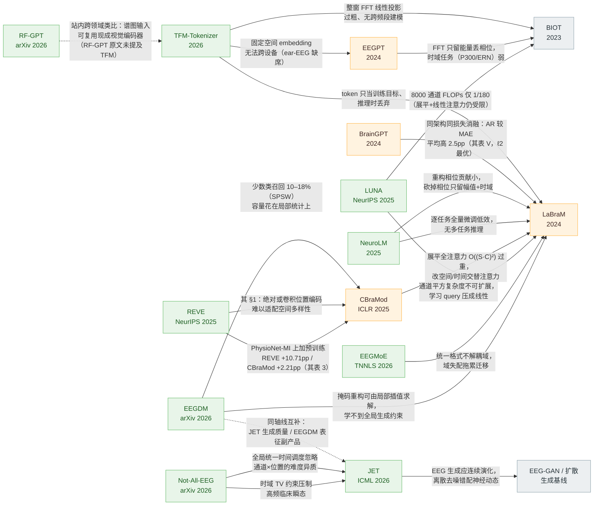

# 十四篇方法对比

> 本页对照十四篇论文的信号表示、预训练和评测设定。按维度查方法，具体结果以各论文的实验条件为准；数字均引自各论文自报结果。论文间的批评与改进关系见[比较与改进](#critique-chain)。

快速入口：[一页速览](#一页速览) · [按维度比较](#dimension-guide) · [模型设计](#mod-architecture) · [频域](#mod-frequency) · [规模效率](#mod-scale) · [比较与改进](#critique-chain)；工具：[交互式并排对比](models.md) · [实验数值追溯](evidence.md)

十四篇 = 核心六篇 + 2025–2026 扩展八篇（CBraMod / LUNA / REVE / EEGMoE / JET / EEGDM / RF-GPT / Not-All-EEG）。先看速览表定位，再进对应专题或笔记核对实验条件。

## 一页速览 {: #一页速览 }

| 论文 | 发表 | 一句话定位 | 参数量 | 预训练数据 | 代码 |
|---|---|---|---|---|---|
| [BIOT](papers/fm/biot.md) | NeurIPS 2023 | 逐通道切段 + 线性注意力的跨格式生物信号编码器 | 3.2M | ~1000 万样本（PREST + SHHS + ECG） | ✅ |
| [LaBraM](papers/fm/labram.md) | ICLR 2024 | VQ 神经词表 + 频谱重构 + 掩码码字预测的大规模 EEG 基座 | 5.8M / 46M / 369M（tokenizer 另 8.6M） | ~2500h · 约 20 数据集 | ✅ |
| [EEGPT](papers/fm/eegpt.md) | NeurIPS 2024 | 对齐 + 重构双自监督的通用特征提取器，linear probing 即 SOTA | ~10M（论文摘要口径；TUEV 主结果用 25M encoder；变体 0.4M–101M） | 5 个多范式数据集 | ✅ |
| [BrainGPT](papers/fm/braingpt.md) | arXiv 2024 | 电极级自回归 + 任务共享电极图的首个 EEG generalist | 1.46M–**1.09B** | 3750 万单电极样本（~1B token） | 未放 |
| [NeuroLM](papers/fm/neurolm.md) | ICLR 2025 | 把 EEG 当外语接进 GPT-2：指令微调单模型多任务 | 254M / 500M / 1696M | ~25000h（TUEG 为主） | ✅ |
| [TFM-Tokenizer](papers/fm/tfm-tokenizer.md) | ICLR 2026 | 单通道时频 motif 词表，离散 token 真正作下游输入 | **~1.9M**（tokenizer 1.2M + 下游 0.7M） | 4 个 EEG 数据集 + ear-EEG 跨设备验证 | ✅ |
| [CBraMod](papers/fm/cbramod.md) | ICLR 2025 | 十字交叉注意力 + ACPE：4M 参数 10 任务全 SOTA | 4.0M | TUEG 清洗版 **>9000h**（110 万样本） | ✅ |
| [LUNA](papers/fm/luna.md) | NeurIPS 2025 | 学习 query 压进固定隐空间：拓扑无关 + 通道数线性复杂度 | 7M / 43M / 311.4M | TUEG + Siena **21,900h**（3 种拓扑） | ✅ |
| [REVE](papers/fm/reve.md) | NeurIPS 2025 | 电极坐标与时间构建 4D 傅里叶位置编码，支持不同电极布局与序列长度；92 数据集 61,415h 预训练 | 12M / 69M / 408M | **61,415h** · 92 数据集 · 24,274 被试 | ✅（decoder 未发布） |
| [EEGMoE](papers/fm/eegmoe.md) | TNNLS 2026 | Specific + Shared 双专家组解耦域差异：解耦保留异构 | 1.68M（激活 0.89M） | 6 数据集 ~142h 预训练（另 3 个下游评测集，认知域） | 未放 |
| [JET](papers/generative/jet.md) | ICML 2026 | 条件流匹配 + 三条生理约束的原始 EEG 生成器 | 129.9M | TUH 三子集（生成器训练即全部） | 项目页 |
| [EEGDM](papers/generative/eegdm.md) | arXiv 2026 | 潜扩散生成目标做表征学习：encoder 表示作条件（不 detach） | 25M（下游 encoder） | TUEG 19ch（30s 样本） | ✅ |
| [Not-All-EEG](papers/generative/not-all-eeg.md) | arXiv 2026 | 位置难度自适应时间调度的流匹配 EEG 生成器（EMA 误差图 → 位置时间图） | 未披露 | 3 数据集（TUEV / BCIC-IV-2a / SEED-IV，生成器训练即全部） | 未附 |
| [RF-GPT](papers/survey/rf-gpt.md) | arXiv 2026 | 射频谱图 + 现成 VLM：零预训练、纯合成 SFT（跨域参照） | 3B / 7B（借 Qwen2.5-VL） | 合成 0.625M 指令对（零人工） | 未附 |

## 分维度导读 {: #dimension-guide }

九个维度：前六个由五个专题承接（通道适配与多任务合并一页，各专题按页内范围选论文），后三个保留在本页。

| 维度 | 核心分歧一句话 | 深读 |
|---|---|---|
| ① 预训练数据 | 规模 / 域距离 / 清洗哲学：TUEG 系语料越报越大（2500h→25000h）；CBraMod 的单项消融显示清洗版优于脏数据版；EEGArena 固定 REVE 架构把预训练语料从 600h 加到 3 万小时仍见增益——两项实验对象与条件不同，数值与协议见[实验证据](evidence.md)，解读详见数据全景专题 | [数据全景专题](topics/data-landscape.md) |
| ② 信号 Tokenization | 切多细（40 点 → 1s）、离不离散（连续 vs VQ 词表）、词表用在哪（预处理 → 训练目标 → 模型输入）——三步跃迁 + 2025–2026 连续派的加固 | [Tokenization 专题](topics/tokenization.md) |
| ③ 预训练目标 | 对比 / 掩码 / 自回归 / **生成**（2026 新增）四条路线；掩码派内部「掩什么 × 预测什么」的设计空间；对掩码重构的三条批评线 | [预训练范式专题](topics/pretraining.md) |
| ④ 空间与通道异构 | 通道 embedding / 单通道建模 / 动态位置编码 / 电极坐标编码 / 统一脑地图——区分通道表示与跨通道整合 | [通道适配](topics/multi-task.md#channel-adaptation) |
| ⑤ 下游适配与多任务 | 逐任务微调 / 冻结 encoder 后逐任务训练 / 多任务联合训练 / 指令微调——区分预训练初始化共享与下游参数共享 | [任务适配](topics/multi-task.md#task-adaptation) |
| ⑥ 基座来源 | 十四篇里十二篇从零训练，仅两例借底座——NeuroLM 接 GPT-2，RF-GPT 更彻底（连信号编码器都不训，直接复用 VLM） | [基座来源专题](topics/base-model.md) |
| ⑦ 模型设计 | 注意力计算图如何匹配 EEG 的（通道 × 时间）结构：展平全注意力 → 线性 → 十字交叉 → query 压缩 → MoE 条件计算；「架构 > 规模」的证据 | [本页下文](#mod-architecture) |
| ⑧ 频域信息 | 频域信息的六类用途：输入特征 / 重构目标 / 输入表示 / 显式建模 / 唯一输入 / 无显式；相位处理的暗线 | [本页下文](#mod-frequency) |
| ⑨ 规模、效率与开源 | 参数量按口径分组（主模型 / 含 tokenizer / 含语言基座 / 复用基座）、效率数字（LUNA 1/180、JET 67× 实时）、算力三档、开源与权重坑 | [本页下文](#mod-scale) |

## 本页保留维度

### 模型设计：注意力结构与位置编码 {: #mod-architecture }

**① 注意力结构谱系**（EEG 的 C×n patch 网格到底怎么数）

- **展平全注意力**：LaBraM / EEGPT 把 C·n 个 patch 展平进标准 ViT——CBraMod 的消融里全注意力在四种变体中垫底（19 通道 × 30s = 570 patch 已超出舒适区）；
- **线性注意力**：BIOT（Linformer 式 E/F 低秩投影）、TFM 下游模型（~0.7M）——牺牲细粒度 token 间路由换效率；
- **十字交叉**：CBraMod 把 8 个注意力头劈成 4 头 S-Attention（同一时刻跨通道）+ 4 头 T-Attention（同一通道跨时间）并行，复杂度 O(Cn² + nC²)；消融 4:4 最优，偏科 6:2 / 2:6 都掉——空间与时间依赖同等重要；
- **隐空间压缩**：LUNA 用 Q 个学习 query 的交叉注意力把任意 C 个通道压进固定 Q×E 隐空间（置换不变 → 拓扑无关），时间注意力只在隐空间做；
- **条件计算**：EEGMoE 把 FFN 换成 SSMoE 块（Top-K Specific 专家 + 软路由 Shared 专家）——MoE 在这里不是用来 scale，是用来管理异构性（与等参数量的稠密模型对照均更优）；
- **时空分治**：BrainGPT 用 ETE 管（causal attention）、TEG 管（GAT 图注意力）空间——时空拆到两个模块；
- **借来底座**：NeuroLM（GPT-2）与 RF-GPT（Qwen2.5-VL）的骨干完全不在 EEG 上设计，见[基座来源专题](topics/base-model.md)；
- **生成骨干**：JET 标准 Transformer + adaLN 条件注入；EEGDM = EEG-ViT encoder + DiT 去噪器（adaLN-Zero）。

**② 架构先验与预训练收益：CBraMod 附录 G 的归因实验**：附录 G 图 8 将 BIOT 和 LaBraM 在 CBraMod 的预训练语料（9000h 清洗版）上重训，分别在 FACED、SEED-V、PhysioNet-MI、SHU-MI 评估，BIOT(ours) ≈ BIOT(original)、LaBraM(ours) 仅小涨。另在表 13 的 TUEV 对照里，CBraMod、剔除 TUEV 后重训的 CBraMod、LaBraM-Huge 的平衡准确率分别为 0.6671、0.6659、0.6616——**4.0M 参数高于 369M 的 LaBraM-Huge**。固定数据换架构，把贡献归因做成了可证伪的对照（[原文](https://proceedings.iclr.cc/paper_files/paper/2025/file/bbbd6d915cb90be21c1254a82d45cedd-Paper-Conference.pdf)）。

**③ 位置编码谱系**：正弦相对（BIOT）→ 可学习时空绝对（LaBraM / NeuroLM）→ RoPE（EEGPT predictor、LUNA 时间轴）→ 电极词表 prefix（BrainGPT）→ **无**（TFM tokenizer 内，消融支持）→ **卷积动态生成**（CBraMod ACPE）→ **连续 3D 坐标 NeRF 编码**（LUNA 空间）→ **4D 傅里叶坐标生成**（REVE：(x,y,z,t) 直投多频笛卡尔积 + 可学习适配层，时间也进坐标、噪声增强抗摆放差异）。趋势：从「查表绑定」走向「动态生成 / 连续坐标」，动因都是跨 montage 泛化——TFM 在 tokenizer 内不用位置编码，是同一取向的另一端：不绑定任何位置信息。

**维度小结**：本维度的共性问题是注意力计算图的形状如何匹配 EEG 的 (通道 × 时间) 结构。

### 频域信息：从特征工程到建模对象 {: #mod-frequency }

频域信息在这批论文中有六类用途（同一论文可占多项）：

- **特征工程**：BIOT 把 FFT 能量向量过 FCN 进 segment embedding——EEGPT 附录 F 批评其丢相位、1s 窗 FFT 过粗，时域任务（P300 等）因此弱；
- **重构目标**：LaBraM 重构 DFT 幅值 + 相位（直接重构原始波形 loss 不收敛的关键替代）；NeuroLM 发现**相位贡献小**，砍掉相位；TFM 掩码重构频谱图；
- **输入表示**：CBraMod（rFFT 能量支路与时域 conv 相加，消融：时+频 > 纯时 > 纯频）、LUNA（FFT 幅相支路——消融里**去掉后掉分最多的组件**）；
- **建模对象**：TFM 走得最远——频率轴本身切 patch、Frequency Transformer 建模窗内跨频段依赖、sigmoid 门控决定「哪些频段重要」；
- **输入即全部**：EEGMoE（5 频带脑地图是唯一输入）、RF-GPT（STFT dB 谱图当图片——其任务是波形的多对一映射，不依赖逐样本相位）；
- **无显式频域**：EEGPT / BrainGPT / EEGDM 的 encoder 走纯时域；JET 只在损失里间接控制频谱（TV 正则 + 统计一致性）。

**相位的处理是一条暗线**：重构它（LaBraM）→ 砍它（NeuroLM / TFM / RF-GPT）→ 又要它（LUNA 幅相都投）。没有定论，但「相位对表示学习有用、对判别式任务可省」是目前的经验边界。

**维度小结**：三家的消融各自支持频域支路在自己的任务与指标上有贡献——TFM 频带掩码贡献最大（其消融）、CBraMod 时+频 > 纯时 > 纯频、LUNA 去掉幅相支路 AUROC 最多降 0.011–0.012——任务与协议不同，不构成跨研究的统一结论。

### 规模、效率与开源 {: #mod-scale }

**① 参数与代码/权重状态**：逐模型的总参数、激活参数、encoder/tokenizer 口径与代码、权重状态统一在[模型对比页](models.md)维护（数据源 `data/models.json`，21 个模型条目）。口径分组的地域：**主模型（从零训练，下游口径）** 从 EEGMoE 1.68M 到 REVE-Large 408M；**端到端合计（含 tokenizer / 语言基座）** 有 TFM ~1.9M 与 NeuroLM-XL 1696M、BrainGPT-Giant 1.09B；**复用外部基座** 有 RF-GPT（Qwen2.5-VL，不解码 EEG 波形参数）。

**② 效率**

- **LUNA**：8000 通道时 23 GFLOPs / 2GB（BIOT 4156 GFLOPs，约 1/180），Base 16-bit 约 14MB——面向可穿戴 SoC 实时预算；
- **CBraMod**：CHB-MIT 16ch×10s 输入 318.9M FLOPs，比 BIOT / LaBraM-Base（均 483M）省 1/3；
- **JET**：推理 149ms/条（约 67× 实时），单张 B200；
- **EEGMoE**：激活参数 0.89M——条件计算省的是每一次前向。

**③ 算力门槛两极分化**

| 档位 | 论文 | 配置 |
|---|---|---|
| 消费级单卡 | TFM、EEGMoE | tokenizer / 模型极小 |
| 单机多卡 | BIOT、EEGPT、CBraMod、LUNA、EEGDM、JET、REVE（~260 A100·h） | 实验室可复现 |
| 多机旗舰 | LaBraM、BrainGPT、NeuroLM、RF-GPT | 预训练成本高 |

**④ 权重细节坑**（逐条状态见[模型对比页](models.md)）：REVE 的 MAE decoder 不发布（能从表示重构原始 EEG，隐私考量）——EEG FM 第一次基于隐私 withholding 组件；LaBraM 的 Large/Huge 权重未开源——各家论文里「打过 LaBraM-Huge」的数字多引自 LaBraM 原文，非独立复现。

**维度小结**：规模轴上被验证过的结果有两组——结构先验替代规模（CBraMod 4M、TFM 1.9M、EEGMoE 1.68M），以及效率型设计（LUNA 面向可穿戴、JET 面向实时生成）；「大模型 + 大数据」的 scaling 叙事在 EEG 上证据仍不完整——REVE 的模型规模消融给出模型侧证据（Base→Large 线性探针 0.609→0.654），EEGArena 固定架构给出数据侧证据（受控对照）；但两者的任务集与协议不同，统一叙事仍缺，数值见[实验证据](evidence.md)（详见[数据全景专题](topics/data-landscape.md)）。

## 论文间的比较与改进 {: #critique-chain }

箭头方向 = 批评/改进指向；实线边标注批评点，虚线边含义见标签。**来源口径**：实线批评边转写自起点论文正文或消融（REVE 的预训练增益差值由其表 3 数字相减得出，因果解释为作者观点）；虚线边为站内类比或互补归纳，不构成论文自身的批评。窄屏可在图内横向滑动。

**解读**（文字版路径：先读各边标签，再按上方来源口径核对）：BIOT 是公共对照组；LaBraM 转向离散码；EEGPT 改进自监督目标；BrainGPT 用同架构消融比较自回归与掩码目标；NeuroLM 把 token 接入 LLM；TFM 把批评落在输入表示层。2025–2026 的核心事实：**CBraMod / LUNA / EEGMoE 的边都指向 LaBraM**——「展平全注意力 + 不解耦域」是被批评边指向最多的设计；JET / EEGDM / Not-All-EEG 在生成轴线内部迭代；RF-GPT 的谱图输入路线是站内跨领域类比（其原文未提及 TFM）；REVE 的两条边都指向 CBraMod——位置编码的空间适配与预训练增益的归因对比。
