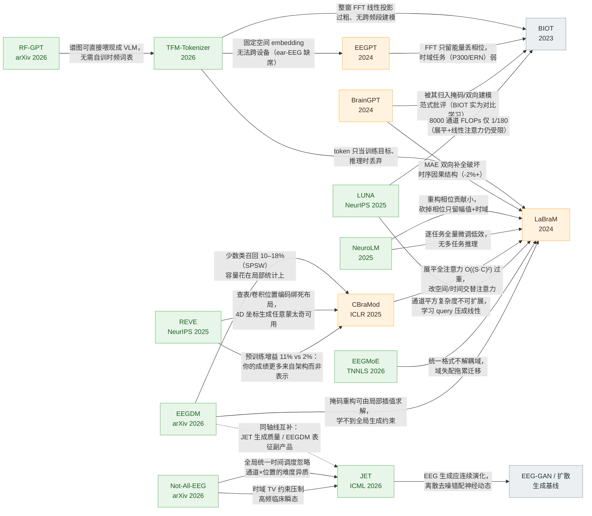

# 十四篇方法对比

> 全站横向对照的**枢纽页**：先[一页速览](#一页速览)给十四篇定位，再按[九个维度](#dimension-guide)拆核心分歧——数据 / tokenization / 预训练目标 / 通道适配与多任务 / 基座来源五个维度下放主题专题深读，模型设计 / 频域 / 规模效率三个维度保留在本页详解；结尾的[互怼链](#critique-chain)梳理论文间的批评与改进关系。数字均引自各论文自报结果。

十四篇 = 核心六篇（[BIOT](papers/biot.md) / [LaBraM](papers/labram.md) / [EEGPT](papers/eegpt.md) / [BrainGPT](papers/braingpt.md) / [NeuroLM](papers/neurolm.md) / [TFM-Tokenizer](papers/tfm-tokenizer.md)，回答「token 该是什么、怎么预训练」）+ 2025–2026 扩展八篇（[CBraMod](papers/cbramod.md) / [LUNA](papers/luna.md) / [REVE](papers/reve.md) / [EEGMoE](papers/eegmoe.md) / [JET](papers/jet.md) / [EEGDM](papers/eegdm.md) / [RF-GPT](papers/rf-gpt.md) / [Not-All-EEG](papers/not-all-eeg.md)，把问题推向异构管理、通用空间编码与规模化、生成与跨模态）。站内其余轴外精读（语音解码 / 时频方法 / 连接组学 / 视觉解码 / 基准评测）不参与十四篇排名，见首页论文库。

## 一页速览 {: #一页速览 }

| 论文 | 发表 | 一句话定位 | 参数量 | 预训练数据 | 代码 |
|---|---|---|---|---|---|
| [BIOT](papers/biot.md) | NeurIPS 2023 | 逐通道切段 + 线性注意力的跨格式生物信号编码器 | 3.2M | ~1000 万样本（PREST + SHHS + ECG） | ✅ |
| [LaBraM](papers/labram.md) | ICLR 2024 | VQ 神经词表 + 频谱重构 + 掩码码字预测的大规模 EEG 基座 | 5.8M / 46M / 369M（tokenizer 另 8.6M） | ~2500h · 约 20 数据集 | ✅ |
| [EEGPT](papers/eegpt.md) | NeurIPS 2024 | 对齐 + 重构双自监督的通用特征提取器，linear probing 即 SOTA | ~10M（变体 0.4M–101M） | 5 个多范式数据集 | ✅ |
| [BrainGPT](papers/braingpt.md) | arXiv 2024 | 电极级自回归 + 任务共享电极图的首个 EEG generalist | 1.46M–**1.09B** | 3750 万单电极样本（~1B token） | 未放 |
| [NeuroLM](papers/neurolm.md) | ICLR 2025 | 把 EEG 当外语接进 GPT-2：指令微调单模型多任务 | 254M / 500M / 1696M | ~25000h（TUEG 为主） | ✅ |
| [TFM-Tokenizer](papers/tfm-tokenizer.md) | ICLR 2026 | 单通道时频 motif 词表，离散 token 真正作下游输入 | **~1.9M**（tokenizer 1.2M + 下游 0.7M） | 4 个 EEG 数据集 + ear-EEG 跨设备验证 | ✅ |
| [CBraMod](papers/cbramod.md) | ICLR 2025 | 十字交叉注意力 + ACPE：4M 参数 10 任务全 SOTA | 4.0M | TUEG 清洗版 **>9000h**（110 万样本） | ✅ |
| [LUNA](papers/luna.md) | NeurIPS 2025 | 学习 query 压进固定隐空间：拓扑无关 + 通道数线性复杂度 | 7M / 43M / 311.4M | TUEG + Siena **21,900h**（3 种拓扑） | ✅ |
| [REVE](papers/reve.md) | NeurIPS 2025 | 4D 傅里叶位置编码吃任意电极布局：最大非侵入预训练语料 | 12M / 69M / 408M | **61,415h** · 92 数据集 · 24,274 被试 | ✅（decoder 未发布） |
| [EEGMoE](papers/eegmoe.md) | TNNLS 2026 | Specific + Shared 双专家组解耦域差异：解耦保留异构 | 1.68M（激活 0.89M） | 9 数据集 ~142h（认知域） | 未放 |
| [JET](papers/jet.md) | ICML 2026 | 条件流匹配 + 三条生理约束的原始 EEG 生成器 | 129.9M | TUH 三子集（生成器训练即全部） | 项目页 |
| [EEGDM](papers/eegdm.md) | arXiv 2026 | 潜扩散生成目标做表征学习：encoder 表示作条件（不 detach） | 25M（下游 encoder） | TUEG 19ch（30s 样本） | ✅ |
| [Not-All-EEG](papers/not-all-eeg.md) | arXiv 2026 | 位置难度自适应时间调度的流匹配 EEG 生成器（EMA 误差图 → 位置时间图） | 未披露 | 3 数据集（TUEV / BCIC-IV-2a / SEED-IV，生成器训练即全部） | 未附 |
| [RF-GPT](papers/rf-gpt.md) | arXiv 2026 | 射频谱图 + 现成 VLM：零预训练、纯合成 SFT（跨域参照） | 3B / 7B（借 Qwen2.5-VL） | 合成 0.625M 指令对（零人工） | 未附 |

## 分维度导读 {: #dimension-guide }

九个维度：前六个由五个专题承接（通道适配与多任务合并一页，各专题按页内范围选论文），后三个保留在本页。

| 维度 | 核心分歧一句话 | 深读 |
|---|---|---|
| ① 预训练数据 | 规模 / 域距离 / 清洗哲学：TUEG 系语料越报越大（2500h→25000h），但清洗质量 > 堆量、域邻近 > 规模、1000h 后边际递减 | [数据全景专题](topics/data-landscape.md) |
| ② 信号 Tokenization | 切多细（40 点 → 1s）、离不离散（连续 vs VQ 词表）、词表用在哪（预处理 → 训练目标 → 模型输入）——三步跃迁 + 2025–2026 连续派的加固 | [Tokenization 专题](topics/tokenization.md) |
| ③ 预训练目标 | 对比 / 掩码 / 自回归 / **生成**（2026 新增）四条路线；掩码派内部「掩什么 × 预测什么」的设计空间；对掩码重构的三条批评线 | [预训练范式专题](topics/pretraining.md) |
| ④ 空间与通道异构 | 通道 embedding / 单通道建模 / 动态位置编码 / 电极坐标编码 / 统一脑地图——区分通道表示与跨通道整合 | [通道适配](topics/multi-task.md#channel-adaptation) |
| ⑤ 下游适配与多任务 | 逐任务微调 / 冻结 encoder 后逐任务训练 / 多任务联合训练 / 指令微调——区分预训练初始化共享与下游参数共享 | [任务适配](topics/multi-task.md#task-adaptation) |
| ⑥ 基座来源 | 十四篇里十二篇从零训练，仅两例借底座——NeuroLM 接 GPT-2，RF-GPT 更彻底（连信号编码器都不训，直接复用 VLM） | [基座来源专题](topics/base-model.md) |
| ⑦ 模型设计 | 注意力计算图如何匹配 EEG 的（通道 × 时间）结构：展平全注意力 → 线性 → 十字交叉 → query 压缩 → MoE 条件计算；「架构 > 规模」的证据 | [本页下文](#mod-architecture) |
| ⑧ 频域信息 | 频域角色的六级递进：特征工程 → 重构目标 → 输入表示 → 建模对象 → 输入即全部 → 无显式；相位处理的暗线 | [本页下文](#mod-frequency) |
| ⑨ 规模、效率与开源 | 参数量 1.68M–1.09B 排序、效率数字（LUNA 1/180、JET 67× 实时）、算力三档、开源与权重坑 | [本页下文](#mod-scale) |

## 本页保留维度

### 模型设计：注意力结构与位置编码 {: #mod-architecture }

**① 注意力结构谱系**（EEG 的 C×n patch 网格到底怎么数）

- **全注意力一锅炖**：LaBraM / EEGPT 把 C·n 个 patch 展平进标准 ViT——CBraMod 的消融里全注意力在四种变体中垫底（19 通道 × 30s = 570 patch 已超出舒适区）；
- **线性注意力**：BIOT（Linformer 式 E/F 低秩投影）、TFM 下游模型（~0.7M）——牺牲细粒度 token 间路由换效率；
- **十字交叉**：CBraMod 把 8 个注意力头劈成 4 头 S-Attention（同一时刻跨通道）+ 4 头 T-Attention（同一通道跨时间）并行，复杂度 O(Cn² + nC²)；消融 4:4 最优，偏科 6:2 / 2:6 都掉——空间与时间依赖同等重要；
- **隐空间压缩**：LUNA 用 Q 个学习 query 的交叉注意力把任意 C 个通道压进固定 Q×E 隐空间（置换不变 → 拓扑无关），时间注意力只在隐空间做；
- **条件计算**：EEGMoE 把 FFN 换成 SSMoE 块（Top-K Specific 专家 + 软路由 Shared 专家）——MoE 在这里不是用来 scale，是用来管理异构性（与等参数量的稠密模型对照均更优）；
- **时空分治**：BrainGPT 用 ETE 管（causal attention）、TEG 管（GAT 图注意力）空间——时空拆到两个模块；
- **借来底座**：NeuroLM（GPT-2）与 RF-GPT（Qwen2.5-VL）的骨干完全不在 EEG 上设计，见[基座来源专题](topics/base-model.md)；
- **生成骨干**：JET 标准 Transformer + adaLN 条件注入；EEGDM = EEG-ViT encoder + DiT 去噪器（adaLN-Zero）。

**② 「架构 > 规模」的最强证据**：CBraMod 附录 G——把 BIOT / LaBraM 的架构搬到 CBraMod 的 9000h 清洗语料上重训，BIOT(ours) ≈ BIOT(original)、LaBraM(ours) 仅小涨，而 CBraMod 全面碾压两者：**4.0M 参数在 TUEV 打过 369M 的 LaBraM-Huge**（0.6671 vs 0.6616）。固定数据换架构，把贡献归因做成了可证伪的对照。

**③ 位置编码谱系**：正弦相对（BIOT）→ 可学习时空绝对（LaBraM / NeuroLM）→ RoPE（EEGPT predictor、LUNA 时间轴）→ 电极词表 prefix（BrainGPT）→ **无**（TFM tokenizer 内，消融支持）→ **卷积动态生成**（CBraMod ACPE）→ **连续 3D 坐标 NeRF 编码**（LUNA 空间）→ **4D 傅里叶坐标生成**（REVE：(x,y,z,t) 直投多频笛卡尔积 + 可学习适配层，时间也进坐标、噪声增强抗摆放差异）。趋势：从「查表绑定」走向「动态生成 / 连续坐标」，动因都是跨 montage 泛化——TFM 的「无」是同一月光的另一面：拒绝一切位置绑定。

**维度小结**：模型设计的演进不是「更大」，而是**注意力计算图的形状逐渐匹配 EEG 的 (通道 × 时间) 结构**——每一步都在回答「哪些 patch 天生该互相看」。

### 频域信息：从特征工程到建模对象 {: #mod-frequency }

频域的角色在这批论文里经历六级递进：

- **特征工程**：BIOT 把 FFT 能量向量过 FCN 进 segment embedding——EEGPT 附录 F 批评其丢相位、1s 窗 FFT 过粗，时域任务（P300 等）因此弱；
- **重构目标**：LaBraM 重构 DFT 幅值 + 相位（直接重构原始波形 loss 不收敛的关键替代）；NeuroLM 发现**相位贡献小**，砍掉相位；TFM 掩码重构频谱图；
- **输入表示**：CBraMod（rFFT 能量支路与时域 conv 相加，消融：时+频 > 纯时 > 纯频）、LUNA（FFT 幅相支路——消融里**去掉后掉分最多的组件**）；
- **建模对象**：TFM 走得最远——频率轴本身切 patch、Frequency Transformer 建模窗内跨频段依赖、sigmoid 门控决定「哪些频段重要」；
- **输入即全部**：EEGMoE（5 频带脑地图是唯一输入）、RF-GPT（STFT dB 谱图当图片——其任务是波形的多对一映射，不依赖逐样本相位）；
- **无显式频域**：EEGPT / BrainGPT / EEGDM 的 encoder 走纯时域；JET 只在损失里间接控制频谱（TV 正则 + 统计一致性）。

**相位的处理是一条暗线**：重构它（LaBraM）→ 砍它（NeuroLM / TFM / RF-GPT）→ 又要它（LUNA 幅相都投）。没有定论，但「相位对表示学习有用、对判别式任务可省」是目前的经验边界。

**维度小结**：社区共识在 2025–2026 收敛为**显式的时频结构建模优于隐式期望模型自己学**——CBraMod / LUNA / TFM 三家的消融从不同方向互证，且三家都把频域放在 patch embedding 这一层（性价比最高的位置）。

### 规模、效率与开源 {: #mod-scale }

**① 参数量排序**（下游可用模型口径）

EEGMoE 1.68M（激活 0.89M）< TFM ~1.9M < BIOT 3.2M < CBraMod 4.0M < LaBraM-Base 5.8M < LUNA-Base 7M < EEGPT ~10M < EEGDM 25M < REVE-Base 69M < JET 129.9M < LUNA-Huge 311.4M < LaBraM-Huge 369M < REVE-Large 408M < NeuroLM-XL 1696M < BrainGPT-Giant **1.09B** < RF-GPT 3B/7B（借 Qwen2.5-VL）。

**② 效率**

- **LUNA**：8000 通道时 23 GFLOPs / 2GB（BIOT 4156 GFLOPs，约 1/180），Base 16-bit 约 14MB——面向可穿戴 SoC 实时预算；
- **CBraMod**：CHB-MIT 16ch×10s 输入 318.9M FLOPs，比 BIOT / LaBraM-Base（均 483M）省 1/3；
- **JET**：推理 149ms/条（约 67× 实时），单张 B200；
- **EEGMoE**：激活参数 0.89M——条件计算省的是每一次前向。

**③ 算力门槛两极分化**

| 档位 | 论文 | 配置 |
|---|---|---|
| 消费级单卡 | TFM、EEGMoE | tokenizer / 模型极小 |
| 单机多卡 | BIOT、EEGPT、CBraMod、LUNA、EEGDM、JET、REVE（~260 A100·h） | 实验室可复现 |
| 多机旗舰 | LaBraM、BrainGPT、NeuroLM、RF-GPT | 预训练成本高 |

**④ 开源与可复现性**

- **有官方代码**：BIOT、LaBraM、EEGPT、NeuroLM、TFM、CBraMod（已进 Braindecode）、LUNA、EEGDM、REVE（encoder 权重 + 任意 3D 坐标加载器 + tutorials）；
- **声明将放出 / 未附**：BrainGPT、EEGMoE、RF-GPT、JET（以项目页为准）；
- **权重细节坑**：REVE 的 MAE decoder 不发布（能从表示重构原始 EEG，隐私考量）——EEG FM 第一次基于隐私 withholding 组件；LaBraM 的 Large/Huge 权重未开源——各家论文里「打过 LaBraM-Huge」的数字多引自 LaBraM 原文，非独立复现。

**维度小结**：规模轴上被验证过的规律只有两条——**结构先验可以替代规模**（CBraMod 4M、TFM 1.9M、EEGMoE 1.68M），以及**效率在特定场景是硬需求**（LUNA 面向可穿戴、JET 面向实时生成）；「大模型 + 大数据」的 scaling 叙事在 EEG 上至今没有被干净地兑现——REVE 给了半张答卷（模型规模消融干净：Base→Large 线性探针 0.609→0.654 稳定上升），数据量 scaling 曲线仍缺（见[数据全景专题](topics/data-landscape.md)）。

## 🔗 论文互怼链 {: #critique-chain }

箭头方向 = 批评/改进指向，每条边标注批评点。

**解读**：BIOT 是公共对照组；LaBraM 转向离散码；EEGPT 改进自监督目标；BrainGPT 掀翻掩码范式；NeuroLM 把 token 接入 LLM；TFM 对前作做「输入表示」的终审。2025–2026 的核心事实：**CBraMod / LUNA / EEGMoE 的边都指向 LaBraM**——「展平全注意力 + 不解耦域」是被攻击最密集的设计；JET / EEGDM / Not-All-EEG 在生成轴线内部迭代；RF-GPT 从跨域视角质疑自训词表的必要性；REVE 的两条边都指向 CBraMod——位置编码泛化与「预训练派 vs 架构派」的归因之争。
