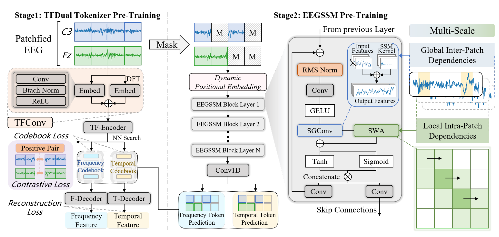
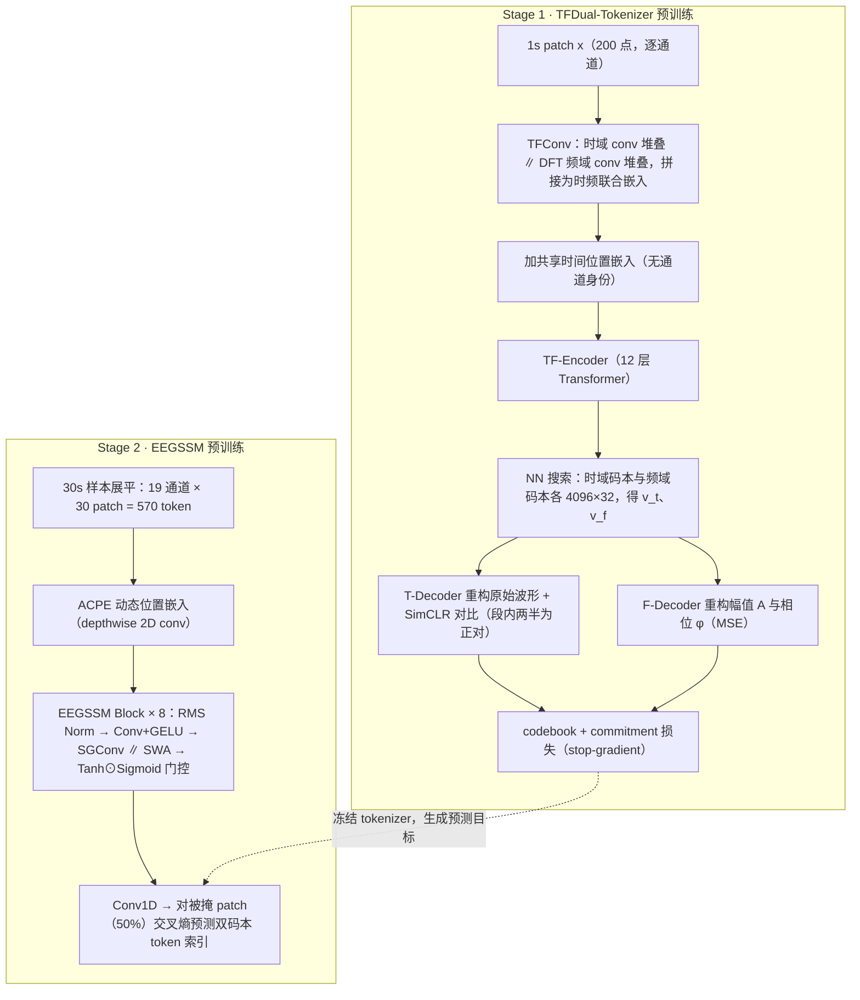

# CodeBrain: Bridging Decoupled Tokenizer and Multi-Scale Architecture for EEG Foundation Model

> **ICLR 2026**（arXiv 2506.09110，v4 2026-05-11）· 新加坡国立大学 Saw Swee Hock 公共卫生学院（兼 NUS 数据科学研究所、NUS 广州研究院）+ 南洋理工 CCDS + 中科院自动化所脑网络组 —— 站内 [Tokenization 演进](../topics/tokenization.md)线上 2026 梯队的占坑之作。谱系上,[LaBraM](0918-labram.md) 学出了词表但 token 只当掩码目标、[NeuroLM](0918-neurolm.md) 把码字并进 GPT-2 词表、[TFM-Tokenizer](0918-tfm-tokenizer.md) 把 token 做成可插拔输入;CodeBrain 不争「token 当不当输入」,而是去填「tokenizer 与下游架构作为整体联合设计」这个缺口——时/频双码本 + SSM 系多尺度骨干,一个模型包干两阶段。

**作者**：Jingying Ma\*, Feng Wu\*（共同一作）, Qika Lin†, Yucheng Xing, Chenyu Liu, Ziyu Jia†, Mengling Feng（†通讯；NUS / NTU / 中科院自动化所）

!!! abstract "TL;DR"
    - 两阶段 EFM:Stage 1 **TFDual-Tokenizer** 把 patch 表征分别量化进**时域/频域两个独立码本**（各 4096×32）——频域分支重构幅值+相位，时域分支重构原始波形并加 SimCLR 对比正则（治 LaBraM「原始信号重构不收敛」的老病）；Stage 2 **EEGSSM**（8 层 15.17M）= SGConv 结构化全局卷积 + SWA 滑窗注意力 + WaveNet 式门控，掩码 token 预测（mask 率 0.5）
    - 预训练 TUEG **9,246 小时**（19 通道 10-20 系统、200 Hz、1s 非重叠 patch、序列长 570 = 19 通道 × 30 patch）；tokenizer 6×A100 约 10 h、骨干 2×A100 约 24 h——算力门槛远低于同类
    - 8 任务 10 数据集全量微调、5 seeds:对最强基线 CBraMod 全线小胜——FACED Kappa **0.5406** vs 0.5041、SEED-V **0.2735** vs 0.2569、ISRUC S3 **0.7671** vs 0.7407;最大增益在 BCIC2020-T3（**+0.0911**,21.6%）与 Mental Arithmetic（AUROC **+0.0802**,10.1%）两个小数据集
    - 诚实处与丢分处:TUEV/TUAB 与预训练库 TUEG 同源,专设 Excluding 重训行且 TUEV 仍占优（0.6838 vs 0.6772）;但 CHB-MIT Balanced Acc（0.7273 vs **0.7398**）、TUAB AUROC/PRAUC（0.9030/0.9100 vs **0.9227/0.9258**）三处输给 CBraMod,正文只在附录轻描淡写
    - 消融:去 SGConv 崩得最狠（FACED 0.5406→0.1936）,Gate 次之（→0.2578）,SWA/CL 各贡献约 0.02;双码本 > 单频 > Mixed ≈ 单时;**SWA 窗长 1 最优**——它实际做的是 patch 内建模而非跨 patch 局部上下文
    - 可解释性是事后定性:类特异 token 检索出 N3 慢波（40.4% 激活 patch 含慢波）、δ 优势（18.3%）、N2 纺锤波等;论文自己承认「不意味着特定可解释码直接决定任务结果」

## 1 问题定位:单码本、全连接注意力、patch 即 token 的三宗罪

论文给现有 EFM 列了三条罪状。**其一,混合 tokenizer 混淆异质模式**:VQ-VAE 框架从图像搬来（LaBraM、TFM 均在此列），图像特征同质所以单码本够用,但 EEG 的时域波形与频域结构反映大脑活动的不同侧面——同一个 patch 在一个域匹配、在另一个域可能发散,单一混合码本会「撞码」,削弱表征容量,也让 token 难以对齐临床可解释的神经事件或频谱节律。**其二,全连接注意力与脑结构错配**:多数 EFM 用 Transformer 自注意力,而脑的小世界拓扑是「稀疏全局依赖 + 强局部相关」,全连接设计既贵（二次复杂度）又不合生理。**其三,patch 即 token 丢掉 patch 内部结构**:每个 patch 压成单个 token 后,patch 内部的瞬态神经事件（睡眠 K-复杂波、纺锤波等短时波形）没有专门机制去建模。

站内坐标:这三条分别对着 [LaBraM](0918-labram.md)（单码本、token 只当目标）、[CBraMod](0928-cbramod.md)（Transformer 骨干）与 [BIOT](0918-biot.md)（切段即 token）。CodeBrain 的答案是把三件事各换一个组件:双码本、卷积 SSM+滑窗注意力的混合骨干、显式的 patch 内注意力层。

## 2 方法

### 2.1 两阶段总览

Stage 1 学 tokenizer:归一化 EEG patch \( x \in \mathbb{R}^L \) 离散化为时域/频域两个 token,码本 \( V^t, V^f \in \mathbb{R}^{K \times D} \),即 \( v_t, v_f = f_{\mathrm{tokenizer}}(x) \)。Stage 2 学表征:序列 \( X \in \mathbb{R}^{C \times f \times T} \)（C 通道、采样率 f、T 秒）切成 n 个非重叠 patch（\( L = f \cdot t \),预训练取 1s patch @200 Hz 即 L=200）,编码器 \( f_{\mathrm{enc}}: \mathbb{R}^{C \times n \times L} \to \mathbb{R}^{C \times n \times D} \) 用掩码 token 预测训练。一个容易忽略的实现细节:30s 样本在 19 通道下展平成 **570 = 19×30 个 token 的单一序列**,通道结构不靠 token 身份区分,而靠 Stage 2 的动态位置嵌入。

### 2.2 TFDual-Tokenizer:共享编码器,分家码本

**共享编码**。TFConv 模块对原始波形与 DFT 频域表示并行做「卷积+BN+ReLU」堆叠（频域输入先做 DFT）,两路拼接成时频联合嵌入;加**共享时间位置嵌入**（无通道身份,tokenizer 级 channel-agnostic）后过 TF-Encoder（Transformer,12 层,hidden 200）。注意:**「解耦」发生在码本与重构目标层面,不在输入层面**——两个码本对的是同一个联合嵌入 \( \tilde{e}_i \):

\[
p^t_i = \arg\min_j \|\tilde{e}_i - v^t_j\|_2, \qquad p^f_i = \arg\min_j \|\tilde{e}_i - v^f_j\|_2
\]

**频域码本**:F-Decoder（Transformer encoder + 两个线性层）从频域码字重构幅值与相位（z-score 归一化后做目标）,MSE 损失:

\[
A_i = \sqrt{\mathrm{Re}(x_i[k])^2 + \mathrm{Im}(x_i[k])^2}, \qquad \varphi_i = \arctan 2\left(\mathrm{Im}(x_i[k]),\ \mathrm{Re}(x_i[k])\right), \qquad \mathcal{L}^f_i = \|y^A_i - A_i\|_2^2 + \|y^P_i - \varphi_i\|_2^2
\]

**时域码本**:LaBraM 当年因原始信号重构不收敛而只做频域重构;附录 F 复现了这个问题（LaBraM 框架内重构损失卡在 0.128–0.131 不降）,CodeBrain 的药方是 TFConv 前置 + SimCLR 对比正则——把每段 EEG 对半劈,两半互为正对、跨段为负对（温度 \( \tau = 0.5 \)）,再加 T-Decoder 重构原始波形。总损失:

\[
\mathcal{L}_{\mathrm{tokenizer}} = \mathcal{L}_{\mathrm{CL}} + \sum_i \Big( \mathcal{L}^f_i + \mathcal{L}^t_i + \underbrace{\|\mathrm{sg}(\tilde{e}_i) - v^t_{p^t_i}\|^2 + \|\mathrm{sg}(\tilde{e}_i) - v^f_{p^f_i}\|^2}_{\text{codebook}} + \underbrace{\|\tilde{e}_i - \mathrm{sg}(v^t_{p^t_i})\|^2 + \|\tilde{e}_i - \mathrm{sg}(v^f_{p^f_i})\|^2}_{\text{commitment}} \Big)
\]

其中 sg(·) 是 stop-gradient。**理论背书**（Proposition 2.1,附录 D）:固定总码本规模 \( K = 2^R \),若时/频表征近似独立且失真可加,率失真论保证积码本（双码本）的最小失真 \( D^\star_{\mathrm{prod}}(R) \) 不高于任何混合码本 \( D^\star_{\mathrm{mix}}(R) \)。Remark 里承认时/频经傅里叶变换耦合,把「近似独立」解释成「语义失真的函数独立」而非统计独立——假设不轻,实测支撑见消融（双码本 vs Mixed 在 FACED 上差 0.073,SEED-V 上只差 0.003,并不均匀）。

### 2.3 EEGSSM:小世界拓扑的三件套

**动态位置嵌入（ACPE）**:单个 depthwise 2D 卷积（非对称核）学跨通道相对结构,借自 CBraMod,用于适配未见过的通道布局——tokenizer 不带通道身份,通道适配全押在这里。

**SGConv 层（管稀疏全局）**:卷积形态的 SSM,借 FFT 把全局卷积算到 \( O(N \log N) \):

\[
y = \mathcal{F}^{-1}_N D_k \mathcal{F}_N u, \qquad D_k = \mathrm{diag}(K \mathcal{F}_N)
\]

对传统 S4 核做两处改造:稀疏参数化 + 核衰减。核 \( K \) 由 \( N = \log_2(L/d) + 1 \) 个子核拼成,第 i 个子核按 \( \alpha^i \) 指数衰减（\( \alpha = 0.5 \)）:

\[
K = \frac{1}{Z}\left[k_0, k_1, \ldots, k_{N-1}\right], \qquad k_i = \alpha^i\, \mathrm{Upsample}_{2^{\max[i-1,0]}d}(w_i)
\]

设计来自 Li et al. 2022 的长卷积工作（与 S5、H3 同门）,和 Mamba 的选择性递推是 SSM 家族的两条分支;序列长只有 570,选卷积形态图的是并行效率。

**SWA 层（管 patch 内局部）**:时间维固定窗的滑窗注意力（Swin 式）,把二次复杂度压到线性。注意消融的真相:窗长 1（即只看自己 patch 内部）最优——SWA 在这个系统里的实际角色是「patch 内波形建模」,不是跨 patch 的局部上下文。

**门控**:WaveNet 式单元融合全局/局部两路（注:论文此处把 WaveNet 错引成 Obeid & Picone 2016,后者是 TUH 语料库论文）:

\[
z = \tanh\left(W_f \cdot \mathrm{Concat}(y_{\mathrm{sg}}, y_{\mathrm{swa}})\right) \odot \sigma\left(W_g \cdot \mathrm{Concat}(y_{\mathrm{sg}}, y_{\mathrm{swa}})\right)
\]

两路输出 \( y_1 = \mathrm{Conv}(z) \) 进下一个 block,\( y_2 = \mathrm{Conv}(z) \) 走 skip connection 汇入总输出。

### 2.4 预训练目标

MAE 式:Bernoulli 掩码（r=0.5）,EEGSSM 输出过 1D 卷积预测被掩 patch 在**两个码本**中的 token 索引,交叉熵 \( p(v_i \mid x_i) = \mathrm{softmax}(\mathrm{Conv1D}(y_i)) \)。损失在 epoch 1→6 从 9.04 降到 6.39,epoch 10 后趋平（6.01→5.66）,官方 checkpoint 取 epoch 10——一半理由是防止对 TUEG 过拟合（TUEV/TUAB 同源）。

## 3 实验与结果

**数据与协议**:预训练 TUEG,剔除 <5 分钟录音、去首尾 1 分钟、19 通道（10-20 系统）、0.3–75 Hz 带通 + 60 Hz 陷波、200 Hz、30s 非重叠段、剔除幅值 >100 µV 的段、逐值 ÷100 归一,留 1,109,545 段 ≈ 9,246 小时。下游 10 数据集横跨 8 任务（情绪 FACED/SEED-V、睡眠 ISRUC S1/S3、想象语音 BCIC2020-T3、心算压力、癫痫 CHB-MIT、运动想象 SHU-MI、事件 TUEV、异常 TUAB）,通道 6–64、时长 1–30s、类别 2–9。划分以跨被试为主(FACED 80/20/23、ISRUC S3 8:1:1、MentalArithmetic 7:1:1、CHB-MIT 20/2/2、SHU-MI 15/5/5),TUEV/TUAB/BCIC2020-T3 走官方协议;**SEED-V 是例外:每 session 15 个 trial 均分 5/5/5,属于被试内划分**（与 CBraMod 协议一致）,和正文「cross-subject or cross-session」的表述要对读。主协议全量微调 + 3 层 MLP 头（睡眠任务头前再加一层 Transformer 建 20 个 epoch 的序列依赖）,5 seeds 报均值方差;多类用 Kappa 选模型、二类用 AUROC 选模型。下游全部重采样到 200 Hz。

**主结果**（Table 2 摘录,Kappa 多类 / AUROC 二类）:

| 数据集（指标） | CodeBrain | CBraMod | LaBraM | BIOT | EEGPT |
|---|---|---|---|---|---|
| FACED（Kappa） | **0.5406** | 0.5041 | 0.4698 | 0.4476 | 0.4639 |
| SEED-V（Kappa） | **0.2735** | 0.2569 | 0.2386 | 0.2261 | 0.1323 |
| ISRUC S3（Kappa） | **0.7671** | 0.7407 | 0.7194 | 0.7168 | 0.6160 |
| BCIC2020-T3（Kappa） | **0.5127** | 0.4216 | 0.3800 | 0.3650 | 0.0567 |
| Mental Arithmetic（AUROC） | **0.8707** | 0.7905 | 0.7721 | 0.7536 | 0.7162 |
| CHB-MIT（AUROC） | **0.8961** | 0.8892 | 0.8679 | 0.8761 | 0.8438 |
| CHB-MIT（Balanced Acc） | 0.7273 | **0.7398** | 0.7075 | 0.7068 | 0.5481 |

**附录四数据集与泄漏处理**（Table 5–8 摘录）:TUEV/TUAB 出自 TUEG 语料家族,与预训练同源。作者的处理比惯例诚实——预训练早停到 epoch 10,并另训一版把 TUEV/TUAB 从预训练库剔除的 Excluding 模型:

| 数据集（指标） | CodeBrain | Excluding | CBraMod | LaBraM |
|---|---|---|---|---|
| TUEV（Kappa） | **0.6912** | 0.6838 | 0.6772 | 0.6637 |
| TUEV（Balanced Acc） | 0.6428 | 0.6375 | **0.6671** | 0.6409 |
| TUAB（Balanced Acc） | **0.8294** | 0.8288 | 0.8289 | 0.8140 |
| TUAB（AUROC） | 0.9030 | 0.9012 | **0.9227** | 0.9022 |
| ISRUC S1（Kappa） | **0.7476** | – | 0.7442 | 0.7231 |
| SHU-MI（AUROC） | **0.7124** | – | 0.6988 | 0.6604 |

即:排除泄漏后 TUEV 仍领先,TUAB 与 CBraMod 打平;而 TUAB 的 AUROC/PRAUC、TUEV/CHB-MIT 的 Balanced Acc 这几个输掉的指标,正文主表里看不见。

**消融**（Table 3,Cohen's Kappa,三个数据集）:

| 配置 | FACED | SEED-V | ISRUC S3 |
|---|---|---|---|
| 完整（Dual + CL + SWA + SGConv + Gate） | 0.5406 | 0.2735 | 0.7671 |
| 单时域码本 | 0.4618 | 0.2633 | 0.7314 |
| 单频域码本 | 0.5006 | 0.2665 | 0.7390 |
| Mixed 共享码本 | 0.4676 | 0.2708 | 0.7400 |
| − 对比损失 CL | 0.5222 | 0.2589 | 0.7558 |
| − SWA | 0.5192 | 0.2561 | 0.7359 |
| − SGConv | **0.1936** | 0.2062 | 0.6218 |
| − Gate | 0.2578 | 0.2212 | 0.5478 |

全局卷积与门控是承重墙（去掉即崩,FACED 上 −SGConv 的方差大到 ±0.1637）,SWA/CL 是装修（各 ~0.02）。双码本对单频码本的增益在 FACED +0.040、ISRUC S3 +0.028、SEED-V 仅 +0.007。另有码本贡献专项（Table 4,ISRUC S3）:整个去掉 tokenizer 改原始信号重构 → 0.7503（−0.017）,掩掉 top-50% 高频激活码 → 0.7426（−0.025）——token 有贡献,但幅度有限,作者自己声明这不构成「可解释码决定任务结果」的因果。

**设计选择**（附录 K）:mask 率 U 型、0.4–0.6 最优（取 0.5）;码本 4096/4096 折中（2048/2048 时频域码有重复、8192/8192 闲置 3401/1260）;patch 取 1s（SEED-V 上 2s 需大量 padding 崩到 0.1545;ISRUC S3 上 0.5s 碎化纺锤波最差 0.7405）;SGConv 衰减 \( \alpha = 0.5 \) 全场最优（ISRUC S3 上 α=2.0 掉到 0.5600）。**子带消融**最扎眼:移除 δ/θ/α 任何单个低频带都近随机（SEED-V 去 α 带 Kappa 0.0082）,γ 最耐拆（0.1372）;作者读作「低频结构主导、与情绪生理学一致」。

**Scaling 与效率**:数据 1k→9k 小时 Kappa 持续上升（SEED-V 5k 小时后平台）;模型从 3.96M（3 层/128）到 146.75M（24 层/384）收益递减,8 层 15.17M 是平衡点。计算开销对比（Table 19）:CodeBrain 15.17M 参数 / 4.37G MACs / 8.74G FLOPs,对比 BENDR 959.84M / 25.02G、EEGPT 25.24M / 9.79G,但 CBraMod（4.03M）与 LaBraM（6.02M）更小。低资源设定（附录 O,linear probe / 10% / 30% few-shot）全数第一,SEED-V 10% few-shot 上 0.1690 对 CBraMod 的 0.0174 差出一个量级——线性探针反而比 few-shot 全量微调稳,说明预训练表征本身有结构。

## 架构图

*Figure 2 · 左（Stage 1）:patched EEG 过 TFConv（时域 conv 堆叠 ∥ DFT→conv 堆叠）→ 共享时间位置嵌入 → TF-Encoder → NN 搜索进时/频两个码本;对比损失（段内正对）+ 双 decoder 重构（T-Decoder 原始波形、F-Decoder 幅值/相位）+ codebook/commitment 损失。右（Stage 2）:掩码 patch → 动态位置嵌入 → EEGSSM Block ×N（RMS Norm → Conv+GELU → SGConv ∥ SWA → Tanh⊙Sigmoid 门控 → Conv×2 走 skip）→ Conv1D 出双码本 token 预测。图注细节:图中「Btach Norm」「Patchfied」为原文拼写笔误*

## 流程

## 与其他论文的关系

| 论文 / 工作 | 关系说明 |
|---|---|
| [LaBraM](0918-labram.md) | token 只作预训练目标的同款范式,但 LaBraM 是单码本 + 只做频域重构（原始信号重构不收敛）;CodeBrain 用 TFConv + 对比正则把时域重构治好（附录 F 实测 LaBraM 框架内损失卡在 0.128–0.131),再把一个码本拆成两个 |
| [TFM-Tokenizer](0918-tfm-tokenizer.md) | 同届 ICLR 2026 的对手路线:单通道时频 motif 词表、token 当可插拔**输入**、tokenizer 内去掉位置编码;CodeBrain 多通道联合嵌入、token 当**目标**。两个「时频」含义不同——TFM 是窗内跨频段依赖建模,CodeBrain 是时/频两套码本分家 |
| [CBraMod](0928-cbramod.md) | 最强基线 + ACPE 出处;同用 TUEG 但 CBraMod 预训练 40 epoch、CodeBrain 早停 10 epoch 且补了 Excluding 重训——泄漏处理比前辈规范。数据上 CodeBrain 以 15M 对 4M 参数换全面小胜 |
| [NeuroLM](0918-neurolm.md) | token 用法的另一极:码字并入 GPT-2 词表做指令推理;CodeBrain 完全不碰语言对齐,靠「解码器重构什么」来定义 token 语义 |
| [NeuroRVQ](1104-neurorvq.md) / [BrainRVQ](1104-brainrvq.md) | 2026 年「把码本做复杂」的三条路同框:NeuroRVQ 单码本内多尺度 RVQ(由粗到细),BrainRVQ 时/频双 RVQ(残差、多层码表),CodeBrain 时/频双 VQ(并列、单层)——双域并列是其中最保守的形态 |
| [NeuroDETR](1104-neurodetr.md) | 「多尺度」的另一种解法:NeuroDETR 把多尺度做在 token 切分上(时间多尺度 + 空间金字塔),CodeBrain 把多尺度做在骨干内核上(多尺度卷积核 + patch 内/间两级注意力) |
| [BIOT](0918-biot.md) / [EEGPT](0918-eegpt.md) | 对照组:BIOT 连续 patch token(无量化)在多数任务落后;EEGPT 在本篇多个数据集上表现异常(ISRUC S1 仅 0.2223、BCIC2020-T3 0.0567),疑似微调协议不适配,读表时需留意 |

## 个人思考

- **「桥接」的实际含义与 token 的退守**。标题喊 Bridging,但对照站内 tokenization 线的演进方向(LaBraM 目标 → NeuroLM 词表 → TFM 输入),CodeBrain 的 token 用法其实**退回**了 LaBraM 范式:Stage 2 吃原始 patch、token 只是被预测的标签,推理时 tokenizer 整个丢弃,下游模型拿不到任何离散接口。真正被「桥」起来的是两阶段的设计耦合——下游预测的监督信号由 Stage 1 的双码本定义、骨干的多尺度假设与 tokenizer 的域分解呼应。所以它填的缺口是「tokenizer 与架构的联合设计」,不是「token 作为模型接口」;拿它和 TFM 比「谁的 token 更可用」会问错问题;
- **双码本的收益要按数据集拆开看**。Dual 对 Mixed 的差距:FACED +0.073、ISRUC S3 +0.027、SEED-V 仅 +0.003(0.2735 vs 0.2708);对单频码本 SEED-V 也只 +0.007。也就是说「二次扩展表征空间」的收益在情绪任务上几乎归零,理论命题(Proposition 2.1)的实证支撑并不均匀——「二次扩空间」的字面事实成立(每 patch 一个码字变成一对,组合空间 4096² ≈ 1678 万),但「判别力随之提升」只在部分任务上兑现。消融里真正普适的结论反而是骨干侧的:SGConv 和 Gate 拆谁都崩;
- **子带消融的「全崩」是个警报,不是勋章**。移除 δ、θ、α 任何单个低频带都把模型打到近随机(SEED-V 去 α 带 0.0082),而健康的频段归因应该是「一个带一个坑」。更合理的解释是模型对输入分布漂移极度敏感:掩掉一个带会破坏全局统计(如 z-score 口径),整个输入相对预训练分布成了 OOD。这与附录 M 大讲通道丢弃/基线漂移鲁棒性的叙事存在张力——同一模型不可能既「对结构化扰动稳健」又「拆一个频带就崩」;
- **增量边际与占坑价值要分开记账**。对 CBraMod 的中位增量只有 0.01–0.03 Kappa,大增益集中在两个小数据集(BCIC2020-T3 共 6,000 样本、Mental Arithmetic 共 1,707 样本),大库任务(TUEV/TUAB)上互有胜负;三个二类指标还输给基线。它的价值更多在「把双码本 + SSM 骨干这条路铺通」:完整消融、scaling 曲线、9k 小时/150M 的外推证据,外加 15M 参数、35 GPU·小时的可复现成本(代码与权重已开源)。典型的占坑之作——坑位本身(解耦 tokenization 的可解释性叙事)比数字更有长期价值,后续 [BrainRVQ](1104-brainrvq.md) 等双域工作都站在这条线上。

## 自问自答

??? question "Q1 · 「解耦」到底解耦了什么?"

    不是输入级:时/频两路在 TFConv 里拼接成同一个联合嵌入,两个码本对的是同一个 \( \tilde{e}_i \)(式 3)。真正分开的是**码本 + 重构目标**:两套 4096 码字、两个 decoder、两个监督域(波形 vs 幅相),codebook/commitment 损失各算各的。所以「二次扩展」的精确含义是每 patch 的输出从 1 个码字变成 \( (v_t, v_f) \) 对,组合空间 \( K^2 \);而 Mixed 消融(共享码本联合重构两个域)差出的 0.073(FACED)是「分家」本身的净收益。

??? question "Q2 · token 在这套系统里承担什么?能不能拿走?"

    只承担预训练目标。Table 4 给了直接答案:整个去掉 tokenizer 改原始信号重构,ISRUC S3 Kappa 0.7671→0.7503(−0.017);把 top-50% 高频激活码换成占位符,→0.7426(−0.025)。token 化的贡献真实但不大,且「token 可解释」与「任务收益」之间论文自己承认没有因果关系(附录 B 开头声明)。想验证 token 接口价值,得看 [TFM-Tokenizer](0918-tfm-tokenizer.md) 那种把 token 喂给下游的设定——CodeBrain 没做这个实验。

??? question "Q3 · 预训练语料泄漏怎么处理的?可信度如何?"

    TUEV/TUAB ⊂ TUEG。三重处理:预训练早停 epoch 10(损失 6.01 后趋平的「保守检查点」叙事);附录 I 给 Excluding 行(从 TUEG 剔除两库重训);正文承诺与所有基线统一数据划分、5 seeds。结果:排除泄漏后 TUEV Kappa 0.6838 仍超 CBraMod 0.6772,TUAB BAcc 0.8288 与 CBraMod 0.8289 打平。可信,但注意 TUAB 的 AUROC/PRAUC 本来就输(0.9030/0.9100 vs 0.9227/0.9258),以及 LaBraM 在 TUEV/TUAB 上用的是其原生 23 通道设定、EEGPT 用两层卷积前置——基线间微调协议并不完全同一,作者在附录承认并保留各自设定。

??? question "Q4 · SGConv 和 Mamba 什么关系?为什么消融不对照 Mamba?"

    SGConv 出自 Li et al. 2022(长卷积脉络,与 S5/H3 同源):把 SSM 展成全局卷积核、FFT 计算 \( O(N \log N) \),再加对数间隔子核与指数衰减做稀疏化;Mamba 是选择性递推分支。两者都是「Transformer 之外的线性复杂度选项」,序列长 570 时卷积形态并行更省。可惜附录 L 的骨干替换实验只对照了 CNN/LSTM/Transformer(参数 16.22M/17.35M/21.2M,SGConv 15.17M 最小、FLOPs 8.74G 最低),没有 Mamba——「SSM 骨干适合 EEG」这个主张在论文内部缺了最有信息量的那个对照组,只能靠站内 [SSM2Mel](1102-ssm2mel.md) 一类的外部证据旁敲。

!!! abstract "复现速查卡"
    - **代码**:[github.com/jingyingma01/CodeBrain](https://github.com/jingyingma01/CodeBrain)(含预训练权重)
    - **数据**:TUEG 9,246 h(1,109,545 × 30s 段);19 通道 10-20 系统,0.3–75 Hz 带通 + 60 Hz 陷波,200 Hz,<5 min 剔除 + 去首尾 1 min,>100 µV 段剔除,逐值 ÷100;30s 段 → 1s patch,序列 570 = 19×30
    - **Stage 1 超参**:双码本各 4096×32(随机初始化 + L2 归一);TFConv 通道 {1,8,4}→{8,4,4}、核 (1,15)/(1,3)/(1,3)、首层 stride (1,8);TF-Encoder 12 层 / hidden 200 / 8 头,decoder 3 层;AdamW,峰值 lr 1e-4 → 1e-5 cosine,wd 1e-4,warmup 5,20 epoch,batch 256,对比温度 τ=0.5
    - **Stage 2 超参**:8 层 / hidden 200;SGConv state 64、双向;SWA 窗 1s;mask 0.5;Adam lr 1e-4 cosine 至 1e-5,wd 5e-3,梯度裁剪 5,dropout 0.1,10 epoch,batch 256
    - **算力**:tokenizer 6×A100-40G × 约 10 h;骨干 2×A100-40G × 约 24 h;微调各任务配置见论文 Table 12(lr 1e-5~1e-4、batch 16~512)
    - **未披露/含糊**:下游 3 层 MLP 头的通道聚合具体机制;SGConv 子核基尺寸 d 的取值(Table 11 只给 state 64);式(10) 中 codebook/commitment/对比损失的权重系数(公式无权重符号);EEGPT/CBraMod 所用「两层卷积前置/linear 微调」等基线协议细节以各自原文为准
    - **关键数字**:FACED Kappa 0.5406 / SEED-V 0.2735 / ISRUC S3 0.7671 / TUEV 0.6912(Excl. 0.6838)/ TUAB BAcc 0.8294;15.17M / 8.74G FLOPs;线性探针 SEED-V 0.2302、10% few-shot 0.1690

---

**相关阅读**

:material-vector-link: [Tokenization 演进(CodeBrain 已入表)](../topics/tokenization.md) ｜ :material-creation: [TFM-Tokenizer(同届另一条时频 tokenization 路线)](0918-tfm-tokenizer.md) ｜ :material-account-group: [LaBraM(单码本 VQ 的源头)](0918-labram.md) ｜ :material-chart-box: [NeuroRVQ(多尺度 RVQ 同框对比)](1104-neurorvq.md) ｜ :material-heart-pulse: [CBraMod(最强基线与 ACPE 出处)](0928-cbramod.md) ｜ :material-home: [首页](../index.md)
