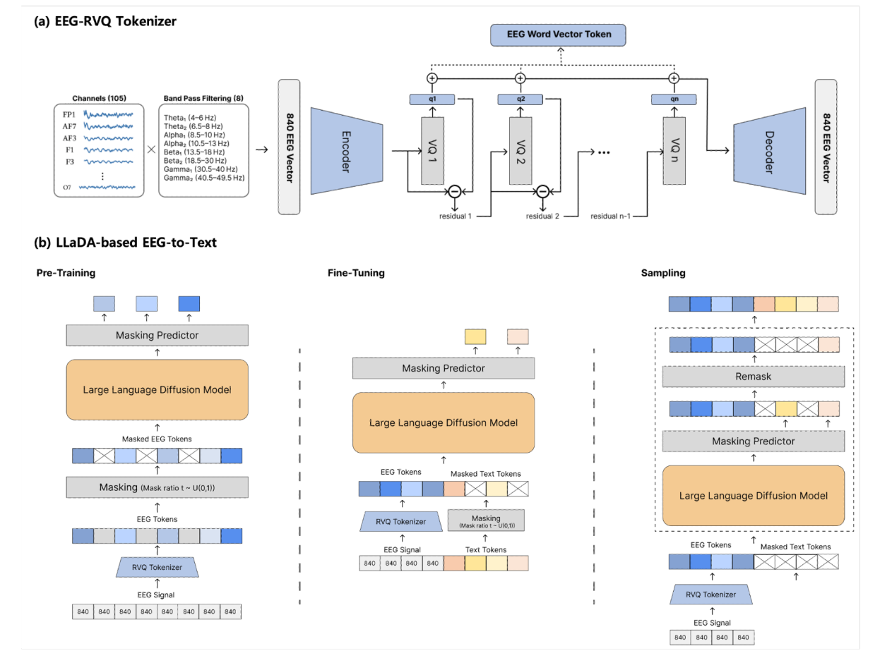
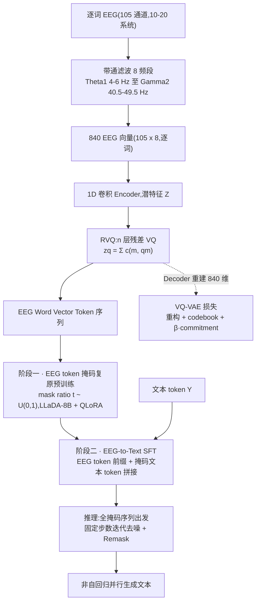

# DELTA: Language Diffusion-based EEG-to-Text Architecture

> **NeurIPS 2025 Workshop**(39th NeurIPS Workshop *Foundation Models for the Brain and Body*,arXiv 2511.21746v1,2025-11-22)· 韩国团队(MODULABS + 成均馆大学,正文 5 页 letter)——站内 **EEG-to-Text 正线的第一篇精读**:Wang & Ji 2022 的 open-vocabulary EEG-To-Text、DeWave 这些工作此前只散落在 [Tokenization 演进](../topics/tokenization.md) 的外围叙述里,本文是「离散 token + 生成式 LLM」在这条线上的占坑之作。与 [BrainGPT](0918-braingpt.md) 共享「EEG 当语言序列建模」的直觉但走向另一分支:那边自回归攒 generalist 表征,这边把 RVQ 码字接进掩码扩散 LLM 直接生成文本——token 侧则接上 [LaBraM](0918-labram.md) / [NeuroLM](0918-neurolm.md) 的码字演进线。

**作者**:MinGyu Jeon(MODULABS)、HyoBin Kim(成均馆大学)——两人共同一作(\* 标注),无通讯作者与导师署名;资助方 Brian Impact Foundation(韩国非营利组织)。两位作者的分工与机构关系原文未说明。

!!! abstract "TL;DR"
    - 任务:开放词汇 EEG-to-Text,ZuCo 1.0 + 2.0 合并(128 通道 500 Hz → 去噪后选 105 通道,NR + TSR 两种阅读任务),25,616 句按 80/10/10 切分、同一句文本不跨集合;**评测全程无 teacher-forcing**——以此回应 Jo et al. 2024 对该领域评测虚高的批判
    - 两段式:自训 **RVQ tokenizer**(105 通道 × 8 带通频段 = 840 维词级向量 → 1D conv encoder → n 层残差 VQ,标准 VQ-VAE 三项损失)把 EEG 变成离散 token;**LLaDA-8B(QLoRA)两阶段**——先在 EEG token 上做掩码复原预训练,再把 EEG token 当前缀提示、对被掩码文本做去噪 SFT
    - 结果:词级特征 BLEU-1 **21.93** / ROUGE-1 F **17.24** / WER 110.03,较同一 RVQ token 输入下重训的最强 AR 基线 T5 BLEU-1 +5.29 pp、较 BART ROUGE-1 F +5.37 pp(摘要口径的「up to 5.37 points」);句子级 14.82 / 7.26 全面小胜但 ROUGE-1 F 对 T5 只 +0.11;词级 BLEU-4 0.76 微输 T5 的 0.81,词级 WER 反而输 BART(110.03 vs 108.43)
    - 范式卖点:非自回归并行去噪替代逐步生成——一步错的 token 可被后续步修正,规避 AR 误差累积;案例分析显示语义解码失败时句法框架仍保留(「(Name) (Dates) was a (Profession).」)
    - 打折:所谓「over existing SOTA」只是跟自家重训的 BART/Pegasus/T5 比,EEG-To-Text/DeWave 等前作零对比;基线与 8B 主模型差一个量级的参数,「扩散优于 AR」与「大模型优于小模型」混杂;RVQ 无连续特征对照、全文零消融;码本层数/尺寸、学习率、采样步数全部未披露,无代码

## 1 问题定位:EEG-to-Text 的两处不稳定

EEG-to-Text 的既有谱系:Wang & Ji 2022 的 open-vocabulary 方法把词级 EEG 特征直接映射进语言模型,DeWave(Duan et al., NeurIPS 2023)用离散 EEG 波编码做翻译,Thought2Text(2024)借 LLM 做文本生成。作者引用 Jo et al. 2024 的「Are EEG-to-Text models working?」指出要害:大量已发表结果靠 teacher-forcing 评测撑着,**不用 teacher-forcing 时,当前模型其实没有克服 EEG 固有的低信噪比**(顺带一提,这句论断的支撑引用给的是 Jiang et al. 2019——一篇去伪迹综述,与 EEG-to-Text 评测无关,引用错位)。

局限被摆成两条。信号侧:连续 EEG 波形本身不稳定,高被试间差异 + 极端噪声之下,直接映射方法的输出「近似处理随机值」(引 Jo et al. 2024);生成侧:AR 模型(BART/T5/Pegasus 这类 seq2seq)逐步生成、上一步的 token 是下一步的输入,噪声 EEG 里推错一个 token 就会级联放大整句质量(此处引的 Wang et al. 2022 是 Self-Consistency 思维链论文,与误差累积无关——又一处引用错位,见疑点清单)。

解法是两个成熟组件的组合:RVQ 承自音频压缩谱系(SoundStream、EnCodec),用分层量化把信号按「核心特征优先」逐层编码;文本侧换成掩码语言扩散 LLaDA(DDPM → D3PM → LLaDA 谱系),把生成表述为「从全掩码出发的复原」而非「逐词翻译」。作者把这叫范式转移:从直译(translation)到复原(restoration)。三条贡献:首个 RVQ + 扩散 LM 的 EEG-to-Text 框架;直译→复原的范式表述;无 teacher-forcing 条件下的验证。第一条的「首个」无法完全核实,但就站内所见确实没有先例;第三条注意——它的对照实验全部是自家重训基线,没有与任何已发表 EEG-to-Text 数字对表。

## 2 方法

### 2.1 Stage 1:RVQ EEG tokenizer(自训,VQ-VAE 目标)

输入构造(正文 + 图 1a):128 通道去噪后选 105 个有效通道(10-20 系统,图 1a 列出 FP1/AF7/AF3/F1/F3/…/O7),每通道分离 8 个带通频段——Theta₁ 4–6 / Theta₂ 6.5–8 / Alpha₁ 8.5–10 / Alpha₂ 10.5–13 / Beta₁ 13.5–18 / Beta₂ 18.5–30 / Gamma₁ 30.5–40 / Gamma₂ 40.5–49.5 Hz(只出现在图 1a,正文只说「8 个频段」;相邻频段间留 0.5 Hz 间隙,未解释)——拼成 \( 105 \times 8 = 840 \) 维**词级**特征向量。正文另说每通道提取「frequency and time series characteristics」,但 840 维里只有频段特征,时序特征提取了什么、有没有进模型,没有下文。

840 维向量序列(图 1b 底部的 [840][840][840]…,即逐词一个向量)经一维卷积 encoder 压成潜特征 \( Z \),RVQ 用 \( M \) 层码本分层量化,每层选出码向量后求和:

\[
z_q = \sum_{m=1}^{M} c^{(m,\, q_m)}
\]

训练目标是标准 VQ-VAE 三项(重构 + codebook + commitment),Decoder 负责从 \( z_q \) 重建 840 维向量(图 1a 右侧):

\[
\mathcal{L}_{\mathrm{VQVAE}} = \mathrm{MSE}(x, \hat{x}) + \mathrm{MSE}(\mathrm{sg}(z_e), z_q) + \beta \cdot \mathrm{MSE}(z_e, \mathrm{sg}(z_q))
\]

输出在图 1a 里叫「EEG Word Vector Token」——tokenizer 是**词级**的,一个句子的 EEG 变成一串 token。要点:**码本是作者在 ZuCo 数据上自训的**,不是搬 EnCodec/SoundStream 权重;但码本层数 \( M \)(图中记作 n)、每层尺寸、encoder 结构、每词产出多少 token,全部未披露。

### 2.2 Stage 2:LLaDA 两阶段训练与条件注入

**EEG 预训练**(公式 3):只吃 RVQ 产出的 EEG token,做大规模随机掩码复原、完全不碰文本——掩码比例 \( t \sim U(0,1) \)(这个关键细节只在图 1b 的 Masking 模块里,正文没写)。让 8B 模型先学会 EEG token 空间的分布:

\[
\mathcal{L}_{\mathrm{Pre\text{-}train}} = \mathbb{E}_{t,\, e_0 \sim p(e)} \left[ \mathrm{CE}(f_\theta(e_t, t),\, e_0) \right]
\]

注意规模:所谓 large-scale,语料其实就是 ZuCo 训练集自己的 20,492 句 EEG token,与站内基础模型轴线的大规模预训练不是一回事。

**EEG-to-Text SFT**(公式 4):EEG token \( \hat{Q} \) 作条件,学习从被掩码文本复原原句。条件注入方式是**序列拼接**(EEG token 前缀 + 掩码文本 token 拼进同一序列,图 1b Fine-Tuning 栏),无 cross-attention;且 SFT 阶段掩码只挂在文本支路,EEG token 不加掩码(图 1b 中 Masking 模块只接在 Text Tokens 之后):

\[
\mathcal{L}_{\mathrm{LLaDA}} = \mathbb{E}_{t,\, x_0 \sim p(x)} \left[ \mathrm{CE}(f_\theta(x_t, t, \hat{Q}),\, x_0) \right]
\]

两阶段都微调 LLaDA-8B,均用 QLoRA;单卡 L40S 40GB,AdamW,batch 32,early stopping。学习率、训练轮数、LoRA rank、early stopping 判据均未披露。

### 2.3 推理:全掩码出发的迭代复原

推理时条件**只有** EEG token:文本序列从全掩码出发(最大不确定态),固定步数迭代反向扩散,每步对整句并行 refine、逐步填坑;图 1b Sampling 栏画出每步之后还有 Remask 环节——即 LLaDA 式的重掩再预测。作者强调非自回归的两点好处:无逐步误差传播;某步推错的 token 可在后续步被修正。采样步数、Remask 具体策略(LLaDA 原版为低置信度重掩)未说明。

## 3 实验与结果

**数据**:ZuCo 1.0 + 2.0 合并,128 通道、500 Hz、约 0.1–100 Hz,NR(自然阅读)+ TSR(任务导向阅读);去噪后选 105 通道,逐词提取特征并归一化到 0–1;含 NaN 或极端噪声的句子剔除。最终 25,616 句:20,492(~80%)训练 / 2,562(~10%)验证 / 2,562(~10%)测试,「按句子内容唯一切分,同一句不跨集合」——被试是否跨集合重叠未说明(48 名被试读相同刺激句,几乎必然重叠,即 subject-dependent)。25,616 显然是(被试, 句子)实例数而非唯一句子数(48 人 × 约 533 句/人),论文未拆解构成。

**基线设定(关键)**:对比对象是 BART、Pegasus、T5,**且它们也在同一套 RVQ token 上重训**——所以比较隔离的是「语言模型头」(AR vs 掩码扩散),tokenizer 好坏根本不在比较范围内。指标:BLEU-N(N=1–4)、ROUGE-1(P/R/F)、WER,测试集 2,562 句。

**主结果**(Table 1):

| 输入条件 | 方法 | BLEU-1 | BLEU-2 | BLEU-3 | BLEU-4 | ROUGE-1 P | ROUGE-1 R | ROUGE-1 F | WER |
|---|---|---|---|---|---|---|---|---|---|
| 句子级 | BART | 11.02 | 1.08 | 0.42 | 0.28 | 7.85 | 8.04 | 6.54 | 142.1 |
| 句子级 | Pegasus | 6.20 | 0.55 | 0.24 | 0.16 | 4.90 | 5.05 | 4.03 | 147.8 |
| 句子级 | T5 | 12.50 | 1.18 | 0.48 | 0.31 | 8.6 | 8.72 | 7.15 | 141.0 |
| 句子级 | **DELTA** | **14.82** | **1.36** | **0.56** | **0.37** | **9.12** | **9.24** | **7.26** | **139.71** |
| 词级 | BART | 13.69 | 2.97 | 0.82 | 0.32 | 11.98 | 13.43 | 11.87 | **108.43** |
| 词级 | Pegasus | 8.47 | 2.48 | 0.81 | 0.25 | 0 | 0 | 0 | 99.69 |
| 词级 | T5 | 16.64 | 5.80 | 1.96 | **0.81** | 12.28 | 12.88 | 11.85 | 111.13 |
| 词级 | **DELTA** | **21.93** | **6.43** | **2.01** | 0.76 | **18.88** | **18.86** | **17.24** | 110.03 |

三个读法。其一,词级条件全面优于句子级(所有模型),DELTA 的领先在词级拉开(BLEU-1 +5.29 pp 对 T5),但句子级 ROUGE-1 F 对 T5 只有 +0.11——「复原全局上下文」的宣称在句子级条件下的证据相当薄。其二,词级 BLEU-4 DELTA(0.76)微输 T5(0.81),词级 WER 输 BART(110.03 vs 108.43),作者只承认了前者。其三,**WER 全线 99.69–147.8**:连最好的输出在词序列层面也与参考文本基本对不上;更可疑的是 Pegasus 词级行——ROUGE-1 P/R/F 全 0 却拿到全场最低 WER 99.69,零 unigram 重叠与 WER < 100 几乎不可能同时成立,评测实现大概率有问题(见个人思考 3)。

**案例分析**:成功的生成可几乎逐字命中真值;更值得注意的是语义失败时句法框架保留——一次预测改错了主语但保住了「(Name) (Dates) was a (Profession).」的骨架。作者据此称模型学到的是语法结构而非单纯词共现。无生成样例表,无从核验。

## 架构图

*Figure 1 · (a) EEG-RVQ Tokenizer:Channels(105:FP1/AF7/AF3/F1/F3/…/O7)× Band Pass Filtering(8:Theta₁ 4–6 / Theta₂ 6.5–8 / Alpha₁ 8.5–10 / Alpha₂ 10.5–13 / Beta₁ 13.5–18 / Beta₂ 18.5–30 / Gamma₁ 30.5–40 / Gamma₂ 40.5–49.5 Hz)→ 840 EEG Vector → Encoder → VQ 1…VQ n(残差逐层相减,⊕ 汇总 q1…qn)→ Decoder 重建 840 EEG Vector,对外输出 EEG Word Vector Token;(b) LLaDA-based EEG-to-Text 三栏:Pre-Training(EEG token → Masking t~U(0,1) → LLaDA-8B → Masking Predictor)、Fine-Tuning(EEG token 与掩码文本 token 拼接,掩码只挂文本支路)、Sampling(全掩码 → 去噪 → Remask 循环)*

## 流程

## 与其他论文的关系

| 论文 / 工作 | 关系说明 |
|---|---|
| DeWave(Duan et al., NeurIPS 2023) | 真正的直接前作:离散 EEG 波编码 → 文本翻译(VQ + AR seq2seq)。DELTA 把 VQ 升级为 RVQ、AR 换成掩码扩散,但全文只引用、不对比——最该同台的角色缺席 |
| [BrainGPT](0918-braingpt.md) | 同走「EEG 当语言序列」的 LLM 路线:BrainGPT 自回归预训练攒 generalist 表征(连续 patch),DELTA 离散 token + 扩散直接解 EEG-to-Text;一个攒表征、一个解任务,结论里「large-scale pre-training」的展望正是两者的合流点 |
| [NeuroLM](0918-neurolm.md) | 「神经码进语言模型」的自回归版:NeuroLM 把 VQ 码字并入 GPT-2 词表做多任务指令推理,DELTA 把 RVQ 码作扩散 LLM 的条件提示——同构的两分支,解码机制(AR vs 掩码扩散)与注入方式(词表并层 vs 前缀拼接)都不同 |
| [LaBraM](0918-labram.md) / [TFM-Tokenizer](0918-tfm-tokenizer.md) | token 用途演进的两端:LaBraM 的 VQ 码只当预训练目标、推理时丢弃;TFM 把码字做成可插拔输入组件;DELTA 的 RVQ 码则是生成模型推理时的实时条件——token 从「训练目标」一路走到「生成条件」 |
| [EEGDM](1017-eegdm.md) | 扩散条件注入的镜像:EEGDM 用 EEG encoder 表示作条件引导潜扩散**生成 EEG**(生成即表征),DELTA 用 EEG token 作条件引导掩码扩散**生成文本**;都是拼接/调制式注入,方向相反 |
| [BrainRVQ](1104-brainrvq.md) | 同批 RVQ tokenization:BrainRVQ 时/频双路 RVQ(2×3 层×8192)服务表征预训练与层级自回归重构,DELTA 单路 RVQ 直接服务跨模态文本生成——RVQ 从音频压缩(SoundStream/EnCodec)搬进 EEG 的两个不同落点 |
| [NeuroDETR](1104-neurodetr.md) | 离散 token 的第三种去向:多尺度时间/空间码当事件检测模型的「记忆」;与本文共同印证 2025–26 tokenization 线的趋势——token 不再只是重构目标,开始驱动下游生成/检测机制 |
| Jo et al. 2024「Are EEG-to-Text models working?」 | 评测批判的来源:teacher-forcing 高估、无 teacher-forcing 下接近随机——DELTA 以此立论并不用 teacher-forcing 评测,但没有与任何已发表 EEG-to-Text 数字对表 |

## 个人思考

- **5 pp 的领先建立在「8B 对亿级」的不对称上,「扩散优于 AR」没有被干净地验证**。基线 BART/T5 的具体规格论文未披露,但即使按 T5-large(7.7 亿)算,与 LLaDA-8B(80 亿)也差一个量级——QLoRA 冻住的只是底座权重,预训练语言能力差距原封不动地带进了对比。要支撑「非自回归复原更适合噪声 EEG」这个核心主张,最起码需要同规模对照:LLaDA-8B 换 AR 解码做同协议微调,或找一个 8B 级 AR LLM 对打。论文一个都没做。摘要的「up to 5.37 points」要与这条对读:提升真实存在,归因完全不明;
- **RVQ 是标题的第一个词,却是全文唯一没有对照的组件**。三个基线吃的都是同一套 RVQ token——没有「连续 840 维特征直接进 LM」的基线,「RVQ 逐层编码核心特征、滤掉噪声」这一动机性宣称(从音频压缩搬来的直觉)在本文任何实验里都没被检验。对比站内 tokenization 线的惯例:[LaBraM](0918-labram.md) 有 tokenizer 与随机初始化的消融,[TFM-Tokenizer](0918-tfm-tokenizer.md) 用 plug-and-play 换头验证 token 质量,DELTA 的 tokenizer 是免检组件;加上码本自训于 ZuCo(跨数据集语义存疑)、层数尺寸未披露、无代码——RVQ 这半篇目前既不可复现也不可评估;
- **绝对值贴地,加一处内部矛盾,提醒这批数字只能当排序用**。WER 全线 110–148% 意味着输出与参考在词序列层面基本对不上,BLEU-1 21.9% 的单字重叠离可用文本很远——「语义对齐改善」是真的,「能解码」还早。更扎眼的是 Pegasus 词级行:ROUGE-1 三项全 0 却拿到全场最低 WER 99.69,两者几乎不可能同时成立,评测脚本大概率有 bug(空输出或截断的特殊处理)。全表无方差、无显著性检验,单次运行里 0.37 对 0.31 这类 BLEU-4 差异不宜过度解读;
- **7 页 letter 给了范式一个占位,没给范式一份证据**。掩码扩散该交的三件套——消融(RVQ 对连续输入、有无 EEG 预训练、掩码调度敏感性)、采样步数-质量曲线、同规模 AR 对照——一件都没有;「EEG token 预训练」用的还是 ZuCo 自己的两万句,「large-scale」名不副实,8B 模型在小数据上的跨模态适应全靠 early stopping 兜底。但占位价值是真的:tokenization 演进线(NeuroRVQ/BrainRVQ/CodeBrain 在卷码字结构)第一次有了「离散 token → 生成式 LLM」的端到端落点,与 [NeuroLM](0918-neurolm.md) 的 AR 分支构成对偶。复现前最想知道的两个数:每词多少 token(决定 8B 模型吃多长的序列)、码本层数与尺寸(决定 840 维向量被压到什么分辨率)。

## 自问自答

??? question "Q1 · 「提升 5.37 points」到底跟谁比?能跟 BrainTranslator / DeWave 的公开数字对表吗?"

    跟自家重训基线比:词级 ROUGE-1 F 17.24 对 BART 11.87(+5.37,即摘要口径),BLEU-1 21.93 对 T5 16.64(+5.29)。不能与前作对表——数据协议不同(合并 ZuCo 1.0+2.0、按句子内容切分、无 teacher-forcing),而已发表 EEG-to-Text 数字大多带 teacher-forcing 污染,直接比反而对 DELTA 不利也不公平。但要指出:贡献列表里「significant performance improvements over existing SOTA models」过强了,实验里没有任何一个 EEG-to-Text 专用模型(EEG-To-Text、BrainTranslator、NPT、DeWave 一个都没出现),SOTA 的说法只在对自家基线时成立。

??? question "Q2 · 「句子级特征」和「词级特征」差在哪?为什么词级全面更好?"

    ZuCo 同时发布句子级(整句聚合的眼动-EEG 特征)与词级(逐词特征)两种特征文件,DELTA 两种都当输入条件测。词级普遍好 5–10 pp,论文的解释只有一句「句子级聚合破坏了对 WER 至关重要的词序信息」——机制上说得通的部分是:逐词特征保留了词与眼动/EEG 段的时间对齐结构,给非自回归解码器提供了隐对齐线索;但为什么 BLEU/ROUGE 也一起掉,没有展开。句子级特征的确切聚合方式论文未说明,只能回 ZuCo 官方文档找。

??? question "Q3 · mask ratio t~U(0,1) 是什么?推理时的 Remask 是同款吗?"

    训练时每个样本随机采一个掩码比例 t,把输入按比例掩掉(图 1b 的 Masking 模块),损失对整个 t 区间求期望——这是 LLaDA 原版训练目标,DELTA 的公式 3/4 中的 t 就是这个分布;t→1 对应推理的起点(全掩码)。推理的固定步数迭代 + 每步 Remask 对应 LLaDA 的低置信度重掩策略,但 DELTA 用的是哪种重掩规则、步数多少,都没写——这是复现生成质量时最要命的缺口,因为采样超参对扩散 LM 的影响不亚于训练超参。

??? question "Q4 · 复现需要补齐哪些论文没给的数字?"

    清单:码本层数 n 与每层尺寸、conv encoder 结构与每词 token 数(决定序列长度)、105 通道名单、β 取值、LoRA rank、学习率、轮数与 early stopping 判据、采样步数、Remask 策略、「time series characteristics」的定义与去向。协议侧两个疑点也要先确认:被试是否跨 train/test 重叠(几乎必然,即 subject-dependent 设定,则被试泛化完全没被测过);25,616 的(被试, 句子)实例构成。这些不补齐,不仅结果无法复现,连「提升来自扩散还是来自 8B」都无法归因。

!!! abstract "复现速查卡"
    - **代码**:论文未附仓库(arXiv 2511.21746v1),作者无 GitHub 链接;底座 LLaDA-8B 与 QLoRA 组件公开可得,tokenizer 与预处理全靠自建
    - **数据**:ZuCo 1.0 + 2.0 合并;128 通道 500 Hz(0.1–100 Hz)→ 去噪后 105 通道;NR + TSR;逐词特征归一化 0–1;25,616 句 → 20,492 / 2,562 / 2,562(80/10/10,按句子内容切、同句不跨集合;**被试维度未说明**)
    - **tokenizer**:105 ch × 8 频段(Theta₁ 4–6 … Gamma₂ 40.5–49.5 Hz,频段定义只在图 1a)= 840 维词级向量;1D conv encoder + n 层 RVQ;VQ-VAE 损失(β 未给)
    - **训练**:LLaDA-8B + QLoRA 两阶段(先 EEG token 掩码复原、mask ratio t~U(0,1),再 EEG 前缀条件文本去噪);单卡 L40S 40GB;AdamW,batch 32,early stopping
    - **未披露**:n/码本尺寸/encoder 结构/每词 token 数、学习率、轮数、LoRA rank、采样步数、Remask 策略、105 通道完整名单、时序特征去向——letter 通病,需等扩展版或邮件要配置
    - **关键数字**:词级 BLEU-1 21.93 / ROUGE-1 F 17.24 / WER 110.03;句子级 14.82 / 7.26 / 139.71;最强 AR 基线 T5 词级 16.64 / 11.85 / 111.13;「+5.37」= 词级 ROUGE-1 F 对 BART 11.87;词级 BLEU-4 输 T5(0.76 vs 0.81)、词级 WER 输 BART(110.03 vs 108.43)

---

**相关阅读**

:material-arrow-left: [BrainRVQ(同批笔记:双域 RVQ 码字服务表征预训练)](1104-brainrvq.md) ｜ :material-vector-link: [Tokenization 演进(离散 token 的完整谱系)](../topics/tokenization.md) ｜ :material-creation: [NeuroLM(神经码进 LLM 词表的自回归版)](0918-neurolm.md) ｜ :material-account-group: [BrainGPT(EEG 当语言序列的自回归预训练)](0918-braingpt.md) ｜ :material-home: [首页](../index.md)
