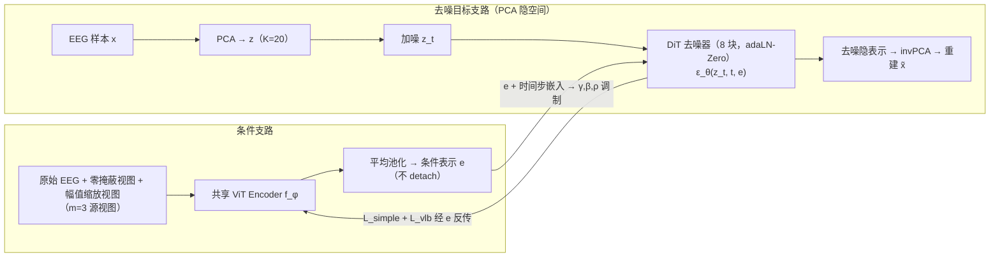
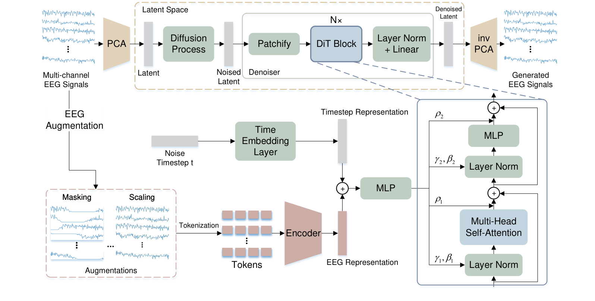

# EEGDM: Learning EEG Representation with Latent Diffusion Model

> **arXiv 2026**（IEEE 格式预印本，v5）· 清华大学计算机系（普适计算教育部重点实验室）+ 天津大学 —— 站内第二篇「生成轴线」论文：与 [JET](../2026-09/0923-jet.md)（流匹配、生成质量导向）互补，EEGDM 把生成目标反过来为**表征学习**服务。名字与 Puah et al. 的 EEGDM（arXiv:2508.14086，本文记作 Puah-EEGDM-SSM）撞名，注意区分。

**作者**：Shaocong Wang†, Tong Liu†（共同一作）, Yihan Li, Ming Li, Kairui Wen, Pei Yang, Wenqi Ji, Yong-Jin Liu\*（清华）；Minjing Yu（天津大学）

!!! abstract "TL;DR"
    - 核心论点：掩码重构在 EEG 上有**局部插值捷径**——强局部自相关下，从可见锚点插值即可把被掩 patch 填得八九不离十，损失低不等于学到了全局分布；而「从纯噪声生成完整信号」必须建模全局数据分布
    - 机制：EEG encoder 把原始信号与两个通道增强视图编码为紧凑表示 \( e \)，作为**条件**引导潜扩散模型（PCA 隐空间 + DiT）从噪声重建原信号；关键设计是 \( e \) **不 detach**——去噪损失经 \( e \) 反传，encoder 与扩散模型联合优化，「学一个对去噪最有用的条件」就是表征学习本身
    - 两个工程组件：① 通道增强丰富条件信息（零掩蔽 0.4s + 幅值缩放 [0.8, 1.2]，\( m=3 \) 视图平均池化）；② patch 沿时间维 PCA 到 \( K=20 \) 维隐空间做扩散（特征分解求基、零训练），降低去噪目标维度
    - 结果：6 个下游任务全面有竞争力；最大亮点是**类不均衡鲁棒性**——TUEV（类比 80:1）上 Balanced Accuracy 0.6826 / G-Mean 0.6443 / Macro AUC-ROC 0.9169 全场最佳，最稀有类 SPSW 召回 50.3%（掩码重构基线仅 10–18%）；TUAB Bal Acc 0.8180 仅次于 CBraMod
    - 消融的干净结论：PCA 与增强**单独用都不涨 Balanced Accuracy，联合才涨**（0.6054→0.6826）；生成模块还能做下游数据增强（CL-Drive +5.4pp）

## 1 问题定位：掩码重构的局部插值捷径

站内已读的三大 EEG 基础模型（[LaBraM](../2026-09/0918-labram.md)、[EEGPT](../2026-09/0918-eegpt.md)、[CBraMod](../2026-09/0928-cbramod.md)）全部以掩码重构为预训练目标。EEGDM 对这个目标提出结构性批评：掩码重构是「从可见锚点预测被掩片段」的任务，而 EEG 有强局部自相关——局部插值就足以把被掩 patch 补到损失很低，模型**不必**捕捉全局生成约束（整体时序模式、跨通道关系）。这与 [BrainGPT](../2026-09/0918-braingpt.md) 对 MAE 的批评（双向补全破坏时序因果）、[JET](../2026-09/0923-jet.md) 的立场（离散去噪错配神经动态）构成互补的第三条批评线，但落点不同：EEGDM 的解法不是换自回归或换流匹配，而是**把生成模型整个搬进来当训练目标**。

论据：能从纯噪声合成高保真内容的扩散模型，很可能在生成过程中刻画了数据的性质、结构与动力学——把这些约束压进 encoder，就得到了携带全局语义的表示。

## 2 方法

### 2.1 框架：以 encoder 表示为条件的潜扩散

原始多通道信号 \( X \in \mathbb{R}^{C \times T} \) 先按时间窗切成样本 \( x \in \mathbb{R}^{C \times t_s} \)。框架分两条支路：

**去噪目标支路（PCA 隐空间）**。每个样本沿时间维做 PCA 得到紧凑隐表示 \( z = Px \in \mathbb{R}^{K} \)（\( K = 20 \) 个主成分，基向量由特征分解求得、无需梯度训练）。扩散全程在这个隐空间进行：加噪 \( z_t = \sqrt{\bar\alpha_t}\, z_0 + \sqrt{1-\bar\alpha_t}\, \epsilon_t \)，去噪结束后经逆变换还原信号 \( \tilde{x} = P^{\top} \tilde{z} \)。PCA 变换的是**去噪目标**，降低扩散模型面对的维度。

**条件支路（EEG encoder）**。源信号 \( x' \)（原样本 + 增强视图）经共享 encoder \( f_\phi \) 编码，三个视图的表示平均池化成条件表示：

\[ e_i = f_\phi(x'_i), \quad e = \frac{1}{m} \sum_{i=1}^{m} e_i \quad (m = 3) \]

\( e \) 与噪声时间步嵌入一起，经 **adaLN-Zero** 块调制 DiT 去噪器：条件嵌入回归缩放/平移参数 \( \gamma, \beta \) 与残差前的逐维缩放 \( \rho \)（\( \rho \) 的 MLP 零初始化，使每个 DiT 块初始为恒等映射——训练起点稳定）。

**关键设计：\( e \) 不 detach**。去噪损失沿 \( e \) 反传到 encoder：

\[ \mathcal{L}_{\mathrm{simple}}(\theta, \phi) = \mathbb{E}_{x, t, \epsilon_t} \big\| \epsilon_\theta(z_t, t, e) - \epsilon_t \big\|_2^2 \]

encoder 参数 \( \phi \) 与扩散参数 \( \theta \) 联合优化——表征学习被重新定义为「学一个对去噪最有用的条件表示」。总目标再加变分下界项（预测协方差需要，改进版 DDPM 惯例）：

\[ \mathcal{L} = \mathcal{L}_{\mathrm{simple}} + \lambda_{\mathrm{vlb}} \mathcal{L}_{\mathrm{vlb}}, \qquad \lambda_{\mathrm{vlb}} = 1 \]

### 2.2 EEG Encoder

ViT 式架构：每通道按 \( \omega \) 长度无重叠切 patch，1 层 1D 卷积时序编码器（512 通道、核 200、步幅 200）把每个 patch 映射为 \( d = 512 \) 的 token，加可学习位置嵌入，进 8 层 Transformer（hidden 512、8 头、MLP 2048），输出 embedding **平均池化**得到样本级表示。下游任务在表示上接线性预测头。

增强视图设计（延续对比学习文献中验证有效的两种）：**零掩蔽**（每通道置零连续 0.4s）与**幅值缩放**（整段乘 \( U[0.8, 1.2] \) 系数），加原样本共三个源视图。增强作用于**条件支路**——迫使 encoder 从扰动视图中保留与目标共享的信息。

### 2.3 训练设置

预训练 TUEG：19 个公共通道、200Hz、30 秒非重叠样本（570 个 1s patch）；DiT 8 块、\( T = 1000 \) 扩散步；AdamW lr 5e-4（OneCycleLR）、batch 32、EMA 0.9999；4×A100 约 32.9 万步（约 113 小时），完全从零训练。下游微调 encoder **不冻结**（统一 lr 5e-4），另报线性探针。

## 架构图

*Figure 1 · encoder 表示 \( e \) 与噪声时间步表示相加后经 MLP 回归 adaLN-Zero 的 \( \gamma, \beta \)（缩放/平移）与 \( \rho \)（残差前逐维缩放），条件信息以此方式调制每一层去噪*

## 3 结果与消融

### 3.1 TUEV：类不均衡是最大亮点

TUEV 类别比最高 80:1，样本加权指标会失真，论文额外报 G-Mean 与 Macro AUC-ROC。微调版（25M）拿下 **Balanced Accuracy 0.6826 / G-Mean 0.6443 / Macro AUC-ROC 0.9169 三项最佳**；Weighted F1（0.7329）与 Kappa（0.5357）低于 CBraMod（0.8176 / 0.6581）——但逐类拆开看，CBraMod/EEGPT/LaBraM 的高分以最稀有类（SPSW）召回近零为代价（10–18%），EEGDM 把 SPSW 召回拉到 **50.3%**。一个掩码重构模型在少数类上几乎是随机丢弃的。

同分布对照实验补得很严谨：把 EEGDM 直接在 TUEV 训练集上预训练，Balanced Accuracy 达 **79.71%**，显著超过同设定、同名的 Puah-EEGDM-SSM（75.57%）——说明跨分布设定下的差距是 TUEG→TUEV 域偏移的代价，不是架构缺陷。

### 3.2 其他任务与范式对照

- **TUAB**：Bal Acc 0.8180 与 AUC-PR 0.9085 均为第二（AUC-PR 的最佳是 Puah-EEGDM-SSM 0.9258），AUROC 0.8922 第三（LaBraM 0.9022 第二、CBraMod 0.9227 最佳），CBraMod 的 Bal Acc 0.8289 仍领先约 1.1pp；
- **DMER（情绪分布预测）**：Chebyshev / Canberra / KL / Cosine / Intersection 五项最佳（Clark 第二）——连续情绪分布任务上扩散预训练的细粒度特征占优；
- **SHU-MI**：AUROC 0.6996 最佳，Bal Acc 0.6324 第二（CBraMod 0.6370）；**CL-Drive**：Bal Acc 与 Kappa 最佳；**Seed-VII**：Bal Acc 0.2300 最佳。Puah-EEGDM-SSM 在 SHU-MI 上接近随机水平（~50%）被移出对照；
- **训练范式对照**（同一 25M EEG-ViT-Large）：从零训练 0.5825 < 线性探针 0.6010 < 微调 0.6826——预训练贡献约 10 个点，收益来自预训练而非容量；
- **线性探针弱于微调**（TUEV 0.6010 vs 0.6826）：生成预训练的表示需要微调兑现，与 CBraMod 冻结实验的结论方向一致。

### 3.3 消融：PCA 与增强互补而非各自为战

TUEV 三种子消融（Bal Acc / G-Mean / Macro AUC-ROC）：

| 变体 | PCA | 增强 | Bal Acc | G-Mean | Macro AUC |
|---|---|---|---|---|---|
| A | ✗ | ✗ | 0.6054 | 0.3391 ± 0.2155 | 0.8750 |
| B | ✓ | ✗ | 0.5805 | 0.4578 | 0.8592 |
| C | ✗ | ✓ | 0.5917 | 0.4544 | 0.8547 |
| D | ✓ | ✓ | **0.6826** | **0.6443** | **0.9169** |

单独启用任一组件 Balanced Accuracy 反而略降，但 **G-Mean 稳定性大幅改善**（基线标准差 ±21.55%（百分数口径），且有一个种子 G-Mean≈0.03——意味着某类召回不到 3%）；联合使用才全面最佳。机理：PCA 作用于去噪目标（压缩至主导结构），增强作用于条件支路（保持跨视图共享信息），两者对齐后条件表示与目标空间的结构匹配。FDR 判别比佐证：0.319 / 0.210 / 0.287 / **0.384**。PCA 维度呈非线性关系（太少丢信息、太多混噪声），20 维最优。

**生成能力的外溢**：扩散模块可直接当数据增强器——在 CL-Drive 上用真实数据的 encoder 表示作条件合成样本，按比例混合使 Balanced Accuracy +5.4pp（53.57%→58.96%）。这是掩码重构模型做不到的。

## 与其他论文的关系

| 论文 / 工作 | 关系说明 |
|---|---|
| [JET](../2026-09/0923-jet.md) | 生成轴线双子星：JET 用流匹配**直接生成**原始 EEG（生成质量导向，TS-FID 论英雄）；EEGDM 用扩散**以生成训表征**（下游指标导向）。同用 adaLN 条件注入（JET 注入 t/类，EEGDM 注入 t/encoder 表示）与「生成目标须建模全局分布」的立场 |
| [EEGPT](../2026-09/0918-eegpt.md) | 「显式约束表示」的两种解法：EEGPT 加对齐分支 \( L_A \)（轻，表示空间对齐）；EEGDM 让表示当扩散条件（重，信号空间生成）。同为 25M EEG-ViT-Large 规模，EEGPT 偏好线性探针、EEGDM 需微调兑现 |
| [CBraMod](../2026-09/0928-cbramod.md) / [LaBraM](../2026-09/0918-labram.md) | 被批评的掩码重构主线：EEGDM 批评其「局部插值捷径」；TUEV 上互有胜负——CBraMod 赢 Weighted F1/Kappa，EEGDM 赢类均衡指标与少数类召回；TUAB 上 CBraMod 仍领先约 1.1pp |
| [BrainGPT](../2026-09/0918-braingpt.md) | 批评 MAE 的另一条线（自回归 vs 双向插值）：三者（BrainGPT/JET/EEGDM）从因果、连续演化、全局生成三个不同角度攻击同一目标 |
| [生成模型脉络](../../basics/generative-lineage.md) | 本文是「DDPM 线」在 EEG 表征学习上的落地实例：条件潜扩散 = PCA 隐空间（对应 VAE 的隐空间思想，但零训练线性化）+ DDPM 目标 + DiT 骨干 + adaLN-Zero（DiT 标配） |
| Puah-EEGDM-SSM（arXiv:2508.14086） | 撞名的另一篇：SSM 进扩散预训练；EEGDM 用 DiT 在 PCA 流形上捕捉跨通道同步与相位关系，同分布对照与多任务上占优（Puah 法在 SHU-MI 近随机） |
| [EEG-FM-Compass](../../blog-2023-2026.md) | 尚未被该 benchmark 收录——生成式预训练在统一评测下的排名是待验证问题；本文的类均衡指标实践（G-Mean/Macro AUC）值得 benchmark 借鉴 |

## 个人思考

- **「条件即表示」是全文最值得记的设计**。EEGPT 用对齐损失显式约束表示（轻量），EEGDM 把表示直接当生成条件且不 detach——梯度信号从「让两个表示相似」变成「让整段信号能被重建」。后者贵得多（要背一个扩散模型），但训练信号也更丰富：去噪器在每个时间步、每个噪声水平都在向 encoder 要信息，encoder 被迫蒸馏源与目标之间的显著共性。代价同样明显：预训练 4×A100×113 小时，比同规模的掩码重构贵一个量级；
- **类不均衡收益不是玄学**。掩码重构基线在 TUEV 少数类召回 10–18%，本质是预训练目标与类别频率无关、但下游交叉熵按频率偏向多数类——而扩散目标逐样本建模，表示对每个样本的「可重建性」不依赖类别身份，微调后少数类可分性更好。G-Mean 那个 ±21.55% 的标准差（一个种子 0.03）是最有力的证据：某些掩码重构模型的「SOTA」建立在整体放弃一个类之上。这也提示 EEG-FM-Compass 式的统一 benchmark 应该把类均衡指标列为标配；
- **PCA 隐空间是极致的工程克制**。LDM 原版用学习的 VAE 隐空间，EEGDM 换成零训练的线性 PCA（K=20）——省掉一个要训的自编码器，代价是线性子空间只保留主导方差。消融显示这恰好和条件支路形成互补对齐（PCA 管目标、增强管条件），「两个都不单独涨、一起才涨」是很少见的消融形态，说明贡献在交互项；
- **与 JET 连读的收获**：两篇都在回答「生成目标能给 EEG 带来什么」，但分工清楚——JET 证明生成质量本身（约束设计），EEGDM 证明生成过程的副产品（条件表示）有下游价值。一个自然的组合实验是把 JET 的生理结构约束搬进 EEGDM 的去噪目标，检验类不均衡收益是否进一步增强；
- **线性探针弱的诚实呈现**：TUEV 上线性探针 0.6010 仅略高于从零训练的 0.5825、远低于微调的 0.6826，论文没有掩饰。结合 EEG-FM-Compass「线性探针普遍不够」的结论，「预训练表示的价值靠微调兑现」在生成路线下依然成立。

## 自问自答

??? question "Q1 · 为什么用零训练的 PCA 而不像 LDM 原版学一个 VAE 隐空间？"

    三个理由：PCA 基由特征分解闭式求得，不引入需要与扩散联合训练的自编码器（少一套不稳定因素）；EEG patch 的主导方差集中在线性子空间，20 维已够（消融显示太多反而引入噪声污染）；PCA 只作用于去噪目标，表征学习的负担由条件支路的 encoder 承担——隐空间不需要「学会压缩」，只需要「保住主导结构」。代价是线性流形外的细节全靠去噪器与逆变换近似，理论上会限制逐 patch 重建的上限（补充材料仅报告波形与主导节律吻合；「精细高频成分有损」是本笔记由线性子空间性质出发的推断，论文未直接验证）。

??? question "Q2 · e 不 detach 到底意味着什么？如果 detach 会怎样？"

    \( \mathcal{L}_{\mathrm{simple}} \) 的梯度路径是 \( \epsilon_\theta \to e \to f_\phi \)：encoder 收到的训练信号是「你的输出作为条件时，去噪误差有多大」。若 detach，\( e \) 只是随机初始化网络的输出、没有任何训练信号，encoder 永远学不到东西——所以不 detach 不是技巧而是这套范式的成立前提。这也解释了为什么条件必须是「与目标语义相关」的源视图（原样本+轻增强）：如果条件与目标无关，encoder 只能学到无意义的相关性。

??? question "Q3 · 「局部插值捷径」的批评对 CBraMod 这种 SOTA 也成立吗？"

    成立但需要限定。CBraMod 的十字交叉注意力确实以空间/时间条带建模显式削弱了纯局部插值的解，且其防泄漏重训成绩说明泛化是真的——EEG-FM-Compass 综合第一不是白来的。EEGDM 的批评更准确的说法是：**同等容量下，掩码重构的目标允许模型把容量花在局部统计上**，而 TUEV 少数类召回 10–18% 与 G-Mean 标准差 ±21.55 是这种容量分配偏差的外显。两条路线在类均衡指标上的差距是实打实的，但在 Weighted F1/Kappa 上掩码系仍领先——「哪个目标更好」取决于你用什么指标定义更好。

??? question "Q4 · 生成模块在下游完全没用上吗？"

    下游分类只用 encoder（生成模块丢弃，论文明说报告的 25M 对应下游网络）。但扩散模块有一个独特外溢：合成 EEG 做数据增强（CL-Drive +5.4pp Balanced Accuracy）。这是掩码重构范式结构性做不到的——它们没有生成器。对样本稀缺的 BCI 任务（如本文用的 CL-Drive），「预训练副产物直接变成增强器」是扩散路线的独有账目。

!!! abstract "复现速查卡"
    - **代码**：[github.com/wangsc18/EEGDM](https://github.com/wangsc18/EEGDM)（含预处理脚本与训练配置）
    - **预训练**：TUEG 19 公共通道（沿用 CBraMod 的通道选取）、200Hz、30s 非重叠样本（570 个 1s patch）；PCA \( K=20 \)（逐 patch 时间维，特征分解零训练）；encoder EEG-ViT：1 层 1D conv（512 出、核 200、步幅 200）+ 8 层 Transformer（512/8 头/MLP 2048）+ 平均池化；DiT 8 块（512/8 头，adaLN-Zero，\( \rho \) 零初始化）；\( T=1000 \)；损失 \( \mathcal{L}_{\mathrm{simple}} + \mathcal{L}_{\mathrm{vlb}} \)（\( \lambda = 1 \)，Improved DDPM 式）
    - **条件**：\( m=3 \) 源视图（原样本 + 零掩蔽 0.4s/通道 + 幅值缩放 \( U[0.8, 1.2] \)），平均池化；\( e \) 不 detach
    - **优化**：AdamW lr 5e-4 OneCycleLR（min 5e-5）、wd 0.05、batch 32、EMA 0.9999、梯度裁剪 1；4×A100 约 32.94 万步（约 113 小时）
    - **下游**：微调不冻结（统一 lr 5e-4，OneCycleLR，30/150 epoch）；线性探针冻结（lr 2e-4/5e-4/2e-3）；任务头为线性预测器；分类交叉熵、分布预测 KL
    - **评测口径**：TUEV/TUAB 用 16 双极导联官方划分；CL-Drive 10 折按被试划分（subject-wise）交叉验证；SHU-MI/DMER/Seed-VII 被试独立划分——类不均衡任务须同时报 G-Mean / Macro AUC-ROC

---

**相关阅读**

:material-creation: [JET · 流匹配生成 EEG（生成轴线姊妹篇）](../2026-09/0923-jet.md) ｜ :material-magnify: [EEGPT（显式表示约束的轻量版对照）](../2026-09/0918-eegpt.md) ｜ :material-chart-timeline-variant: [生成模型脉络（DDPM 线的 EEG 落地）](../../basics/generative-lineage.md) ｜ :material-compress: [CBraMod（掩码重构主线对照）](../2026-09/0928-cbramod.md) ｜ :material-home: [首页](../../index.md)
