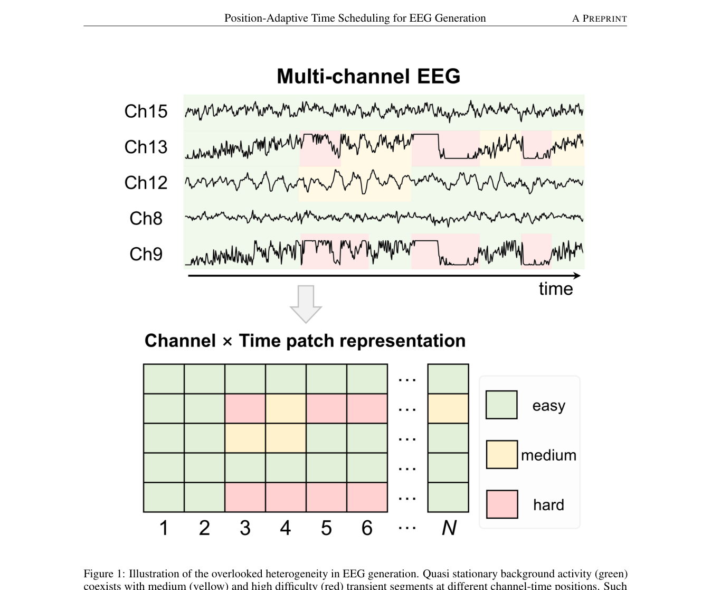
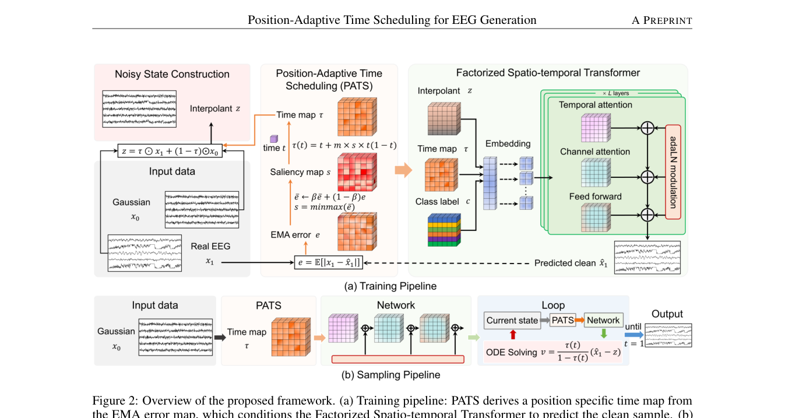
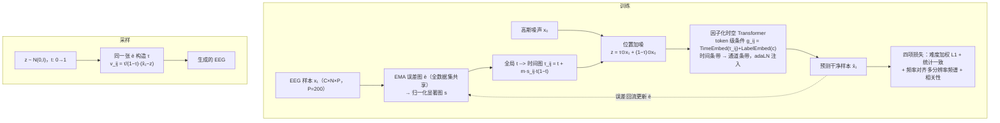

# Not All EEG Moments Are Equal: Position-Adaptive Time Scheduling for EEG Generation

> **arXiv 2026**（eess.SP 预印本 v1，2026-07-25）· 北京理工大学计算机学院 —— 站内**第三篇生成轴线**论文：直接站在 [JET](../2026-09/0923-jet.md)（ICML 2026，流匹配）之上，攻击其遗留的「全局统一时间调度」假设；与 [EEGDM](1017-eegdm.md)（潜扩散训表征）一起，把生成轴线的三篇拼成完整光谱——生成质量（JET）→ 生成训表征（EEGDM）→ 生成调度精细化（本篇）。

**作者**：Boheng Liu, Ziyu Li\*（通讯）, Chenghua Duan, Qing Li, Xia Wu（北京理工大学）

!!! abstract "TL;DR"
    - 核心论点：**不是所有 EEG 时刻都同等难**——准平稳背景节律与稀疏高难度瞬态（病理放电、伪迹段、通道特异性事件）共存于同一段记录，且难位置在同一采集协议下**跨样本复现**；而现有流匹配（JET）让所有通道 × 时间位置共享一个标量时间 t，难易位置拿到完全相同的有效监督，容量浪费在易位置上
    - PATS（核心贡献）：训练中维护每个 (通道 i × patch j) 位置重构误差的 **EMA 统计图**（全数据集共享）→ 归一化为显著图 s → 把全局 t 展开为端点保持的位置时间图 \( \tau_{i,j}(t) = t + m\, s_{i,j}\, t(1-t) \)——历史难的位置被提前推向低噪声阶段；采样用同一张统计图
    - 配套两件：**因子化时空注意力**（时间条带 + 通道条带两阶段，τ 作 token 级条件经 adaLN 注入，复杂度 \( O(CN^2 + NC^2) \)——与 [CBraMod](../2026-09/0928-cbramod.md) 十字交叉同族、搬到生成侧）；**频率对齐多分辨率频谱一致性损失**（STFT 幅值 + 频率权重 \( w_k \propto k^\alpha \) 对抗幂律谱偏置——替换 JET 的时域 TV 约束）
    - 结果：三个数据集（TUEV 16ch / BCIC-IV-2a 22ch / SEED-IV 62ch）TS-FID 全面最低——比自家复现的最强基线 JET 再降 **40.7% / 62.2% / 41.5%**；下游增强 ΔAcc 最高 +9.58pp（EEGNet 裁判）/ +2.74pp（CBraMod 裁判），两个裁判下全部最高
    - 全文最漂亮的一张牌：按基线误差十分位分层的误差削减——第 1–6 分位 1.3%→4.8% 缓升、7–9 分位回落至 3.3%、**第 10 分位跳到 14.9%**（约为其他分位 3 倍）：收益集中在最难的少数位置，中心假设的直接验证

## 1 问题定位：统一时间调度的「均等主义」

EEG 数据稀缺 → 生成增强的动机与 JET 一致。本文攻击的是 JET 留下的一个具体假设：条件流匹配的线性插值路径 \( x_t = t\,x_1 + (1-t)\,x_0 \) 中，**样本内所有通道、所有 patch 位置共享同一个标量 t**——同一训练步里，每个 (i,j) 位置的噪声水平完全相同。

这与 EEG 的两个物理事实冲突：

1. **难度异质**：准平稳背景与高难瞬态共存，重构误差天然不均衡；
2. **难位置复现**：同一采集协议下，病理放电、通道特异性伪迹等难模式趋向出现在相近的通道-时间位置（TUEV 的事件中心窗尤其如此）——因此「难度」可以做成**数据集级的位置统计量**，而不必逐样本估计。

统一调度的后果：难位置与易位置得到同样的有效监督 → 有限容量被浪费。与站内已有批评线的关系：[EEGDM](1017-eegdm.md) 批评掩码重构的「局部插值捷径」（监督信号**太容易**），本文批评流匹配的「均匀调度」（监督信号**分配太平均**）——同属「训练信号分配失当」家族，EEGDM 换目标，本篇换调度。

## 2 方法

### 2.1 预备：干净样本参数化的条件流匹配

patch 化（P=200 无重叠，承 JET）得 \( x_1 \in \mathbb{R}^{C \times N \times P} \)，高斯 \( x_0 \) 同形。与 JET 直接回归向量场不同，本文让网络**直接预测干净样本** \( \hat{x}_1 = f_\theta(z, t, c) \)（引 Li & He 2026「Back to basics」的去噪参数化），向量场由 \( \hat{x}_1 \) 反解，推理解 ODE。

### 2.2 PATS：位置自适应时间调度（核心贡献）

**① EMA 误差图**。每个训练步后更新 \( \bar{e} \leftarrow \beta\bar{e} + (1-\beta)e \)，其中 \( e_{i,j} = \mathbb{E}_{P,B}[|x_1 - \hat{x}_1|] \) 是位置 (i,j) 上沿 patch 维与 batch 平均的绝对误差。这张 \( \bar{e} \in \mathbb{R}^{C \times N} \) 图**全数据集共享、持续更新**——记录的是「该位置在数据集上历来有多难」，而非逐样本属性。min-max 归一化得显著图 \( s \in [0,1]^{C \times N} \)。

**② 端点保持的时间图**。把全局 t 展开为位置专属时间：

\[
\tau_{i,j}(t) = t + m\, s_{i,j}\, t(1-t), \qquad m \in [0,1)
\]

三个关键性质：

- **端点保持**：\( \tau(0)=0,\ \tau(1)=1 \) 对任意 \( s_{i,j} \) 成立——每个位置仍从纯噪声出发、到干净样本结束，只有中间进度被调制，流的分布正确性不被破坏；
- **严格单调**：\( \dot{\tau}_{i,j}(t) = 1 + m\,s_{i,j}(1-2t) > 0 \)（m<1），ODE 良定义；最大偏移在 t=0.5 处，为 \( m\,s_{i,j}/4 \)；
- **可退化**：m=0 恢复 JET 的均匀调度。

**③ 加噪与采样**。\( z = \tau \odot x_1 + (1-\tau) \odot x_0 \)（τ 沿 patch 维广播），网络改吃时间图 \( \hat{x}_1 = f_\theta(z, \tau, c) \)。采样的位置专属向量场：

\[
v_{i,j}(z,t,c) = \frac{\dot{\tau}_{i,j}(t)}{1-\tau_{i,j}(t)}\big(\hat{x}_{1,i,j} - z_{i,j}\big)
\]

注意那个 \( \dot{\tau}/(1-\tau) \) 因子——省掉它就等价于按 m=0 积分，位置调度在推理端失效。生成时用**训练得到的同一张** \( \bar{e} \) 构造 s 与 τ，Heun 或 Euler 积分。

### 2.3 因子化时空注意力

τ 在通道与 patch 间都不同 → 条件必须解析到 **token 级**：每个 token 的条件向量 \( g_{i,j} = \mathrm{TimeEmbed}(\tau_{i,j}) + \mathrm{LabelEmbed}(c) \) 预测每个块 adaLN 的 shift/scale/gate。

注意力不做 C×N 联合，而是两阶段因子化：**时间条带**（每通道内 N 个 patch 做注意力，捕长程时序）→ **通道条带**（每时间位置的 C 个通道做注意力，显式建模容积传导的跨通道依赖），复杂度 \( O((CN)^2) \to O(CN^2 + NC^2) \)。（站内对照：这正是 [CBraMod](../2026-09/0928-cbramod.md) criss-cross 的结论在生成侧的重演——「EEG 的通道×时间网格该这么数注意力」。）

### 2.4 四项损失

1. **难度加权重构**：\( w_{i,j} = 1 + \gamma\sqrt{s_{i,j}} \) 的归一化加权 L1（分母 \( \mathbb{E}[w] \) 保证尺度与 γ 无关）；
2. **统计一致性**：逐通道 μ/σ 对齐（同 JET 的 \( L_{\mathrm{cons}} \)）；
3. **频率对齐多分辨率频谱一致性**（替换 JET 的时域 TV）：R 个分辨率的 STFT 幅值谱，每分辨率 = 谱收敛项（Frobenius 比）+ log 幅值 L1 项；评估频带 \( k < \eta F \) 内加频率权重 \( w_k \propto k^\alpha \)（η 与下游评估协议的最大频率比对齐），带外置 1——直接补偿幂律谱导致的低频主导梯度；
4. **相关性**：\( 1 - \rho_{\mathrm{Pearson}} \)（同 JET）。

第 3 项与 JET 的路线冲突值得单独记：JET 用时域 TV 正则「压高频噪声」，本文指出**时域平滑约束天然偏置向压制临床相关的高频瞬态**（EEG 功率谱 1/f^χ，能量最小化主导的梯度天然偏向低频），改到频域显式加权——恰好接住了 [JET 笔记](../2026-09/0923-jet.md)里「λ_tv 对高频敏感范式需重新标定」的担忧。

## 3 实验与结果

**设定**：TUEV（16ch 事件分类，被试独立划分）/ BCIC-IV-2a（22ch 运动想象，跨 session）/ SEED-IV（62ch 情绪，trial 级）——通道数、采样率、任务语义差异极大，用于验证位置异质性是 EEG 的普遍性质而非单一协议的伪象；P=200 固定，仅 C 与 N 随数据集变化，无数据集特定结构改动。基线全部按原文复现、同划分训练：ESC-GAN（AAAI 2024，EEG 情绪编辑 GAN）、Diffusion-TS（ICLR 2024）、PaD-TS（AAAI 2025，种群感知扩散）、JET（最强、最直接可比）。合成样本按类配平 1× 混入真实训练集。

**主结果**（EEGNet 做下游裁判，3 种子）：

| 数据集 | TS-FID（Ours / JET 复现） | 相对降幅 | ΔAcc（Ours / JET） |
|---|---|---|---|
| TUEV | 213.92 ± 6.53 / 360.78 ± 9.64 | −40.7% | **9.58 ± 0.47%** / 2.81 ± 0.25%（3.4× 相对增益） |
| BCIC-IV-2a | 196.32 ± 7.85 / 518.89 ± 13.47 | **−62.2%** | 2.58 ± 0.29% / 0.62 ± 0.22% |
| SEED-IV | 437.84 ± 11.26 / 748.01 ± 17.83 | −41.5% | 2.61 ± 0.33% / 1.80 ± 0.21% |

GAN / 扩散基线的 TS-FID（412–1103）与 ΔAcc（≤1.7%）全面落后，延续「离散→连续」的进步方向；TUEV 上分类准确率从 No-Aug 的 67.53% 提到 **77.11%**（Macro-F1 ×1.59、Macro-Recall ×1.47）。

**换裁判仍成立**（CBraMod 做下游评估骨干）：ΔAcc 2.39 / 2.74 / 2.15pp，三集仍全面最高（超 JET 0.75 / 1.21 / 0.74pp）——「不是所有时刻同等难」在预训练大模型裁判下同样成立。

**消融**（TUEV，leave-one-out）：

| 配置 | TS-FID | ΔAcc |
|---|---|---|
| Baseline（= 复现 JET） | 360.78 | 2.81% |
| w/o 因子化注意力 | 241.87 | 6.47% |
| **w/o PATS** | **268.53** | **5.12%** |
| w/o 频谱损失 | 226.35 | 8.03% |
| Full | **213.92** | **9.58%** |

三组件各自必要且互补，**PATS 移除后掉得最深**（两项指标都是），且每个消融版仍明显好于 JET。损失细消融：去频率加权（α=0）219.47/8.41%、单分辨率（R=1）221.83/8.07%、去难度加权重构 217.35/8.72%——频率加权贡献最大（幂律补偿），多分辨率次之，难度加权是 PATS 之上的锦上添花。

**十分位分析**（Figure 4，全文最说服力的证据）：把实例按基线（JET）误差排序分十份，看本框架的相对误差削减：第 1–6 分位 1.3%→4.8% 缓升，7–9 分位回落（4.7%→3.3%），**第 10 分位跳到 14.9%**——收益高度集中在最难的一成位置，正是「少数复现性的难位置（病理放电、瞬态）在均匀调度下被亏待」这一中心假设的直接验证。

## 架构图

*Figure 1 · 难度异质示意：准平稳背景与高难瞬态共存于不同通道-时间位置，且同一协议下跨样本复现——难度可做成数据集级位置统计*

*Figure 2 · 框架总览：(a) 训练——PATS 从 EMA 误差图导出位置时间图，条件化因子化时空 Transformer 预测干净样本；(b) 采样——从高斯噪声出发，按同一位置调度迭代解流 ODE*

## 流程

## 与其他论文的关系

| 论文 / 工作 | 关系说明 |
|---|---|
| [JET](../2026-09/0923-jet.md) | 直接前作与最强基线，三处修正：① 全局统一调度 → 位置自适应调度（核心）；② 时域 TV 约束压制高频 → 频域显式加权；③ 直接回归向量场 → 干净样本参数化。TS-FID 对其复现值再降 40–62% |
| [EEGDM](1017-eegdm.md) | 生成轴线三部曲分工：JET 生成质量 / EEGDM 生成训表征 / 本篇生成调度精细化。难度感知粒度对照：EEGDM **样本级**（类不均衡，逐样本建模）、本篇**位置级**（channel×patch 的数据集统计）——两级难度感知可否叠加是个自然问题 |
| [CBraMod](../2026-09/0928-cbramod.md) | 两重关系：因子化注意力同族（criss-cross 从判别侧搬到生成侧，O(CN²+NC²) 结论两侧互证）；同时是本文 Table 2 的下游评估裁判 |
| [LaBraM](../2026-09/0918-labram.md) / [TFM-Tokenizer](../2026-09/0918-tfm-tokenizer.md) | 频域约束谱系的延续：LaBraM 频谱重构目标 → TFM 频带掩码 → 本文频带加权 \( w_k \propto k^\alpha \)——「低频会吃掉梯度」的共识从掩码侧一路传导到生成侧 |
| [RF-GPT](../2026-09/0921-rf-gpt.md) | 合成增强的两种形态：配置即标签的零噪声仿真 vs 学习式生成——EEG 没有合规仿真器，学习式生成 + 难度调度是当下的替代路径 |
| Diffusion-TS / PaD-TS | 被比较的时间序列生成基线（ICLR 2024 / AAAI 2025）；它们的「干净样本重构 + 种群统计约束」思想分别被本文的参数化与统计一致性损失吸收 |

## 个人思考

- **PATS 学到的其实是「采集协议的位置语法」**：EMA 误差图是数据集级统计，前提是难位置跨样本对齐——TUEV 事件中心窗、BCIC cue 对齐窗、SEED trial 窗恰好都满足（都是范式对齐的窗口）。对位置随机化的自由长记录（如随机开窗的 TUAB），「第 j 个 patch 难」不再有跨样本语义，这个假设会弱化。论文未讨论该边界，结论里也只把 instance-level 难度列为 future work——**这个方法的适用域比三个 benchmark 暗示的窄**；
- **τ 的调制是三件事打包**：数据侧（每位置噪声水平）、监督侧（难度加权损失）、条件侧（token 级时间嵌入）。细消融显示大头在调度本身：去 PATS 掉到 5.12%，仅去难度加权重构只掉到 8.72%——「把监督信号分配对」比「把损失加权调对」更根本；
- **可以视为位置粒度的课程学习**：难位置每步被推到更「成熟」（更低噪声）的阶段，等价于给它们更细的终点邻域监督，且端点保持保证不改分布——比传统 curriculum（改数据顺序）优雅，代价是要维护一张与协议绑定的统计图；
- **复现口径警示（站内 benchmark 表适用）**：本文复现的 JET 在 TUEV 上 TS-FID=360.78，而 JET 原文报 235.86——差 53%。TS-FID 的特征空间与预处理强依赖论文口径，跨论文数字**不可直接横比**，只应在同一篇的同一口径内比较（本篇内部对比是干净的）；
- **一个想看的缺失实验**：EMA 误差图 s 本身的可视化。哪些通道 × 哪些时间段难？如果 s 与已知的伪迹拓扑、放电导联对得上，就是漂亮的可解释性证据（TFM 的 token 分析、EEGMoE 的专家分工可视化都是这么加分的），论文只给了按难度分层的收益曲线，差最后一步。

## 自问自答

??? question "Q1 · τ 为什么要端点保持？不保持会怎样？"

    流匹配的正确性依赖「t=0 全体位置处于先验分布、t=1 全体位置处于数据分布」这两个端点。若允许 τ(0)≠0 或 τ(1)≠1，某些位置在轨迹两端就不在正确的分布上——采样从纯噪声出发时，这些位置对应的边缘分布错位，生成的联合分布随之扭曲。t(1−t) 因子在两个端点取 0，正好把调制限制在轨迹内部；严格单调（m<1）保证 ODE 可积且不出现位置间的「时间倒流」。

??? question "Q2 · 难度统计为什么用数据集级 EMA，而不是逐样本估计？"

    两个原因：① 逐样本难度在训练早期噪声极大（一个 batch 的误差说明不了该样本的固有难度），而「同一协议下难位置跨样本复现」让数据集级统计有明确的物理对应；② 采样时也需要 τ——逐样本统计在生成时无法获得（没有真值算误差），数据集级 EMA 图可以直接复用，训练与采样调度一致。代价是放弃了实例级敏感度：对「难在非常规位置」的样本无能为力，作者把这列为 future work。

??? question "Q3 · 频率加权 w_k ∝ k^α 与 JET 的 TV 正则，都在「救高频」，差别在哪？"

    方向相反。TV 正则在时域惩罚相邻点差异，对高频成分是无差别压制——JET 用它压「无结构的高频噪声」，但临床棘波、瞬态也是高频，被一起压掉了（JET 自己也承认 >15Hz 生成谱轻度衰减是「保守约束」）。本文放弃时域平滑，改在 STFT 域按频率显式加权：低频能量大但权重低，高频能量小但权重按 k^α 提升——把「哪些频率重要」从隐式（能量）改成显式（可设计的权重），并用 η 与下游评估频带对齐。本质是把先验从「平滑」换成「频谱形状」。

??? question "Q4 · 下游增强为什么用 EEGNet 和 CBraMod 两个裁判？"

    单一裁判有偏：EEGNet 从零训练、轻量，合成数据的「可分性」红利容易被放大；CBraMod 是大规模预训练模型，特征已强，合成数据要提供的是「预训练没见过的信息」才能涨分。两个裁判下本文都最高（+9.58pp / +2.74pp），说明增益不是针对弱分类器的伪象。这也是站内已读论文里第一次见到「双裁判」协议——JET 只用了 CBraMod，EEGDM 用下游模型自带协议，本篇的做法更稳。

!!! abstract "复现速查卡"
    - **代码**：论文未附仓库（arXiv 2608.00048 v1，eess.SP）
    - **关键设定**：P=200 无重叠 patch；EMA 误差图 β 衰减；margin m ∈ [0,1)；损失权重 λstat/λspec/λcorr、频率指数 α、频带上限 η；Heun/Euler 积分——**具体数值正文未披露**（v1 预印本，细节待后续版本/附录）
    - **数据**：TUEV（16ch，subject-disjoint）/ BCIC-IV-2a（22ch，cross-session）/ SEED-IV（62ch，trial-level）；合成样本按类配平 1× 混入
    - **裁判**：EEGNet（从零训练）+ CBraMod（预训练骨干）；3 种子，mean ± std
    - **复现要点**：采样时务必带 \( \dot{\tau}/(1-\tau) \) 因子（式 3），漏掉等价于 m=0；EMA 图与训练数据绑定（换数据集需重新积累）

---

**相关阅读**

:material-arrow-left: [EEGDM（生成轴线姊妹篇：扩散训表征）](1017-eegdm.md) ｜ :material-creation: [JET（直接前作：条件流匹配 + 生理约束）](../2026-09/0923-jet.md) ｜ :material-chart-timeline-variant: [生成模型脉络（VAE → DDPM → FM）](../../basics/generative-lineage.md) ｜ :material-heart-pulse: [CBraMod（因子化注意力同族 + 下游裁判）](../2026-09/0928-cbramod.md) ｜ :material-home: [首页](../../index.md)
