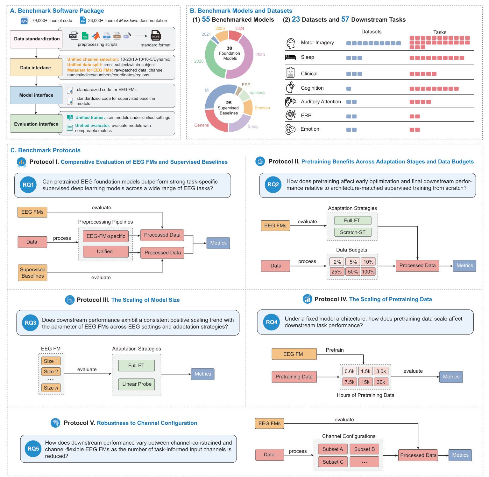
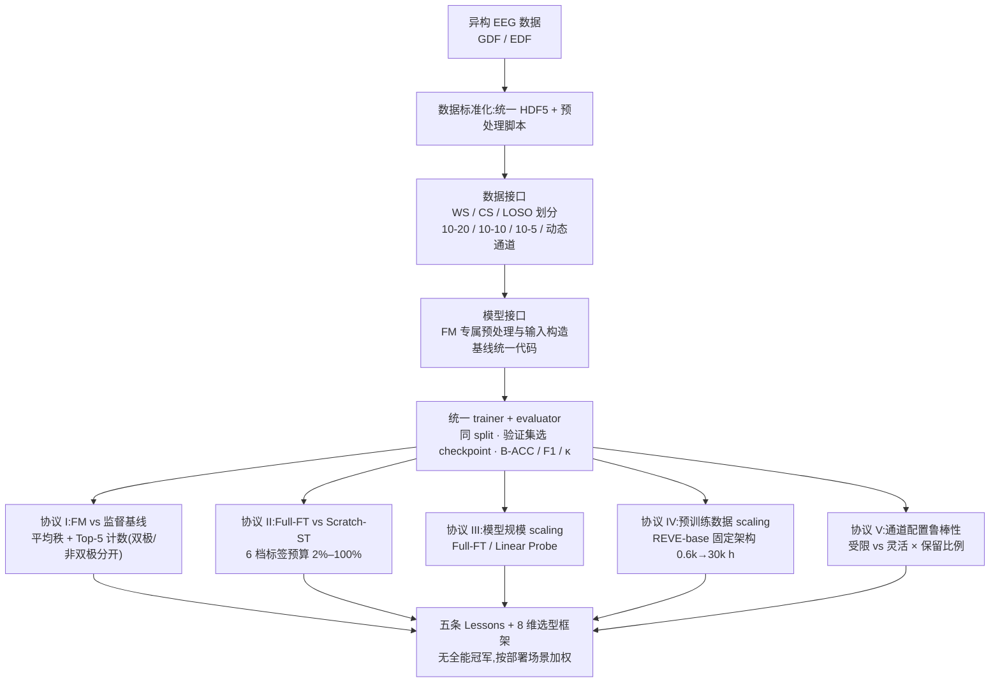

# Benchmarking EEG Foundation Models at Scale: Lessons from 20,000 Evaluations

> **arXiv 2026**(cs.LG 预印本 v1,2026-09-26,91 页)· 香港理工大学数据科学与 AI 系 + 利物浦大学 + 西交利物浦大学(通讯 Jibin Wu,Kay Chen Tan 参与)——站内**第一篇「基准评测」类笔记**,也是对 [comparison.md](../../comparison.md) 既有结论的第一次大规模外部检验:站内十三篇里 BIOT / LaBraM / EEGPT / CBraMod / TFM / NeuroRVQ 都进了同一擂台,「架构 > 规模」「清洗质量 > 堆量」等站内结论在这里被逐条对账。

**作者**:Zhige Chen、Shu Peng、Chengxuan Qin(三人共同一作)、Rui Liu、Rui Yang、Kay Chen Tan、Jibin Wu(通讯,港理工)

!!! abstract "TL;DR"
    - 规模:30 个 FM 变体(20 个家族,BIOT/LUNA/ST-EEGFormer/SleepFM 各 3 个变体)+ 25 个监督基线(含传统方法 YASA)× 23 数据集 / 57 任务 / 7 范式,五协议共 20,000+ 次评测;开源 79,000 行代码 + 23,000 行文档 + 在线排行榜(eeg.fm)
    - 总排名:**FM 在多数任务上压过强监督基线,非双极导联设定下优势最大**——平均秩榜前四全是 FM(REVE-base / ST-EEGFormer-small / LEAD / HEAR-large),第一个基线 U-Sleep 约第 9;双极设定下 BIOT 三个变体包揽前三
    - 监督反超的两种场景:跨被试 TUEV 全线塌方(基线 TMSA-Net 49.95 第一,FM 最高仅 39.87);HGD Task3 WS 被 2017 年的 ShallowConvNet 拿走第一(96.01 vs EEGPT 95.93)
    - 最反直觉的 lesson:**预训练红利随下游标签增多而变大**——末轮增益从 2% 预算的 +0.4% 涨到 100% 预算的 +8.2%,与「小样本才需要预训练」的直觉相反;8/10 模型第 1 个 epoch 就有正增益(优化启动优势)
    - scaling 判决:参数量与下游性能**无一致正相关**(REVE-base 69M 打过 REVE-large 408M、ST-EEGFormer-small 32.7M 打过 328M 版);但固定架构下预训练数据 0.6k→30k 小时带来 Full-FT +6.69pp(被试内)/ +4.22pp(跨被试)的持续增益——数据才是 scaling 轴
    - 需要打折的地方:全文无显著性检验;平均秩的有效模型集合逐任务不同(SleepEEGNet 的 Top-5 榜首部分是覆盖面红利);协议 II/IV 只覆盖 10 个模型、1 个架构;channel-flexible 结论与「最新代际 + 最大预训练数据」混淆未拆

## 1 问题定位:给 EEG FM 补一场有强对手的擂台赛

论文的出发点是既有基准的结构性缺陷(Table 1 清点了 11 个同类基准):监督基线普遍缺席或偏弱(EEG-FM-Bench、EEG-Bench 为 0,最多的 NeuralBench 也只有 8 个),且 FM 之间的排名把架构、参数量、预训练数据混在一起,赢了也说不清赢在哪。最终精度一个数字,还回答不了「预训练到底带来了什么」。EEG-Arena 的答案是把问题拆成五个 RQ:FM 对强基线(RQ1)、预训练收益及其随标签量的变化(RQ2)、参数量 scaling(RQ3)、预训练数据 scaling(RQ4)、通道配置鲁棒性(RQ5)——前一个靠大覆盖面横评,后四个靠受控对照实验,这是它区别于纯排行榜的地方。

## 2 基准设计

### 2.1 规模与模型口径

55 个模型 = 30 个 FM 变体 + 25 个基线(24 个 DL + YASA 谱方法);入选标准是开源可得、引用量、社区认可度。注意「30」是**变体口径**:20 个家族里 BIOT、LUNA、ST-EEGFormer、SleepFM 各 3 个变体、HEAR/REVE 各 2 个。57 个任务覆盖 7 范式(MI / Sleep / Clinical / Cognitive / AAD / ERP / Emotion;Table 4 逐任务给全定义,窗口 0.85–30 s、通道 2–144);有可靠被试元数据的任务同时报 WS(被试内)与 CS(跨被试)。

### 2.2 统一管线:统一什么、保留什么

软件包统一三件事:**数据**标准化为 HDF5(GDF/EDF 摄入,统一 split 与 10-20/10-10/10-5/动态通道选择);**模型**接口统一初始化与任务头配置,但**保留 FM 专属预处理与输入构造**(Table 7:21 套预处理并存——CBraMod 0.3–75 Hz + notch 60 + ÷100 µV,REVE session 级 z-score ±15σ 裁剪,而监督基线统一 0.1–75 Hz + notch 50 + 通道级 z-score);**训练/评估**统一(同一 split、按验证集选 checkpoint、统一优化设置)。两条排除规则很关键:预训练数据与下游数据直接重叠的结果被剔除出总排名(红 E 徽章),通道数/输入长度/格式不兼容的组合标记 unsupported 不进排名。

### 2.3 统计方法

三指标(二分类 balanced accuracy、多分类 macro-F1、Cohen's κ),对每个模型在每个任务上取三个指标名次的均值再对任务平均:

\[
\bar{r}_m = \frac{1}{|T_m|} \sum_{t \in T_m} \mathrm{rank}_t\!\left( \frac{r^{\mathrm{BA}}_{m,t} + r^{\mathrm{F1}}_{m,t} + r^{\kappa}_{m,t}}{3} \right)
\]

另有 Top-5 计数(进入任务前五的次数);双极 / 非双极设定分开排名。协议 II 的预训练增益定义为同架构 Full-FT 与随机初始化 Scratch-ST 的差:\( \bar{G}_m(d) = \bar{s}_m(d, \mathrm{Full\text{-}FT}) - \bar{s}_m(d, \mathrm{Scratch\text{-}ST}) \),在 6 档标签预算 {2%, 5%, 10%, 25%, 50%, 100%} 下配对比较。协议 IV 另用参数位移 \( P_{s,t} = \|\theta^{\mathrm{post}}_{s,t} - \theta^{\mathrm{pre}}_s\|_2 / \|\theta^{\mathrm{pre}}_s\|_2 \) 与逐层 1−CKA 度量微调改变了什么。

## 3 核心发现

### 3.1 总排名:领先是真实的,但分设定

| 平均秩榜单 | 前列(全为 FM) | 第一个监督基线 |
|---|---|---|
| 非双极 | REVE-base → ST-EEGFormer-small → LEAD → HEAR-large | U-Sleep(约第 9) |
| 双极 | BIOT six-datasets → BIOT shhs-prest → BIOT prest-16ch | SleepEEGNet(约第 8,Top-5 计数第一但系覆盖任务更多所致) |

具体任务上更直观:TUEV Task1 WS(双极)前三全是 FM——ST-EEGFormer-small 92.62、Uni-DMFM-base 92.21、ST-EEGFormer-base 91.55,CBraMod 88.13,最强的通用基线 BiDANN 仅 76.47;CAP-Sleep Task1 WS 由 BIOT 三变体包揽(75.82 / 75.72 / 74.91),最好基线 SleepEEGNet 73.97。BIOT 通道受限,非双极任务整列缺席(unsupported)。

### 3.2 监督基线反超的两种场景

| 场景 | 结果 | 解读 |
|---|---|---|
| TUEV Task1 CS(4 类事件) | 基线 TMSA-Net 49.95 第一;FM 最高仅 39.87 | 跨被试设定全体塌方,WS→CS 的落差比 FM vs 基线的差距更大 |
| HGD Task3 WS(二分类 MI) | ShallowConvNet(2017)96.01 第一,EEGPT 95.93 第二 | 二分类大方差任务,经典 CNN 仍能赢 |
| MigraineDB 系列(9 任务) | BIOT / EEGPT / LUNA-large 等多个 100.00 并列 | 天花板效应,排名无意义 |

反超的共性:CS 塌方与任务饱和都不是「基线更强」而是「协议暴露弱点」——FM 的优势在 WS、在非双极、在难任务上兑现,论文对此没有回避。

### 3.3 预训练收益:随标签变多而变大,数据 scaling 持续有效

协议 II(10 个 FM 架构配对对照)的均值曲线:末轮增益随标签预算从 **+0.4%(2%)单调涨到 +8.2%(100%)**,预算 ≥25% 后 10/10 模型为正;首轮增益 8/10 为正。协议 IV(固定 REVE-base 架构与目标函数,只动预训练数据 0.6k→30k 小时):

| 0.6k→30k h | Full-FT | Linear Probe |
|---|---|---|
| 被试内(WS) | +6.69 pp | +5.97 pp |
| 跨被试(CS) | +4.22 pp | +1.89 pp |

机制侧写最有信息量:预训练数据越多,Full-FT 的参数位移越小(约 0.12→0.03)而输出层表征变化(1−CKA,0.7→0.9+)越大;逐层看,小数据预训练的适配集中在最后几层,15k–30k h 后**中间层**表征也开始重组、早期层保持稳定——大数据预训练学到的是「可以被下游高效重组」的表征。

### 3.4 参数不 scaling,通道灵活者占优

协议 III:30 个 FM 变体横截面上参数量(1–600M,log 轴)与平均性能无单调关系——REVE-base(69M)> REVE-large(408M),ST-EEGFormer-small(32.7M)> 其 base(110.9M)/ large(328.4M)版。论文自己声明这是观察性结论,架构/数据/训练策略全部混淆,不能归因于参数本身。协议 V:10 个 FM(6 通道受限:CBraMod / CodeBrain / CSBrain / EEGPT / NeuroRVQ / ST-EEGFormer-small;4 通道灵活:REVE-base / HEAR×2 / LEAD)按任务相关电极子集逐步减通道,通道灵活组在**所有**保留比例下绝对性能都更高。

## 4 论文自述的 Lessons(摘要五条 + 我们的评估)

1. **FM 在多数任务上胜过强监督基线,非双极设定下优势最大**——成立,但论文同时承认对双极特化模型(如 BIOT)跨设定比较会低估前者,双极榜 BIOT 横扫就是注脚;
2. **预训练改善早期优化与最终性能,且标签越多增益越大越稳**——本篇最反直觉也最扎实的一条(架构配对 + 6 档预算),直接推翻「预训练是小样本技巧」的流行叙事;小样本下 FM 的优势主要是优化稳定性(基线大量 50.00 坍缩),红利兑现要等标签;
3. **参数量与性能无一致正相关**——方向上支持站内「架构 > 规模」;但它是跨家族观察,不是受控结论,REVE-base 赢 REVE-large 也可能只是大数据小模型的常规剧本;
4. **固定架构下预训练数据 scaling 持续有效**——全文含金量最高的受控实验:0.6k→30k h 无平台,配 CKS/位移分析给出了「为什么」;论文据此把「扩充预训练数据」点名为下一步最有希望的方向;
5. **通道灵活模型绝对性能更高**——成立但混淆未拆:REVE/HEAR/LEAD 恰好是最新、预训练数据最大的模型,通道灵活性与数据规模两个变量纠缠在一起;
6. 隐含的第六条(Section 4):**没有全能冠军**——论文拒绝给出单一排名,改为 8 维度(任务性能 ×2、预训练有效性 ×3、覆盖与效率 ×3)+ 用户自定义权重 \( U_m(w) = \sum_j w_j z_{m,j} \) 的雷达图选型框架:REVE-base 强在排名与低标注、HEAR-large 强在微调增益、CBraMod 强在覆盖与吞吐、LEAD 强在参数效率。

## 架构图

*Figure 1 · (A) 软件包:数据标准化(HDF5)→ 数据 / 模型 / 评估三接口,统一 trainer + evaluator,79,000+ 行代码;(B) 30 FM + 25 基线(2021–2026)与 7 范式 57 任务;(C) 协议 I 大横评、II 预训练收益 × 6 档标签预算、III 模型规模、IV 预训练数据 0.6k–30k h、V 通道子集鲁棒性*

## 流程

## 与其他论文的关系

| 论文 / 站内结论 | 本篇的外部检验 |
|---|---|
| [BIOT](../2026-09/0918-biot.md) | 翻案:站内批评其线性注意力牺牲细粒度,但在双极设定下 BIOT 是全场最强 FM(双极平均秩前三,CAP-Sleep 前三包揽);代价是非双极任务整列缺席——「通道受限换设定内最强」的定位被坐实 |
| [CBraMod](../2026-09/0928-cbramod.md) | 证实:非双极 Top-5 计数第 4(仅次于 REVE-base / Uni-DMFM / NeuroRVQ)、双极平均秩榜第 15,TUEV WS 88.13 压 LaBraM-base 69.29——站内「4M 架构 > 规模」的证据链在第三方管线里方向一致 |
| [LaBraM](../2026-09/0918-labram.md) | 落差:非双极榜约 29/47、TUEV 69.29;仅 base 版入榜(Huge 权重未开源,与站内笔记记录的坑一致),排名下滑有协议与版本两重原因 |
| [EEGPT](../2026-09/0918-eegpt.md) | 平庸:非双极榜约 32/47、双极榜中游;其「任务依赖带通 + 统一 mV」的专属预处理(Table 7)在统一管线下没有换来优势 |
| [TFM-Tokenizer](../2026-09/0918-tfm-tokenizer.md) | 警示:TFM-CHBMIT 变体双极约 26 位、非双极约 39 位——只在 CHB-MIT 上预训练的词表不外推,tokenization 精巧 ≠ 通用;站内 4.5 分评的是机制贡献,泛化项要补扣 |
| [NeuroLM](../2026-09/0918-neurolm.md) / [BrainGPT](../2026-09/0918-braingpt.md) | 缺席:两个最大参数路线(1.7B / 1.09B)都没进擂台,站内战绩表暂无外部对照可引 |
| [NeuroRVQ](1104-neurorvq.md) | 高方差:非双极 Top-5 计数第 3,却在 CAP-Sleep 9.19 / TUEV 14.55 崩盘——「有的任务冠军、有的任务随机水平」的典型画像 |
| 数据专题「1000h 后边际递减」 | 正面冲突:该结论来自 TUEG 系自证,本篇受控实验 0.6k→30k h 全程上行无平台,是目前对「递减论」最强的外部反例 |

## 个人思考

- **20,000 次评测的统计功效来自配对结构,而非显著性检验**。功效的真正来源是三重配对:同 split 同 checkpoint 规则、同架构 Full-FT vs Scratch-ST、三指标名次取均值后对几十个任务聚合——把单次评测的噪声在任务维度上平均掉。但全文没有任何显著性检验或置信区间,平均秩的「有效模型集合」逐任务不同(双极榜 40 个、非双极榜 47 个),覆盖面广的模型天然多拿名次,论文承认 SleepEEGNet 的 Top-5 第一属于此类。读这篇的姿态应该是「模式可信、单点名次存疑」;
- **统一管线刻意保留了一个不统一:预处理**。这是全场最微妙的设计决定——FM 保留各自的带通/notch/归一化/窗长(0.85–30 s 跨度),意味着 FM vs 基线的差距里永远混着「输入表征选择」这个隐藏变量,反过来 FM 被自家接口锁死的部分(unsupported 标记)又让它少跑了整个非双极侧。EEG-Arena 量化的是「自带预处理的完整权重」的 FM,不是「表征本身」的 FM;Protocol I 榜单上的差距,有一部分应该记在预处理工程的账上;
- **对站内 LaBraM / EEGPT / CBraMod / BIOT 结论的冲击是分化而非通杀**:BIOT 在其设计域内被追认为最强 FM(站内评分偏低了它在本域的价值);CBraMod 的领先方向被外部复现;LaBraM 的 base 版与 EEGPT 双双平庸化——2024 世代(掩码重构 + 通道受限)在 2026 的强基线面前整体失色,而 2025–2026 的 REVE / HEAR / LEAD / ST-EEGFormer 包揽非双极前列,代际差主要落在「通道灵活性 + 预训练数据规模」两个轴上。站内 [comparison.md](../../comparison.md) 的 TUEV/TUAB 战绩表今后引用时要加一句:自报数字,EEG-Arena 已提供统一口径的替代参照;
- **「数据是 scaling 轴」的判决要和站内的「边际递减」论放在一起读**。站内数据专题的递减结论出自 TUEG 系清洗语料的自我对比(数据质量与域距离混在其中),而协议 IV 是干净的单变量实验——唯一的漏洞是它只做了 REVE-base 一个架构、一个目标函数,30k h 恰约等于 REVE 原始配方,「递减论错了」还太早,更稳的表述是:清洗带来的递减没有挡住数据量的持续收益,两件事可以同时为真。

## 自问自答

??? question "Q1 · 一次「评测」到底指什么?20,000 怎么凑出来的?"

    一次评测 = 1 个模型变体 × 1 个任务 × 1 种设定(WS 或 CS)× 1 种协议条件的完整训练+测试。粗算:协议 I 约 55 模型 × 57 任务 × 2 设定(扣掉 unsupported 与泄漏剔除)+ 协议 II 的 10 模型 × 6 预算 × 2 策略 + 协议 III 的双适配策略 + 协议 IV 的 6 尺度 × 2 策略 × 2 设定 + 协议 V 的 10 模型 × 多个子集。论文没给分解表,无法核对精确构成——引用「20,000」时应表述为「训练+评估运行次数」,不是 20,000 个独立数据集。

??? question "Q2 · 平均秩对谁有利?Top-5 计数为什么不能单独看?"

    秩是在「该任务的有效模型集合」里排的,集合随任务变化:SleepEEGNet 只参加睡眠类任务却拿下双极 Top-5 计数第一,论文自己承认部分原因是它参评的双极任务更多。平均秩同样受覆盖面影响——参评任务少的模型方差大、运气好就能冲高。两个指标要一起看,且优先看同覆盖家族内的比较(如 BIOT 三个变体之间、REVE base/large 之间)。

??? question "Q3 · 通道灵活模型更高,这个结论能直接采信吗?"

    方向上可信(所有保留比例、所有任务聚合后方向一致,不是单点),归因上要打折:四个灵活模型(REVE/HEAR/LEAD)同时是 2025 代际、预训练数据最大的模型,协议 V 没有控制「同一模型去掉电极编码后还剩多少优势」。真正干净的检验是拿 REVE 加/去电极位置编码做消融——本篇没做。对站内的含义:LUNA(灵活但排名中游)说明灵活性不是充分条件,只是有利条件。

??? question "Q4 · 协议 IV 的 30k 小时终点是不是就是 REVE 的原始配方?"

    正文未明说。REVE 原论文预训练规模为约 25,000 名受试者,量级与 30,000 h 相当,30k 点很可能逼近其原生配方(即「再加数据会怎样」仍未回答)。此外六档尺度只有 0.6k–30k,跨度内最陡的增益出现在哪一段正文也没给数值——复现该实验前这两点都要去代码库核对。

!!! abstract "复现速查卡"
    - **代码**:eeg.fm/benchmarks(平台)与 eeg.fm/leaderboards(排行榜);79,000+ 行代码、23,000+ 行文档,数据统一 HDF5,接受 GDF/EDF
    - **协议 I**:三指标 = B-ACC(二分类)/ macro-F1(多分类)/ Cohen's κ;平均秩 + Top-5;双极、非双极分开;验证集选 checkpoint;预训练数据重叠任务剔除(红 E)、不兼容组合标 unsupported
    - **协议 II**:Full-FT vs 同架构 Scratch-ST;预算 {2, 5, 10, 25, 50, 100}%;验证/测试集固定、只子采样训练集;10 个 FM
    - **协议 IV**:REVE-base(69M)固定架构与优化,预训练数据 {0.6k, 1.5k, 3k, 7.5k, 15k, 30k} h;Full-FT + Linear Probe × WS/CS;度量 = 参数位移 + 逐层 1−CKA
    - **协议 V**:6 受限(CBraMod/CodeBrain/CSBrain/EEGPT/NeuroRVQ/ST-small)vs 4 灵活(REVE-base/HEAR-base/HEAR-large/LEAD);保留比例 ρ = 缩减通道数/全通道数
    - **关键数字**:非双极前四 REVE-base / ST-small / LEAD / HEAR-large;末轮增益 0.4%→8.2%;+6.69pp(WS)/+4.22pp(CS);REVE-base 69M > REVE-large 408M

---

**相关阅读**

:material-sword-cross: [CBraMod(「架构>规模」证据链在本榜被外部复现)](../2026-09/0928-cbramod.md) ｜ :material-shield-search: [BIOT(双极设定内被追认为最强 FM)](../2026-09/0918-biot.md) ｜ :material-tag-multiple: [TFM-Tokenizer(泛化项被本榜扣分的警示)](../2026-09/0918-tfm-tokenizer.md) ｜ :material-puzzle: [NeuroRVQ(同批笔记:高方差画像与本榜一致)](1104-neurorvq.md) ｜ :material-home: [首页](../../index.md)
