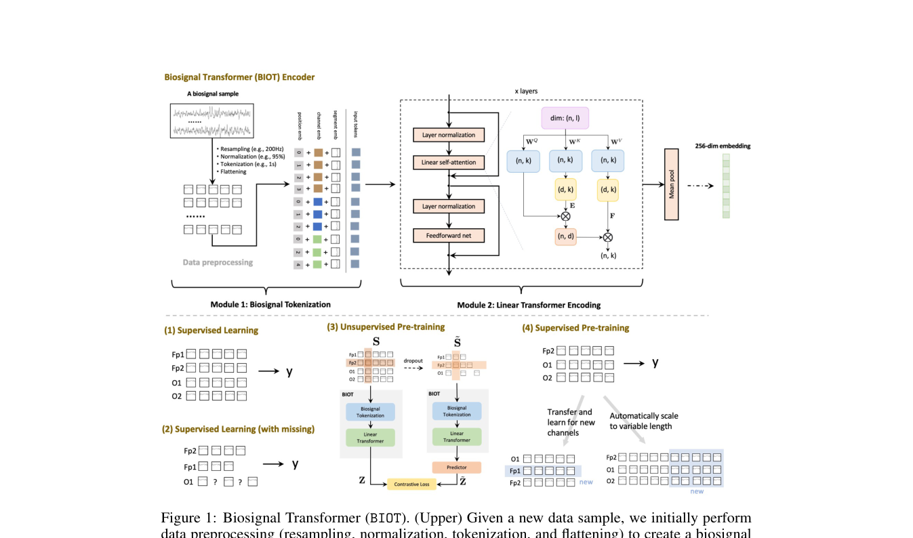
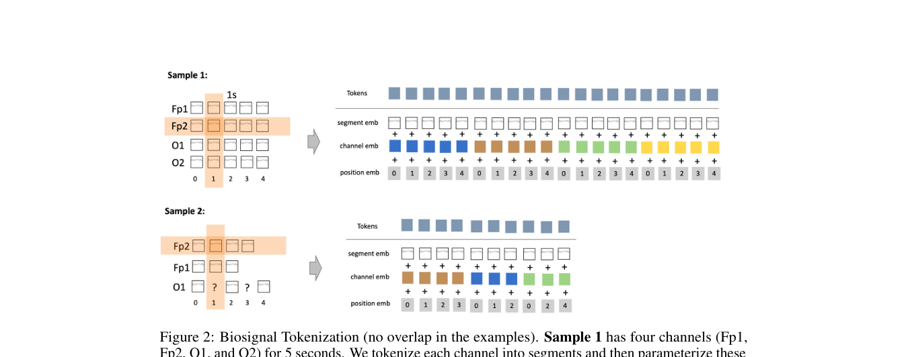

# BIOT: Cross-data Biosignal Learning in the Wild

> **NeurIPS 2023**

BIOT: Cross-data Biosignal Learning in the Wild (NeurIPS 2023)

**作者**：Chaoqi Yang, M. Brandon Westover, Jimeng Sun（UIUC / Harvard / BIDMC）

#### 1.1 问题定位

现实中的生物信号格式高度异构：采样率不同、通道分布不匹配、时长不一、存在缺失。现有模型只针对单一固定格式，换数据集则失效。BIOT 是第一个能处理各种格式生物信号的统一编码模型。

#### 1.2 方法

整体由两个模块级联：**生物信号 Tokenizer** + **线性 Transformer 编码器**。

**1. 生物信号 Tokenizer**

1. **重采样**：线性插值统一到同一采样率 r（EEG 用 200Hz），依据采样定理（EEG 感兴趣最高频率约 100Hz）；
2. **归一化**：每个通道除以自身绝对幅值的 95 分位数 \( S[i] \,/\, |S[i]|_{95\%} \)，消除通道/数据集间的单位和幅度差异；
3. **逐通道 Tokenization**：每个通道**独立**切成 t 秒（1s）的 token，相邻 token 可重叠 p 秒（0.5s）；**缺失段的 token 直接丢弃**。逐通道独立切分是与以往"所有通道拼一起切"的关键区别——通道缺失/不匹配也能处理；
4. **Flattening**：所有通道的 token 按顺序展平成一条统一的"biosignal sentence"。

**Token embedding（三部分相加）**：

- **Segment embedding（频谱）**：对每个 token 段做 FFT，提取所有频带的能量向量，过一个全连接网络（FCN）得到；

- **Channel embedding（空间）**：可学习的通道 embedding 表，标记 token 来自哪个通道；

- **Positional embedding（时间）**：通道内 token 顺序用正弦/余弦**相对**位置编码， position针对的是token位置的position 而不是原始序列时间点的的position。

最终"句子"为 \( X \in \mathbb{R}^{N \times l} \)。

**2. 线性 Transformer**

其线性注意力的核心公式（Linformer 式低秩投影）：

$$
\mathbf{H} = \mathrm{softmax}\left( \frac{(\mathbf{X}\mathbf{W}_Q)(\mathbf{E}\mathbf{X}\mathbf{W}_K)^{\top}}{\sqrt{k}} \right)(\mathbf{F}\mathbf{X}\mathbf{W}_V)
$$

其中设输入序列 \(\mathbf{X}\in\mathbb{R}^{N\times D}\)，投影矩阵 \(\mathbf{W}_Q,\mathbf{W}_K\in\mathbb{R}^{D\times d_k}\)，\(\mathbf{W}_V\in\mathbb{R}^{D\times d_v}\)，压缩矩阵 \(\mathbf{E},\mathbf{F}\in\mathbb{R}^{d\times N}\)，且 \(d\ll N\)。则各中间量的形状为：

$$
\begin{aligned}
\mathbf{Q} &= \mathbf{X}\mathbf{W}_Q &&\in \mathbb{R}^{N\times d_k},\\
\mathbf{K}' &= \mathbf{E}\mathbf{X}\mathbf{W}_K &&\in \mathbb{R}^{d\times d_k},\\
\mathbf{V}' &= \mathbf{F}\mathbf{X}\mathbf{W}_V &&\in \mathbb{R}^{d\times d_v},\\
\mathbf{A} &= \mathrm{softmax}\left(\frac{\mathbf{Q}\mathbf{K}'^{\top}}{\sqrt{k}}\right) &&\in \mathbb{R}^{N\times d},\\
\mathbf{H} &= \mathbf{A}\mathbf{V}' &&\in \mathbb{R}^{N\times d_v}.
\end{aligned}
$$

因此注意力图由 \(N\times N\) 压缩为 \(N\times d\)，计算复杂度由 \(O(N^2)\) 降为 \(O(Nd)\)。

- 多通道长信号句子很长（64 通道 × 20s = 1280 tokens），标准注意力 O(N²) 不可行；
- 采用 **Linformer 式低秩线性注意力**：引入两个可学习的低秩压缩矩阵 \( E \in \mathbb{R}^{d \times N} \)、\( F \in \mathbb{R}^{d \times N} \)（\( d \ll N \)，论文原文记作 \( E^{\top} \in \mathbb{R}^{N \times d} \)），注意力图从 N×N 压缩到 N×d，时间/空间复杂度对 N 均为线性 `O(Nkd)`；
- 每个模块 = 一层线性自注意力 + FCN，组件前加 LayerNorm、残差、dropout（pre-norm）；
- 默认配置：4 层、8 头；句子级表示用 **mean pooling**（试过 [CLS] token，略差）；
- 分类头：ELU + 线性层。

**无监督预训练（对比学习）**

- 随机 dropout 部分通道 + 从剩余通道 dropout 部分 token，得到扰动信号 S̃；
- 同一 BIOT 编码器分别编码 S 和 S̃；S̃ 侧接两层 predictor：\( Z = \mathrm{BIOT}(S) \)，\( \tilde{Z} = \mathrm{predictor}(\mathrm{BIOT}(\tilde{S})) \)；
- 对比损失让扰动版预测原信号 embedding。

## 架构图

*Figure 1 · BIOT 整体架构：Module 1 生物信号 tokenization + Module 2 线性 Transformer 编码*

*Figure 2 · Tokenization 细节：逐通道切段后用 segment/channel/position 三类 embedding 参数化*

#### 1.3 创新点

1. **首个**能处理通道不匹配、长度可变、数据缺失的统一生物信号编码模型；
2. **逐通道独立 tokenization**——异构数据通吃的核心设计（缺失通道/短通道直接丢 token 即可）；
3. **线性注意力 Transformer** 解决多通道长句子的二次复杂度问题（低秩 E/F 投影，注意力图 N×N → N×d）；
4. 频率信息以 FFT 能量特征形式进入 segment embedding——证明频域特征对 CHB-MIT、IIIC 与可穿戴 HAR 任务尤其有用；

---

**相关阅读**

:material-arrow-left: [上一篇：TFM-Tokenizer](tfm-tokenizer.md) ｜ :material-arrow-right: [下一篇：LaBraM](labram.md) ｜ :material-vector-link: [Tokenization 演进](../topics/tokenization.md) ｜ :material-chart-box: [十四篇方法对比](../comparison.md)
