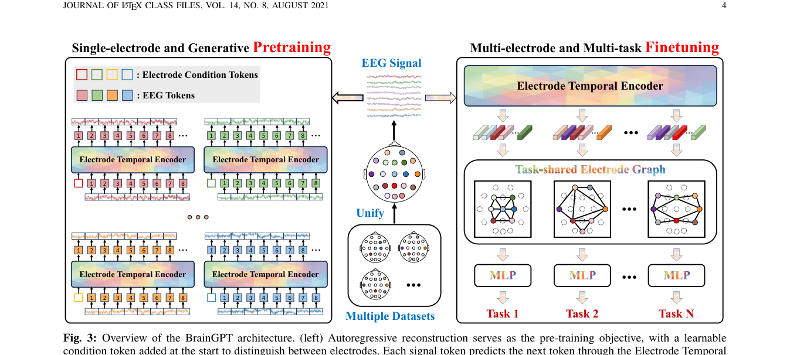

# BrainGPT: Unleashing the Potential of EEG Generalist Foundation Model by Autoregressive Pre-training

> **arXiv 2024**

BrainGPT：自回归 EEG 通用模型 (arXiv 2024)

**作者**：Tongtian Yue 等（中科院自动化所）

#### 4.1 问题定位

现有 EEG 基础模型三大局限：① 数据格式异构难以统一；② 普遍采用 MAE 式双向掩码重构，忽视 EEG 的时序依赖/因果结构；③ 任务特定微调导致 specialist 模型，无多任务协同。BrainGPT 定位为**第一个 generalist EEG 基础模型**，核心是用**自回归（下一 token 预测）替代掩码重构**。

#### 4.2 方法

**（a）电极级建模策略（Electrode-wise Modeling）**

- 多电极 EEG 先切成 T 个 1 秒区间，每区间 D 个均匀采样点；再**把每个电极的时间序列拆成独立训练样本** \( x_i^e \in \mathbb{R}^{T \times D} \)——天然适配任意电极数/组合；
- **电极词表** \( \mathcal{V} \in \mathbb{R}^{E \times D} \)：覆盖预训练中出现的全部 E 个电极，每个电极一个可学习 embedding，作为 **条件 token** 拼在序列最前面，告诉模型信号来自哪个电极；
- 预训练集：3750 万个单电极样本，约 10 亿 tokens。

**（b）自回归预训练（ETE: Electrode Temporal Encoder）**

- 所有电极**共享**一个 GPT 式因果 Transformer：多头**因果**注意力（causal mask，只看过去）+ Swish 门控前馈网络（公式见下）；
- 轻量 MLP 预测下一个 token（**连续原始信号值**，不做 VQ 离散化）；
- 损失：预测的下一 token 与真实值之间的 ρ 距离（默认 **MSE**），公式见下；
- 意义：首个自回归 EEG 模型，直接建模「过去神经活动影响未来状态」的时序结构。

Swish 门控前馈（SwiGLU 形式）：

\[ \mathrm{FFN}(x) = W_{\text{down}} \left( \mathrm{Swish}(W_{\text{gate}}\, x) \odot (W_{\text{up}}\, x) \right) \]

自回归下一 token 预测损失：

\[ \mathcal{L}(\theta) = \frac{1}{T} \sum_{t=1}^{T} \rho \left( x_i^e[t] - \mathrm{ETE}(x_i^e[\leq t]) \right) \]

**（c）多任务迁移学习（TEG: Task-shared Electrode Graph）**

- ETE **冻结**，只作特征提取骨干；
- 每个样本的每条电极序列末尾追加一个可学习 special token c（利用因果注意力把整条序列信息汇聚到该位置），取出该位置输出作为电极表示 \( z_j \in \mathbb{R}^{E_j \times D} \)；
- **全局电极图**：节点 = 预训练中所有 E 个电极（可学习向量），全连接图 \( \mathcal{G} \in \mathbb{R}^{E \times D} \)；每个样本只激活其电极对应的子图 \( G_j \)（indicator 矩阵 \( I_{G_j} \) + \( diag(z_j) \) ）；
- **图注意力机制**（GAT）计算节点相关性（注意力系数公式见下），masking 系数 \( \beta_{mn} \)（同子图=1，否则 0）保证交互只发生在激活子图内，K 层堆叠 + 残差 + pre-norm；
- 同一 batch 内不同数据集/任务通过构造各自的 β mask 矩阵统一训练；
- 图网络池化节点表示 → 任务专属头（分类或回归）。

GAT 注意力系数（‖ 表示向量拼接）：

\[ \alpha_{mn} = \mathrm{ReLU} \left( \mathbf{a}^{\top} \big[ W h_m \,\Vert\, W h_n \big] \right) \]

**模型规格**：Base 1.46M / Large 11.29M / Huge 183.8M / **Giant 1.09B**（EEG 领域当时最大）。

#### 4.3 创新点

1. **电极级建模**：单电极信号为基本样本 + 电极条件 prefix token，支持最多 138 个电极及任意组合（覆盖面最大）；
2. **首个自回归 EEG 基础模型**：从「双向掩码补全」转向「因果下一 token 预测」，更贴合 EEG 的时序本质（消融：同架构同损失下 AR 比 MAE 平均高 2%+）；
3. **首次验证 EEG 预训练的 scaling law**（模型规模 4 个数量级 + 数据量 0~1B token 均正相关）；
4. **任务共享图网络（TEG）实现多任务兼容与协同**：首个证实多任务联合训练优于逐任务单独训练（joint 比 separate 在 5 个任务上全部提升，MW +3.9%）；
5. 渐进式时空解耦：ETE 管时间（预训练）→ TEG 管空间（下游）。

## 架构图

*Fig. 3 · 总体架构：左=单电极自回归预训练（ETE），右=多电极多任务微调（TEG 图网络）*

---

**相关阅读**

:material-arrow-left: [上一篇：EEGPT](eegpt.md) ｜ :material-arrow-right: [下一篇：NeuroLM](neurolm.md) ｜ :material-vector-link: [Tokenization 演进](../topics/tokenization.md) ｜ :material-chart-box: [十四篇方法对比](../comparison.md)
