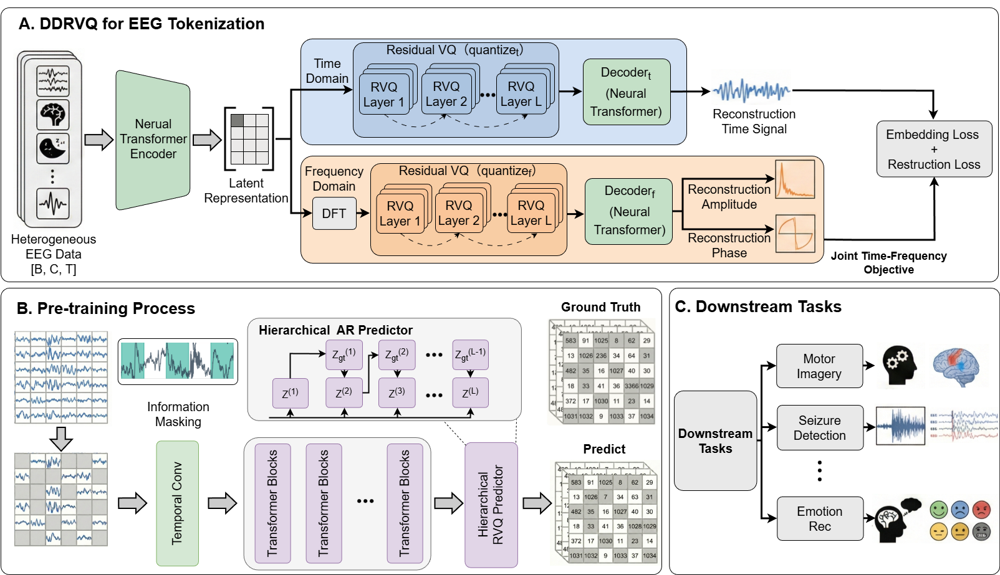

# BrainRVQ: A High-Fidelity EEG Foundation Model via Dual-Domain Residual Quantization and Hierarchical Autoregression

> **arXiv 2026**

**作者**:Mingzhe Cui, Tao Chen*, Yang Jiao, Yiqin Wang, Lei Xie, Yi Pan, Luca Mainardi(浙江大学;Yang Jiao、Yi Pan 来自中科院深圳先进院;Luca Mainardi、Tao Chen 挂米兰理工;通讯作者 Tao Chen,chentao98@zju.edu.cn)

## 1 问题定位:单域量化的信息损失与扁平码本的容量天花板

论文把现有 EEG 基础模型的表征保真度问题归为三条,每条都指向 tokenization 而不是骨干:

1. **单域 tokenization**:时域 tokenizer(如 LaBraM 的时域 VQ)擅长抓棘波这类瞬态事件,但丢全局谱模式;频域方法反之。单一视角的量化天然丢掉时频耦合信息;
2. **扁平量化容量不足**:单层 VQ 是硬容量天花板,容易码本坍缩;RVQ 在音频领域(SoundStream、EnCodec、AudioLM)已证明级联码本能以递增精度逼近信号——但直接搬到 EEG 有两个障碍:EEG 的层次结构(主导节律 + 细微细节)混着高噪声底,标准的「所有残差码独立等权预测」会让模型把容量浪费在重构背景噪声上;
3. **独立预测丢弃层次先验**:MAE 式掩码建模对每个 token 独立预测,第 1 层码捕捉的全局模式无法约束第 2、3 层的细化预测。

三条诊断对应的药方就是标题三件套:双域 RVQ(DD-RVQ)tokenizer、层次自回归预训练目标、重要性引导课程掩码。逻辑自洽,第 3 节的消融会回头检验每味药的实际疗效。

## 2 方法

### 2.1 总览:三阶段流水线

输入 \( X \in \mathbb{R}^{C \times T} \) 按通道切 1 s 非重叠 patch(\( P = 200 \),200 Hz),30 s 样本得到 19 × 30 = 570 个 patch。流程:DD-RVQ tokenizer 把每个 patch 量化成 2 域 × 3 层 = 6 个离散码 → 重要性引导课程掩码按 50% 比例选 patch 掩掉 → 掩码表征进 12 层 Transformer 编码器,以层次自回归目标逐层重构被掩码的码。下游只用预训练编码器(接池化头微调),token 推理时丢弃。

### 2.2 DD-RVQ:共享编码器、双套码本、双目标重构

对归一化 patch \( \bar{x}_{c,a} \in \mathbb{R}^{P} \),先做 DFT 得到频谱,取幅值 \( A[k] = |X_{freq}[k]| \) 与相位 \( \phi[k] = \arg(X_{freq}[k]) \) 作重构目标。时域 patch 本体过一个**共享 Transformer 编码器**得到统一潜在表示 \( h \in \mathbb{R}^d \)——注意是同一个 \( h \) 分别送进两个并行 RVQ(时域 \( Q_t \)、频域 \( Q_f \)),双域分化发生在码本与解码器层面,不在编码器层面。

RVQ 逐层量化残差:

\[
z_i^{(l)} = \arg\min_{k \in \{1,\dots,K_l\}} \| r^{(l-1)} - v_k^{(l)} \|_2, \qquad r^{(l)} = r^{(l-1)} - v_{z_i^{(l)}}^{(l)}, \qquad r^{(0)} = \tilde{e}
\]

最终量化表示为各层码字之和 \( h_q = \sum_{l=1}^{L} v_{z_i^{(l)}}^{(l)} \)。实现上每个域 \( L = 3 \) 层、每层码本 8192、码字 64 维;编码器输出与码字都做 ℓ2 归一化(单位超球面上算距离,方向学习),码本用 EMA 更新(衰减 0.99)防坍缩。

重构目标共三条(时域一条、频域两条):

\[
\mathcal{L}_{time} = \| \mathrm{Decoder}_t(h_q^{(t)}) - \bar{x}_{c,a} \|_2^2, \qquad \mathcal{L}_{freq} = \| y_A - A \|_2^2 + \| y_\phi - \phi \|_2^2
\]

总损失 = 双域重构 + 逐层逐域 commitment(β=1.0):

\[
\mathcal{L}_{total} = \mathcal{L}_{time} + \mathcal{L}_{freq} + \beta \sum_{d \in \{t,f\}} \sum_{l=1}^{L} \| \mathrm{sg}[r_d^{(l-1)}] - v_d^{(l)} \|_2^2
\]

### 2.3 层次自回归预训练:层间 teacher forcing

标准 MAE 式目标对每个 token 的各层码独立预测(式 8)。本文把位置 \( i \) 上所有层码的联合分布按层分解:

\[
P(z_i \mid X_{\backslash M}) = \prod_{l=1}^{L} P(z_i^{(l)} \mid z_i^{(1:l-1)}, X_{\backslash M})
\]

实现为共享编码器 \( f_\theta \) + L 个层级专属预测头 \( g_\theta^{(l)} \):预测第 l 层时,把前 l−1 层码的 embedding **累加**进编码器输出作条件:

\[
\hat{z}_i^{(l)} = g_\theta^{(l)}\left( \mathrm{LN}^{(l)}\left( h_i + \sum_{k=1}^{l-1} \mathrm{Embed}^{(k)}(z_i^{(k)}) \right) \right)
\]

直接自回归训练要用模型自己的预测 \( \hat{z}^{(l-1)} \) 条件下一层,误差会沿链累积;于是用 **teacher forcing**——训练时条件于 tokenizer 给出的真值码。总目标按层加权聚合,\( \lambda_l = 2^{-(l-1)} \)(即 λ = 1 / 0.5 / 0.25),粗层错误会沿链传播所以权重高;推理时改为完全自回归:先预测 \( \hat{z}^{(1)} \),取其 embedding 条件第 2 层,逐层迭代。这是 AudioLM/RQ-Transformer 式 coarse-to-fine 生成在 EEG 掩码建模上的移植。

### 2.4 重要性引导课程掩码

均匀随机掩码对事件稀疏、背景占多数的 EEG 是浪费:掩到背景等于做插值作业。本文给每个 patch 打复合信息分:频域两指标——神经频带比(4–30 Hz 功率占比,覆盖 θ/α/β)、伪迹惩罚(<2 Hz 基线漂移与 ≥45 Hz 肌电占比的倒数);时域用 Hjorth 参数(activity 取对数、mobility、complexity)加一个不规则性指标。加权聚合:

\[
S_{c,a} = \alpha_1 \tilde{S}_{neural} + \alpha_2 \tilde{S}_{clean} + \alpha_3 \tilde{S}_{complexity} + \alpha_4 \tilde{S}_{irreg} + \alpha_5 \tilde{S}_{mobility}
\]

权重 \( (\alpha_1,\dots,\alpha_5) = (0.30, 0.25, 0.20, 0.15, 0.10) \),min-max 归一化。课程通过重要性加权采样实现:

\[
\hat{S}_{c,a}(t) = w(t) \cdot S_{c,a} + (1 - w(t)) \cdot U_{c,a}, \qquad U_{c,a} \sim \mathrm{Uniform}(0,1)
\]

\( w(t) \) 从 0.2 线性升到 0.7:早期近似均匀采样保覆盖,后期偏向高信息 patch。采样用 softmax(温度 τ=0.8),掩码率 0.5(消融确认 0.4–0.6 为倒 U 峰值区)。

## 架构图

*Figure 1 · (A) DD-RVQ for EEG Tokenization——异构 EEG 经 Neural Transformer Encoder 得潜在表示,时域支路直接进 RVQ(quantize_t),频域支路经 DFT 进 RVQ(quantize_f),各自 3 层码本级联,Decoder_t 重构波形、Decoder_f 重构幅值与相位,Embedding Loss + 重构损失联合优化(图中右上角的「Restruction Loss」为原文拼写错误);(B) Pre-training Process——Information Masking 选高信息 patch,Temporal Conv → Transformer Blocks → Hierarchical RVQ Predictor 逐层自回归预测 token(Z^(l) 条件于前层);(C) Downstream Tasks——预训练编码器接任务头微调*

---

**相关阅读**

:material-vector-link: [NeuroRVQ(RVQ 分支先行者:多尺度卷积单时域)](neurorvq.md) ｜ :material-vector-circle: [CodeBrain(双域 VQ + Mamba 的最近竞品)](codebrain.md) ｜ :material-tag: [LaBraM(单层 VQ + token 作目标的范式起点)](labram.md) ｜ :material-vector-polyline: [TFM-Tokenizer(token 作输入的可插拔路线)](tfm-tokenizer.md) ｜ :material-compare: [CBraMod(同语料最强基线)](cbramod.md) ｜ :material-routes: [Tokenization 演进](../topics/tokenization.md) ｜ :material-home: [首页](../index.md)
