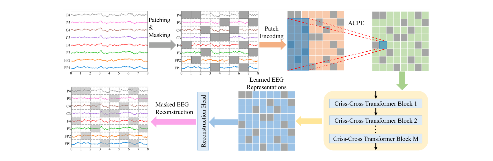
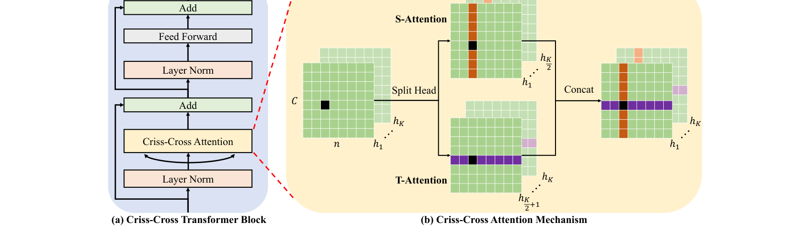

# CBraMod: A Criss-Cross Brain Foundation Model for EEG Decoding

> **ICLR 2025**

**作者**：Jiquan Wang, Sha Zhao\*, Zhiling Luo（阿里）, Yangxuan Zhou, Haiteng Jiang, Shijian Li, Tao Li, Gang Pan\*（浙大大脑机智能重点实验室；\*通讯）

## 1 问题定位：两处「照搬 ViT」的不合身

第一代 EEG 基础模型（BIOT/LaBraM/EEGPT 等）的通用配方是：切段 → 展平 → 全注意力，再用「电极编号 → embedding」编码通道位置。CBraMod 指出这套配方在 EEG 上有两处错配：

**异构的空间-时间依赖**。图像 patch 之间只有空间依赖，而 EEG 是「多通道 × 时间序列」的二维结构：同一通道内相邻时间段、同一时刻相邻通道之间的依赖，强于跨通道跨时间的任意两 patch。全注意力对这 C·n 个 patch 一视同仁地建模，既浪费容量又超出合适的建模范围（19 通道 × 30 秒 = 570 个 patch，已超出全注意力的舒适区）。

**通道变异性**。EEG 通道不只由电极位置决定，还受参考方案影响（耳参考、平均参考、REST、双极纵联）。LaBraM 式的「电极编号 → 绝对位置编码」假设通道和电极位置一一对应，换数据集换参考就崩。

## 2 方法

### 2.1 切段与掩码

EEG 样本 \(S \in \mathbb{R}^{C \times T}\) 按固定时间窗 \(t\) 切成 \(X \in \mathbb{R}^{C \times n \times t}\)（\(n = \lfloor T/t \rfloor\)），每通道 \(n\) 个 patch。按 Bernoulli 比例 \(r\) 随机生成掩码 \(M\)，被掩 patch 替换为全零 mask token（消融显示全零与可学习 token 无显著差异）。

### 2.2 时频双分支 patch 编码

每个 patch 过两条并行支路再相加：

- **时域支路**：3 层 1D 卷积块（Conv + GroupNorm + GELU）提局部波形特征；
- **频域支路**：对 patch 做 rFFT 得到能量向量（每维是一个频率的能量），过全连接层投影到同一维度。

\[ e_{i,j} = e^{t}_{i,j} + e^{f}_{i,j} \]

与 LUNA 的 FFT 幅相支路、TFM 的时频 motif 一脉相承——时频信息补全在 patch embedding 这一层是各家共识，且 CBraMod 的消融（附录 I）给出排序：**时域+频域 > 纯时域 > 纯频域**（频域丢失时域信息掉得更多）。

### 2.3 ACPE：非对称条件位置编码

改造自 CPVT 的 CPE（条件位置编码）：用**1 层 2D depthwise 卷积**从 patch embedding 的时空邻域动态生成位置编码，加回 embedding。非对称性体现在卷积核 (19, 7)——空间维长边编码**长程空间**位置关系，时间维短边编码**短程时间**位置关系，对应「EEG 通道少而时间步多」的结构。

与两类前代的关系：比 APE 强在**动态生成**（不焊死通道-电极对应，换蒙太奇/换参考都适用）；比 CPE 强在**非对称设计**（图像 patch 两个轴对称，EEG 不是）。消融排序：w/o PE < APE < CPE < ACPE。

### 2.4 Criss-Cross Attention：空间/时间两路并行

把 K=8 个注意力头**劈成两半**，4 头管空间、4 头管时间，在同一层并行计算：

- **S-Attention**：把 embedding 按 n 个时刻切成 n 条「空间条带」，每条条带内 C 个通道做注意力——只在**同一时刻的通道间**交互；
- **T-Attention**：同理按 C 个通道切成「时间条带」，条带内 n 个时间段做注意力——只在**同一通道的时间步间**交互。

\[ \mathrm{CrissCrossAttn}(\tilde{E}) = \mathrm{Concat}(\mathrm{head}_1, \dots, \mathrm{head}_K), \quad \mathrm{head}_k = \begin{cases} \text{S-Attention}_k(\tilde{E}) & k \le K/2 \\ \text{T-Attention}_k(\tilde{E}) & k > K/2 \end{cases} \]

backbone 共 12 层（hidden 200 / FF 800 / pre-norm），复杂度 \(O(Cn^2 + nC^2)\)——把全注意力的 \(O(C^2n^2)\) 拆成两个一维注意力的和。附录 L 的头数配比消融：4:4 最优，偏科（6:2 或 2:6）都掉分，说明**空间与时间依赖同等重要**。

### 2.5 掩码重构预训练

FC 重构头从表示还原被掩 patch，MSE 损失**只算被掩位置**（MAE 惯例）。

## 3 预训练流水线

关键数字：清洗环节剔掉了大量脏数据后仍剩 **>9000h**（LaBraM 预训练语料 2,534.78h 的 3.5 倍）；训练配置 AdamW lr 5e-4 / wd 5e-2 / cosine 退火 / batch 128 / 40 epoch，4×RTX A5000 约 5 天。

## 架构图

*Figure 2 · 预训练总览：左上切段+掩码，右上 ACPE 从邻域动态生成位置编码，右下 12 层 criss-cross 块，左下只重构被掩 patch*

*Figure 3 · criss-cross 注意力机制：空间条带（同一时刻跨通道）与时间条带（同一通道跨时刻）两路并行，各占一半注意力头*

---

**相关阅读**

:material-arrow-left: [LaBraM（最主要对照：神经码字 vs 像素重构）](labram.md) ｜ :material-compress: [LUNA（通道线性复杂度的另一极）](luna.md) ｜ :material-sine-wave: [TFM-Tokenizer（ICLR 2026 掩码路线的另一端）](tfm-tokenizer.md) ｜ :material-grid-large: [通道适配与多任务学习](../topics/multi-task.md#channel-adaptation) ｜ :material-vector-polyline: [Attention 替代方案（因子化注意力谱系）](../basics/attention-alternatives.md) ｜ :material-home: [首页](../index.md)
