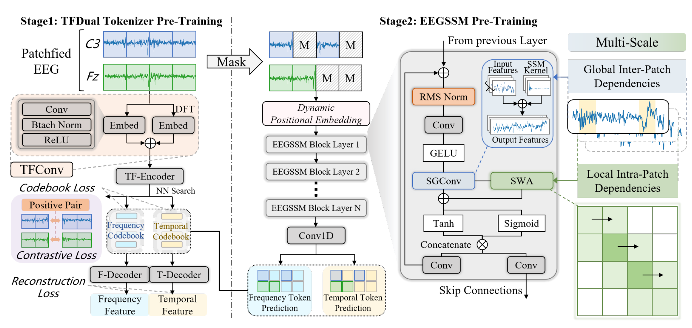

# CodeBrain: Bridging Decoupled Tokenizer and Multi-Scale Architecture for EEG Foundation Model

> **ICLR 2026**

**作者**：Jingying Ma\*, Feng Wu\*（共同一作）, Qika Lin†, Yucheng Xing, Chenyu Liu, Ziyu Jia†, Mengling Feng（†通讯；NUS / NTU / 中科院自动化所）

## 1 问题定位:单码本、全连接注意力、patch 即 token 的三宗罪

论文给现有 EFM 列了三条罪状。**其一,混合 tokenizer 混淆异质模式**:VQ-VAE 框架从图像搬来（LaBraM、TFM 均在此列），图像特征同质所以单码本够用,但 EEG 的时域波形与频域结构反映大脑活动的不同侧面——同一个 patch 在一个域匹配、在另一个域可能发散,单一混合码本会「撞码」,削弱表征容量,也让 token 难以对齐临床可解释的神经事件或频谱节律。**其二,全连接注意力与脑结构错配**:多数 EFM 用 Transformer 自注意力,而脑的小世界拓扑是「稀疏全局依赖 + 强局部相关」,全连接设计既贵（二次复杂度）又不合生理。**其三,patch 即 token 丢掉 patch 内部结构**:每个 patch 压成单个 token 后,patch 内部的瞬态神经事件（睡眠 K-复杂波、纺锤波等短时波形）没有专门机制去建模。

站内坐标:这三条分别对着 [LaBraM](labram.md)（单码本、token 只当目标）、[CBraMod](cbramod.md)（Transformer 骨干）与 [BIOT](biot.md)（切段即 token）。CodeBrain 的答案是把三件事各换一个组件:双码本、卷积 SSM+滑窗注意力的混合骨干、显式的 patch 内注意力层。

## 2 方法

### 2.1 两阶段总览

Stage 1 学 tokenizer:归一化 EEG patch \( x \in \mathbb{R}^L \) 离散化为时域/频域两个 token,码本 \( V^t, V^f \in \mathbb{R}^{K \times D} \),即 \( v_t, v_f = f_{\mathrm{tokenizer}}(x) \)。Stage 2 学表征:序列 \( X \in \mathbb{R}^{C \times f \times T} \)（C 通道、采样率 f、T 秒）切成 n 个非重叠 patch（\( L = f \cdot t \),预训练取 1s patch @200 Hz 即 L=200）,编码器 \( f_{\mathrm{enc}}: \mathbb{R}^{C \times n \times L} \to \mathbb{R}^{C \times n \times D} \) 用掩码 token 预测训练。一个容易忽略的实现细节:30s 样本在 19 通道下展平成 **570 = 19×30 个 token 的单一序列**,通道结构不靠 token 身份区分,而靠 Stage 2 的动态位置嵌入。

### 2.2 TFDual-Tokenizer:共享编码器,分家码本

**共享编码**。TFConv 模块对原始波形与 DFT 频域表示并行做「卷积+BN+ReLU」堆叠（频域输入先做 DFT）,两路拼接成时频联合嵌入;加**共享时间位置嵌入**（无通道身份,tokenizer 级 channel-agnostic）后过 TF-Encoder（Transformer,12 层,hidden 200）。注意:**「解耦」发生在码本与重构目标层面,不在输入层面**——两个码本对的是同一个联合嵌入 \( \tilde{e}_i \):

\[
p^t_i = \arg\min_j \|\tilde{e}_i - v^t_j\|_2, \qquad p^f_i = \arg\min_j \|\tilde{e}_i - v^f_j\|_2
\]

**频域码本**:F-Decoder（Transformer encoder + 两个线性层）从频域码字重构幅值与相位（z-score 归一化后做目标）,MSE 损失:

\[
A_i = \sqrt{\mathrm{Re}(x_i[k])^2 + \mathrm{Im}(x_i[k])^2}, \qquad \varphi_i = \arctan 2\left(\mathrm{Im}(x_i[k]),\ \mathrm{Re}(x_i[k])\right), \qquad \mathcal{L}^f_i = \|y^A_i - A_i\|_2^2 + \|y^P_i - \varphi_i\|_2^2
\]

**时域码本**:LaBraM 当年因原始信号重构不收敛而只做频域重构;附录 F 复现了这个问题（LaBraM 框架内重构损失卡在 0.128–0.131 不降）,CodeBrain 的药方是 TFConv 前置 + SimCLR 对比正则——把每段 EEG 对半劈,两半互为正对、跨段为负对（温度 \( \tau = 0.5 \)）,再加 T-Decoder 重构原始波形。总损失:

\[
\mathcal{L}_{\mathrm{tokenizer}} = \mathcal{L}_{\mathrm{CL}} + \sum_i \Big( \mathcal{L}^f_i + \mathcal{L}^t_i + \underbrace{\|\mathrm{sg}(\tilde{e}_i) - v^t_{p^t_i}\|^2 + \|\mathrm{sg}(\tilde{e}_i) - v^f_{p^f_i}\|^2}_{\text{codebook}} + \underbrace{\|\tilde{e}_i - \mathrm{sg}(v^t_{p^t_i})\|^2 + \|\tilde{e}_i - \mathrm{sg}(v^f_{p^f_i})\|^2}_{\text{commitment}} \Big)
\]

其中 sg(·) 是 stop-gradient。**理论背书**（Proposition 2.1,附录 D）:固定总码本规模 \( K = 2^R \),若时/频表征近似独立且失真可加,率失真论保证积码本（双码本）的最小失真 \( D^\star_{\mathrm{prod}}(R) \) 不高于任何混合码本 \( D^\star_{\mathrm{mix}}(R) \)。Remark 里承认时/频经傅里叶变换耦合,把「近似独立」解释成「语义失真的函数独立」而非统计独立——假设不轻,实测支撑见消融（双码本 vs Mixed 在 FACED 上差 0.073,SEED-V 上只差 0.003,并不均匀）。

### 2.3 EEGSSM:小世界拓扑的三件套

**动态位置嵌入（ACPE）**:单个 depthwise 2D 卷积（非对称核）学跨通道相对结构,借自 CBraMod,用于适配未见过的通道布局——tokenizer 不带通道身份,通道适配全押在这里。

**SGConv 层（管稀疏全局）**:卷积形态的 SSM,借 FFT 把全局卷积算到 \( O(N \log N) \):

\[
y = \mathcal{F}^{-1}_N D_k \mathcal{F}_N u, \qquad D_k = \mathrm{diag}(K \mathcal{F}_N)
\]

对传统 S4 核做两处改造:稀疏参数化 + 核衰减。核 \( K \) 由 \( N = \log_2(L/d) + 1 \) 个子核拼成,第 i 个子核按 \( \alpha^i \) 指数衰减（\( \alpha = 0.5 \)）:

\[
K = \frac{1}{Z}\left[k_0, k_1, \ldots, k_{N-1}\right], \qquad k_i = \alpha^i\, \mathrm{Upsample}_{2^{\max[i-1,0]}d}(w_i)
\]

设计来自 Li et al. 2022 的长卷积工作（与 S5、H3 同门）,和 Mamba 的选择性递推是 SSM 家族的两条分支;序列长只有 570,选卷积形态图的是并行效率。

**SWA 层（管 patch 内局部）**:时间维固定窗的滑窗注意力（Swin 式）,把二次复杂度压到线性。注意消融的真相:窗长 1（即只看自己 patch 内部）最优——SWA 在这个系统里的实际角色是「patch 内波形建模」,不是跨 patch 的局部上下文。

**门控**:WaveNet 式单元融合全局/局部两路（注:论文此处把 WaveNet 错引成 Obeid & Picone 2016,后者是 TUH 语料库论文）:

\[
z = \tanh\left(W_f \cdot \mathrm{Concat}(y_{\mathrm{sg}}, y_{\mathrm{swa}})\right) \odot \sigma\left(W_g \cdot \mathrm{Concat}(y_{\mathrm{sg}}, y_{\mathrm{swa}})\right)
\]

两路输出 \( y_1 = \mathrm{Conv}(z) \) 进下一个 block,\( y_2 = \mathrm{Conv}(z) \) 走 skip connection 汇入总输出。

### 2.4 预训练目标

MAE 式:Bernoulli 掩码（r=0.5）,EEGSSM 输出过 1D 卷积预测被掩 patch 在**两个码本**中的 token 索引,交叉熵 \( p(v_i \mid x_i) = \mathrm{softmax}(\mathrm{Conv1D}(y_i)) \)。损失在 epoch 1→6 从 9.04 降到 6.39,epoch 10 后趋平（6.01→5.66）,官方 checkpoint 取 epoch 10——一半理由是防止对 TUEG 过拟合（TUEV/TUAB 同源）。

## 架构图

*Figure 2 · 左（Stage 1）:patched EEG 过 TFConv（时域 conv 堆叠 ∥ DFT→conv 堆叠）→ 共享时间位置嵌入 → TF-Encoder → NN 搜索进时/频两个码本;对比损失（段内正对）+ 双 decoder 重构（T-Decoder 原始波形、F-Decoder 幅值/相位）+ codebook/commitment 损失。右（Stage 2）:掩码 patch → 动态位置嵌入 → EEGSSM Block ×N（RMS Norm → Conv+GELU → SGConv ∥ SWA → Tanh⊙Sigmoid 门控 → Conv×2 走 skip）→ Conv1D 出双码本 token 预测。图注细节:图中「Btach Norm」「Patchfied」为原文拼写笔误*

## 与其他论文的关系

| 论文 / 工作 | 关系说明 |
|---|---|
| [LaBraM](labram.md) | token 只作预训练目标的同款范式,但 LaBraM 是单码本 + 只做频域重构（原始信号重构不收敛）;CodeBrain 用 TFConv + 对比正则把时域重构治好（附录 F 实测 LaBraM 框架内损失卡在 0.128–0.131),再把一个码本拆成两个 |
| [TFM-Tokenizer](tfm-tokenizer.md) | 同届 ICLR 2026 的对手路线:单通道时频 motif 词表、token 当可插拔**输入**、tokenizer 内去掉位置编码;CodeBrain 多通道联合嵌入、token 当**目标**。两个「时频」含义不同——TFM 是窗内跨频段依赖建模,CodeBrain 是时/频两套码本分家 |
| [CBraMod](cbramod.md) | 最强基线 + ACPE 出处;同用 TUEG 但 CBraMod 预训练 40 epoch、CodeBrain 早停 10 epoch 且补了 Excluding 重训——泄漏处理比前辈规范。数据上 CodeBrain 以 15M 对 4M 参数换全面小胜 |
| [NeuroLM](neurolm.md) | token 用法的另一极:码字并入 GPT-2 词表做指令推理;CodeBrain 完全不碰语言对齐,靠「解码器重构什么」来定义 token 语义 |
| [NeuroRVQ](neurorvq.md) / [BrainRVQ](brainrvq.md) | 2026 年「把码本做复杂」的三条路同框:NeuroRVQ 单码本内多尺度 RVQ(由粗到细),BrainRVQ 时/频双 RVQ(残差、多层码表),CodeBrain 时/频双 VQ(并列、单层)——双域并列是其中最保守的形态 |
| [NeuroDETR](neurodetr.md) | 「多尺度」的另一种解法:NeuroDETR 把多尺度做在 token 切分上(时间多尺度 + 空间金字塔),CodeBrain 把多尺度做在骨干内核上(多尺度卷积核 + patch 内/间两级注意力) |
| [BIOT](biot.md) / [EEGPT](eegpt.md) | 对照组:BIOT 连续 patch token(无量化)在多数任务落后;EEGPT 在本篇多个数据集上表现异常(ISRUC S1 仅 0.2223、BCIC2020-T3 0.0567),疑似微调协议不适配,读表时需留意 |

## 个人思考

- **「桥接」的实际含义与 token 的退守**。标题喊 Bridging,但对照站内 tokenization 线的演进方向(LaBraM 目标 → NeuroLM 词表 → TFM 输入),CodeBrain 的 token 用法其实**退回**了 LaBraM 范式:Stage 2 吃原始 patch、token 只是被预测的标签,推理时 tokenizer 整个丢弃,下游模型拿不到任何离散接口。真正被「桥」起来的是两阶段的设计耦合——下游预测的监督信号由 Stage 1 的双码本定义、骨干的多尺度假设与 tokenizer 的域分解呼应。所以它填的缺口是「tokenizer 与架构的联合设计」,不是「token 作为模型接口」;拿它和 TFM 比「谁的 token 更可用」会问错问题;
- **双码本的收益要按数据集拆开看**。Dual 对 Mixed 的差距:FACED +0.073、ISRUC S3 +0.027、SEED-V 仅 +0.003(0.2735 vs 0.2708);对单频码本 SEED-V 也只 +0.007。也就是说「二次扩展表征空间」的收益在情绪任务上几乎归零,理论命题(Proposition 2.1)的实证支撑并不均匀——「二次扩空间」的字面事实成立(每 patch 一个码字变成一对,组合空间 4096² ≈ 1678 万),但「判别力随之提升」只在部分任务上兑现。消融里真正普适的结论反而是骨干侧的:SGConv 和 Gate 拆谁都崩;
- **子带消融的「全崩」是个警报,不是勋章**。移除 δ、θ、α 任何单个低频带都把模型打到近随机(SEED-V 去 α 带 0.0082),而健康的频段归因应该是「一个带一个坑」。更合理的解释是模型对输入分布漂移极度敏感:掩掉一个带会破坏全局统计(如 z-score 口径),整个输入相对预训练分布成了 OOD。这与附录 M 大讲通道丢弃/基线漂移鲁棒性的叙事存在张力——同一模型不可能既「对结构化扰动稳健」又「拆一个频带就崩」;
- **增量边际与占坑价值要分开记账**。对 CBraMod 的中位增量只有 0.01–0.03 Kappa,大增益集中在两个小数据集(BCIC2020-T3 共 6,000 样本、Mental Arithmetic 共 1,707 样本),大库任务(TUEV/TUAB)上互有胜负;三个二类指标还输给基线。它的价值更多在「把双码本 + SSM 骨干这条路铺通」:完整消融、scaling 曲线、9k 小时/150M 的外推证据,外加 15M 参数、35 GPU·小时的可复现成本(代码与权重已开源)。典型的占坑之作——坑位本身(解耦 tokenization 的可解释性叙事)比数字更有长期价值,后续 [BrainRVQ](brainrvq.md) 等双域工作都站在这条线上。

---

**相关阅读**

:material-vector-link: [Tokenization 演进(CodeBrain 已入表)](../topics/tokenization.md) ｜ :material-creation: [TFM-Tokenizer(同届另一条时频 tokenization 路线)](tfm-tokenizer.md) ｜ :material-account-group: [LaBraM(单码本 VQ 的源头)](labram.md) ｜ :material-chart-box: [NeuroRVQ(多尺度 RVQ 同框对比)](neurorvq.md) ｜ :material-heart-pulse: [CBraMod(最强基线与 ACPE 出处)](cbramod.md) ｜ :material-home: [首页](../index.md)
