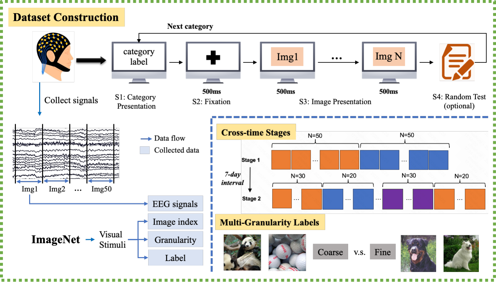

# CrossPT-EEG: A Benchmark for Cross-Participant and Cross-Time Generalization of EEG-Based Visual Decoding

> **arXiv 2024**

**作者**:Shuqi Zhu, Ziyi Ye, Qingyao Ai, Yiqun Liu(全部来自清华大学计算机科学与技术系;通讯未标注,联系邮箱 zhusq22@mails.tsinghua.edu.cn)

## 1 问题定位:视觉解码的 EEG 数据集缺口

论文开篇的处境描述与站内 [GUIDED](guided.md) 笔记的框架一致:fMRI/MEG 靠大资源(NSD:8 人 × 10,000 图 × 一年)撑起了重建高潮,EEG 便宜、便携、毫秒级,却受限于三条:(1) 缺大规模高质量数据集;(2) 标注粒度粗,做不了细粒度分析;(3) 普遍用 block 设计——同类图像连块呈现,EEG 信号在刺激前后带上时间标记,Li et al. 2020a 已证明这会虚高 within-session 分类结果。对现有数据集的点名批评有两个:Spampinato 2017(6 人 2,000 图)规模小;Things-EEG1/2 用 50/100 ms 的极短 RSVP,「只有早期神经响应被捕获」,研究不了完整的视觉时程。

作者的三个设计对应三条批评:4,000 图 + 两级粒度标注对规模与粒度;两阶段跨时间设计对 block 混淆。值得注意的是出发点:这是清华 IR 组(THUIR)的作品——Yiqun Liu 组此前有 brain-machine search interface 的 SIGIR Forum 立项文章、EEG-SVRec、TOIS 的 relevance feedback with brain signals,视觉解码基准服务于「图像搜索 BCI」的长期议程,所以 cross-time(用户隔周回访)和随机乱序(搜索结果不会按类分块出现)是第一需求,而非神经科学的事后补充。

作为基准类论文,本文的主产品不是方法而是**测量**:图 2 的任务划分协议和 Table 2/3 的崩塌数字。被评模型是配角(作者自己在 Limitation 里承认没纳入最新方法)。

## 2 基准设计:数据集、两阶段范式与四个任务

### 2.1 数据集与采集

- **被试**:16 人(10 男 6 女),21–27 岁(均值 24.06 ± 1.69),右利手大学生,每人每阶段约 2 小时(含 30 分钟设备准备),报酬每小时 11.8 美元;Stage 1 全员 16 人,其中 6 人于至少 7 天后参加 Stage 2(7 天间隔为规避记忆效应),合计 22 session。
- **刺激**:ImageNet21k 子集,80 类 × 50 张手工筛选(宽高 >300 px、无水印、主体突出);前 40 类为粗粒度、与 Spampinato 2017 的类别一致(ImageNet1k),后 40 类为细粒度、分 5 组 × 8 类,组内共享 WordNet 父节点(如乐器组:手风琴/大提琴/长笛/双簧管/小军鼓/长号)。因 ImageNet 版权,发布物只含图像 index + 类别 wnid,不含图像本体。
- **范式**(Figure 1):S1 类别标签呈现(空格键继续)→ S2 注视点 500 ms → S3 RSVP 每图 500 ms → S4 随机测试(类块结束后随机抽查当前类别,未通过的类别数据剔除)。每被试自选随机种子决定类序与图序,两阶段用不同种子。
- **硬件**:Scan NuAmps Express + 64 导 Quik-Cap(数据为 62 个 EEG 通道,M1/M2 作参考),Curry8 记录,1000 Hz,阻抗 <50Ω(原文如此,量级上应为 kΩ 笔误);27 寸 2560×1440 @60 Hz 显示器。
- **规模**:87,850 对 / 20.85 GB。理论满额 22 session × 4,000 = 88,000,缺口 150 对未解释(推测为 S4 剔除)。

### 2.2 预处理与特征

重参考用 offline linked mastoids(M1+M2 均值,Yao et al. 2019);带通 0.5–80 Hz;50 Hz 陷波;伪迹去除只写「消除异常幅值与眨眼/头动伪迹」——**方法、阈值、是否用 ICA 均未披露**。特征窗取刺激后 **40–440 ms**(400 ms,避开相邻刺激污染)。频域特征为五频段(delta 0.5–4 / theta 4–8 / alpha 8–13 / beta 13–30 / gamma 30–80 Hz)的微分熵(Welch 法估计功率谱后 \( \mathrm{DE} = -\int P(f)\log P(f)\,df \)),逐电极逐段;经典模型与 MLP/RGNN 吃 DE 特征,EEGNet 吃时域原始段(表中以 * 标注)。

### 2.3 四个任务与指标

任务划分(Figure 2,所有任务的测试集都落在 Stage 2,故主表「全体被试平均」的实际口径是 6 名两阶段被试):

| 任务 | 训练数据 | 测试数据 | 考察维度 |
|---|---|---|---|
| WT(Within-Time) | 同一被试 Stage 2 每类 30 张 | 同一被试 Stage 2 每类 20 张 | 非 block 条件下的被试内上界 |
| CT(Cross-Time) | 同一被试 Stage 1 全部 50 张 | 同一被试 Stage 2 全部 50 张 | 跨 session(≥7 天)泛化 |
| CP(Cross-Participant) | 其余 10 人(未参加 Stage 2)的 Stage 1 | 目标被试 Stage 2 | 跨被试 + 跨 session |
| PT(Pre-training) | 10 人 Stage 1 预训(半 lr 半 epochs)+ 目标被试 Stage 1 续训 | 目标被试 Stage 2 | 借他人数据能否救回跨时间 |

主指标用 two-way identification(承 fMRI 重建文献,Ozcelik & VanRullen 2023):每个测试样本随机抽对比样本做二选一判别,重复 k=500 次取平均,chance 0.5;accuracy/F1 放在附录。**注意正文的指标定义措辞含糊**:「randomly select k comparison samples from different categories」与 two-way ID 的通常定义(单次二选一、多次重复)对不上,k 的确切语义要进代码确认。

### 2.4 被评模型

经典四件套:Ridge、KNN、RandomForest、SVM(DE 特征,核函数与正则/树数/邻居数做了网格)。深度三件套:MLP(两层隐层 256/128 + BN + dropout 0.5)、EEGNet(时域输入,首层卷积核长 = 时间点数之半 = 200)、RGNN(Zhong et al. 2020 的正则化图网络,电极拓扑按设备坐标,加两层 BN)。统一 CE 损失、batch 80、单卡 4090;MLP/EEGNet 用 SGD(lr 1e-3 训 2000 epochs → 1e-4 再训 1000),RGNN 用 Adam 同调度。全部为本基准上重训。清单里没有任何 2021 年后的视觉解码模型——「被测方」比数据集本身旧。

## 架构图

*Figure 1 · 上排实验范式:EEG 戴帽采集 → S1 类别标签呈现(空格键继续)→ S2 注视点 500 ms → S3 RSVP 每图 500 ms(Img1…ImgN)→ S4 随机测试(可选),Next category 回环;左下:连续采集的 EEG 按图像对齐(Img1–Img50),与图像 index、粒度、标签共同入库;右下 Cross-time Stages:Stage 1 每类 N=50 block 呈现(橙/蓝分块)→ 7 天间隔 → Stage 2 每类 N=30/N=20 乱序(紫色为乱序插入的类别);底部 Multi-Granularity Labels:熊猫/高尔夫球为 Coarse,罗威纳/萨摩耶为 Fine。注:图中 S1–S4 步骤标签与图例是 PDF 矢量叠加层,不在内嵌位图里*

## 与其他论文的关系

| 论文 / 工作 | 关系说明 |
|---|---|
| [GUIDED / ATM](guided.md) | 同轴互补的一对:GUIDED 在 THINGS-EEG 上测被试内「上限」(200-way 检索 top-1 28.64%、2-way 94.92%),本篇测泛化「下限」;两者都用 two-way identification 量纲,但协议不可直比(80 次重复 ERP 平均 vs 单 trial、500 ms vs 1000 ms 窗、不同刺激集) |
| Things-EEG1/2(Grootswagers/Gifford 2022) | 最直接的对照数据集:THINGS 概念多(1,854/22,248 图)但呈现极短(50/100 ms)、无跨时间设计;本篇 4,000 图、500 ms、多粒度标注 + 两阶段——两边各拿了对方没有的东西 |
| Spampinato 2017(EEG-Classification)+ Li et al. 2020a | Stage 1 直接复刻其 block 范式(40 个粗粒度类同款);Li et al. 2020a 的 block design 批评是方法论依据,Table 5 vs 6 的水分量化与 A.5 时间效应分析就是对该批评的同库复现 |
| [EEGArena](eegarena.md) | 同为基准但颗粒度互补:EEGArena 用 20,000+ 次评测横评 30 个基础模型 × 57 任务,考「谁的方法强」;本篇只做一个任务族(视觉分类)但把被试/时间两个泛化维度切成受控协议——宽度基准 vs 深度基准 |
| [EEGPT](eegpt.md) / [CBraMod](cbramod.md) | 预训练轴线的「评测缺口」:基础模型论文都声称跨被试/跨数据集泛化,视觉解码侧此前没有受控的跨被试/跨时间协议——本篇的 WT/CT/CP/PT 恰好是它们需要的评测形状,尽管被评清单里还没有它们 |
| [BIOT](biot.md) | 泛化主张的对账对象:BIOT 主打跨被试/跨记录的通道无关建模;本篇 CP≈0.50–0.57 的地板说明这类主张在视觉解码任务上必须单独重验 |
| [EEGDM](eegdm.md) / [Not-All-EEG](not-all-eeg.md) | 生成线与本篇零交集(那边评生成质量、不评泛化),但生成线的检索指标在 CP 条件下会掉多少,本篇的崩塌数字是预告 |
| Ozcelik & VanRullen 2023 | 主指标的出处:fMRI 重建文献的 two-way identification 被搬进 EEG 分类基准,使重建线与基准线共享量纲 |

## 个人思考

- **基准的价值在「下限」而不在「上限」**。WT 0.95 → CT 0.55 → CP 0.52 这条崩塌曲线,是站内视觉解码线所有论文都没系统报过的维度:[GUIDED](guided.md) 自己报过被试内 28.64% → 跨被试 11.84% 的腰斩,但那是单模型单数据集;本篇用 7 个模型 × 4 任务 × 2 粒度的受控矩阵说明:跨被试 ≈ 接近重来,跨时间 ≈ 丢掉六成。任何在 THINGS-EEG 上刷 SOTA 的工作,宣称「可用于 BCI」之前应该先过 CT/CP 这两关——本篇最大的贡献是把这两关做成了标准化协议;
- **「预训练有用」的证据在这里很弱,但方向诚实**。PT 比 CT 只多 0.02–0.03:10 个被试 × 4,000 图的有监督预训练几乎买不到泛化。对照站内基础模型轴线的口径,本篇可以当「朴素预训练收益基线」——新方法的跨被试增益若不超过这个幅度,不足以支撑「预训练表征有跨被试不变性」的宣称。但边界要留:这里的预训练只是「换人训 + 半 lr 续训」,没有任何表征对齐、对抗解耦或通道无关设计,它给的是下界不是方法上限;CP 崩到 0.52 恰恰说明跨被试差异是主矛盾,谁若能在 CP 上把 0.52 拉到 CT 水平,就是下一个值得写的结果;
- **block 设计水分的 9–14 个点值得记住**。Stage 1 复刻 Spampinato、Stage 2 纠偏,同一数据集内直接给出膨胀幅度;加上 A.5 的「测试集最前几张图准确率异常高」,这是 Li et al. 2020a 之后少有的同库对照证据。站内在 [GUIDED](guided.md) 笔记里夸过 THINGS-EEG 的 RSVP 协议,本篇补上另一半:非 block 只去掉类内时间标记,去掉不了 session 间漂移——CT 掉的 0.34–0.40 里有多少是协议残余、多少是真实脑状态漂移(7 天间的睡眠、情绪、电极位置),数据集本身给不出答案,这恰是它留下的开放问题;
- **基准的「被测方」与「数据方」都不完整**。被测模型停在 2020 年(作者自认),没有 NICE/ATM/Conformer/EEGPT 一代,也没有任何重建任务——它目前更像「泛化协议参照系」而不是「SOTA 降落场」。数据侧,Stage 2 只有 6 人(且是自愿参加两阶段的 6 人,自选偏差未讨论),CP 的崩塌数字建立在 6 个测试被试上;80 类对细粒度解码只有 5 组 × 8 类,而 THINGS 有 1,854 概念。另外 v2(2025-12)仍写「review 后公开」、代码还是匿名链——数据可得性是复现前要确认的第一件事,这也限制了它现在作为基准的实际地位。

---

**相关阅读**

:material-eye: [GUIDED · 视觉重建线(被试内上限,与本篇互补)](guided.md) ｜ :material-format-list-numbered: [EEGArena(基础模型横评基准,宽度对本篇深度)](eegarena.md) ｜ :material-layers: [EEGPT(预训练特征提取器,CP 协议的天然候选被测方)](eegpt.md) ｜ :material-creation: [CBraMod(多数据集预训练,跨被试主张待此基准对账)](cbramod.md) ｜ :material-heart-pulse: [BIOT(跨被试/跨记录建模的对账对象)](biot.md) ｜ :material-home: [首页](../index.md)
