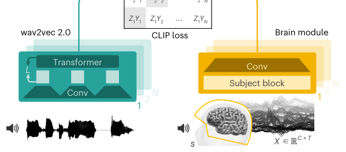
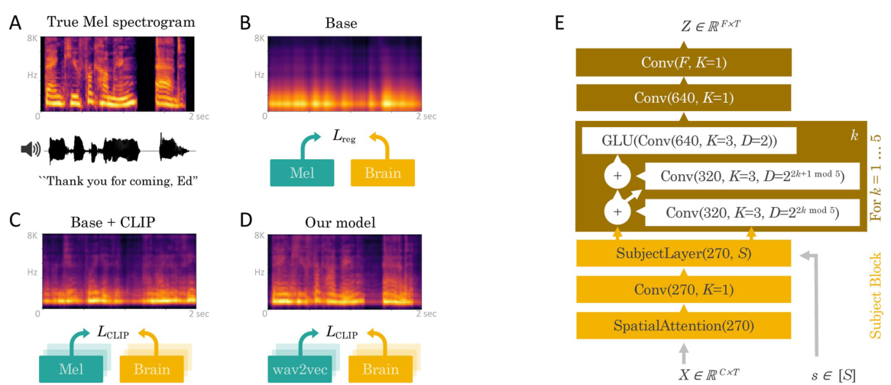

# Decoding Speech Perception from Non-invasive Brain Recordings

> **Nature Machine Intelligence 2023**

**作者**：Alexandre Défossez, Charlotte Caucheteux, Jérémy Rapin, Ori Kabeli, Jean-Rémi King（Meta AI；Caucheteux 兼 Inria，King 兼 ENS）

## 1 问题定位：非侵入 + 自然语音的两难

论文开篇把领域处境摆得很直白：侵入式已经做出实绩（Willett 手写 90 字符/分、Metzger 拼写 CER 6.13%），但要开颅；非侵入的 MEG/EEG 信号噪、跨被试漂移大，所以以往工作要么单被试训练，要么只解码极小的词表（文献里最多也就 10 个词、83% 准确率的量级）。两条路都到不了「自然语言 + 可穿戴」的交点。

作者选择的破局点有两处，都在换假设而不是换模型：

1. **单被试 → 大队列联合训练**。MEG/EEG 的跨被试变异性不必靠复杂的 per-subject 预处理流水线吸收，可以只留一个被试专属层让网络自己学；
2. **人工特征 → 自监督语音模型的目标空间**。脑里到底用什么格式编码语音是未解问题，与其猜（Mel、音素、字母），不如直接对齐一个在大规模语音上学到的表征空间——这步把「表征格式」的问题外包给了 wav2vec 2.0。

评测协议也跟着换了：不是分类（词表固定），是**候选集检索**——给定脑信号，对测试集全部 3 秒段算相似度排序。测试段的词与训练词表有 15–40% 不重叠（Table 1 的 word overlap 60–85%），所以这是真 zero-shot，而不是闭集分类换了个说法。

## 2 方法

### 2.1 问题形式化与 CLIP 损失

设 \( X \in \mathbb{R}^{C\times T} \) 是脑信号段（\( C \) 传感器数、\( T \) 时间步），\( Y \in \mathbb{R}^{F\times T} \) 是对应语音表征。传统做法是回归 \( \hat{Y}=f_{\mathrm{reg}}(X) \) 最小化 \( L_2 \)。论文对回归失败的诊断很具体：Mel 谱的各维度重要性极不均衡（极低频与语音基本无关、各频带幅值差几个数量级），\( L_2 \) 平等对待所有维度后，模型输出被一个**不可分辨的宽带成分**主导——Extended Data Fig. 4 里回归出的 Mel 谱只是一团模糊的能量轮廓，分不出词。

解法是换目标：不预测 \( Y \) 本身，只要求 \( Z=f(X) \) 与正样本 \( Y \) 的内积在候选中最大。取 batch 内其余 \( N-1 \) 个样本做负例，用 softmax 近似后验：

\[
\hat{p}_j = \frac{e^{\langle Z,\, \bar{Y}_j\rangle}}{\sum_{j'=1}^{N} e^{\langle Z,\, \bar{Y}_{j'}\rangle}}, \qquad
\mathcal{L}_{\mathrm{CLIP}}(p,\hat{p}) = -\langle Z, Y\rangle + \log\Big(\sum_{j'=1}^{N} e^{\langle Z,\, \bar{Y}_{j'}\rangle}\Big)
\]

动机上这是把「逐维拟合」改成「可分辨性」：损失只关心正确段在 batch 里排第一，模型自己去找 Mel/wav2vec 空间里那些对判别有用的维度并自动配好尺度。训练时负例来自 batch（形式化描述为从数据集采样 \( N-1 \) 个负例，训练实现按 CLIP 惯例取 batch 内其余样本），测试时负例是**测试集全部其他段**——这就是检索评测本身。与标准 CLIP 还有两处不同值得记：对齐是**单向**的，softmax 只沿「脑信号 → 语音候选」一个方向做，没有语音到脑的反向项；公式里也**没有温度参数**，内积直接进 softmax（式 2、3 均如此）。

### 2.2 Brain module：一个为「多设备、多被试」设计的卷积栈

输入是 120 Hz 重采样后的原始信号（不做 ICA、不做伪迹剔除），结构四层递进（Extended Data Fig. 4e）：

- **空间注意力**：传感器三维坐标先经 MNE-Python 的 find_layout 投影到保留通道间距离的 2D 平面，再归一化到 [0,1]。每个输出通道 \( j \) 学一个定义在该平面上的函数 \( a_j(x,y) \)，在傅里叶空间参数化——每轴只取 \( K=32 \) 个低频谐波（式 4），等价于强制 \( a_j \) 在传感器平面上平滑变化。论文只给了设计没给动机，为什么这样合理要自己补一步：相邻传感器看到高度重叠的皮层源，权重地形没有理由逐通道跳变，截断傅里叶级数正是「平滑地形」的参数化表达（学到的地形见 Extended Data Fig. 5——除 Brennan 外，均落在听觉刺激的典型激活通道上）。对 \( a_j \) 在各传感器位置取值做 softmax 得到混合权重，把任意数目、任意布局的传感器重映射到固定 \( D_1=270 \) 通道。另有两个实现细节：\( a_j \) 是周期函数，坐标向内缩 0.1 留边距；spatial dropout 随机采一个位置、从 softmax 里删掉半径 0.2 内的传感器（正则化）。原意是让一个模型跨四个数据集（不同设备、不同导联数）共享权重，结果发现这层本身就把精度抬上去了（Extended Data Fig. 2 消融确认）——归纳偏置的意外收益；
- **被试层**：每个被试一个 \( M_s \in \mathbb{R}^{270\times270} \) 的 1×1 卷积，紧跟空间注意力之后。跨被试的全部个体差异只由这一个矩阵吸收。多数据集联合训练的细节论文写得很少：只说「所有被试共享除被试层外的全部权重」，batch 内如何混采四个数据集没有写明（要看 brainmagick 代码）；验证协议是每个数据集内部按 70/20/10 划分，验证集约为测试集一半大小（Table 1 注），同一句子的所有重复固定在同一 split，早停只看验证损失；
- **5 块 × 3 层膨胀卷积**：前两层残差连接（膨胀率 \( 2^{2k \bmod 5} \) 与 \( 2^{2k+1 \bmod 5} \)，核宽 3）、BatchNorm + GELU、输出 320 通道；第三层输出 640 通道用 **GLU** 减半。全程保持时间分辨率不变；
- 两个收尾 1×1 卷积映到 \( F \) 维（wav2vec 特征空间 1,024 维）。

两个工程细节值得记：脑信号整体**前移 150 ms** 补偿刺激-响应延迟；归一化只用 baseline correction（减前 0.5 s 均值）+ robust scaler + **截断 20 个标准差以外的离群值**—— Supplementary 实验说截断是训练能否收敛的关键，且这套极简预处理与 autoreject 这类完整清洗流程效果持平。

### 2.3 Speech module：把表征格式的选择题交给 wav2vec 2.0

三个候选逐个试：直接回归 Mel（Base）、端到端联合学的潜表征（Deep Mel，与 brain module 同构的卷积栈、去掉被试层）、以及预训练 **wav2vec2-large-xlsr-53**（56,000 小时、53 种语言，取最后 4 层 transformer 激活平均）。Deep Mel 只见过四个数据集里的音频，wav2vec 见过 56,000 小时——结果（Table 2）预训练路线全面胜出。作者的解读接在他们自己组的脑编码文献上：自监督语音模型的激活可以线性映射到脑响应，所以对齐它是在「借」一个已被验证与脑表征兼容的空间。

### 2.4 训练与评测

Adam，lr \( 3\times10^{-4} \)，batch 256，一个 epoch 定义为 1,200 次更新，验证集 10 个 epoch 无提升即停，两张 V100 16GB。评测三种口径：段级 top-10（主指标，作者明说段级候选太多、top-1 会低估模型解码到的信息）、词级 top-1/top-10（对测试集每个词取词首前 500 ms 至 2.5 s 的 3 s 窗，把候选段按词分组、对同词各段的概率求和）、以及解释性分析（ridge 回归预测 decoder 给正确词的 softmax 概率，五组特征：音素 d=60（Phonemizer）、zipf 词频 d=1、词性 d=15、词向量 d=300（spaCy）、短语向量 d=1,024（Laser），词袋嵌入即段内词向量求和；5 折交叉验证后与真值算 Pearson R）。

## 3 实验与结果

**主表（Table 2，top-10 段级准确率 %，3 次随机初始化）**：

| 模型 | Brennan (EEG) | Broderick (EEG) | Gwilliams (MEG) | Schoffelen (MEG) |
|---|---|---|---|---|
| Random | 5.3 | 0.5 | 0.7 | 0.8 |
| Base（回归 Mel） | 6.0 | 1.0 | 12.4 | 20.6 |
| + Contrastive | 8.0 | 9.7 | 55.1 | 55.1 |
| + Deep Mel | 24.7 | 15.4 | 64.4 | 61.2 |
| + wav2vec 2.0 | **25.7** | **17.7** | **70.7** | **67.5** |

三条增量各自清晰：对比损失换掉回归是最大的一跳（MEG 上 +34.5 到 +42.7pp，EEG 上只有 +2.0 到 +8.7pp）；给 Mel 谱加深层编码器（Deep Mel）再 +6 到 +17pp；换成预训练 wav2vec 特征又 +1 到 +6pp（MEG 上约 +6pp，EEG 上仅 +1 到 +2pp）。EEG 上绝对数字低一个台阶，但相对排序完全一致——结论对模态稳健。

**MEG 与 EEG 的差距是模态性的**。为排除「MEG 数据更多、通道更多」的混淆，作者做了同质化对照：三个数据集各裁到 128 通道、19 名被试、相同的被试平均录音时长，结果 MEG 仍以 30.3% / 31.7% 显著高于 EEG（全部 P < 10⁻⁶）。作者留了限定语：还没做过同一批被试同时戴 EEG 和 MEG 听同样刺激的实验，所以严格说这是「设备类型强相关」而非因果定论——但论文自己也承认没预料到差距这么大。机制上不难理解：头皮 EEG 经过颅骨的容积传导低通，高频时间结构所剩无几，而 3 秒段检索恰恰吃时间精度。

**被试数曲线**（Fig. 2c）：固定评测前 10% 被试，训练被试数从少到多，两个 MEG 数据集上 top-10 单调上升。单模型 + 每被试一个 1×1 卷积就吃下了个体差异，这是「脑记录基础模型」这条路线最直接的可行性证据。

**与侵入式对照**（作者做得很克制，限定语给足）：50 词闭集里，本模型词级 top-1 平均 22.7%（最好被试 42.9%，Supplementary A.9），侵入式的 Moses et al. 是 39.5%；若候选词嵌在句子语境里，本模型平均 top-1 超 72.5%、最好被试 92.2–95.9%（Fig. 2b），反超 Moses 的 74%。感知 vs 产出的脑基础不同，这个对比只能当量级参考，不能当胜负。

**解释性分析**（Fig. 3、Fig. 4）：Fig. 3 先给定性一瞥——五个代表被试（20–80 分位）听「Thank you for coming, Ed」时，decoder 在每个词位置输出的候选词按 log 概率定字号，正确词多居前列。定量上，用各层语言特征去预测 decoder 给正确词的概率，短语嵌入与词袋嵌入的解释力最强（均 P < 10⁻²³），词向量 P < 10⁻⁸，词性 P < 0.004，词频与音素更弱（Fig. 4 中音素的 R 接近零）。表征层级越高解释力越强，decoder 主要在用词汇-语境语义信息检索，而不是声学匹配。

## 架构图

*Figure 1 · 左：speech module（wav2vec 2.0 的卷积 + Transformer）把 3 秒语音映为 \( Y \)；右：brain module（空间注意力 + 被试块 + 卷积栈）把 \( C\times T \) 的脑信号映为 \( Z \)；顶部为评测协议——对每个脑表征 \( Z_i \) 给 \( N \) 个候选段逐一打内积分，即零样本检索；两空间以 CLIP 对比损失对齐，\( N \) 名被试共享除被试层外的全部权重*

*Extended Data Fig. 4 · A–D 是同一被试「Thank you for coming, Ed」的 Mel 重建对照：回归基线（B）只剩模糊能量轮廓，对比损失（C）恢复频带结构，换 wav2vec 目标（D）最干净；E 是 brain module 逐层结构——SpatialAttention(270) → Conv(270, K=1) → 被试专属 SubjectLayer(270, S) → 5 块膨胀卷积（GLU 减半）→ 两层 1×1 收尾到 \( F \) 维*

## 与其他论文的关系

| 论文 / 工作 | 关系说明 |
|---|---|
| [SSM2Mel](ssm2mel.md) | 语音解码轴线的两端：本篇（2023）是**检索范式**——不产出声学信号，在候选集里排序，数字漂亮但永远受候选集约束；SSM2Mel（2025）是**回归范式**——直接 EEG→mel 谱，Pearson 0.069 贴着噪声地板。两者目标空间也不同：wav2vec 高层语义 vs mel 低层声学。SSM2Mel 的 SparrKULee（85 人荷兰语 EEG）与本篇的 Schoffelen（96 人荷兰语 MEG）是同一语言的姊妹数据集，可交叉参照 |
| [BrainGPT](braingpt.md) | 同为「对齐外部语言模型表征」，结构选择相反：本篇用判别式对比 + 卷积，BrainGPT 用自回归 + 因果 Transformer 生成式预测。本篇 Discussion 点名的下一步是补一个不需要候选集的生成模块，BrainGPT 可视为这个方向的后续 |
| [EEGPT](eegpt.md) | 处理多被试/多数据集的两种答案：本篇用一个空间注意力层把任意导联布局归一到 270 通道 + 每被试一个 1×1 卷积；EEGPT 用 patch + 通道 embedding 拼接。本篇的被试层数值极小（一个矩阵），对评估「被试嵌入该多大」是个参照点 |
| [BIOT](biot.md) | 预处理哲学两极：本篇证明 baseline correction + 截断 20σ 就够、与 autoreject 持平；BIOT 走重采样/归一化的规范化路线。两者共同点是把跨设备异构性压进模型而非压进预处理 |
| [CBraMod](cbramod.md) | 轴线分工：CBraMod 用脑信号自监督预训练通用表征；本篇反向——用外部（语音）模型的特征监督脑解码。两条「预训练方向」在 LaBraM（脑信号蒸馏 EEG 表征）处汇合 |
| wav2vec 2.0 / CLIP | 目标空间与损失函数的直接来源：wav2vec 2.0 提供 56,000 小时语音的自监督表征（末 4 层平均），CLIP 提供跨模态对比框架。本文的贡献不在两者本身，而在验证「自监督语音特征可线性对齐脑活动」在解码任务上成立 |

## 个人思考

- **检索范式是绕道而非终点**。对比学习赢回归，赢在把「逐维拟合」换成「可分辨性」，但代价是解码器只会排序、不会生成——给定脑信号，它能在 1,000 个候选里挑出那句，却无法输出候选集之外的一个词。作者在 Discussion 里自己承认要补生成模块。这个限制和 SSM2Mel 形成精确的互补：回归路线输出自由但信噪比贴地，检索路线信噪比可用但被候选集圈死。真正的语音解码（想象语音、病人产出）两个都得过生成关；
- **被试层小得令人意外，这个结论可能被低估了**。270×270 的一个矩阵就吸收了跨被试差异，且训练被试越多整体越好——这暗示 MEG/EEG 的被试特异性主要不是深层表征差异，而是「传感器几何 + 个体解剖」的低维重映射。对站内基础模型轴线的直接影响：EEGPT、CBraMod 这类多被试预训练模型里的被试建模，可能根本不需要复杂的 per-subject adapter，一个线性映射加一个位置先验就够了。当然边界要留：本文只测了被动听觉，主动任务或临床人群里被试差异的维度可能高得多；
- **解释性分析有个没拆开的循环**。结论说「decoder 主要依赖语义表征」，但 decoder 的目标空间是 wav2vec 2.0，而 wav2vec 特征本身就以词汇-语义成分为主（作者自己的引用文献 54、55 说它线性映射脑响应）。用短语嵌入解释 decoder 输出时，有多少是脑的属性、多少只是目标特征的属性？一个干净的对照是：拿在声学层面匹配但不语义相关的候选，看 decoder 是否真的放弃声学匹配。论文没做这一步，所以这个结论我打八折收下；
- **MEG/EEG 差距对站内的警示**。站内现有语音解码工作全部在 EEG 上做（SSM2Mel 的 SparrKULee），本篇的同质化对照说明这个差距是模态性的——EEG 上做语音解码，天花板可能天然低一截。SSM2Mel 的 0.069 Pearson 贴地，部分原因也许不在模型而在模态上限。做 EEG 语音解码的 baseline 设计时，应该把「换到 MEG 会好多少」当作一个校准问题记住。

!!! abstract "复现速查卡"
    - **代码**：github.com/facebookresearch/brainmagick（CC-NC-BY 4.0；论文数据与音频由各数据集作者提供，许可各异）
    - **数据**：Broderick 2019（EEG 128ch × 19 人 × 19.2 h，《老人与海》）；Brennan & Hale 2019（EEG 60ch × 33 人 × 6.7 h，《爱丽丝》）；Schoffelen 2019（MEG 273ch × 96 人 × 80.9 h，荷兰语句子与词表，Donders Repository 注册下载）；Gwilliams 2022（MEG 208ch × 27 人 × 56.2 h，MASC 语料，CC0）。划分 70/20/10，同一句子的所有重复固定在同一 split，测试段限定词首前 500 ms 有词的 3 s 窗
    - **预处理**：重采样 120 Hz → baseline correction（减前 0.5 s 均值）→ robust scaler → 截断 >20σ；无需 ICA/autoreject（Supplementary A.3–A.4 验证）
    - **模型**：SpatialAttention(270, K=32 谐波) → 1×1 Conv → 被试层 \( M_s\in\mathbb{R}^{270\times270} \) → 5×(膨胀卷积 ×2 残差 + GLU 卷积) → 两层 1×1 收尾；输入前移 150 ms；目标 = wav2vec2-large-xlsr-53 末 4 层平均；Mel 基线用 120 Mel bands、STFT frame 512 / hop 128 @16 kHz、log(ε+Mel) ε=10⁻⁵
    - **训练**：Adam lr 3e-4，batch 256，1 epoch = 1,200 updates，验证 10 epoch 早停，2×V100 16GB；CLIP 损失单向、无温度参数，负例取 batch 内其余样本
    - **评测**：段级 top-10 为主指标；词级 = 候选段按词聚合求概率和；解释性 = ridge 回归 + 5 折交叉验证 Pearson R

---

**相关阅读**

:material-arrow-left: [SSM2Mel（语音解码轴线的回归端：EEG→mel 谱）](ssm2mel.md) ｜ :material-brain: [BrainGPT（自回归因果 Transformer 的语言解码）](braingpt.md) ｜ :material-layers: [EEGPT（多被试 patch+通道 embedding 的另一解法）](eegpt.md) ｜ :material-home: [首页](../index.md)
