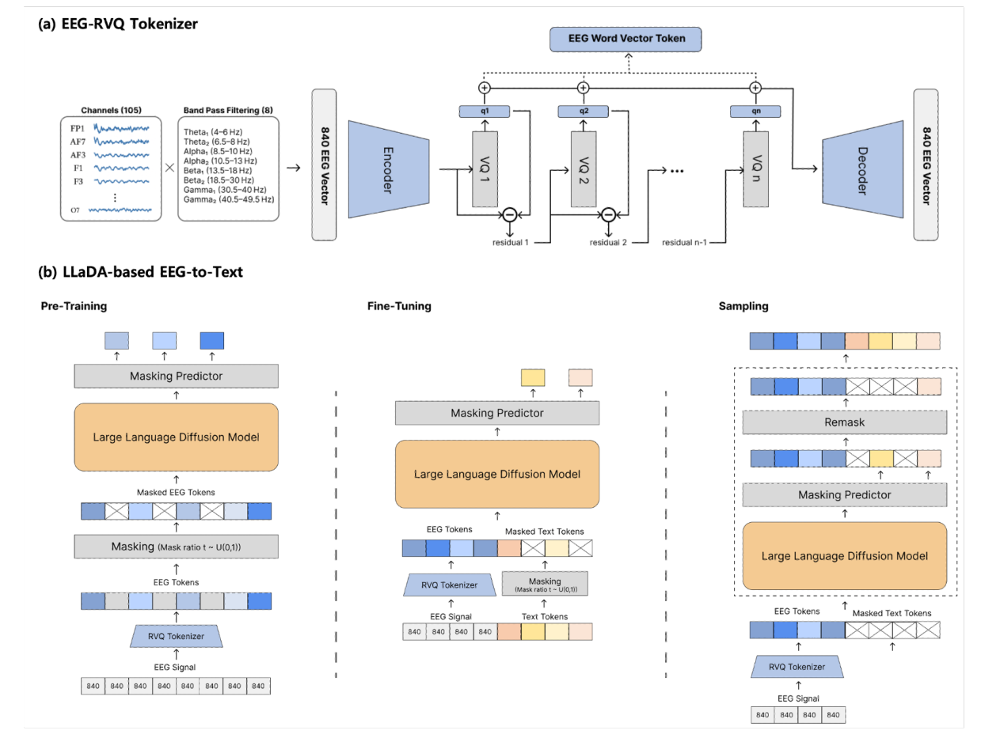

# DELTA: Language Diffusion-based EEG-to-Text Architecture

> **NeurIPS 2025 Workshop**

**作者**:MinGyu Jeon(MODULABS)、HyoBin Kim(成均馆大学)——两人共同一作(\* 标注),无通讯作者与导师署名;资助方 Brian Impact Foundation(韩国非营利组织)。两位作者的分工与机构关系原文未说明。

## 1 问题定位:EEG-to-Text 的两处不稳定

EEG-to-Text 的既有谱系:Wang & Ji 2022 的 open-vocabulary 方法把词级 EEG 特征直接映射进语言模型,DeWave(Duan et al., NeurIPS 2023)用离散 EEG 波编码做翻译,Thought2Text(2024)借 LLM 做文本生成。作者引用 Jo et al. 2024 的「Are EEG-to-Text models working?」指出要害:大量已发表结果靠 teacher-forcing 评测撑着,**不用 teacher-forcing 时,当前模型其实没有克服 EEG 固有的低信噪比**(顺带一提,这句论断的支撑引用给的是 Jiang et al. 2019——一篇去伪迹综述,与 EEG-to-Text 评测无关,引用错位)。

局限被摆成两条。信号侧:连续 EEG 波形本身不稳定,高被试间差异 + 极端噪声之下,直接映射方法的输出「近似处理随机值」(引 Jo et al. 2024);生成侧:AR 模型(BART/T5/Pegasus 这类 seq2seq)逐步生成、上一步的 token 是下一步的输入,噪声 EEG 里推错一个 token 就会级联放大整句质量(此处引的 Wang et al. 2022 是 Self-Consistency 思维链论文,与误差累积无关——又一处引用错位,见疑点清单)。

解法是两个成熟组件的组合:RVQ 承自音频压缩谱系(SoundStream、EnCodec),用分层量化把信号按「核心特征优先」逐层编码;文本侧换成掩码语言扩散 LLaDA(DDPM → D3PM → LLaDA 谱系),把生成表述为「从全掩码出发的复原」而非「逐词翻译」。作者把这叫范式转移:从直译(translation)到复原(restoration)。三条贡献:首个 RVQ + 扩散 LM 的 EEG-to-Text 框架;直译→复原的范式表述;无 teacher-forcing 条件下的验证。第一条的「首个」无法完全核实,但就站内所见确实没有先例;第三条注意——它的对照实验全部是自家重训基线,没有与任何已发表 EEG-to-Text 数字对表。

## 2 方法

### 2.1 Stage 1:RVQ EEG tokenizer(自训,VQ-VAE 目标)

输入构造(正文 + 图 1a):128 通道去噪后选 105 个有效通道(10-20 系统,图 1a 列出 FP1/AF7/AF3/F1/F3/…/O7),每通道分离 8 个带通频段——Theta₁ 4–6 / Theta₂ 6.5–8 / Alpha₁ 8.5–10 / Alpha₂ 10.5–13 / Beta₁ 13.5–18 / Beta₂ 18.5–30 / Gamma₁ 30.5–40 / Gamma₂ 40.5–49.5 Hz(只出现在图 1a,正文只说「8 个频段」;相邻频段间留 0.5 Hz 间隙,未解释)——拼成 \( 105 \times 8 = 840 \) 维**词级**特征向量。正文另说每通道提取「frequency and time series characteristics」,但 840 维里只有频段特征,时序特征提取了什么、有没有进模型,没有下文。

840 维向量序列(图 1b 底部的 [840][840][840]…,即逐词一个向量)经一维卷积 encoder 压成潜特征 \( Z \),RVQ 用 \( M \) 层码本分层量化,每层选出码向量后求和:

\[
z_q = \sum_{m=1}^{M} c^{(m,\, q_m)}
\]

训练目标是标准 VQ-VAE 三项(重构 + codebook + commitment),Decoder 负责从 \( z_q \) 重建 840 维向量(图 1a 右侧):

\[
\mathcal{L}_{\mathrm{VQVAE}} = \mathrm{MSE}(x, \hat{x}) + \mathrm{MSE}(\mathrm{sg}(z_e), z_q) + \beta \cdot \mathrm{MSE}(z_e, \mathrm{sg}(z_q))
\]

输出在图 1a 里叫「EEG Word Vector Token」——tokenizer 是**词级**的,一个句子的 EEG 变成一串 token。要点:**码本是作者在 ZuCo 数据上自训的**,不是搬 EnCodec/SoundStream 权重;但码本层数 \( M \)(图中记作 n)、每层尺寸、encoder 结构、每词产出多少 token,全部未披露。

### 2.2 Stage 2:LLaDA 两阶段训练与条件注入

**EEG 预训练**(公式 3):只吃 RVQ 产出的 EEG token,做大规模随机掩码复原、完全不碰文本——掩码比例 \( t \sim U(0,1) \)(这个关键细节只在图 1b 的 Masking 模块里,正文没写)。让 8B 模型先学会 EEG token 空间的分布:

\[
\mathcal{L}_{\mathrm{Pre\text{-}train}} = \mathbb{E}_{t,\, e_0 \sim p(e)} \left[ \mathrm{CE}(f_\theta(e_t, t),\, e_0) \right]
\]

注意规模:所谓 large-scale,语料其实就是 ZuCo 训练集自己的 20,492 句 EEG token,与站内基础模型轴线的大规模预训练不是一回事。

**EEG-to-Text SFT**(公式 4):EEG token \( \hat{Q} \) 作条件,学习从被掩码文本复原原句。条件注入方式是**序列拼接**(EEG token 前缀 + 掩码文本 token 拼进同一序列,图 1b Fine-Tuning 栏),无 cross-attention;且 SFT 阶段掩码只挂在文本支路,EEG token 不加掩码(图 1b 中 Masking 模块只接在 Text Tokens 之后):

\[
\mathcal{L}_{\mathrm{LLaDA}} = \mathbb{E}_{t,\, x_0 \sim p(x)} \left[ \mathrm{CE}(f_\theta(x_t, t, \hat{Q}),\, x_0) \right]
\]

两阶段都微调 LLaDA-8B,均用 QLoRA;单卡 L40S 40GB,AdamW,batch 32,early stopping。学习率、训练轮数、LoRA rank、early stopping 判据均未披露。

### 2.3 推理:全掩码出发的迭代复原

推理时条件**只有** EEG token:文本序列从全掩码出发(最大不确定态),固定步数迭代反向扩散,每步对整句并行 refine、逐步填坑;图 1b Sampling 栏画出每步之后还有 Remask 环节——即 LLaDA 式的重掩再预测。作者强调非自回归的两点好处:无逐步误差传播;某步推错的 token 可在后续步被修正。采样步数、Remask 具体策略(LLaDA 原版为低置信度重掩)未说明。

## 架构图

*Figure 1 · (a) EEG-RVQ Tokenizer:Channels(105:FP1/AF7/AF3/F1/F3/…/O7)× Band Pass Filtering(8:Theta₁ 4–6 / Theta₂ 6.5–8 / Alpha₁ 8.5–10 / Alpha₂ 10.5–13 / Beta₁ 13.5–18 / Beta₂ 18.5–30 / Gamma₁ 30.5–40 / Gamma₂ 40.5–49.5 Hz)→ 840 EEG Vector → Encoder → VQ 1…VQ n(残差逐层相减,⊕ 汇总 q1…qn)→ Decoder 重建 840 EEG Vector,对外输出 EEG Word Vector Token;(b) LLaDA-based EEG-to-Text 三栏:Pre-Training(EEG token → Masking t~U(0,1) → LLaDA-8B → Masking Predictor)、Fine-Tuning(EEG token 与掩码文本 token 拼接,掩码只挂文本支路)、Sampling(全掩码 → 去噪 → Remask 循环)*

---

**相关阅读**

:material-arrow-left: [BrainRVQ(同批笔记:双域 RVQ 码字服务表征预训练)](brainrvq.md) ｜ :material-vector-link: [Tokenization 演进(离散 token 的完整谱系)](../topics/tokenization.md) ｜ :material-creation: [NeuroLM(神经码进 LLM 词表的自回归版)](neurolm.md) ｜ :material-account-group: [BrainGPT(EEG 当语言序列的自回归预训练)](braingpt.md) ｜ :material-home: [首页](../index.md)
