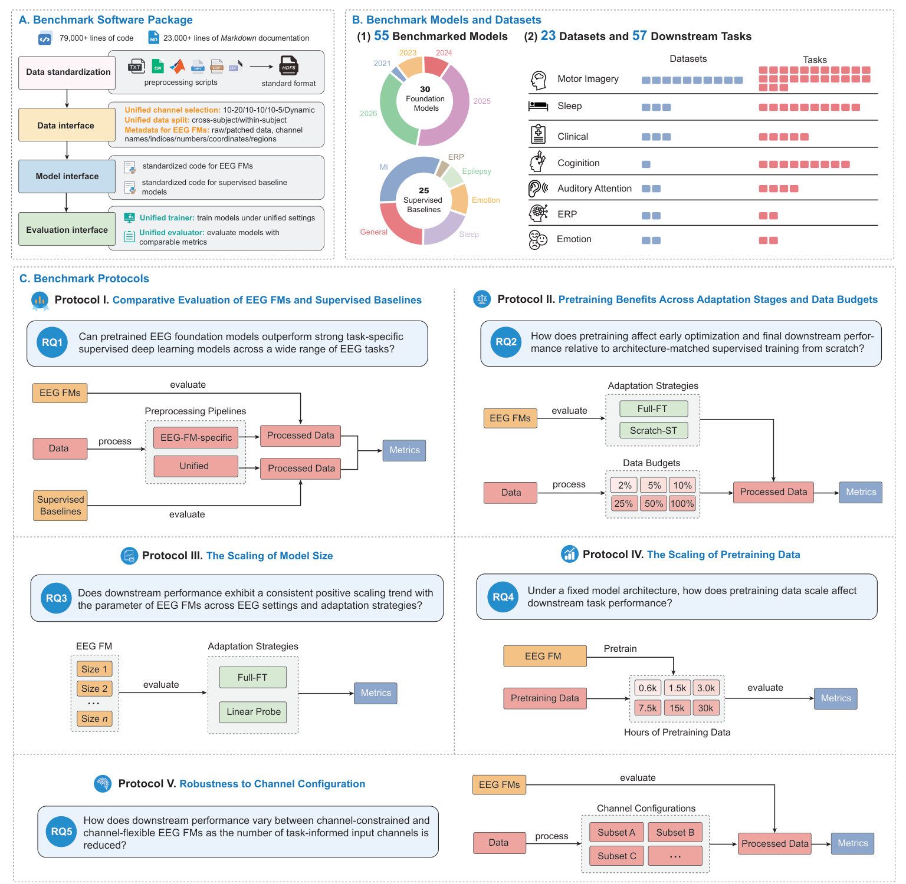

# Benchmarking EEG Foundation Models at Scale: Lessons from 20,000 Evaluations

> **arXiv 2026**

**作者**:Zhige Chen、Shu Peng、Chengxuan Qin(三人共同一作)、Rui Liu、Rui Yang、Kay Chen Tan、Jibin Wu(通讯,港理工)

## 1 问题定位:给 EEG FM 补一场有强对手的擂台赛

论文的出发点是既有基准的结构性缺陷(Table 1 清点了 11 个同类基准):监督基线普遍缺席或偏弱(EEG-FM-Bench、EEG-Bench 为 0,最多的 NeuralBench 也只有 8 个),且 FM 之间的排名把架构、参数量、预训练数据混在一起,赢了也说不清赢在哪。最终精度一个数字,还回答不了「预训练到底带来了什么」。EEG-Arena 的答案是把问题拆成五个 RQ:FM 对强基线(RQ1)、预训练收益及其随标签量的变化(RQ2)、参数量 scaling(RQ3)、预训练数据 scaling(RQ4)、通道配置鲁棒性(RQ5)——前一个靠大覆盖面横评,后四个靠受控对照实验,这是它区别于纯排行榜的地方。

## 2 基准设计

### 2.1 规模与模型口径

55 个模型 = 30 个 FM 变体 + 25 个基线(24 个 DL + YASA 谱方法);入选标准是开源可得、引用量、社区认可度。注意「30」是**变体口径**:20 个家族里 BIOT、LUNA、ST-EEGFormer、SleepFM 各 3 个变体、HEAR/REVE 各 2 个。57 个任务覆盖 7 范式(MI / Sleep / Clinical / Cognitive / AAD / ERP / Emotion;Table 4 逐任务给全定义,窗口 0.85–30 s、通道 2–144);有可靠被试元数据的任务同时报 WS(被试内)与 CS(跨被试)。

### 2.2 统一管线:统一什么、保留什么

软件包统一三件事:**数据**标准化为 HDF5(GDF/EDF 摄入,统一 split 与 10-20/10-10/10-5/动态通道选择);**模型**接口统一初始化与任务头配置,但**保留 FM 专属预处理与输入构造**(Table 7:21 套预处理并存——CBraMod 0.3–75 Hz + notch 60 + ÷100 µV,REVE session 级 z-score ±15σ 裁剪,而监督基线统一 0.1–75 Hz + notch 50 + 通道级 z-score);**训练/评估**统一(同一 split、按验证集选 checkpoint、统一优化设置)。两条排除规则很关键:预训练数据与下游数据直接重叠的结果被剔除出总排名(红 E 徽章),通道数/输入长度/格式不兼容的组合标记 unsupported 不进排名。

### 2.3 统计方法

三指标(二分类 balanced accuracy、多分类 macro-F1、Cohen's κ),对每个模型在每个任务上取三个指标名次的均值再对任务平均:

\[
\bar{r}_m = \frac{1}{|T_m|} \sum_{t \in T_m} \mathrm{rank}_t\!\left( \frac{r^{\mathrm{BA}}_{m,t} + r^{\mathrm{F1}}_{m,t} + r^{\kappa}_{m,t}}{3} \right)
\]

另有 Top-5 计数(进入任务前五的次数);双极 / 非双极设定分开排名。协议 II 的预训练增益定义为同架构 Full-FT 与随机初始化 Scratch-ST 的差:\( \bar{G}_m(d) = \bar{s}_m(d, \mathrm{Full\text{-}FT}) - \bar{s}_m(d, \mathrm{Scratch\text{-}ST}) \),在 6 档标签预算 {2%, 5%, 10%, 25%, 50%, 100%} 下配对比较。协议 IV 另用参数位移 \( P_{s,t} = \|\theta^{\mathrm{post}}_{s,t} - \theta^{\mathrm{pre}}_s\|_2 / \|\theta^{\mathrm{pre}}_s\|_2 \) 与逐层 1−CKA 度量微调改变了什么。

## 架构图

*Figure 1 · (A) 软件包:数据标准化(HDF5)→ 数据 / 模型 / 评估三接口,统一 trainer + evaluator,79,000+ 行代码;(B) 30 FM + 25 基线(2021–2026)与 7 范式 57 任务;(C) 协议 I 大横评、II 预训练收益 × 6 档标签预算、III 模型规模、IV 预训练数据 0.6k–30k h、V 通道子集鲁棒性*

## 与其他论文的关系

| 论文 / 站内结论 | 本篇的外部检验 |
|---|---|
| [BIOT](biot.md) | 翻案:站内批评其线性注意力牺牲细粒度,但在双极设定下 BIOT 是全场最强 FM(双极平均秩前三,CAP-Sleep 前三包揽);代价是非双极任务整列缺席——「通道受限换设定内最强」的定位被坐实 |
| [CBraMod](cbramod.md) | 证实:非双极 Top-5 计数第 4(仅次于 REVE-base / Uni-DMFM / NeuroRVQ)、双极平均秩榜第 15,TUEV WS 88.13 压 LaBraM-base 69.29——站内「4M 架构 > 规模」的证据链在第三方管线里方向一致 |
| [LaBraM](labram.md) | 落差:非双极榜约 29/47、TUEV 69.29;仅 base 版入榜(Huge 权重未开源,与站内笔记记录的坑一致),排名下滑有协议与版本两重原因 |
| [EEGPT](eegpt.md) | 平庸:非双极榜约 32/47、双极榜中游;其「任务依赖带通 + 统一 mV」的专属预处理(Table 7)在统一管线下没有换来优势 |
| [TFM-Tokenizer](tfm-tokenizer.md) | 警示:TFM-CHBMIT 变体双极约 26 位、非双极约 39 位——只在 CHB-MIT 上预训练的词表不外推,tokenization 精巧 ≠ 通用;站内 4.5 分评的是机制贡献,泛化项要补扣 |
| [NeuroLM](neurolm.md) / [BrainGPT](braingpt.md) | 缺席:两个最大参数路线(1.7B / 1.09B)都没进擂台,站内战绩表暂无外部对照可引 |
| [NeuroRVQ](neurorvq.md) | 高方差:非双极 Top-5 计数第 3,却在 CAP-Sleep 9.19 / TUEV 14.55 崩盘——「有的任务冠军、有的任务随机水平」的典型画像 |
| 数据专题「1000h 后边际递减」 | 正面冲突:该结论来自 TUEG 系自证,本篇受控实验 0.6k→30k h 全程上行无平台,是目前对「递减论」最强的外部反例 |

## 个人思考

- **20,000 次评测的统计功效来自配对结构,而非显著性检验**。功效的真正来源是三重配对:同 split 同 checkpoint 规则、同架构 Full-FT vs Scratch-ST、三指标名次取均值后对几十个任务聚合——把单次评测的噪声在任务维度上平均掉。但全文没有任何显著性检验或置信区间,平均秩的「有效模型集合」逐任务不同(双极榜 40 个、非双极榜 47 个),覆盖面广的模型天然多拿名次,论文承认 SleepEEGNet 的 Top-5 第一属于此类。读这篇的姿态应该是「模式可信、单点名次存疑」;
- **统一管线刻意保留了一个不统一:预处理**。这是全场最微妙的设计决定——FM 保留各自的带通/notch/归一化/窗长(0.85–30 s 跨度),意味着 FM vs 基线的差距里永远混着「输入表征选择」这个隐藏变量,反过来 FM 被自家接口锁死的部分(unsupported 标记)又让它少跑了整个非双极侧。EEG-Arena 量化的是「自带预处理的完整权重」的 FM,不是「表征本身」的 FM;Protocol I 榜单上的差距,有一部分应该记在预处理工程的账上;
- **对站内 LaBraM / EEGPT / CBraMod / BIOT 结论的冲击是分化而非通杀**:BIOT 在其设计域内被追认为最强 FM(站内评分偏低了它在本域的价值);CBraMod 的领先方向被外部复现;LaBraM 的 base 版与 EEGPT 双双平庸化——2024 世代(掩码重构 + 通道受限)在 2026 的强基线面前整体失色,而 2025–2026 的 REVE / HEAR / LEAD / ST-EEGFormer 包揽非双极前列,代际差主要落在「通道灵活性 + 预训练数据规模」两个轴上。站内 [comparison.md](../comparison.md) 的 TUEV/TUAB 战绩表今后引用时要加一句:自报数字,EEG-Arena 已提供统一口径的替代参照;
- **「数据是 scaling 轴」的判决要和站内的「边际递减」论放在一起读**。站内数据专题的递减结论出自 TUEG 系清洗语料的自我对比(数据质量与域距离混在其中),而协议 IV 是干净的单变量实验——唯一的漏洞是它只做了 REVE-base 一个架构、一个目标函数,30k h 恰约等于 REVE 原始配方,「递减论错了」还太早,更稳的表述是:清洗带来的递减没有挡住数据量的持续收益,两件事可以同时为真。

---

**相关阅读**

:material-sword-cross: [CBraMod(「架构>规模」证据链在本榜被外部复现)](cbramod.md) ｜ :material-shield-search: [BIOT(双极设定内被追认为最强 FM)](biot.md) ｜ :material-tag-multiple: [TFM-Tokenizer(泛化项被本榜扣分的警示)](tfm-tokenizer.md) ｜ :material-puzzle: [NeuroRVQ(同批笔记:高方差画像与本榜一致)](neurorvq.md) ｜ :material-home: [首页](../index.md)
