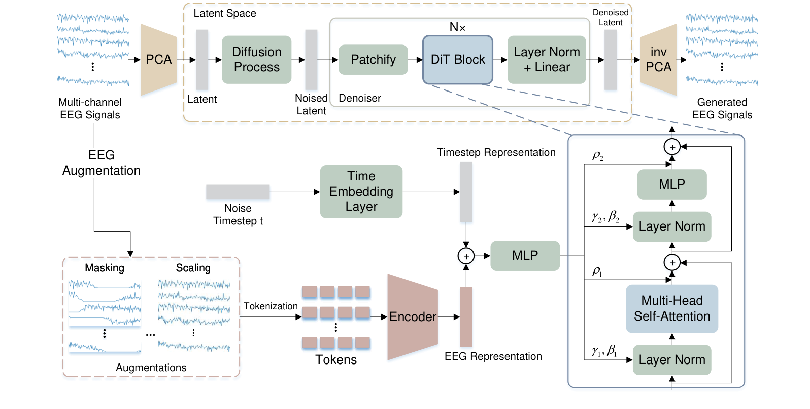

# EEGDM: Learning EEG Representation with Latent Diffusion Model

> **arXiv 2026**

**作者**：Shaocong Wang†, Tong Liu†（共同一作）, Yihan Li, Ming Li, Kairui Wen, Pei Yang, Wenqi Ji, Yong-Jin Liu\*（清华）；Minjing Yu（天津大学）

## 1 问题定位：掩码重构的局部插值捷径

站内已读的三大 EEG 基础模型（[LaBraM](labram.md)、[EEGPT](eegpt.md)、[CBraMod](cbramod.md)）全部以掩码重构为预训练目标。EEGDM 对这个目标提出结构性批评：掩码重构是「从可见锚点预测被掩片段」的任务，而 EEG 有强局部自相关——局部插值就足以把被掩 patch 补到损失很低，模型**不必**捕捉全局生成约束（整体时序模式、跨通道关系）。这与 [BrainGPT](braingpt.md) 对 MAE 的批评（双向补全破坏时序因果）、[JET](jet.md) 的立场（离散去噪错配神经动态）构成互补的第三条批评线，但落点不同：EEGDM 的解法不是换自回归或换流匹配，而是**把生成模型整个搬进来当训练目标**。

论据：能从纯噪声合成高保真内容的扩散模型，很可能在生成过程中刻画了数据的性质、结构与动力学——把这些约束压进 encoder，就得到了携带全局语义的表示。

## 2 方法

### 2.1 框架：以 encoder 表示为条件的潜扩散

原始多通道信号 \( X \in \mathbb{R}^{C \times T} \) 先按时间窗切成样本 \( x \in \mathbb{R}^{C \times t_s} \)。框架分两条支路：

**去噪目标支路（PCA 隐空间）**。每个样本沿时间维做 PCA 得到紧凑隐表示 \( z = Px \in \mathbb{R}^{K} \)（\( K = 20 \) 个主成分，基向量由特征分解求得、无需梯度训练）。扩散全程在这个隐空间进行：加噪 \( z_t = \sqrt{\bar\alpha_t}\, z_0 + \sqrt{1-\bar\alpha_t}\, \epsilon_t \)，去噪结束后经逆变换还原信号 \( \tilde{x} = P^{\top} \tilde{z} \)。PCA 变换的是**去噪目标**，降低扩散模型面对的维度。

**条件支路（EEG encoder）**。源信号 \( x' \)（原样本 + 增强视图）经共享 encoder \( f_\phi \) 编码，三个视图的表示平均池化成条件表示：

\[ e_i = f_\phi(x'_i), \quad e = \frac{1}{m} \sum_{i=1}^{m} e_i \quad (m = 3) \]

\( e \) 与噪声时间步嵌入一起，经 **adaLN-Zero** 块调制 DiT 去噪器：条件嵌入回归缩放/平移参数 \( \gamma, \beta \) 与残差前的逐维缩放 \( \rho \)（\( \rho \) 的 MLP 零初始化，使每个 DiT 块初始为恒等映射——训练起点稳定）。

**关键设计：\( e \) 不 detach**。去噪损失沿 \( e \) 反传到 encoder：

\[ \mathcal{L}_{\mathrm{simple}}(\theta, \phi) = \mathbb{E}_{x, t, \epsilon_t} \big\| \epsilon_\theta(z_t, t, e) - \epsilon_t \big\|_2^2 \]

encoder 参数 \( \phi \) 与扩散参数 \( \theta \) 联合优化——表征学习被重新定义为「学一个对去噪最有用的条件表示」。总目标再加变分下界项（预测协方差需要，改进版 DDPM 惯例）：

\[ \mathcal{L} = \mathcal{L}_{\mathrm{simple}} + \lambda_{\mathrm{vlb}} \mathcal{L}_{\mathrm{vlb}}, \qquad \lambda_{\mathrm{vlb}} = 1 \]

### 2.2 EEG Encoder

ViT 式架构：每通道按 \( \omega \) 长度无重叠切 patch，1 层 1D 卷积时序编码器（512 通道、核 200、步幅 200）把每个 patch 映射为 \( d = 512 \) 的 token，加可学习位置嵌入，进 8 层 Transformer（hidden 512、8 头、MLP 2048），输出 embedding **平均池化**得到样本级表示。下游任务在表示上接线性预测头。

增强视图设计（延续对比学习文献中验证有效的两种）：**零掩蔽**（每通道置零连续 0.4s）与**幅值缩放**（整段乘 \( U[0.8, 1.2] \) 系数），加原样本共三个源视图。增强作用于**条件支路**——迫使 encoder 从扰动视图中保留与目标共享的信息。

### 2.3 训练设置

预训练 TUEG：19 个公共通道、200Hz、30 秒非重叠样本（570 个 1s patch）；DiT 8 块、\( T = 1000 \) 扩散步；AdamW lr 5e-4（OneCycleLR）、batch 32、EMA 0.9999；4×A100 约 32.9 万步（约 113 小时），完全从零训练。下游微调 encoder **不冻结**（统一 lr 5e-4），另报线性探针。

## 架构图

*Figure 1 · encoder 表示 \( e \) 与噪声时间步表示相加后经 MLP 回归 adaLN-Zero 的 \( \gamma, \beta \)（缩放/平移）与 \( \rho \)（残差前逐维缩放），条件信息以此方式调制每一层去噪*

## 与其他论文的关系

| 论文 / 工作 | 关系说明 |
|---|---|
| [JET](jet.md) | 生成轴线双子星：JET 用流匹配**直接生成**原始 EEG（生成质量导向，TS-FID 论英雄）；EEGDM 用扩散**以生成训表征**（下游指标导向）。同用 adaLN 条件注入（JET 注入 t/类，EEGDM 注入 t/encoder 表示）与「生成目标须建模全局分布」的立场 |
| [EEGPT](eegpt.md) | 「显式约束表示」的两种解法：EEGPT 加对齐分支 \( L_A \)（轻，表示空间对齐）；EEGDM 让表示当扩散条件（重，信号空间生成）。同为 25M EEG-ViT-Large 规模，EEGPT 偏好线性探针、EEGDM 需微调兑现 |
| [CBraMod](cbramod.md) / [LaBraM](labram.md) | 被批评的掩码重构主线：EEGDM 批评其「局部插值捷径」；TUEV 上互有胜负——CBraMod 赢 Weighted F1/Kappa，EEGDM 赢类均衡指标与少数类召回；TUAB 上 CBraMod 仍领先约 1.1pp |
| [BrainGPT](braingpt.md) | 批评 MAE 的另一条线（自回归 vs 双向插值）：三者（BrainGPT/JET/EEGDM）从因果、连续演化、全局生成三个不同角度攻击同一目标 |
| [生成模型脉络](../basics/generative-lineage.md) | 本文是「DDPM 线」在 EEG 表征学习上的落地实例：条件潜扩散 = PCA 隐空间（对应 VAE 的隐空间思想，但零训练线性化）+ DDPM 目标 + DiT 骨干 + adaLN-Zero（DiT 标配） |
| Puah-EEGDM-SSM（arXiv:2508.14086） | 撞名的另一篇：SSM 进扩散预训练；EEGDM 用 DiT 在 PCA 流形上捕捉跨通道同步与相位关系，同分布对照与多任务上占优（Puah 法在 SHU-MI 近随机） |
| [EEG-FM-Compass](../blog-2023-2026.md) | 尚未被该 benchmark 收录——生成式预训练在统一评测下的排名是待验证问题；本文的类均衡指标实践（G-Mean/Macro AUC）值得 benchmark 借鉴 |

---

**相关阅读**

:material-creation: [JET · 流匹配生成 EEG（生成轴线姊妹篇）](jet.md) ｜ :material-magnify: [EEGPT（显式表示约束的轻量版对照）](eegpt.md) ｜ :material-chart-timeline-variant: [生成模型脉络（DDPM 线的 EEG 落地）](../basics/generative-lineage.md) ｜ :material-compress: [CBraMod（掩码重构主线对照）](cbramod.md) ｜ :material-home: [首页](../index.md)
