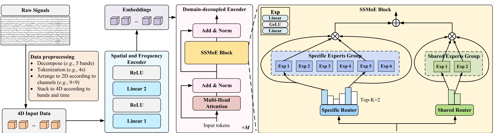

# EEGMoE: A Domain-Decoupled Mixture-of-Experts Model for Self-Supervised EEG Representation Learning

> **IEEE TNNLS 2026**

**作者**：Xuange Gao, Danli Wang, Yanyan Zhao（State Key Laboratory of Multimodal Artificial Intelligence Systems, CASIA）

## 1 问题定位：统一格式 ≠ 学好表征

任务专用 EEG 模型（DEAP 上调好的情绪模型换到 MI 就失效）泛化受限，这已是共识；近年的回应是大规模自监督预训练——LaBraM、BIOT、DMAE-EEG 等把不同数据集**统一成同一格式**喂给一个模型。EEGMoE 对这条路线的批评是：**统一格式只处理了「怎么喂」，没处理「喂进去之后域与域打架」的问题**。

论文的实证很直观（Fig. 1）：在经典 Transformer 上对 DEAP（ER）、BCIC4-2a（MI）、STEW（MWL）三个任务交替做自监督预训练，把每步梯度更新方向投影到 2-D 参数空间——ER 把参数往右下拉、MI 往左上拉、MWL 往右上拉。**异质域的梯度冲突是真实存在的**，而同质参数硬吃异构数据的后果是域特定细节被抹掉。

对 EEG 里已有的 MoE 工作，论文的批评分三类：IDMMOE、Seizure-MoE 用**全部专家加权求和**（丧失 MoE「选择性激活」的核心优势）；MoGE 是单任务有监督特征提取器；EEGMamba 虽有 MoE 但靠**任务 token 引导专家选择**、面向有监督多任务兼容，而非自监督的细粒度域解耦。EEGMoE 自称是**首个用 MoE 做解耦式 EEG 表征学习**的工作。

## 2 方法

### 2.1 数据预处理：4-D 脑地图输入

原始信号切 Ts 秒不重叠片段 → 每段分解为 **5 个频带**（δ 1–4Hz、θ 4–8Hz、α 8–14Hz、β 14–31Hz、γ 31–45Hz）→ 每个频带按电极的头皮位置摆成 **2-D 脑地图**（高斯平滑/z-score 消除突变）→ 沿频带堆成 3-D → 按时间堆成 4-D：X ∈ R^{(T×Sr)×B×H×W}。一个空间与频率编码器（两层 MLP，隐藏 64→128）沿通道和频带维度聚合，得到 embedding Z。注意这一步顺带解决了**跨数据集 montage 不一致**——所有数据集都被映射到统一的 2-D 电极网格上。

### 2.2 SSMoE 块：Specific + Shared 双专家组

域解耦编码器的 Transformer 层中，FFN 被替换为 SSMoE 块，由两部分相加：

**Specific MoE（Top-K 硬路由 → 域特定）**：E 个专家（每个是两层 MLP + GELU），路由器按 token 计算激活概率后只选 Top-K 个：

\[ g_x = W_e \cdot x, \qquad p_i(x) = \frac{\exp(g_{x_i})}{\sum_{j=1}^{|E|} \exp(g_{x_j})}, \qquad \mathrm{SpecMoE}(x) = \sum_{i \in \mathrm{TopK}} p_i(x)\, e_i(x) \]

**Shared MoE（软路由 → 域共享）**：F 个固定专家**无论输入是什么都全部参与**，保证共性表征不被路由丢弃：

\[ \mathrm{ShareMoE}(x) = \sum_{i \in F} p_i(x)\, f_i(x) \]

**SSMoE(x) = SpecMoE(x) + ShareMoE(x)**——简单相加。直觉分工：不同 token 按域挑选不同专家组合（特性），同一组共享专家对所有数据一视同仁地学习（共性）。

### 2.3 两阶段训练

**Stage 1 自监督预训练**：随机掩码 embedding，SSMoE 重构被掩表示，L1 重构损失 + **负载均衡辅助损失**（防 Top-K 路由把 token 都塞给少数过载专家）：

\[ \mathcal{L}_{\mathrm{pretrain}} = \mathcal{L}_1 + \alpha \mathcal{L}_{\mathrm{aux}}, \qquad \alpha = 1 \times 10^{-4} \]

**Stage 2 有监督微调**：继承预训练的域解耦编码器，接**单层线性分类头**，交叉熵微调。

## 架构图

*Figure 2 · SSMoE 块细节：Specific Router 按 token 选 Top-K=2 个特定专家，Shared Router 让 2 个共享专家对所有 token 全程参与*

## 与其他论文的关系

| 论文 / 工作 | 关系说明 |
|---|---|
| LUNA（本站同期笔记） | **哲学相反的姊妹篇**：EEGMoE 把域差异当「信号」解耦保留（MoE 分工），LUNA 把拓扑差异当「噪声」统一抹平（query 瓶颈）；且一个作用于任务/数据集轴，一个作用于电极几何轴 |
| EEGMamba | 都在 EEG 用 MoE：EEGMamba 靠任务 token 引导专家选择、面向**有监督多任务兼容**，EEGMoE 做**自监督细粒度域解耦**（差异在特征层） |
| LaBraM / BIOT | 被反超的对照组：癫痫域预训练 → 认知任务下游的域失配是它们复现成绩差的主因（论文归因） |
| IDMMOE / Seizure-MoE | 早期 EEG-MoE：全专家加权求和，没有选择性路由 |
| NeuroLM | 同为「多任务统一」但路线不同：NeuroLM 把 EEG 变成 LLM 的外语用指令微调；EEGMoE 在表征层用专家分工 |
| [通道异构专题](../topics/multi-task.md#channel-adaptation) | 先用统一脑地图处理布局，再用**解耦路由**学习域共性与域特性 |

## 个人思考

- **参数量是最好的清醒剂**：1.68M 总参数/0.89M 激活——MoE 在 EEG 的价值压根不在 scale（那是 NLP 千亿参数的游戏），而在**用条件计算管理异构性**。这也解释了为什么 total-equivalent 模型（1.68M 稠密）反而比 EEGMoE 差：同样的参数量，解耦路由的「分工先验」本身就是收益；
- **「large-scale」这个词要打折看**：预训练语料约 142 小时、9 个数据集全是小样本认知任务数据集。这更像一次严肃的多域联合训练研究，而非 NeurIPS 意义上的基础模型工作——它的可扩展性（换更多域、更多数据）恰恰是 MoE 路线的理论优势，但论文没验证；
- **4-D 脑地图输入是个隐藏的大决定**：把波形离散化到 2D 电极网格 + 5 频带，等于放弃原始波形的相位/形态细节（对比 JET/TFM 的 raw/时频路线），换来的是**任何 montage 都能摆进同一张网格**。这个取舍和 LUNA 的 query 统一异曲同工——都是「牺牲信号细节换拓扑统一」，只是实现位置不同（输入端 vs 编码器内）；
- **掩码的是 embedding 而非原始信号**：预训练目标是重构空间/频率编码器输出的 embedding，不是重建波形。这与 CBraMod（重构 raw patch）形成对比——重构 embedding 更容易（信息已压缩），但学到的动态也受限于编码器的表达能力；
- **DEAP 上 STD 高达 7–11 个百分点**（LOSO 逐被试波动大），和基线同量级——跨被试方差这个 EEG 老大难并没有被 MoE 化解，域解耦按数据集/任务分工，但「被试内差异」这层域没有被显式建模。IDMMOE 按被试分配子空间的思路其实可以叠上来。

---

**相关阅读**

:material-arrow-right: [LUNA（拓扑统一路线，对照阅读）](luna.md) ｜ :material-arrow-left: [JET（流匹配生成）](jet.md) ｜ :material-grid-large: [通道适配与多任务学习](../topics/multi-task.md#channel-adaptation) ｜ :material-chart-box: [十一篇方法对比](../comparison.md) ｜ :material-home: [首页](../index.md)
