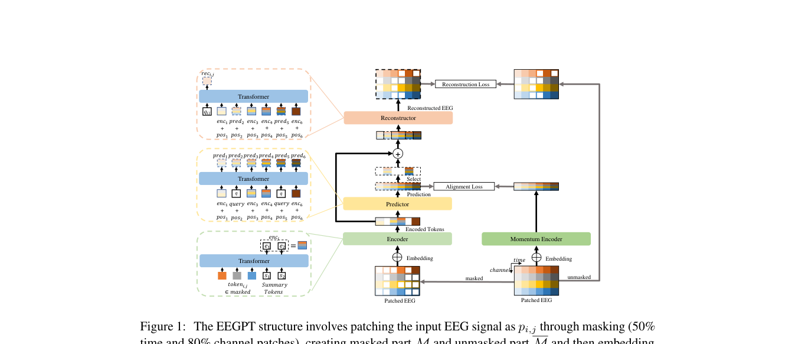

# EEGPT: Pretrained Transformer for Universal and Reliable Representation of EEG Signals

> **NeurIPS 2024**

EEGPT: Pretrained Transformer (NeurIPS 2024)

**作者**：Guagnyu Wang 等（哈尔滨工业大学）

#### 3.1 问题定位

EEG 低信噪比、被试间差异大、通道不匹配，导致掩码自编码器（MAE）学到的特征质量差、BERT 式模型没有显式表示 z。EEGPT 提出仅 ~10M 参数的通用特征提取器，用**双自监督**（时空表示对齐 + 掩码重构）训练，下游只做 **linear probing**。

#### 3.2 方法

**理论动机（式 1→2）**：标准 MAE 只有 \( \mathcal{H}(d_\phi(z),\ x \odot (1-M)) \) 重构项，没有显式的隐变量z；EEGPT 加一条表示对齐分支 \( \mathcal{H}(z,\ f_\theta(x)) \)，显式地让 encoder 输出 z ，携带全局语义，提升编码质量与泛化。

**局部时空 embedding**

- 58 电极、256Hz、输入 4 秒（T=1024）；每 patch 时间长度 d=64（250ms），共 N=16 个时间 patch；
- patch embedding + **通道 embedding（Code book）**：可学习通道向量 `{ς_i}`，**灵活对应任意数据集的通道配置**（通道适配的关键）；
- \( \mathrm{token}_{i,j} = \mathrm{Embed}(p_{i,j}) + \varsigma_i \)。

**双自监督预训练**
三条路径，patch后输入：第一条不掩码，经过momentum encoder得到压缩后的表示；第二条做掩码之后备用；第三条不经过momentum encoder,掩码后经过encoder得到压缩表示，再经过predictor预测掩码部分得到完整预测表示，和第二条表示做对齐；然后把掩码部分挖掉，经过reconstructor映射回原始信号维度，和第二条做reconstruction loss.

**路径① · 完整信号 → Momentum encoder（对齐目标）**。不做掩码，经动量编码器 \( f_{\bar\theta} \)（权重由在线 encoder 的 EMA 更新，目标侧不回传梯度）输出**全部位置**的目标表示：

\[ \mathrm{menc}_j = f_{\bar\theta}(x)_j, \qquad j = 1, \dots, N \]

**路径② · 掩码信号（真值备用）**。按 \(50\%\) 时间 × \(80\%\) 通道挖掉 patch，被挖掉的原始 patch 记为 \( \{p_{i,j}\}_{(i,j)\in\mathcal{M}} \)，留作重构目标。与 MAE 相反的关键设计：encoder 不看这些位置，只处理掩码后剩下的稀疏可见 token，且每个时间步追加 \(S\) 个可学习 summary token（类似 [CLS]）聚合全局信息。

**路径③ · 掩码视图 → Encoder → 两个头（学习支路）**。

- **Encoder** 编码稀疏可见部分：

\[ z_{\mathcal{V}} = f_\theta\big( \{x_p\}_{p\in\mathcal{V}},\ \text{summary tokens} \big), \qquad \mathcal{V}\ \text{为可见位置集合} \]

- **Predictor（对齐头）**：以 encoder 特征 + RoPE 旋转位置编码 + 可学习 query token，预测**全部时间段**的表示，与路径①的目标做对齐（JEPA 风格：在表示空间对齐，不做像素级重建；目标侧 LayerNorm 稳定训练）：

\[ \mathrm{pred}_j = P\big( z_{\mathcal{V}},\ \mathrm{RoPE}_j,\ q \big), \qquad \mathcal{L}_A = \frac{1}{N} \sum_{j=1}^{N} \big\| \mathrm{pred}_j - \mathrm{LN}(\mathrm{menc}_j) \big\|_2^2 \]

- **Reconstructor（重构头）**：encoder 特征（可见部分）+ predictor 特征 + 位置信息 → 映射回原始信号维度，只重构被掩 patch（encoder→reconstructor 有 **skip connection**，保持特征、加速收敛），与路径②的真值对齐（MAE 风格，目标侧同样做 LayerNorm）：

\[ \mathcal{L}_R = \frac{1}{|\mathcal{M}|} \sum_{(i,j)\in\mathcal{M}} \big\| \mathrm{rec}_{i,j} - \mathrm{LN}(p_{i,j}) \big\|_2^2 \]

**总损失**：

\[ \mathcal{L} = \mathcal{L}_A + \mathcal{L}_R \]

分工：\( \mathcal{L}_A \) 迫使 encoder 在只剩稀疏可见 token 的条件下输出对齐全量目标的全局语义表示（linear probing 不微调直接可用的来源）；\( \mathcal{L}_R \) 把表示锚回局部信号细节。

**下游 Linear Probing**

- encoder 完全冻结，只加两个轻量模块：**adaptive spatial filter**（1×1 卷积，对齐数据通道与模型通道）+ 线性分类头；
- 只用 encoder 输出的 **summary token** 对应特征送入分类头；
- 目的：避免大数据模型在小样本微调下过拟合，同时让性能纯粹反映 encoder 本身的表示质量。

#### 3.3 创新点

1. **双自监督**：表示对齐（JEPA 式，在表示空间预测）+ 掩码重构（MAE 式，在信号空间重构）——显式表示 z，对抗低信噪比导致的特征质量差；
2. **掩码方向反转**：encoder 看被 mask 的稀疏部分、momentum encoder 看全量，迫使 encoder 输出含全局信息；
3. **通道 Code book**（名字→向量映射）实现跨设备/跨通道配置适配；
4. **Linear probing 达到 SOTA**：证明学到的特征本身足够通用，小样本下游免微调；
5. 参数规模 scaling law 实证：\( \mathrm{ACC} = (33.6 \cdot N)^{0.029} \)、\( \mathcal{L}_R = (0.72 \cdot N)^{-0.014} \)。

## 架构图

*Figure 1 · 双自监督结构：encoder 看 masked 部分 + predictor 对齐 momentum 输出 + reconstructor 重构*

## 与其他论文的关系

| 论文 / 工作 | 关系说明 |
|---|---|
| 思想上 | 承接 BYOL（momentum encoder）+ MAE（重构）+ JEPA（在表示空间预测）三条线 |
| LaBraM | 互补路线：LaBraM 走离散语义码，EEGPT 坚持连续表示但把自监督目标做得更好 |
| TFM-Tokenizer | 对照实验：EEGPT 依赖固定 58 通道布局的 Codex book，ear-EEG 跨设备实验无法参与 |

---

**相关阅读**

:material-arrow-left: [上一篇：LaBraM](labram.md) ｜ :material-arrow-right: [下一篇：BrainGPT](braingpt.md) ｜ :material-vector-link: [Tokenization 演进](../topics/tokenization.md) ｜ :material-chart-box: [十三篇方法对比](../comparison.md)
