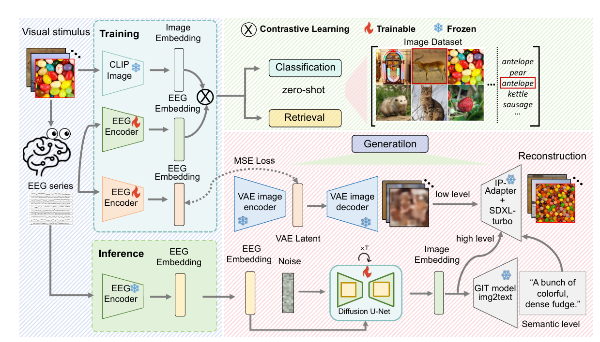

# Visual Decoding and Reconstruction via EEG Embeddings with Guided Diffusion

> **arXiv 2024**

**作者**:Dongyang Li\*、Chen Wei\*(共同一作)、Shiying Li、Jiachen Zou、Haoyang Qin、Quanying Liu\*(通讯)——全部来自南方科技大学生物医学工程系

## 1 问题定位:把 fMRI 的视觉重建范式搬进 EEG

fMRI 视觉解码在 2023 年被「对比学习 + 生成模型」组合推到高潮:[Takagi & Nishimoto](https://arxiv.org/abs/2211.06956) 的 LDM 重建、Ozcelik & VanRullen 的潜扩散、Mind's Eye(Scotti et al.)的对比学习 + 扩散先验都能从 fMRI 重建出语义正确的高分辨率图像。但 fMRI 昂贵、不可携、时间分辨率低(~1s 量级),天然不适合 BCI。EEG 便宜、便携、毫秒级时间分辨率,却长期被认为做不了自然图像解码:低信噪比、低空间分辨率、被试间差异大。

离这个问题最近的两步:Benchetrit et al.(文中记作 B.D.)在 MEG 上用 CLIP 对齐 + 扩散先验实现近实时重建;Song et al.(NICE)用 ShallowNet 时空卷积做 EEG 编码器、对比学习对齐,在 THING-EEG 上做出像样的解码。但两者与 fMRI 水平仍有显著差距,作者的归因是「EEG 视觉解码框架没有被彻底探索」。本文的三个贡献:① 首个 EEG 零样本分类+检索+重建统一框架(编码器可任意替换);② 精心组装的编码器 ATM,三任务 SOTA;③ 两阶段 EEG→图像生成策略,只用不到 500ms 的 EEG。

一个值得先立的背景:以往 EEG 图像分类多次被 block 设计坑——同类图像连块呈现,解码器可以靠自相关噪声作弊(Li et al. 的 block design 批评,[27])。THINGS 的 RSVP 快速流呈现 + 目标检测任务 + 概念级零样本划分,是这套协议比「40 类分类」可信的根本原因。

## 2 方法:对齐 + 两阶段引导扩散

### 2.1 ATM:不切 patch 的通道注意力编码器

EEG 数据 \( E \in \mathbb{R}^{N \times C \times T} \)(N 样本、C 通道、T 时间窗),目标是学 \( Z_E = f(E) \in \mathbb{R}^{N \times 1024} \) 对齐 CLIP 图像嵌入 \( Z_I \in \mathbb{R}^{N \times 1024} \)。ATM 三段(图 3):

- **嵌入与通道注意力**:整段 EEG 序列**不切分、每段序列即一个 patch**,经线性层 + 正弦位置编码后,通道注意力层(channel-wise attention)整合各导联信息,并附带可解释性(电极相关性);
- **时空卷积模块(可插拔)**:承 NICE 的设计——时空卷积参数量小、抗过拟合;两个配置:ATM-S 用 ShallowNet 卷积、ATM-E 用 EEGNetV4 卷积,放在 **Transformer 编码器之后**效果最好(pre 14.23 vs post 28.64,Table 4);
- **MLP 投影器**:M 个残差组件 + 全连接层 + 输出 LayerNorm,汇成 1024 维。另给每个样本拼一个**被试 token**:已知被试用专属 ID token,未知被试用共享 token 或全 token 平均——联合被试训练,一个模型同时服务被试内与跨被试推理。

参数量(Table 2):通道注意力 553K + 时空卷积 104K + 聚合 0 + MLP 投影 2.53M,合计 **3.18M**。附录消融(Table 4)里最有趣的几条:token 策略是生死线——保留维度进时空卷积 28.64、扁平化 14.85、平均成单 token 7.29;FFN 沿时间维 28.64、沿空间维 19.92;**位置编码可有可无**(正弦 27.96 / 可学习 26.66 / 无 28.64)——「整段序列一个 patch」的设定下位置编码根本没有用武之地。

### 2.2 对齐目标:CLIP 损失 + MSE

图像嵌入用 CLIP(ViT 架构,1024 维整体向量,而非 257×768 patch 网格)。分类/检索任务只用 CLIP 对比损失(温度 \( \tau = 0.07 \)):

\[
\mathcal{L}_{\mathrm{CLIP}} = -\frac{1}{N}\sum_{i=1}^{N} \log \frac{\exp(\mathrm{sim}(z_E^{(i)},\, z_I^{(i)})/\tau)}{\sum_{j=1}^{N}\exp(\mathrm{sim}(z_E^{(i)},\, z_I^{(j)})/\tau)}
\]

生成任务额外加 MSE 回归损失做一致性学习,总损失(双损失设计承 B.D.):

\[
\mathcal{L} = \lambda \cdot \mathcal{L}_{\mathrm{CLIP}} + (1-\lambda) \cdot \mathcal{L}_{\mathrm{MSE}}
\]

\( \lambda \) 取值全文未披露。消融的组件账目(Table 3,THINGS-EEG 检索):仅 MLP 8.11 → MLP+TSConv 21.65(ATM-S)/ 17.95(ATM-E)→ MLP+CAL 23.73 → 全量 ATM-S 28.64 / ATM-E 24.92。时空卷积与通道注意力各贡献约 5–7 个点,无卷积骨干时 ATM-S 与 ATM-E 退化为同一模型(表内同值与此一致)。

### 2.3 Stage I:EEG 条件的先验扩散

联合分布分解(DALL-E 2 式):

\[
p(I,\, z_E,\, z_I) = p(z_I \mid z_E)\; p(I \mid z_I)
\]

Stage I 学 \( p(z_I \mid z_E) \):一个**轻量 U-Net** \( \epsilon_{\mathrm{prior}}(z_I^t,\, t,\, z_E) \) 以 EEG 嵌入为条件对噪声化的 CLIP 嵌入去噪。正文自己称之为 EEG-Conditioned Diffusion——**机制上是条件扩散,不是 classifier guidance**;「Guided」体现在两处:采样时的 classifier-free guidance 外推,与 Stage II 的低层 img2img 引导。CFG 公式:

\[
\epsilon^{w}_{\mathrm{prior}}(z_I^t;\, t,\, z_E) = (1+w)\,\epsilon_{\mathrm{prior}}(z_I^t;\, t,\, z_E) - w\,\epsilon_{\mathrm{prior}}(z_I^t;\, t), \qquad w \geq 0
\]

训练时以 10% 概率把 \( z_E \) 替换为空向量;guidance scale \( w \) 的取值未披露,Fig. 6d 只展示其对「相似度 vs 多样性」的调节。**协议模糊点**:C.1 写「训练使用来自 ImageNet 数据库、超过一百万图像的配对来微调 EEG 条件扩散模型」——THINGS-EEG 里没有 ImageNet 的 EEG,这批配对如何构成正文没有解释。

### 2.4 Stage II:SDXL 渲染与低层/语义管线

Stage II 用冻结的 SDXL + IP-Adapter 建模 \( p(I \mid z_I) \):去噪模型 \( \epsilon_{\mathrm{SD}}(z_t,\, t,\, z_I) \) 作用于 SDXL VAE 潜变量,IP-Adapter 以双交叉注意力把 CLIP 嵌入 \( z_I \) 注入 U-Net。两条辅助管线:

- **低层管线**:CLIP 缺低层视觉特征,故再训一条 EEG→VAE latent(4×64×64)的对齐——投影层 + 上采样 CNN,200 epochs;试过 latent MSE、对比损失、VAE 重构损失,**纯 latent MSE 最好**(重构/对比损失更差且显存开销大;低层视觉模型蒸馏反而过拟合,与 MindEye 结论一致)。低层对齐的证据:VAE latent 检索 top-1 **10.14%** / top-5 29.55%(机会 0.5 / 2.5,Table 5)。使用时 SDXL 推理 10 步(SDXL-turbo 4 步)、img2img 去噪强度 0.5;作者承认 EEG 低层零样本重建「不够稳定,可能误导模型」;
- **语义管线**:先验扩散输出的 1×1024 EEG 特征经图像投影器得 256×1024 图像特征,GIT 模型直接生成 caption 作 SDXL 文本提示。但 caption 从低维 EEG latent 生成不稳定,可能干扰正确语义——**呈现的重建结果并不强制使用语义管线**。

Fig. 10 的对照实验:单阶段(EEG 嵌入直接生成)明显差于两阶段(先验扩散精炼后再生成)——先验扩散把 EEG 嵌入「拉回」CLIP 图像嵌入流形这一步是必要的。

## 架构图

*Figure 2 · 左列:训练块——视觉刺激经 CLIP Image(雪花冻结)与 EEG Encoder(火焰可训练)分别嵌入,⊗ 对比学习对齐,零样本做 Classification / Retrieval(右侧 Image Dataset 给出 antelope / pear / kettle / sausage 候选);推理块 EEG Encoder 亦冻结。右下 Generation 块:EEG 嵌入经 MSE Loss 对齐 VAE image encoder → VAE Latent → VAE image decoder 出低层模糊图;EEG 嵌入 + Noise 进 Diffusion U-Net(×T,可训练)出图像嵌入(高层);两者汇入 IP-Adapter + SDXL-turbo 渲染重建图像;GIT model img2text 从图像嵌入生成 caption(如 "A bunch of colorful, dense fudge.")作文本提示(语义层)。图内 "Generatilon" 系原文笔误*

---

**相关阅读**

:material-eye: [EEGDM · 条件扩散的反向用法(以生成训表征)](eegdm.md) ｜ :material-image-multiple: [Not-All-EEG(生成轴线:位置自适应调度)](not-all-eeg.md) ｜ :material-creation: [JET(流匹配生成 EEG 的质量标杆)](jet.md) ｜ :material-waveform: [Défossez 语音解码(感知解码姊妹线)](defossez-speech.md) ｜ :material-home: [首页](../index.md)
