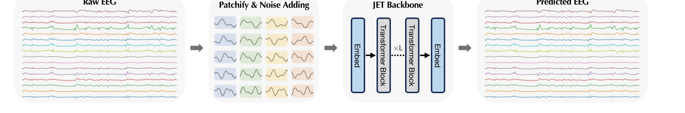

# JET: Let EEG Models Learn EEG

> **ICML 2026**

**作者**：Yifan Wang, Yijia Ma, Wen Li, Chenyu You

## 1 问题定位：为什么 EEG 生成这么难

EEG 建模的根本瓶颈是数据——高质量临床记录昂贵、需专家标注、受隐私法规限制，即便是最大的公开语料 TUH EEG Corpus 也比现代基础模型的预训练数据小几个数量级。生成建模是自然的出路，但现有范式（GAN、扩散）都栽在同一件事上：**EEG 的统计特性与通用生成范式的前提假设不匹配**。

论文把这种不匹配拆成三条内在挑战：

| 挑战 | EEG 的真实性质 | 通用范式的失效方式 |
|---|---|---|
| 幂律频谱结构（谱偏置） | 功率谱服从 1/f^χ，高频瞬变能量低但信息密集 | 以能量最小化为主的损失压制高频成分 → 过度平滑 |
| 非平稳时间动态 | 亚秒级持续变化的能量与连接性 | 离散生成步难以刻画流体式过渡 → 波形静止、重复 |
| 重尾幅度分布 | 幅值重尾、方差模式复杂 | 高斯先验坍缩向均值 → 覆盖不到病理记录的极端幅值 |

论文的归因很干脆：离散去噪形式在**各向同性噪声假设下优化局部重构精度**，而 EEG 生成需要的是**跨时间、频率、幅度的全局结构保真**；局部小误差在生成步中累积，最终表现为频谱偏置、时间相干性退化、统计特性错配。

由此提出核心论点：脑活动在高维状态空间里**平滑演化**，因此生成应当跟随一条连续轨迹，而不是一串离散的去噪步骤——这正是条件流匹配的适用场景。

## 2 方法

### 2.1 条件流匹配的形式化

记 x₁ ~ q(x₁) 为 EEG 数据样本，x₀ ~ N(0, I) 为标准高斯先验。流匹配要学的是随时间演化的向量场 \( v_t(x, t) \)，把概率密度从 x₀ 输运到 x₁（t 从 0 到 1）。

为了让训练可解，采用条件流匹配：给定配对 (x₀, x₁)，定义线性插值路径

\[ x_t = t\,x_1 + (1-t)\,x_0, \qquad t \in [0, 1] \]

其时间导数给出了回归目标向量场：

\[ u_t(x_t \mid x_0, x_1) = \frac{dx_t}{dt} = x_1 - x_0 \]

网络 \(f_\theta\)（即 JET）接收带噪状态 \(x_t\)、时间 \(t\)、类别标签 \(c\)，预测 \(v_\theta(x_t, t, c)\)。**推理时**从 \(x_0 \sim \mathcal{N}(0, I)\) 出发解常微分方程即可采样：

\[ \frac{dx_t}{dt} = v_\theta(x_t, t, c) \]

与扩散的对照：扩散是「随机去噪动力学」（每步注入/去除噪声），流匹配是「学习一个平滑的时变向量场，其积分曲线实现从源分布到目标分布的最优输运」。论文用三个流形上的玩具实验直观对比了 GAN / 扩散 / 流匹配三种范式学到的分布。

### 2.2 架构：为什么不切时频图、也不要邻接矩阵

论文的架构选择有一个明确的立场：**直接在原始多通道序列上建模**，不做时频变换、不用预定义邻接矩阵。理由是 EEG 的两个物理性质违反了卷积与静态图模型的先验假设——**容积传导**让单一神经源的活动同时扩散到多个电极（空间依赖不是局部的），**功能连接**随时间连续演化（连接结构不是静态的）。自注意力提供的全局感受野天然适合表达跨越远近时间点与空间分布通道的依赖。

**原始 EEG 的 tokenization**：输入 X ∈ R^{C×T}（C 通道、T 时间点），沿时间轴切成 N = T/P 个不重叠 patch，得到 \( X_p \) ∈ R^{C×N×P}；每个 patch 线性投影到 D 维。**关键细节**：与标准 ViT 先把空间维展平再做投影不同，JET 在初始 embedding 阶段**保留通道身份**以维持空间结构，得到 token 序列 Z₀ ∈ R^{(C·N)×D}，另加可学习位置编码表达时间顺序。

**Transformer 骨干**：标准堆叠（多头自注意力 + FFN + LayerNorm + 残差）。条件信息（流时间 t 与类别标签 c）沿用 DiT / JiT 的做法，通过 **adaptive layer normalization** 注入——每层归一化的 scale/shift 参数由时间嵌入与类别嵌入之和预测，保证整条流轨迹都可被条件控制。

**自适应类别均衡采样**：临床 EEG 天然严重类别不平衡，均匀采样会让模型偏向多数类、甚至模式坍塌。为此给每个训练样本按类别频率赋采样概率：

\[ p_i \propto \frac{1}{N_c^{\alpha}}, \qquad \alpha \in [0, 1] \]

α 控制再平衡强度，使训练分布的期望类别频率近似均匀，让模型在不被主导节律带偏的前提下学好罕见病理模式。

### 2.3 三条"principled constraints"

论文强调「principled」的含义是：这些约束**源自 EEG 的建模假设与统计结构**，而不是临时拼凑的正则项。它们沿重构、统计、时空三个维度约束学习到的流。

**（a）Laplacian 先验的重构损失**——EEG 常含肌电、电极移动引起的脉冲式非高斯伪迹，L2 重构对应高斯似然、对离群点敏感；改用 L1 重构，隐含 Laplacian 先验，对瞬态偏离更稳健，同时保住尖锐的神经事件（如癫痫样棘波）：

\[ \hat{x}_1 = x_t + (1-t)\,v_\theta(x_t, t, c), \qquad \mathcal{L}_{\mathrm{recon}} = \mathbb{E}_t \left\| x_1 - \hat{x}_1 \right\|_1 \]

论文在附录 C 给了定理与证明：若残差服从独立同分布 Laplacian，最小化 L1 范数等价于最大似然估计。

**（b）统计一致性**——约束生成信号的一二阶矩与真实 EEG 对齐，防止幅值统计漂移。µ(·)、σ(·) 为逐通道时间轴上的均值与标准差（再对通道与 batch 取平均）：

\[ \mathcal{L}_{\mathrm{cons}} = \lambda_{\mathrm{cons}} \Big( \left\| \mu(x_1) - \mu(\hat{x}_1) \right\|_1 + \left\| \sigma(x_1) - \sigma(\hat{x}_1) \right\|_1 \Big) \]

**（c）时空结构**——时间全变分（TV）正则抑制无意义的高频抖动、保留生理上有意义的动态；Pearson 相关最大化则鼓励波形形态对齐（对幅度缩放不变，捕捉的是形态而非绝对幅值）：

\[ \mathcal{L}_{\mathrm{geo}} = \lambda_{\mathrm{tv}} \mathcal{L}_{\mathrm{tv}} + \lambda_{\mathrm{corr}} \mathcal{L}_{\mathrm{corr}} = \lambda_{\mathrm{tv}} \, \frac{1}{T} \sum_t \left\| \nabla_t \hat{x}_1 \right\|_1 + \lambda_{\mathrm{corr}} \big( 1 - \rho(x_1, \hat{x}_1) \big) \]

**总目标**：

\[ \mathcal{L}_{\mathrm{total}} = \mathcal{L}_{\mathrm{recon}} + \mathcal{L}_{\mathrm{cons}} + \mathcal{L}_{\mathrm{geo}} \]

## 架构图

*Figure 7 · JET 架构：patch 化 tokenization（保留通道身份）→ Transformer 堆叠 → 反 patch 投影回信号维度*

## 与其他论文的关系

| 论文 / 工作 | 关系说明 |
|---|---|
| CBraMod | 本文用它做下游效用评估的骨干分类器——生成质量最终由它的准确率增益来背书，是生成侧的「裁判」 |
| LaBraM / TFM-Tokenizer | 谱域对照：LaBraM 把频谱当**重构目标**学表示、TFM 把时频图当**离散 token**；JET 直接生成**原始时域波形**，只在损失函数里通过 TV/相关约束间接控制频谱 |
| NeuroLM / BrainGPT | 那些是「解码/表示」轴线（EEG → 语义），JET 是「生成」轴线（噪声 → EEG）——本笔记是站内第一篇生成向论文 |
| EEG-GAN / Vanilla Diffusion | 本文的两个直接对照基线，两者在 TS-FID 与下游增强上都被大幅超越 |
| MEG-GPT / GPT2MEG | 论文批评的对象：它们对 MEG 做自回归生成，依赖**离散化表示**，与神经信号的连续本性先天错位 |
| SleepGPT（待读清单） | 对照：SleepGPT 是「时频编码器 + 生成式预训练 + 多任务解码」的大模型路线（用生成能力做增强与伪迹修复），JET 是「流匹配 + 原始波形」的专用生成器路线 |

---

**相关阅读**

:material-arrow-left: [RF-GPT（跨领域：时频图 + LLM）](rf-gpt.md) ｜ :material-hammer-wrench: [LoRA · 低秩适配](../basics/lora.md) ｜ :material-vector-polyline: [Attention 替代方案](../basics/attention-alternatives.md) ｜ :material-heart-pulse: [CBraMod 作为本文下游裁判 → BIOT 笔记](biot.md) ｜ :material-home: [首页](../index.md)
