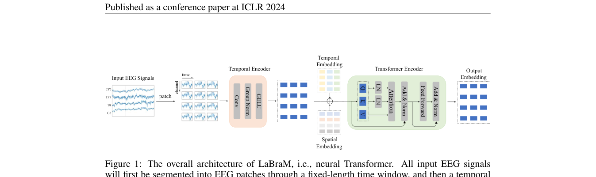
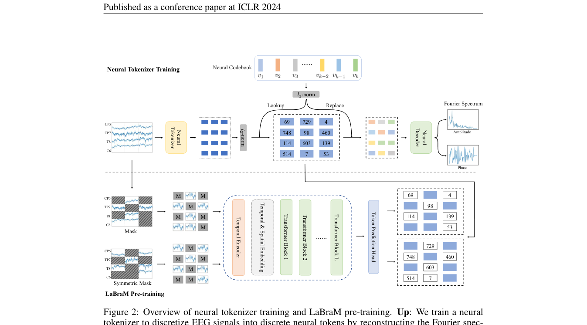

# LaBraM: Large Brain Model for Learning Generic Representations with Tremendous EEG Data in BCI

> **ICLR 2024**

LaBraM: Large Brain Model (ICLR 2024)

**作者**：Wei-Bang Jiang, Li-Ming Zhao, Bao-Liang Lu（上海交通大学）

#### 2.1 问题定位

受 LLM 启发探索大型 EEG 模型（LEMs）。三大挑战：① 缺乏足够大规模 EEG 数据（收集了 ~2500 小时、约 20 个数据集）；② EEG 采集配置多样，电极数、时长不一；③ 缺乏有效的 EEG 表示学习范式（低信噪比）。核心答案：**把 EEG 切成 channel patch，用向量量化的「神经 tokenization」得到离散神经码，再用 BERT 式掩码预测码字来预训练**。

#### 2.2 方法

**（a）骨干架构：Neural Transformer**

- EEG \( X \in \mathbb{R}^{C \times T} \) 按 w=200（1 秒）无重叠窗口切成 channel patch，共 \( N = C \cdot \lfloor t / w \rfloor \) 个；
- **Temporal Encoder**：每个 patch 过若干 1D 卷积块（Conv + GroupNorm + GELU）提取 patch 内时序特征 → patch embedding；
- **Temporal & Spatial Embedding**：可学习的时间 embedding 列表（长度 tmax）+ 空间（通道）embedding 列表（10-20 系统），相加注入时空信息（绝对位置编码）；
- **Transformer Encoder**：ViT 风格，但做两点修改（引 Dehghani et al. 2023）：Q、K 先做 LayerNorm 再点积注意力（防 attention logits 过大）；QKV 计算去掉 bias 项加速训练；
- 下游用平均池化 + 任务预测头。

**（b）神经 VQ-Tokenizer**

- 受 VQ-VAE 启发：codebook \( \mathcal{V} \in \mathbb{R}^{K \times D} \)（K=8192，D=64）；
- patch 表示 p 做 **ℓ2 归一化**后在 codebook 里**余弦相似度最近邻查表**得到码字索引（ℓ2 归一化提升 codebook 利用率）；
- **重构目标：频谱（幅值 A + 相位 φ），不是原始波形**：EEG 低信噪比、随机、非平稳、非线性，直接重构原始波形 loss 不收敛；频谱的频率/相位分布反映底层神经生理活动。做法：对 patch 做 DFT；
- Neural decoder（若干 Transformer 块 + 平均池化 + 幅值/相位两个回归头）从离散码字回归频谱，MSE 损失；
- 总损失（式 9）= 幅值 MSE + 相位 MSE + **codebook loss**（\( \left\| \mathrm{sg}(\ell_2(p)) - \ell_2(v_{z_i}) \right\|_2^2 \)，拉码字）+ **commitment loss**（\( \left\| \ell_2(p) - \mathrm{sg}(\ell_2(v_{z_i})) \right\|_2^2 \)，稳编码器）；sg = stop-gradient；码字用 **EMA（指数滑动平均）**更新。

**（c）掩码预训练**

- patch embedding 中随机 mask 比例 r=0.5，被 mask 位置换成可学习 mask token；
- Transformer 编码可见 patch，线性分类头预测被 mask patch 对应的**码字索引**，交叉熵损失；
- **对称掩码（Symmetric Masking）**：mask 的补集也各做一次 masked modeling，相当于数据增强，提升下游性能与稳定性；
- **VAE/ELBO 理论解释**（附录 B）：tokenizer 是后验 \( q_\phi(z \mid x) \)，decoder 是 \( p_\psi(\tilde{x} \mid z) \)，masked modeling 学习先验 \( p_\theta(z \mid x^M) \)；两阶段分别对应「最小化重构损失」和「固定 \( q \)、\( p_\psi \) 最小化 KL」。

**模型规格**：Base 5.8M（12层/200维/10头）、Large 46M、Huge 369M。

#### 2.3 创新点

1. **首个**在 2500 小时、约 20 个数据集上预训练的大规模 EEG 基础模型（数据本身即是贡献）；
2. **channel patch** 切分 + 可学习空间 embedding，天然兼容任意电极数/时长配置；
3. **神经 codebook**：VQ 离散码 + 傅里叶频谱重构目标——绕开原始波形不可重构的难题，把连续 EEG 变成 8192 个「神经 token」的离散语义空间；
4. **掩码码字预测**（masked neural code prediction）替代原始信号重构作为预训练目标；
5. 对称掩码策略（效率 + 数据多样性）；
6. 大规模 scaling 实验（数据量 1~2500 小时 × 模型 Base/Large/Huge），证实 EEG 领域也遵循 scaling law（Huge 模型在万小时级数据上仍会持续提升）。

## 架构图

*Figure 1 · Neural Transformer 整体架构：patch → temporal encoder → 时空 embedding → Transformer*

*Figure 2 · 上：神经 tokenizer 训练（VQ + 频谱重构）；下：掩码 EEG 建模预训练*

## 与其他论文的关系

| 论文 / 工作 | 关系说明 |
|---|---|
| NeuroLM | 同团队续作：tokenizer 改为时频双域重构 + GRL 文本空间对齐，token 并入 GPT-2 词表 |
| TFM-Tokenizer | 批评其 token 「只当训练目标、推理时被丢弃」；并入 TFM tokenizer 后（BIOT-TFM/LaBraM-TFM 合计）93% 的指标情形提升 |
| EEGPT / BrainGPT | 作为预训练基线被比较；BrainGPT 猜测其预训练语料偏癫痫临床域，domain 差异拖累一般下游任务 |

---

**相关阅读**

:material-arrow-left: [上一篇：BIOT](biot.md) ｜ :material-arrow-right: [下一篇：EEGPT](eegpt.md) ｜ :material-vector-link: [Tokenization 演进](../topics/tokenization.md) ｜ :material-chart-box: [十三篇方法对比](../comparison.md)
