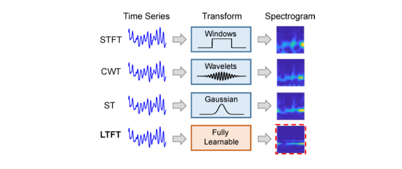
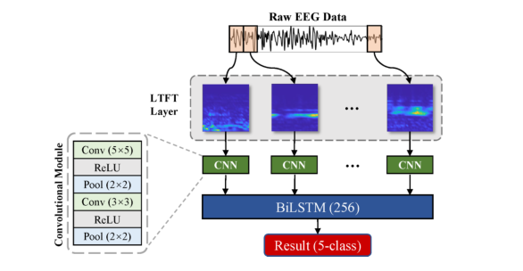

# Learnable Time-Frequency Transform With Application to EEG Signal Analysis

> **IEEE TETCI 2026**

**作者**：Guoyang Liu, Lan Tian, Weidong Zhou\*（通讯，山东大学）

## 1 问题定位：窗口选择这个「手工活」

时频谱图进神经网络是 EEG 分类的主流管线，但整条管线里最上游的一步——选什么窗、什么母小波——始终是手工的：STFT 的窗长窗型、CWT 的母小波、S 变换的高斯宽度，都按数据分布人工调。混合管线的变换和网络是**分开优化**的，变换端永远拿不到任务损失的梯度。

已有可学习前端的修法各有保留：LEAF 学 Gabor 滤波器组、SincNet 学 sinc 带通、CWConv 只学母小波的尺度和平移、DSTFT 把 STFT 超参数连续化。共同点是核函数被约束在特定函数族里，作者认为这限制了适配能力，也不构成一个「一般的」可学习时频变换框架。LTFT 的回答是去掉全部先验：每频率一个复值窗口，实部虚部都训。

这篇文章的定位其实是信号处理社区的（作者组此前做过 S 变换癫痫检测、S 变换 ECG 质量评估），和站内 EEG 基础模型那条线语言不同，但回答的问题相邻：**频域表示该在哪一层被学习**。

## 2 方法

### 2.1 定义与前向

\[ L(\tau, f) = \int_{-\infty}^{+\infty} x(t)\, w_f(\tau - t)\, e^{-2\mathrm{i}\pi f t}\, \mathrm{d}t = \big(x(\tau)\, e^{-2\mathrm{i}\pi f \tau}\big) * w_f(\tau) \]

形式上就是 STFT，唯一区别是窗口 \( w_f(\xi) \) 带**频率下标**（不同频率可以有不同的窗口）且是自由复值函数。转到频域，对固定 \( f \)，LTFT 系数是信号谱的循环移位与窗口谱的乘积再逆变换：

\[ L(\tau, f) = \mathcal{F}^{-1}_{\alpha\to\tau}\big\{ X(\alpha + f)\, W_f(\alpha) \big\} \]

离散实现（式 8–9）：对归一化频率 \( f_m = m/NT \)，定义循环移位谱 \( [X_m]_n = X[(n+m) \bmod N] \)，则

\[ L_m = \mathrm{IFFT}\big( X_m \odot W_m \big) \in \mathbb{C}^N \]

每个频率 bin 一次 IFFT 出一整行时频系数，谱图取 \( |L(\tau,f)|^2 \)。这个实现继承自 S 变换的 FFT 加速路线，训练完成后 \( W_f \) 可缓存，推理代价与 STFT 同阶。

### 2.2 反向传播：复参数的 Wirtinger 梯度

损失 \( E \) 是实的，窗口 \( w_f \in \mathbb{C} \)，所以用 Wirtinger 微分沿共轭梯度 \( \partial E/\partial w_f^*(\xi) \) 更新。设上游梯度 \( \Delta(\tau,f) = \partial E/\partial P(\tau,f) \)（\( P = |L|^2 \) 为谱图输出，由自动微分免费拿到）。链式展开共三段（式 12–14），每段恰好对应一次傅里叶变换，闭式是这样一步步推出来的而不是凑出来的：第一段对谱图输出，\( \partial E/\partial L^* = \Delta \odot L \)（式 12）——实损失对复输出的标准 Wirtinger 结果，乘的是 \( L \) 本身而非其共轭；第二段经 \( L^*(\tau,f) = \int X^*(\alpha+f)\, W_f^*(\alpha)\, e^{-i2\pi\alpha\tau}\, d\alpha \) 传到窗口谱，\( \partial E/\partial W_f^*(\alpha) = X^*(\alpha+f)\, \mathrm{FFT}[\Delta \odot L] \)（式 13）——信号谱直接调制窗口梯度；第三段按 DFT 定义逆变换回时域，天然就是一个 IFFT（式 14）。合并（式 15–16）得

\[ \frac{\partial E}{\partial w_m^*} = \mathrm{IFFT}\big( X_m^* \odot \mathrm{FFT}(\Delta_m \odot L_m) \big) \]

前向的 \( L_m \) 直接复用，每频率代价 \( O(N\log N) \)，两个 FFT、两次逐点乘、一个 IFFT，完全不需要手写复数自动微分。窗口用带动量 SGD 更新（式 17）。两个值得注意的训练细节：正则化只加在网络参数 \( \theta \) 上（L2，\( \lambda = 0.001 \)，式 10 称「对所有网络」），**窗口 \( w \) 完全不正则**——这是一个大胆的选择，后面 MI 实验里「峰值后回落」的过拟合迹象与此直接相关（论文内部有个小矛盾：V-A 节又称合成实验的交叉熵「无任何正则惩罚」，与式 10 对不上）；窗口初始化为 S 变换的频率依赖高斯窗，即起点就是标准 ST。

### 2.3 与传统变换的关系：三退化一

这节是论文理论贡献的核心，证明自由复值窗口是三类传统变换的超集：

- **STFT**：取 \( w_f(\xi) = g(\xi) \)（与频率无关的固定窗），LTFT 退化为任意窗的 STFT；
- **CWT**：取 \( w_f(\xi) = \frac{1}{\sqrt{s(f)}}\, \psi^*\!\big(\tfrac{\xi}{s(f)}\big) e^{2\mathrm{i}\pi f \xi} \)（母小波的缩放调制版，\( s(f) \) 建立频率-尺度对应），则 \( L(\tau,f) = e^{-2\mathrm{i}\pi f \tau}\, \mathrm{CWT}(\tau,f) \)——即**相位校正 CWT**，绝对参考相位被保留（S 变换作者 Stockwell 强调过的性质）；
- **S 变换**：取 \( w_f(\xi) = \frac{|f|}{\sqrt{2\pi}} e^{-\xi^2 f^2/2} \)（频率依赖高斯窗），LTFT 恰为标准 S 变换。

超集关系本身不保证学到更好的变换，但它给了两条实际好处：初始化点（ST）有已知的好性质，且训完的窗口偏离初始化多少、在哪些频率偏离，可以直接当可解释性证据读。

## 3 实验与结果

**数据集四个**（详见复现速查卡）：合成 chirp（200 条 1 s 信号，唯一区别是 20 Hz 窄带片段的插入位置，按位置前/后 100 条二分类，i=100/101 只差一个采样点的边界难例）；BCI Competition II dataset III 运动想象（单被试，C3/Cz/C4，768 点）；Bonn 五类癫痫（Z/O/N/F/S 各 100 段）；SEED 情绪（自建正负二分类子集，600 段、15 被试、62 通道降到 32 通道）。

**网络形态随任务走**：合成与 MI 用「LTFT + 时间轴平均池化 + 线性分类器」（Fig. 3），SEED 同为线性分类器头但**不池化**——每段只有 1 s，50×128×32 谱图直接展平、过一层 BatchNorm 再进线性分类器；Bonn 用「LTFT + CNN + BiLSTM(256) + 逐段输出 + 多数投票」（Fig. 9）。所有对比变换配到与 LTFT 相同的频率范围和谱图尺寸（STFT 谱沿时间轴双三次插值对齐），可学习基线（LEAF/DSTFT/CWConv）按原文默认配置。

**主结果**（Table I，总体准确率 %）：

| 变换 | 合成 | MI | Bonn 五类 | SEED 二分类 |
|---|---|---|---|---|
| STFT | — | 82.93 | 85.40 | 63.00 |
| CWT（morlet/db4） | — | 83.07 | 88.00 | 69.67 |
| CWConv | — | 83.71 | 84.80 | 71.50 |
| LEAF | — | 85.06 | 88.80 | 70.00 |
| DSTFT | — | 85.40 | 85.80 | 70.83 |
| ST（= 冻结 LTFT） | 95.50 | 85.70 | 89.00 | 73.33 |
| **LTFT** | **99.50** | **86.95** | **91.00** | **73.33** |

几点解读：

- **合成数据是唯一的干净消融**：LTFT 与 ST 只差「窗口是否可训」，99.50 vs 95.50（p<0.05）把可学习性的贡献隔离得很清楚；t-SNE 显示 LTFT 特征线性可分而 ST 特征不可分。MI 上 STFT 统一用 32 点窗 50% 重叠、未按数据集调参，作者在讨论里承认 STFT 基线没做敏感性分析；正文另提到未进 Table I 的其余变换（STFT 与 CWT 的其他小波变体）在 MI 上落在 82.15–83.07% 区间；
- **MI 上有过拟合迹象**：平均准确率在 120 epoch 见顶 88.53%，随后回落到 86.95%——作者归因于可学习参数增加 + 数据少（单被试 280 trial）。单次最高 92.14%，超过当年 BCI 竞赛第一名和近期文献，但注意这是**单被试数据的随机划分**，不是跨被试协议；
- **SEED 上与 ST 完全打平（73.33%）**，显著性检验差距边缘。作者没有藏这个结果，反而做了归因：训后窗口与 ST 初始化在 1–50 Hz 几乎重合（L2 距离全程很小）。情绪判别靠的是稳定的谱统计与通道间组织（熵/不对称类模式），没有刻意的瞬态时频模板，高斯窗先验已经够用——**窗口学习的前提是任务存在可复现的瞬态时频特征**；
- **窗口可视化是全文最有说服力的部分**：合成数据的窗口偏离集中在 20 Hz（正是插入片段的频率）；MI 在 10–12 Hz（alpha ERD/ERS 的文献位置）；Bonn 集中在 18 Hz 以下、尤其 8–13 Hz alpha 段，18–32 Hz 几乎不动——作者据此认为 O/F/S 三类的判别信息主要在 2–18 Hz；且 100 个随机种子下权重差异的标准差只有 0.005，训练稳定。Bonn 上低频学出小波样函数、高频保留高斯包络——不同频段自发匹配了不同类型的核，正好呼应了「超集」的论证。Fig. 16 的逐段谱图对照补了定性证据：CWConv 沿谱脊呈阶梯状不连续、DSTFT 保留偏宽的 STFT 样脊线、LEAF 过度平滑，而 LTFT 对 Bonn 单段信号能量聚在 12 Hz 附近；
- ERSP 图（Fig. 14）：LTFT 的 ERD/ERS 能量集中度最高、谱泄漏和时间涂抹最小，C3/C4 半球对比比 ST/STFT/CWT 都清晰，且没有 CWConv/DSTFT/LEAF 那种可见的表示伪影——神经生理保真度这一层，站内其他频域论文基本没做这种验证。

## 架构图

*Figure 1 · 四种时频变换对照：前三行的核是手工预定义的，LTFT（末行）的核完全可学习，谱图每个像素都是学出来的表示*

*Figure 9 · Bonn 五类任务架构：每段 1 s EEG 独立过 LTFT 层（0–31 Hz，32×256 谱图，池化后 32×32），双卷积层 + 2×2 池化得 8×8×8 特征图，BiLSTM(256) 建模 23 个段的时序，多数投票定记录级标签*

## 与其他论文的关系

| 论文 / 工作 | 关系说明 |
|---|---|
| [BIOT](biot.md) | BIOT 把 FFT 能量特征直接喂进 embedding，DFT 是**固定的特征提取器**；LTFT 问的是这个提取器本身能不能训。前者接受固定谱的次优性换效率，后者付出复值参数的代价换任务适配 |
| [LaBraM](labram.md) | LaBraM 用 DFT 幅相作为**重构目标**（预测频域掩码 token），固定 DFT 在监督信号端；LTFT 让变换端可训。两者可以叠加：可学习变换的谱同样可以做掩码重构目标 |
| [TFM-Tokenizer](tfm-tokenizer.md) | 最直接的候选组合：TFM 用固定 STFT 谱图切 patch + 频率 Transformer 做 tokenizer。LTFT 理论上可替换其 STFT 前端，但**预训练目标不是分类损失**，窗口往哪学是个未解决的问题（见个人思考 3） |
| [LUNA](luna.md) | LUNA 的 FFT 幅相双路也是固定变换 + 下游学习；与 TFM 同属「接受固定变换、在表示层学习」一派 |
| [Not-All-EEG](not-all-eeg.md) | 互补的两端：其频率加权谱损失 \( w_k \propto k^\alpha \) 在**损失端**手工设计频率重要性，LTFT 在**变换端**让频率重要性自己长出来（Bonn 上自动集中到 18 Hz 以下）。前者显式可控，后者数据驱动，可解释性殊途同归（都能指出哪些频段在起作用） |
| LEAF / DSTFT / CWConv | 论文内的直接被比较对象：LEAF（Gabor 约束）、CWConv（固定母小波只学尺度平移）、DSTFT（STFT 超参连续化）都往核里塞先验，LTFT 的卖点是去掉先验后的超集地位。注意论文自己也引了 EfficientLEAF 的结论：可学习前端**并不稳定优于固定滤波器组**——这一警告对 LTFT 同样适用，SEED 打平就是例证 |
| S 变换谱系（作者组前作） | 作者组 2020 年起做 S 变换癫痫检测、S 变换 ECG 质量，这篇本质是把自家用了多年的手工 ST 升级为可训练版本：初始化 = ST，冻结 = ST 基线，实验设计带着这个自证结构 |

## 个人思考

1. **与「固定 STFT/DFT + 下游学习」的差别到底在哪？** 站内那条频域线（BIOT/LaBraM/TFM/LUNA）的共同假设是：固定变换给出的频域表示已经够好，学习发生在表示层（embedding、重构目标、patch 注意力）。LTFT 把梯度一路送到变换核，学习发生在**核函数层**。但读了窗口可视化我会修正一个预期：学到的并不是全新的核——Bonn 上高频窗口基本留在高斯初始化，改动集中在少数判别频段。也就是说 LTFT 的实际收益模式是「在 ST 先验上做任务驱动的局部重加权」，而不是发现 ST/CWT 之外的表示。而且这个自由度不只是重加权：下游的损失加权或掩码只能改变「哪些频段的已有表示更重要」，改窗口改变的是每个频段**时频分辨率权衡本身**（窗宽窗形），这是自由度放进核函数才有的能力——Bonn 低频学出小波样核、高频保留高斯包络，就是分辨率被按频段重新分配的直接证据。这与 Not-All-EEG 的频率加权在精神上接近，只是加权从损失函数搬进了核函数，且权重由梯度而非人工 \( k^\alpha \) 决定；
2. **自由度放在变换本身，合理但要付三笔账**。参数账：每频率一个长度 N 的复窗口，256 点 32 频率就是 1.6 万参数，对单被试 280 trial 的 MI 明显偏多（峰值 88.53% 回落到 86.95% 就是账单）；正则账：窗口完全不正则，只靠数据量兜底，换到更大谱图（SEED 是 50×128×32）时这个设计的扩展性存疑；优化账：复值 Wirtinger 梯度虽给了闭式，但每频率一次 IFFT 的开销乘上频率数，训练成本高于一次性 FFT 的固定变换。另外全文只试了 ST 一种初始化，没有初始化敏感性消融——「换个起点（窄带 STFT 窗、Morlet 母小波）会学到什么」目前是空的。作者把「更高效的初始化方案」列为 future work，说明他们清楚这笔账；
3. **能不能当 TFM 那种 tokenizer 的前端？我现在持保留态度。** 结构上可行：LTFT 谱图替换 TFM 的 STFT 谱图，切 patch 照旧。但机制上有一个断层：LTFT 的窗口是被**任务分类损失**驱动的，tokenizer 的预训练目标是掩码重构——重构目标下最优窗口趋近于无损表示（窗宽趋零、分辨率拉满），未必对齐下游判别；而如果先在分类任务上预训窗口再搬去 tokenizer，又回到「分开优化」的老问题。更现实的路径可能是 BIOT/LUNA 式的轻量用法：把 LTFT 当作需要极少标注数据的**判别任务前端**（癫痫、MI 这类有清晰瞬态模式的），而不是基础模型的通用 tokenizer。SEED 的平局恰恰圈定了它的适用域；
4. **评测口径要打折看**。四个数据集里两个是玩具级（合成 chirp、Bonn 是被无数论文刷穿的基准），MI 是单被试随机划分而非跨被试，Bonn 的十折是全数据混合交叉验证，没有被试独立协议；SEED 子集只有 600 段且做了平衡采样。这些协议下 91%、86.95% 的绝对数字与站内 TUEV/TUAB 那类跨被试结果**不可比**。这篇的价值在方法推导与窗口分析那一半，不在 benchmark 数字那一半。

!!! abstract "复现速查卡"
    - **代码**：论文未附仓库（DOI 10.1109/TETCI.2026.3684470）
    - **核心实现**：逐频率 \( L_m = \mathrm{IFFT}(X_m \odot W_m) \)，\( X_m \) 为循环移位谱；0 Hz 处定义为信号均值；窗口梯度 \( \mathrm{IFFT}(X_m^* \odot \mathrm{FFT}(\Delta_m \odot L_m)) \)，SGDM 更新；**窗口不加正则**，网络参数 L2 \( \lambda = 0.001 \)；初始化 = ST 频率依赖高斯窗
    - **数据与协议**：合成 chirp（256 点 @256 Hz，20 Hz 片段插入位置二分类，200 条，十折，500 epoch 全批训练、batch=200）/ BCI Competition II dataset III（MI，C3/Cz/C4，3–9 s 共 768 点，1–40 Hz 五阶 Butterworth + z-score，随机划分，100 种子）/ Bonn（五类，重采样 256 Hz 截断 23 s，切 23 个 1 s 段，多数投票，十折，200 epoch、batch 450；显著性检验用 455–500 epoch 间每 5 epoch 存一个的 10 个模型）/ SEED 二分类子集（正负各 300 段，取每段影片中段 60–180 s 切 1 s @128 Hz，62→32 通道，1–50 Hz，五折）
    - **谱图尺寸**：合成 32×256（1–32 Hz）；MI 40×768×3（1–40 Hz，池化到 40×96×3）；Bonn 32×256（0–31 Hz，池化到 32×32）；SEED 50×128×32（1–50 Hz，不池化）
    - **基线对齐注意**：STFT 统一 32 点窗 50% 重叠、谱图沿时间双三次插值到原始长度（会引入时间轴平滑）；CWT 尺度按中心频率覆盖目标频带选取；LEAF/DSTFT/CWConv 用原文默认配置、仅改滤波器数与 hop 对齐尺寸
    - **复现要点**：MI 准确率 120 epoch 见顶，别拿最终 epoch 的数字对齐；跨被试协议论文没做，别拿这些数字与 TUEV/TUAB 类结果横比

---

**相关阅读**

:material-arrow-left: [Not-All-EEG（损失端频率加权 vs 变换端可学习窗口）](not-all-eeg.md) ｜ :material-creation: [TFM-Tokenizer（STFT 谱图 tokenizer，LTFT 的潜在替换对象）](tfm-tokenizer.md) ｜ :material-waveform: [BIOT（FFT 能量特征进 embedding）](biot.md) ｜ :material-chart-timeline-variant: [LaBraM（DFT 幅相作重构目标）](labram.md) ｜ :material-home: [首页](../index.md)
