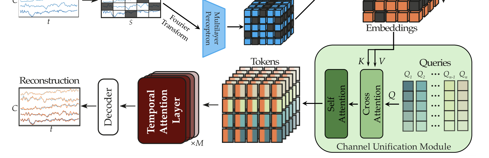

# LUNA: Efficient and Topology-Agnostic Foundation Model for EEG Signal Analysis

> **NeurIPS 2025**

**作者**：Berkay Döner, Thorir Mar Ingolfsson, Luca Benini, Yawei Li（Integrated Systems Laboratory, ETH Zürich）

## 1 问题定位：拓扑异构是 EEG 基础模型的地基问题

每个公开 EEG 数据集自定义电极布局，模型换 montage 就崩。论文给的三组数字把问题钉死：运动想象解码器跨数据集最多掉 14pp；SOTA 情绪模型（BIOT、MMM）在 SEED 与 DEAP 蒙特之间掉 13–15pp；sEEG 的被试间迁移在无显式空间编码时接近随机。

现有方案的取舍都不彻底：**每个 montage 训专用模型**（放弃统一）；**只保留公共电极**（丢掉最多 80% 数据）；**通道+时间展平成超长序列**（O((S·C)²) 复杂度，高密度帽直接爆显存）。论文要的是**单一、montage 无关、对电极数高效扩展**的架构。

## 2 方法

### 2.1 Patch 特征提取（双路 + 3D 空间编码）

原始 EEG x ∈ R^{B×C×T} 每通道切 S = T/P 个不重叠 patch，两路并行嵌入后求和：

- **时域路**：1D 卷积网络（GroupNorm + GELU），与 LaBraM/CBraMod 同款；
- **频域路**：每个 patch 做 FFT，幅值与相位经 MLP 投影；
- **通道位置编码**：对归一化的 **3D 电极坐标**做 NeRF 式正弦编码再过 MLP，加到特征上。注意这是比 10–20 系统离散 embedding 更连续优雅的空间先验——任意位置都有定义。

预训练时随机掩码部分 token（可学习 mask embedding）。

### 2.2 Channel-Unification Module：拓扑无关的核心

这是全文的关键创新，思想来自 Set Transformer 的 inducing points 与 PerceiverIO 的隐空间瓶颈：

- **Q 个学习 query** \( Q_{\mathrm{learn}} \in \mathbb{R}^{Q \times E} \)（**无 batch 维**的共享参数，正交初始化），对每个 (batch, patch) 实例的 C 个通道特征做交叉注意力（query→Q，通道特征→K,V）：

\[ \mathbf{A}_{\mathrm{out}} = \mathrm{MultiHeadAttention}(\tilde{\mathbf{Q}}, \mathbf{X}', \mathbf{X}') \in \mathbb{R}^{(B \cdot S) \times Q \times E} \]

- 再经 FFN + L 层 Transformer（在 Q 维上做自注意力）得到统一表示 \( X_{\mathrm{unified}} \in \mathbb{R}^{(B \cdot S) \times Q \times E} \)。

两个性质：**置换不变**（打乱通道顺序输出不变 → 拓扑无关），**对 C 线性**（交叉注意力只算 Q×C 的注意力图）。每个时间 token 从此封装的是「该时刻所有通道的聚合信息」，而非单通道片段。

### 2.3 Patch-wise 时间编码器 + 双解码器

统一表示重排为 \( X'_{\mathrm{unified}} \in \mathbb{R}^{B \times S \times (Q \cdot E)} \)，用带 **RoPE** 的 Transformer 块建模时间依赖——**有效序列长度从 S·C 降到 S**，这是效率的第二个来源（第一个是 Q ≪ C）。

解码器按任务分两种：**重构头**（预训练）用 C 个**按通道标签索引**的学习 query 交叉注意力还原各通道 patch 值（电极有重叠的数据集可复用）；**分类头**（微调）用单个聚合 query 生成池化表示过 MLP。

### 2.4 训练目标：重构 + query 特化

Smooth L1 同时作用于被掩与可见 patch（可见部分系数 α=0.05——让可见部分也承担弱约束）；外加 **query 特化损失**：对通道统一模块的 query-channel 亲和矩阵，惩罚其非对角元素相似度，促使各 query 关注不同空间区域：

\[ \mathcal{L}_{\mathrm{spec}} = \frac{\lambda_{\mathrm{spec}}}{B' \cdot Q \cdot (Q-1)} \sum_{b'} \sum_{i} \sum_{j \neq i} \big( (\mathbf{A}_{\mathrm{affinity}} \mathbf{A}_{\mathrm{affinity}}^{\top})_{b',i,j} \big)^2 \]

**预训练规模**：TUEG + Siena 共 **21,900 小时**原始 EEG，覆盖 20/22 通道双极 + 29 通道单极共 3 种拓扑，mask 率 0.5。三个模型规格：Base 7M（8 层/Q=4/E=64/hidden 256）、Large 43M（10 层/Q=6/96/576）、Huge 311.4M（24 层/Q=8/128/1024）。

## 3 复杂度账本

| 方法 | 瓶颈复杂度 |
|---|---|
| **LUNA**（隐空间注意力） | O(B·S²·Q·E) 或 O(B·S·Q·C·E) |
| 全注意力（LaBraM） | O(B·S²·C²·E) |
| 交替注意力（CBraMod，patch 维） | O(B·S²·C·E) |
| 交替注意力（CBraMod，通道维） | O(B·S·C²·E) |

效率曲线（附录 Table 9/10）：patch 数 4000 时 BIOT 2286 GFLOPs vs LUNA-Base 768；**通道数 8000 时 BIOT 4156 GFLOPs / 12.3GB vs LUNA-Base 23 GFLOPs / 2GB**。结论：通道数增加时 LUNA 计算近乎恒定，且 LUNA-Base（7M 参数、16-bit 约 14MB）能塞进可穿戴 SoC 的实时预算——这是同组（ETH 低功耗组）的看家视角。

## 架构图

*Figure 1 · Channel-Unification Module：Q 个学习 query 对 C 通道特征做交叉注意力，时间注意力只在固定隐空间上进行*

## 与其他论文的关系

| 论文 / 工作 | 关系说明 |
|---|---|
| EEGMoE（本站同期笔记） | **对照哲学**：LUNA 把拓扑差异当噪声抹平（query 瓶颈），EEGMoE 把域差异当信号解耦（MoE 分工）——作用轴不同（电极几何 vs 任务/数据集），可叠加 |
| LaBraM / CBraMod | 精度上限对照组：展平/交替注意力的容量优势在 TUAB 上兑现约 1pp，但通道复杂度平方——高密度场景不可行 |
| BIOT | 效率路线前作：BIOT 展平后用线性注意力（其原文为 Linformer 式低秩投影），LUNA 先统一通道再全注意力；论文正文 4.3 把 BIOT 作为效率基线，附录 Table 9/10 给出详细对比——8000 通道时 LUNA-Base FLOPs 约为 BIOT 的 1/180 |
| MMM | 显式拓扑映射前作：预定义解剖区域 + 手工 DE 特征；LUNA 用学习 query + 原始信号端到端（消融显示两者指标相当，但学习 query 免解剖先验） |
| Set Transformer / PerceiverIO | 机制来源：inducing points / 隐空间瓶颈，LUNA 加了 3D 电极坐标编码与两种任务解码头（重构/分类） |
| Brant / GNN 系 | 被绕开的路线：固定拓扑空间编码器 / 预定义邻接图，都需要为动态拓扑打补丁 |
| [通道异构专题](../topics/multi-task.md#channel-adaptation) | **先统一再建模**：可学习 query 汇聚通道，与通道 embedding 的查表方式不同 |

---

**相关阅读**

:material-arrow-left: [EEGMoE（域解耦路线，对照阅读）](eegmoe.md) ｜ :material-heart-pulse: [BIOT（效率前作对照）](biot.md) ｜ :material-grid-large: [通道适配与多任务学习](../topics/multi-task.md#channel-adaptation) ｜ :material-vector-polyline: [Attention 替代方案（效率视角）](../basics/attention-alternatives.md) ｜ :material-home: [首页](../index.md)
