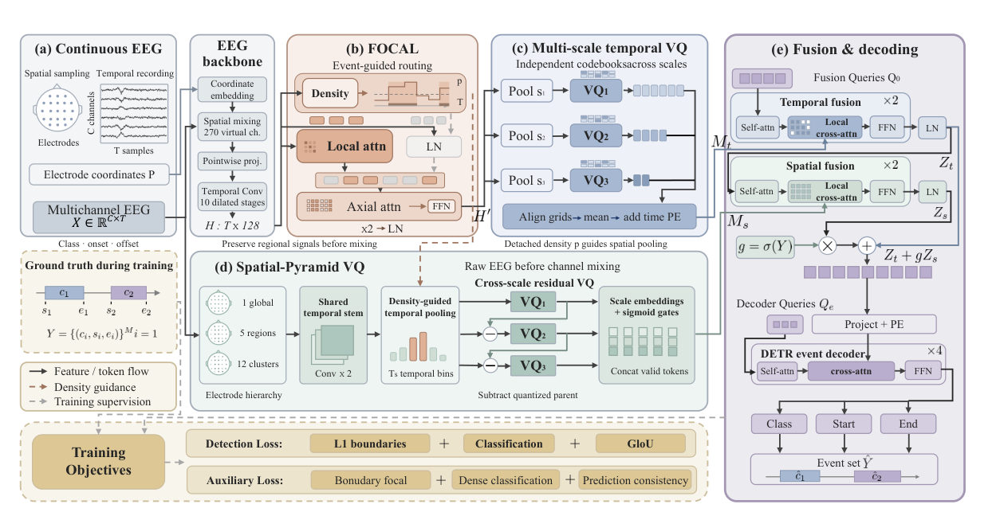

# NeuroDETR: Multiscale Discrete Spatiotemporal Tokenization for Asynchronous EEG Event Detection

> **arXiv 2026**

**作者**：Yaozhi Wen, Kun Zhao, Wei Wei, Haoyang Chen, Kangning Wang, Yi Sun, Shaowei Gu, Dingkun Liu, Shuang Qiu, Huiguang He（中科院自动化所；Haoyang Chen 来自武汉大学、Dingkun Liu 来自华中科技大学；通讯作者 Shuang Qiu、Huiguang He）

## 1 问题定位：滑窗的窗长枷锁与「事件记忆」的空缺

异步解码解决的是 BCI 的真问题：在连续 EEG 里找行为/生理上有意义的事件，同时给出类别和边界。论文开篇把现有路线分成两层。第一层是滑窗分类：给每个固定长度的窗打「事件/背景」标签——固定窗长与可变的事件时长、边界天然错配，导致检测碎片化或相邻事件粘连，性能对窗口设置和后处理规则高度敏感。第二层是 query-based 检测（DETRtime、DANCE）：把连续 EEG 直接映射成无序事件集合，每个事件带类别、onset、offset。但现有的 query-based 方法用 cross-attention 把长特征序列聚进固定一组**连续** latent tokens，没有显式组织「跨时间尺度 × 空间区域」的事件线索——而事件响应弱、瞬态、嵌在持续背景活动里，聚合阶段一压缩就可能丢。

站内坐标：tokenization 演进线到 2026 年已有 VQ 词表（LaBraM → NeuroLM）、时频 motif 词表（TFM-Tokenizer）、多尺度 RVQ（NeuroRVQ）和双域码表（BrainRVQ / CodeBrain），但 token 的下游全是分类器或预训练目标。异步检测的输出是**变长集合**，token 在这里的新职责是当检测头的「记忆」——本文填的就是这个格子。配套问题是效率与稀疏性：整段记录里事件往往只占百分之几（TUSZ 3.2%、HDOP 6.1%），对全序列做稠密注意力既浪费又引入背景干扰，于是有了 FOCAL 这个「事件驱动」的稀疏化模块。

## 2 方法

### 2.1 问题形式化与总体结构

输入 \( X \in \mathbb{R}^{C \times T} \)（\( T = f_s W \)，\( W \) 为窗长），目标是无序事件集合：

\[
Y = \{(c_i, s_i, e_i)\}_{i=1}^{M}, \qquad c_i \in \{1, \dots, K\}, \quad 0 \le s_i < e_i \le 1
\]

\( M \) 随窗变化，边界按 \( W \) 归一化；\( N_e \) 个可学习事件查询并行预测，类别 0 为背景。流水线（Fig. 2）：卷积骨干出稠密特征 → FOCAL 事件引导精炼 → 双路 VQ（多尺度时间 / 空间金字塔）→ 查询式融合 → DETR 解码。

### 2.2 骨干：借自语音解码的 SimpleConv

电极坐标 \( P \in \mathbb{R}^{C \times 2} \)（归一化）过 Fourier 嵌入（维度 2048）后作为空间注意力权重，把 \( C \) 个真实通道混成 270 个虚拟通道（跨数据集通道数不一致就此抹平）；pointwise 投影到 256 维、输入 dropout 0.1，再过 10 级膨胀时域卷积：前 9 级 512 通道、kernel 9、膨胀率 \( d_\ell = \lfloor 2.5^{\ell-1} \rfloor \)，第 10 级出 128 维、膨胀率 3814、无归一化无激活，全程 stride 1 保时序分辨率：

\[
H = f_{\mathrm{enc}}(X, P) \in \mathbb{R}^{T \times D}, \qquad D = 128
\]

保分辨率是为 FOCAL 的窗级路由和辅助边界监督服务的（边界热图建在原始采样率上）。整套骨干 Adapt 自 Défossez et al. 的语音解码 SimpleConv——和站内语音解码轴线用的是同一个上游。

### 2.3 FOCAL：事件感知稀疏注意力

**事件引导路由**。\( H \) 按 \( N_w = \lceil T/w \rceil \) 切成 \( w \)-token 的窗（末窗补零）。密度头 \( g_\phi \)（LN + 两层线性 + GELU）在窗口均值池化特征上出标量再过 sigmoid：

\[
\ell_n = g_\phi\Big( \tfrac{1}{w} \sum_{t \in \mathcal{W}_n} h_t \Big), \qquad p_n = \sigma(\ell_n)
\]

窗标签：与任一标注事件有重叠则 \( y_n = 1 \)，BCE 监督。路由规则：

\[
\mathcal{I}_{\mathrm{evt}} = \{ n : p_n > \tau \} \cup \mathrm{TopK}(\ell, k_{\min}), \qquad \tau = 0.4,\ k_{\min} = 1
\]

密度图与路由掩码只算一次、两个 FOCAL 块共享；硬路由不可导，但 \( g_\phi \) 始终由 \( \mathcal{L}_{\mathrm{den}} \) 监督，梯度通路不受影响。

**局部-轴向交互**。选中窗做局部自注意力 \( H_n + \mathrm{MHSA}(\mathrm{LN}(H_n)) \)；未选中窗只做背景归一化 \( \mathrm{LN_{bg}}(H_n) \)——背景段不算注意力账，算力与干扰双省。axial attention 把 \( [B, N_w, w, D] \) 重排成 \( [Bw, N_w, D] \)，让所有窗口的同一 token 位置互相注意，跨窗上下文由此保留。两个块 + 末层 LN + 去补零，输出 \( H' \in \mathbb{R}^{T \times D} \) 进时间 VQ。

### 2.4 时空 VQ：多尺度时间码表 + 空间金字塔码表

量化本体是标准 VQ：最近邻码字 + 直通估计，commitment 项 \( \beta\,\mathrm{MSE}(z, \mathrm{sg}[e_{k^\star}]) \)；码表由特征初始化、EMA 更新、低频码重置。时间/空间两支各自持有**按尺度独立**的码表。

\[
k^\star = \arg\min_j \| z - e_j \|_2^2, \qquad Q(z) = z + \mathrm{sg}[e_{k^\star} - z]
\]

**多尺度时间 VQ**。尺度 \( s \) 上平均池化（kernel = stride = \( s \)，保留末尾不满 bin）得 \( \lceil T/s \rceil \) 个 token，量化为 \( q_s^t \)；各尺度码线性插值到最细池化网格 \( L_m \)、取平均、加正弦位置编码，得时间记忆：

\[
M_t = \frac{1}{|\mathcal{S}_t|} \sum_{s \in \mathcal{S}_t} \mathrm{Up}_{L_m}(q_s^t) + \mathrm{PE}_{L_m}
\]

另有重建监督：两层 MLP \( r_\psi \) 从「加 PE 之前」的码（重采样回长度 \( T \)）重建稠密特征，MSE 对 \( \mathrm{sg}[H'] \)——重建锚定码表的编码能力，但不进融合。

**空间金字塔 VQ**。在骨干通道混合**之前**按通道名聚合原始 EEG：\( R_\ell = A_\ell X \)，层级 \( (N_1, N_2, N_3) = (1, 5, 12) \)——1 全头、5 粗区（额/颞/中央/顶/枕）、12 细簇（额 3、颞 2、中央 3、顶 3、枕 1，附录 B；按各数据集可用通道实例化）。共享 stem（两层跨步时域卷积 + GELU）出区域特征。**密度引导池化**：把 FOCAL 的 \( p \) **detach** 后插值到 stem 网格当权重，行归一化三角核 \( \kappa \) 加权池化进 \( T_s \) 个 bin——突出可能的事件时段，又不更新密度估计器：

\[
E_{\ell,r,b} = \frac{\sum_u \kappa(b,u)\, e_{d_u} F_{\ell,r,u}}{\max\big( \sum_u \kappa(b,u)\, e_{d_u},\ \epsilon \big)}, \qquad \epsilon = 10^{-6}
\]

**跨尺度残差量化**：全头描述子直接量化；更细的层量化「自己减去广播的父层量化输出」——层级版 RVQ，父层已编码的粗结构不重复占用子层码表：

\[
u_\ell = E_\ell - \mathrm{Broadcast}_\ell(q_{\ell-1}^s), \qquad q_\ell^s = Q_{s,\ell}(u_\ell)
\]

尺度嵌入 \( a_\ell \) + sigmoid 门 \( g_\ell = \sigma(\eta_\ell) \) 组装空间记忆 \( M_s \)（逐层拼接非空通道组的全部时间 bin）。

### 2.5 事件记忆融合与集合预测

\( N_q \) 个正弦初始化的融合查询，时间流交替「全局自注意力 → 滑窗交叉注意力 SWA → FFN」共 2 层（交叉注意力跨度沿记忆按比例居中），输出 \( Z_t \)；再初始化一个**独立参数化**的空间流（同结构）读 \( M_s \)，经门控残差并入：

\[
Z = Z_t + g\, \mathrm{LN}[F_s(Z_t, M_s)], \qquad g = \sigma(\gamma),\ g \text{ 初始 } 0.02
\]

门从 0.02 起步——空间分支小增益上路，训练中自己挣话语权。DETR 解码器 4 层 4 头，\( N_e \) 个事件查询（投影 128→256 + 正弦嵌入）在 \( Z \) 上做交叉注意力；查询特征 \( o_j \) 出三个头：类别 softmax、起止 sigmoid。推理时丢弃最高概率类别为背景的查询，剩余边界乘 \( W \) 还原成秒。

### 2.6 训练目标

**检测损失**。匈牙利匹配，代价 = 类别对数似然 + 时间 IoU 差：\( C_{ji} = -\lambda_{\mathrm{cls}}^m \log \hat{p}_j(c_i) + 1 - \mathrm{IoU}(\hat{I}_j, I_i) \)。\( \mathcal{L}_{\mathrm{cls}} \) 对全部 \( N_e \) 个查询交叉熵（匹配上给事件标签、没匹配上给背景）；\( \mathcal{L}_{\ell 1} \) 端点回归与 \( \mathcal{L}_{\mathrm{GIoU}} \) 时间广义 IoU 只对匹配查询生效、按 \( N_e \) 归一，GIoU 带最小包围区间项——预测与真值不重叠时也有梯度：

\[
\mathcal{L}_{\mathrm{det}} = \lambda_{\ell 1} \mathcal{L}_{\ell 1} + \lambda_{\mathrm{cls}} \mathcal{L}_{\mathrm{cls}} + \lambda_{\mathrm{giou}} \mathcal{L}_{\mathrm{GIoU}}
\]

**辅助损失**三条，用全分辨率监督补集合预测的分辨率损失：① 边界头在骨干特征 \( H \) 上出类别无关 onset/offset 高斯热图（宽度 \( \sigma_{\mathrm{bnd}} \)），sigmoid focal loss 监督；② 稠密分类：融合记忆 \( Z \) 每个位置交叉熵（沿用 DANCE 的辅助策略）；③ 预测一致性：把查询预测按离散化区间累积概率投影到 \( N_q \) 网格，与稠密预测做 KL。最妙的是未覆盖位置的退化形式——集合侧被钳成零向量后，该位置贡献化为 \( \log(1/\epsilon_{\mathrm{clamp}}) - H(P_{\mathrm{dense}}) \)，即**对稠密预测的熵正则**；覆盖位置则拉齐两路预测。

\[
\mathcal{L}_{\mathrm{event}} = \mathcal{L}_{\mathrm{det}} + \lambda_{\mathrm{bnd}} \mathcal{L}_{\mathrm{bnd}} + \lambda_{\mathrm{dense}} \mathcal{L}_{\mathrm{dense}} + \lambda_{\mathrm{cons}} \mathcal{L}_{\mathrm{cons}}
\]

## 架构图

*Figure 2 · (a) 连续 EEG 输入与事件集合标注格式；(b) FOCAL：密度头出窗级事件概率，引导局部注意力路由，axial attention 跨窗交互 ×2；(c) 多尺度时间 VQ：各尺度独立码表，池化-插值对齐取平均加时间 PE；(d) 空间金字塔 VQ：混合前的原始 EEG 按 1 全头 / 5 脑区 / 12 细簇聚合，密度引导池化 + 跨尺度残差量化（减去量化父层）；(e) 融合与解码：时间/空间双流 ×2 + 门控残差，DETR 解码器 ×4 出 Class/Start/End。左下 Training Objectives：检测损失（L1 边界 + 分类 + GIoU）与辅助损失（边界 focal + 稠密分类 + 预测一致性）。图例：实线箭头 = 特征/token 流，橙虚线 = 密度引导，黄虚线 = 训练监督。图中 "Bonudary focal"（应为 Boundary）与 "codebooksacross"（缺空格）为原文图内笔误*

---

**相关阅读**

:material-vector-link: [Tokenization 演进（站内主线，本文补上「事件驱动」一格）](../topics/tokenization.md) ｜ :material-timeline: [LaBraM（token 只当预训练目标的起点）](labram.md) ｜ :material-chart-box: [TFM-Tokenizer（时频 motif 词表的可插拔用法）](tfm-tokenizer.md) ｜ :material-layers: [NeuroRVQ（多尺度 RVQ 的预训练路线）](neurorvq.md) ｜ :material-code-json: [CodeBrain（双域解耦码表）](codebrain.md) ｜ :material-home: [首页](../index.md)
