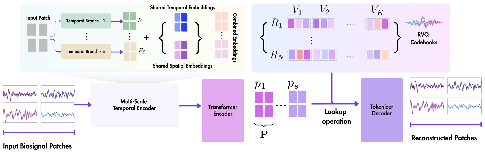

# NeuroRVQ: Multi-Scale Biosignal Tokenization for Generative Foundation Models

> **arXiv 2025**

**作者**:Konstantinos Barmpas, Na Lee, Dimitrios Chalatsis, William Raftery, Yannis Panagakis, Dimitrios A. Adamos, Nikolaos Laskaris, Alexandros Koliousis, Dario Farina, Stefanos Zafeiriou(帝国理工/Cogitat;通讯作者未标注)

## 1 问题定位:tokenizer 是 masked 建模的瓶颈

论文的出发点是 masked modeling 的成败取决于 tokenizer:现有两条路线都不行。深骨干/Transformer 式 tokenizer(如 CBraMod、BIOT)学出「纠缠冗余、不为重构优化」的表征,生成的 token 缺少 masked prediction 所需的保真度;码本路线(LaBraM 单码本 VQ、BrainOmni 单 RVQ)虽能学可重构的离散 token,但**都用单码本覆盖全频谱**,且训练损失不尊重重构目标的信号处理性质(最典型:对 ±π 边界不连续的相位角直接做 MSE)。结果是「codebook-based tokenizers with unfaithful signal reconstruction」。

生物信号侧的论证:EEG/ECG/EMG 共享「信息分布在多个频率尺度」的结构——EEG 有 delta–gamma 分频段节律,ECG 是低频 QRS 形态叠加高频细微成分,EMG 是运动单元募集(低频)与发放动力学(高频)的叠加。所以 tokenizer 的目标函数应当是**跨全部重要频率尺度的忠实重构**,而不是像 LaBraM 那样只保证粗粒度相似。三件套药方:多尺度架构 + 逐尺度 RVQ、相位感知损失、每模态一个极简 FM 来隔离「tokenizer 质量 → 下游性能」的因果链。这三味药是否各自起效,第 3 节消融逐一回头查账。

## 2 方法

### 2.1 总体:多尺度分支 + 逐分支 RVQ + Fourier 目标解码

输入 \( X \in \mathbb{R}^{C \times T} \) 切成 P 个长 w 的 patch(论文记作 \( x \in \mathbb{R}^{P \times w} \),通道维在记号里消失了——空间嵌入 SE 按电极索引,通道信息实际保留)。流程:多尺度时间编码器提特征 → 加共享时空嵌入过共享 Transformer → 每个尺度分支独立 RVQ 离散化 → 解码器以 Fourier 谱为目标重构。

多尺度时间编码器是 inception 式:S 个分支,每个分支 = 1D conv → GroupNorm(4 组/8 通道)→ GELU → pooling,**序列重复两次**。EEG/ECG(200 Hz)四分支卷积核 (21,15,9,5)→(9,7,5,3)——200 Hz 下最大感受野 105 ms 对齐低频形态、最小 15 ms 对齐快瞬态;EMG(1000 Hz)核 (51,17,8,5)→(25,9,4,3)。滤波器全部 8→8。输出 \( F_1,\dots,F_S \in \mathbb{R}^{w} \)。

时间嵌入 TE(按 patch 位置)与空间嵌入 SE(按电极在**预训练库全电极列表**中的位置,如 10-20 系统)维度均为 w,跨 S 个分支共享相加;共享 Transformer(12 层,并入 Dehghani et al. 2023/ViT-22B 的稳定性改造——具体内容未说明)输出多尺度 patch 表示 \( p_1,\dots,p_S \in \mathbb{R}^D \)。

### 2.2 逐分支 RVQ

每个时间分支配一套 RVQ 码本 \( R = \{V_i \mid i=1,\dots,N\} \),每层码本 \( V_i \in \mathbb{R}^{K \times D} \) 含 K=8192 个 D=128 维码字。量化逐层进行:

\[
z_1 = \arg\min_{v_1 \in V_1} \|\, \ell_2(p_1) - \ell_2(v_1) \,\|, \qquad p_{i+1} = p_i - z_i, \qquad \hat{p} = \sum_{i=1}^{N} z_i
\]

最终重构表示是 N 层选中码字之和。EEG/ECG 取 N=8、EMG 取 N=16(broadband 需要更大容量)。注意两处未披露:码本更新机制(EMA?死码重分配?)与 commitment 损失 \( \mathcal{L}_Q \) 的权重系数;另外隐藏维(表载 EEG/ECG 200)到码字维 128 之间的投影也没写。

### 2.3 相位感知损失:本篇最硬的技术贡献

解码器(3 层共享 Transformer)不直接重构原始波形,而是三个头分别预测 \( \log(1+\hat{A}) \)、\( \hat{c} \)、\( \hat{s} \)(幅值取对数压缩动态范围、相对强调高频)。相位为何要如此处理,Appendix A 给了三级递进:

1. 原始相位 MSE 在 ±π 边界不连续:\( \hat{\varphi}=\pi-\epsilon,\ \varphi=-\pi+\epsilon \) 时损失 \( \approx 4\pi^2 \),几乎相同的角却产生爆炸梯度(LaBraM 正是这么做的);
2. 改用 sin/cos 表示得 \( \mathcal{L}_{r} = 2 - 2\cos(\hat{\varphi}-\varphi) \),连续了,但当 \( \hat{\varphi} \approx \varphi \pm \pi \)(预测最大错)时梯度 \( 2\sin(\hat{\varphi}-\varphi) \approx 0 \)——**最错的预测反而收不到学习信号**;
3. 所以让网络直接预测二维向量 \( (\hat{c}, \hat{s}) \),与目标 \( (\cos\varphi, \sin\varphi) \) 做余弦相似度做方向对齐:最大错误产生大梯度,且 ĉ/ŝ 联合优化而非独立两个量。tanh 输出把范数压在 \( \le\sqrt{2} \),实践中预测范数自然趋近 1。

总目标(式 6):

\[
\mathcal{L}_T = \underbrace{\sum_i \| \log(1+\hat{A}_i) - \log(1+A_i) \|_2^2}_{\text{对数幅值}} + \underbrace{1 - \sum_i \frac{\hat{c}_i \cos\varphi_i + \hat{s}_i \sin\varphi_i}{\sqrt{\hat{c}_i^2 + \hat{s}_i^2}}}_{\text{相位}} + \underbrace{\| \hat{X}_i - X_i \|_2^2}_{\text{时域正则}} + \mathcal{L}_Q
\]

时域项的立场值得注意:LaBraM 说直接重构原始波形不稳定所以回避,本文的实验结论是**加上**时域 MSE 反而提供稳定梯度、让相位项充分发挥(Appendix B 的协同分析)。可选的单位圆正则 \( \mathcal{L}_{reg} = \lambda_{circle} \sum_i (\hat{c}_i^2 + \hat{s}_i^2 - 1)^2 \) 的敏感性分析(Table 3)显示 λ=0.0 的 MSE 最低(EEG 0.035 vs λ=0.1 的 0.050,劣化 43%),主结果却保守保留 λ=0.1——论文称之为 "negligible cost",这个措辞与自家表格有出入。

### 2.4 Scaling 分析与模态自适应

四个设计旋钮(patch 长 w、分支数 S、卷积核组、RVQ 深度 N)各自对准模态的谱时特性。S∈{1,2,4} × N∈{1,...,32} 的系统 scaling(小数据集上 50 epoch:EEG 用 PhysioNet MI、ECG 用 PTB、EMG 用 emg2pose-small):加深码本收益最大;加分支在小 N 时补益明显(各频段单独量化更容易);ECG(信号最刻板)最早饱和,EEG 持续受益于加深,EMG 最吃深度。最终按算力取 S=4、N=8/8/16。

### 2.5 NeuroRVQ-FM:刻意简单的下游验证

FM 复用同一多尺度编码器 + Transformer + token 预测头,以对称掩码策略(LaBraM 式)0.5 比例做 masked-token 预训练(50 epoch、bs 64、AdamW 5e-4),下游接分类头全微调——「刻意保持架构简单以隔离 tokenizer 的贡献」。正文没有说明 FM 输入到底是量化后的离散 token 还是编码器连续 embedding,只有一句 "operates on the tokenized representation"。FM 预训练语料与 tokenizer 相同,总量(小时数)未披露。

## 3 实验与结果

**预训练数据**(Appendix E):EEG 13 个公开集(BCIC IV-1、Grasp-Lift、PhysioNet MI、bi2015a、Inria、Trujillo×2、SPIS、TUAR、Siena、TUEP、TUSZ,跨运动想象/ERP/静息/伪迹/癫痫)+ **235 h 自采 29 通道运动想象**(私有);ECG 为 PTB + MIMIC-IV-ECG + Chapman-Shaoxing(不含 PTB-XL);EMG 为 emg2pose + emg2qwerty。统一重采样 EEG/ECG 200 Hz、EMG 1000 Hz。算力:4×V100(DGX)。

**重构对比**(tokenzier 层面):

- **同数据对照**(Table 12,与 LaBraM 同语料同划分同预算):NeuroRVQ raw MSE **0.016** vs LaBraM 1.071(≈67×);delta 0.006 vs 1.561(注:LaBraM 的 delta 带误差反高于其 raw 误差,口径未说明);
- **OOD 对照**(Table 10,High Gamma 与 Pavlov 工作记忆两数据集):0.084/0.090 vs LaBraM 1.985/2.004,六个频带全领先;
- **BrainOmni 对照**(Table 11):同归一化下 0.275 vs 0.332——但只在 BrainOmni 的公开**样本数据**上比,不是系统基准。

**组件消融**(Table 2,从 LaBraM 式 baseline 逐项加料,验证 MSE):

| 配置 | EEG | ECG | EMG |
|---|---|---|---|
| 1 分支 1 码本,MSE 相位+幅值(LaBraM 式) | 1.509 | 1.956 | 1.996 |
| 4 分支 8 码本,MSE 相位+幅值 | 0.946 | 1.417 | 1.651 |
| + log(A) + 时域项 | 0.603 | 0.843 | 1.000 |
| 4 分支 8 码本,**相位余弦损失** + MSE 幅值 | 0.167 | 0.287 | 0.903 |
| 全家桶(相位余弦 + log(A) + 时域) | **0.035** | **0.115** | **0.447** |

多尺度架构贡献 37%(1.509→0.946),单换相位损失 5.7×(0.946→0.167),全组合相对 baseline 43×;且从「相位损失+MSE 幅值」(0.167)到全家桶(0.035)还有 4.8× 空间——相位、对数幅值、时域三项强协同。

**下游主结果**(Table 1;EEG 为 Lee et al. 2025a benchmark,10-fold 被试独立 CV,全微调 20 epoch,报 BAcc):

| 模型 | Motor | ERP | Memory | Sleep | Eyes | Mean |
|---|---|---|---|---|---|---|
| BIOT | 44.3±7.9 | 50.0±0.0 | 51.0±1.8 | – | 76.3±4.9 | – |
| CBraMod | 61.4±10.4 | 77.7±5.2 | 57.4±3.8 | 63.5±4.1 | 83.9±4.1 | 68.8±5.5 |
| MIRepNet | 68.9±8.6 | – | – | – | – | – |
| EEGPT | 31.3±3.5 | 66.8±14.6 | 52.0±1.7 | 63.4±4.4 | 79.7±3.7 | 58.7±5.6 |
| NeuroGPT | 68.2±8.3 | 75.7±4.8 | **59.7±2.9** | 67.4±3.3 | 82.7±3.6 | 70.7±4.6 |
| BrainOmni | 58.5±5.8 | 72.3±4.1 | 51.8±2.3 | – | 85.2±2.2 | – |
| LaBraM | 63.0±7.6 | 82.2±4.0 | 52.6±2.6 | 65.2±3.7 | 79.9±4.7 | 68.6±4.5 |
| **NeuroRVQ-EEG** | **70.0±7.3** | **87.6±3.3** | 57.4±2.7 | **72.8±2.8** | **86.9±2.6** | **74.9±3.7** |

ECG(Table 1B,PTB-XL 10-fold 患者分层):43 类任务 NeuroRVQ-ECG Acc/BAcc **79.17/58.33**,对 ECGFounder 65.51/28.96、HuBERT-ECG 62.49/20.71——BAcc 翻倍;5 类任务 ECGFounder 领先(76.55/65.39 vs 70.19/64.50),论文如实承认。EMG(Table 1C,四任务全胜):Discrete Gestures BAcc 70.80 vs PhysioWave 54.70 / TinyMyo 39.70;NinaPro DB5 Acc 41.36 vs ~25;UCI-EMG 89.43。注意 EMG 协议改成**被试级 7:1:2 切分**(既有工作在被试内跨 repetition 切),绝对数整体低于文献值——作者自认且解释了 NinaPro 去掉 no-gesture 类的原因。from-scratch 消融(Table 14):NinaPro 32.8→41.4(预训练增量最大,恰是标注稀缺场景)、Discrete Gestures 65.9→70.8。

**matched-data 下游对照**(Table 15,两模型同数据同预算重训):Motor 0.700 vs 0.570(+13.0)、Eyes 0.869 vs 0.805(+6.4)大幅领先,但 Memory +0.8、Sleep +1.3 的优势远小于 Table 1 里的 +4.8/+7.6,ERP 未进对照——「同数据也赢」成立,但赢的幅度被数据混合放大过。

**参数量**(Table 16–18):EEG 5.9M(NeuroGPT 79.5M、EEGPT 25.7M、LaBraM 5.8M、BIOT 3.2M、CBraMod 4.9M 但分类头 40–73M);ECG **264K**(vs 30M 级基线);EMG 5.9M。

## 架构图

*Figure 1 · 下行为主干:Input Biosignal Patches → Multi-Scale Temporal Encoder(S 个分支)→ Transformer Encoder → 多尺度 patch 表示 p1..pS → Lookup operation 进 RVQ Codebooks → Tokenizer Decoder → Reconstructed Patches;上行为放大细节:S 个 Temporal Branch 输出 F1..FS,与 Shared Temporal/Spatial Embeddings 相加成 Combined Embeddings;右侧 RVQ 放大:每分支 R1..RN 各含 V1..VK 个码字。图中只画了架构,损失三项(对数幅值/相位/时域)不在图内*

## 与其他论文的关系

| 论文 / 工作 | 关系说明 |
|---|---|
| [LaBraM](labram.md) | 范式直系 + 主对手:FM 的对称掩码/token 目标承自 LaBraM;其单码本 VQ + 原始相位 MSE 正是本文批评的「单尺度 + 病态损失」。同数据重构 67×;但 matched 下游对照里 Memory/Sleep 优势仅 +0.8/+1.3——Table 1 的部分优势来自预训练数据混合 |
| [BrainRVQ](brainrvq.md) | RVQ 分支姊妹篇(本篇先行):BrainRVQ 补「双域两套 RVQ + 层间自回归」,本篇是「单时域多尺度卷积分支 + 逐分支 RVQ」。相位处理正面对立——BrainRVQ 直接 MSE 重构相位(平均 r=0.577),恰是本篇 Appendix A 论证为病态、用余弦方向损失替代的做法 |
| [CodeBrain](codebrain.md) | 同为「把频谱信息塞进 tokenizer」的竞品但路线不同:CodeBrain 独立时/频编码器 + 双 VQ;本篇用多尺度卷积做**频率尺度**分解(非时/频双域),频域只出现在重构目标里 |
| BrainOmni | 最近的 RVQ 同类:单 RVQ(EnCodec 式)vs 多尺度逐分支 RVQ;OOD 对照 0.275 vs 0.332——但只在 BrainOmni 公开样本数据上比,且 Sleep 任务因其算力约束缺席 |
| [TFM-Tokenizer](tfm-tokenizer.md) | token 用法的分岔口:TFM 把时频 motif token 做成下游输入与可插拔组件;本篇 token 止步预训练目标。空间设计也不同:TFM 单通道 channel-agnostic 且 tokenizer 内无位置编码,本篇用电极索引空间表——依赖预训练库的电极列表 |
| [CBraMod](cbramod.md) | 「深骨干 tokenizer 学出纠缠冗余表征」的批评对象;benchmark 上 68.8 vs 74.9。注意 CBraMod 分类头 40–73M(本篇 0.8–4.8K),参数基线并不完全对齐 |
| [BIOT](biot.md) | 连续 patch 路线在码本系 benchmark 上的崩盘样本:ERP 50.0±0.0(随机水平)、Motor 44.3——BIOT 因预训练缺基准电极无法测 Sleep;基线是否都调到位无说明 |
| [NeuroLM](neurolm.md) | 层次化的两种含义 + 相位之争:NeuroLM 的层次在词表层级(VQ 码并入 GPT-2 词表)且实验认为相位重构对下游贡献小;本篇层次在 RVQ 深度并把相位损失当最大功臣——同一段信号处理,两条线结论相反,值得对表实验 |

## 个人思考

- **「损失设计 > 架构」的叙事把协同效应记错账**。摘要与讨论反复强调 phase-aware loss 是最大改进,单看行消融(0.946→0.167,5.7×)确实压过架构的 37%;但从「相位损失+MSE 幅值」(0.167)到全家桶(0.035)还有 4.8× 的空间——即对数幅值与时域项的增益**依赖**相位表示先摆正,反之亦然。更诚实的读法是:相位表示是使能器(enabler),43× 是三项联合的数字。另外别忽略 baseline 本身是 LaBraM 式配置,「43×」里有一部分是 LaBraM 的相位 MSE 太病态贡献的;
- **标题里的 Generative 至今没有兑现**。全文只有 masked modeling + 判别式下游,RVQ 层次结构的真正红利——coarse-to-fine 生成、AudioLM 式条件生成——一个实验都没有。对站内 [tokenization 演进页](../topics/tokenization.md) 记录的「与自然语言对齐/生成」遗留问题,这篇只交了 tokenizer 半张卷:高保真重构是生成的必要前提,但 token 目前连下游输入都不是(TFM 路线),更不是生成序列。v1 到 v4 相隔半年仍在补 baseline,生成的部分大概率在后续工作里;
- **基准自建 + 参数量矛盾 + 无代码,可复现性打折**。EEG benchmark 出自同一批作者(Lee、Barmpas 都是本文作者),协议一致是优点,但基线健康度存疑:EEGPT Motor 31.3、BIOT ERP 50.0±0.0 都是退化水平,无法判断是模型不行还是协议不合适。ECG「264K 骨干胜过 30M 基线」是全文最惊艳的数字,却与 Table 13 的 hidden dimension 200/200/40(EEG/ECG/EMG)矛盾——264K 恰是 d=40 的体量,而 Table 18 又把 5.9M(d=200 的体量)记给 EMG;两处必有一处标错。PDF 正文无任何代码链接;
- **三个模态三套 tokenizer 三套 FM——这是「设计空间」论文而非「统一模型」论文**。modality-adaptive 的代价是没有任何跨模态共享表征(作者自己列为 future direction),与 BIOT/BrainOmni 的跨模态野心相反。真正可迁移的资产是四个旋钮的调法:采样率定 w、频谱宽度定 N、形态时标定卷积核组——这套方法论对想做「心肌/肌电版 LaBraM」的人比 SOTA 数字更有用。另外 EEG 预训练语料混着 235 h 自采私有数据,这部分不可复现,复现实验时要有心理预期。

!!! abstract "复现速查卡"
    - **代码**:论文正文未附仓库(arXiv 2510.13068 v4);站内 tokenization 演进页记载项目页 [neurorvq.github.io](https://neurorvq.github.io) 与 HF [ntinosbarmpas/NeuroRVQ](https://huggingface.co/ntinosbarmpas/NeuroRVQ)——以项目页为准
    - **数据**:EEG 13 公开集(BCIC IV-1 / Grasp-Lift / PhysioNet MI / bi2015a / Inria / Trujillo×2 / SPIS / TUAR / Siena / TUEP / TUSZ)+ 235 h 自采 29ch(私有);ECG PTB + MIMIC-IV-ECG + Chapman-Shaoxing;EMG emg2pose + emg2qwerty;统一重采样 EEG/ECG 200 Hz、EMG 1000 Hz
    - **Tokenizer**:S=4 分支(EEG/ECG 核 21→3、EMG 51→3,8 滤波器,GroupNorm 4 组);RVQ N=8/8/16,每层 8192 × D=128;encoder 12 层 / decoder 3 层;λ_circle=0.1;bs 256,AdamW 5e-5→1e-5 cosine,100 epoch(warmup 10),wd 1e-4,grad clip 3,layer scale 0.001;4×V100
    - **FM**:对称掩码 0.5,50 epoch,bs 64,AdamW 5e-4(wd 0.05),encoder depth 12;表载 hidden 200/200/40、heads 10(与参数量表矛盾,见下);下游 EEG 全微调 20 epoch、10-fold 被试独立 CV;ECG PTB-XL 9+1 fold 患者分层;EMG 被试级 7:1:2、通道拼接+时间平均 + 单线性头
    - **未披露**:码本更新机制(EMA/重分配)与 L_Q 权重;straight-through 与否;FM 预训练损失具体形式(交叉熵?权重?);w→D=128 投影;ECG/EMG hidden 维度归属(264K ↔ d=40 矛盾);Wrist Velocity Regression 结果;FM 预训练语料总时长
    - **关键数字**:同数据 EEG 重构 MSE 0.016 vs LaBraM 1.071(67×);消融 baseline→full 1.509→0.035(43×),单换相位损失 0.946→0.167;EEG mean BAcc 74.9(Motor 70.0 / ERP 87.6 / Sleep 72.8);ECG 43 类 BAcc 58.33(基线 28.96);EMG Discrete Gestures BAcc 70.80;λ_circle=0.1 使 EEG MSE 0.035→0.050;骨干 EEG 5.9M / ECG 264K(存疑)/ EMG 5.9M

---

**相关阅读**

:material-vector-link: [Tokenization 演进(RVQ/多尺度缺口由本篇填补)](../topics/tokenization.md) ｜ :material-vector-circle: [BrainRVQ(RVQ 分支后续:双域 + 层间自回归)](brainrvq.md) ｜ :material-tag: [LaBraM(被对照 67× 的单码本 VQ 前作)](labram.md) ｜ :material-vector-polyline: [TFM-Tokenizer(token 作输入的分岔路线)](tfm-tokenizer.md) ｜ :material-compare: [CBraMod(深骨干 tokenizer 的批评对象)](cbramod.md) ｜ :material-heart-pulse: [BIOT(连续 patch 路线的崩盘基线)](biot.md) ｜ :material-home: [首页](../index.md)
