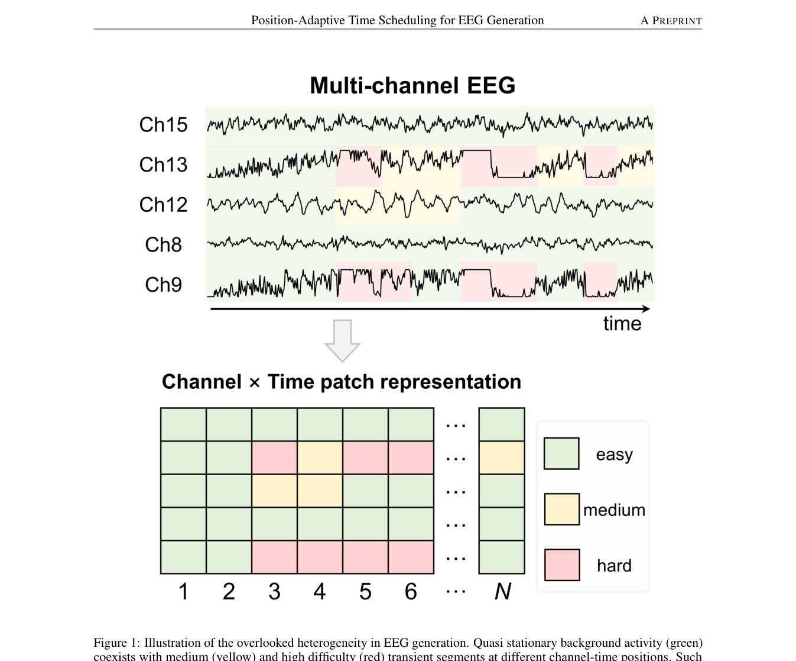
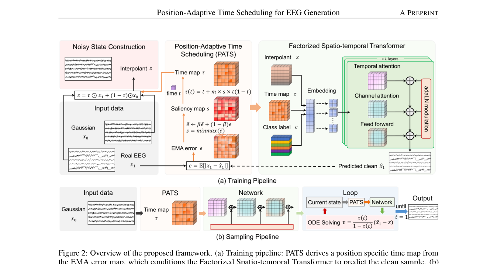

# Not All EEG Moments Are Equal: Position-Adaptive Time Scheduling for EEG Generation

> **arXiv 2026**

**作者**：Boheng Liu, Ziyu Li\*（通讯）, Chenghua Duan, Qing Li, Xia Wu（北京理工大学）

## 1 问题定位：统一时间调度的「均等主义」

EEG 数据稀缺 → 生成增强的动机与 JET 一致。本文攻击的是 JET 留下的一个具体假设：条件流匹配的线性插值路径 \( x_t = t\,x_1 + (1-t)\,x_0 \) 中，**样本内所有通道、所有 patch 位置共享同一个标量 t**——同一训练步里，每个 (i,j) 位置的噪声水平完全相同。

这与 EEG 的两个物理事实冲突：

1. **难度异质**：准平稳背景与高难瞬态共存，重构误差天然不均衡；
2. **难位置复现**：同一采集协议下，病理放电、通道特异性伪迹等难模式趋向出现在相近的通道-时间位置（TUEV 的事件中心窗尤其如此）——因此「难度」可以做成**数据集级的位置统计量**，而不必逐样本估计。

统一调度的后果：难位置与易位置得到同样的有效监督 → 有限容量被浪费。与站内已有批评线的关系：[EEGDM](eegdm.md) 批评掩码重构的「局部插值捷径」（监督信号**太容易**），本文批评流匹配的「均匀调度」（监督信号**分配太平均**）——同属「训练信号分配失当」家族，EEGDM 换目标，本篇换调度。

## 2 方法

### 2.1 预备：干净样本参数化的条件流匹配

patch 化（P=200 无重叠，承 JET）得 \( x_1 \in \mathbb{R}^{C \times N \times P} \)，高斯 \( x_0 \) 同形。与 JET 直接回归向量场不同，本文让网络**直接预测干净样本** \( \hat{x}_1 = f_\theta(z, t, c) \)（引 Li & He 2026「Back to basics」的去噪参数化），向量场由 \( \hat{x}_1 \) 反解，推理解 ODE。

### 2.2 PATS：位置自适应时间调度（核心贡献）

**① EMA 误差图**。每个训练步后更新 \( \bar{e} \leftarrow \beta\bar{e} + (1-\beta)e \)，其中 \( e_{i,j} = \mathbb{E}_{P,B}[|x_1 - \hat{x}_1|] \) 是位置 (i,j) 上沿 patch 维与 batch 平均的绝对误差。这张 \( \bar{e} \in \mathbb{R}^{C \times N} \) 图**全数据集共享、持续更新**——记录的是「该位置在数据集上历来有多难」，而非逐样本属性。min-max 归一化得显著图 \( s \in [0,1]^{C \times N} \)。

**② 端点保持的时间图**。把全局 t 展开为位置专属时间：

\[
\tau_{i,j}(t) = t + m\, s_{i,j}\, t(1-t), \qquad m \in [0,1)
\]

三个关键性质：

- **端点保持**：\( \tau(0)=0,\ \tau(1)=1 \) 对任意 \( s_{i,j} \) 成立——每个位置仍从纯噪声出发、到干净样本结束，只有中间进度被调制，流的分布正确性不被破坏；
- **严格单调**：\( \dot{\tau}_{i,j}(t) = 1 + m\,s_{i,j}(1-2t) > 0 \)（m<1），ODE 良定义；最大偏移在 t=0.5 处，为 \( m\,s_{i,j}/4 \)；
- **可退化**：m=0 恢复 JET 的均匀调度。

**③ 加噪与采样**。\( z = \tau \odot x_1 + (1-\tau) \odot x_0 \)（τ 沿 patch 维广播），网络改吃时间图 \( \hat{x}_1 = f_\theta(z, \tau, c) \)。采样的位置专属向量场：

\[
v_{i,j}(z,t,c) = \frac{\dot{\tau}_{i,j}(t)}{1-\tau_{i,j}(t)}\big(\hat{x}_{1,i,j} - z_{i,j}\big)
\]

注意那个 \( \dot{\tau}/(1-\tau) \) 因子——省掉它就等价于按 m=0 积分，位置调度在推理端失效。生成时用**训练得到的同一张** \( \bar{e} \) 构造 s 与 τ，Heun 或 Euler 积分。

### 2.3 因子化时空注意力

τ 在通道与 patch 间都不同 → 条件必须解析到 **token 级**：每个 token 的条件向量 \( g_{i,j} = \mathrm{TimeEmbed}(\tau_{i,j}) + \mathrm{LabelEmbed}(c) \) 预测每个块 adaLN 的 shift/scale/gate。

注意力不做 C×N 联合，而是两阶段因子化：**时间条带**（每通道内 N 个 patch 做注意力，捕长程时序）→ **通道条带**（每时间位置的 C 个通道做注意力，显式建模容积传导的跨通道依赖），复杂度 \( O((CN)^2) \to O(CN^2 + NC^2) \)。（站内对照：这正是 [CBraMod](cbramod.md) criss-cross 的结论在生成侧的重演——「EEG 的通道×时间网格该这么数注意力」。）

### 2.4 四项损失

1. **难度加权重构**：\( w_{i,j} = 1 + \gamma\sqrt{s_{i,j}} \) 的归一化加权 L1（分母 \( \mathbb{E}[w] \) 保证尺度与 γ 无关）；
2. **统计一致性**：逐通道 μ/σ 对齐（同 JET 的 \( L_{\mathrm{cons}} \)）；
3. **频率对齐多分辨率频谱一致性**（替换 JET 的时域 TV）：R 个分辨率的 STFT 幅值谱，每分辨率 = 谱收敛项（Frobenius 比）+ log 幅值 L1 项；评估频带 \( k < \eta F \) 内加频率权重 \( w_k \propto k^\alpha \)（η 与下游评估协议的最大频率比对齐），带外置 1——直接补偿幂律谱导致的低频主导梯度；
4. **相关性**：\( 1 - \rho_{\mathrm{Pearson}} \)（同 JET）。

第 3 项与 JET 的路线冲突值得单独记：JET 用时域 TV 正则「压高频噪声」，本文指出**时域平滑约束天然偏置向压制临床相关的高频瞬态**（EEG 功率谱 1/f^χ，能量最小化主导的梯度天然偏向低频），改到频域显式加权——恰好接住了 [JET 笔记](jet.md)里「λ_tv 对高频敏感范式需重新标定」的担忧。

## 架构图

*Figure 1 · 难度异质示意：准平稳背景与高难瞬态共存于不同通道-时间位置，且同一协议下跨样本复现——难度可做成数据集级位置统计*

*Figure 2 · 框架总览：(a) 训练——PATS 从 EMA 误差图导出位置时间图，条件化因子化时空 Transformer 预测干净样本；(b) 采样——从高斯噪声出发，按同一位置调度迭代解流 ODE*

---

**相关阅读**

:material-arrow-left: [EEGDM（生成轴线姊妹篇：扩散训表征）](eegdm.md) ｜ :material-creation: [JET（直接前作：条件流匹配 + 生理约束）](jet.md) ｜ :material-chart-timeline-variant: [生成模型脉络（VAE → DDPM → FM）](../basics/generative-lineage.md) ｜ :material-heart-pulse: [CBraMod（因子化注意力同族 + 下游裁判）](cbramod.md) ｜ :material-home: [首页](../index.md)
