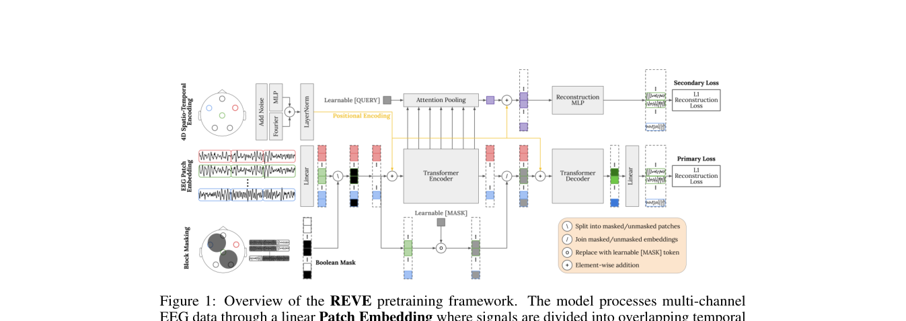

# REVE: A Foundation Model for EEG — Adapting to Any Setup with Large-Scale Pretraining on 25,000 Subjects

> **NeurIPS 2025** · IMT Atlantique（法国）+ 蒙特利尔大学 + Mila —— 站内已读**语料最大**的 EEG 基础模型：92 个数据集、24,274 名被试、61,415 小时（此前最大 ~40,000h 且以颅内 EEG 为主）。它与 [LUNA](luna.md)、[CBraMod](cbramod.md) 同处「空间编码不查表」路线但走得更远——位置编码直接从 (x, y, z, t) 坐标生成；也正面回应了 [CBraMod](cbramod.md) 笔记留下的数据规模之问。笔记基于 arXiv 2510.21585 v1。

**作者**：Yassine El Ouahidi\*, Jonathan Lys, Philipp Thölke, Nicolas Farrugia, Bastien Pasdeloup, Vincent Gripon, Karim Jerbi, Giulia Lioi\*（IMT Atlantique Lab-STICC；Thölke/Jerbi 兼 Montréal/Mila/UNIQUE）

!!! abstract "TL;DR"
    - 痛点有名字：现有 EEG FM 普遍只在单一 montage 上预训练（TUH 系 19/21 通道），位置编码查表或卷积都绑死布局——换蒙太奇就退化，尤其 linear probing 场景。REVE 的答案是 **4D 傅里叶位置编码**：每个 patch 的 (x, y, z, t) 直接生成编码，任意电极数、任意信号长度都有定义
    - 数据：92 数据集 / 24,274 被试 / **61,415h** / 19TB 原始（OpenNeuro 56 集 + TUH 26,847h + MOABB 27 集 + PhysioNet），396 个电极名、10-5 系统——非侵入 EEG 最大预训练语料；清洗哲学与 [CBraMod](cbramod.md) 相反：**不剔** >100µV 段（保住 60,000h vs CBraMod 9,000h / LaBraM 2,534h），只剔 <10s 短记录和下游任务数据（防泄漏内建）
    - 目标：MAE + **时空块掩码**（55%，空间 3cm 半径连续块 + 时间 3s 窗 + 10% 整通道 dropout）+ **全局 token 二次损失**（attention pooling 跨全部 MHA 层，λ=0.1）——后者是信息瓶颈，专治 MAE 末层过拟合，linear probing 平均 0.523→0.558
    - 结果：10 个下游任务微调平均 **+2.5%** vs CBraMod（BCIC-IV-2a 一项 +12.6pp，但加了基线没有的 Euclidean Alignment 预处理）；linear probing REVE-Large 0.654 vs CBraMod 0.501（**+17%**）；泛化到 30s 睡眠输入与训练没见过的双极 montage
    - 预训练价值消融是全文最锋利的一张牌：无预训练时 REVE 比 CBraMod 差 8%+，有预训练 REVE **+11%** 而 CBraMod 只 **+2%**——「架构派 vs 预训练派」之争第一次被同框量化

## 1 问题定位：montage 绑定是线性探针下的第一瓶颈

作者对现有 EEG FM 的归因分两层。**数据层**：BIOT / LaBraM / CBraMod / NeuroGPT 的预训练语料几乎都来自 TUH（固定 19/21 通道蒙太奇），换电极布局的数据集天然吃不到预训练红利。**架构层**：位置编码要么查表（LaBraM 的电极编号 → embedding、BIOT 的通道表），要么卷积生成（CBraMod 的 ACPE）——前者覆盖不了训练没见过的电极名，后者编码的是邻域模式而非绝对空间位置，迁移时往往要全量微调补课。两层的共同后果：linear probing（最能反映表示通用性的协议）成绩次优。

REVE 的三个贡献各打一层：4D 位置编码解决架构层（任意布局任意长度都有定义），61,415h 多源语料解决数据层（布局多样性内建于数据），修改版 MAE 解决表示层（冻结可用）。

## 2 方法

### 2.1 4D 位置编码：从坐标生成，不查表

切段承 [BIOT](biot.md)：每通道切 w=1s、重叠 o=0.1s 的 patch，线性嵌入。位置编码分三步：

1. **坐标 + 噪声**：电极 3D 坐标 \( P \in \mathbb{R}^{C\times3} \) 加标准差 0.25cm 的高斯噪声——模拟头围大小与电极摆放的自然差异；
2. **4D 傅里叶投影**：把每个 patch 的 (x, y, z, t) 各投影到 n\_freq 个频率（时间维取离散值 1..p 并缩放到与空间同尺度），四维频率按**笛卡尔积**组合成 \( n_{freq}^4 \) 维（层级周期：x 的周期是 \( n_{freq}^1 \)、y 是 \( n_{freq}^2 \)……），正弦余弦变换后得 \( 2 n_{freq}^4 \) 维向量。方法直接沿用 [Défossez 语音解码](defossez-speech.md)的 2D 傅里叶位置编码并扩到 4D——站内两条线在这里接上了；
3. **可学习适配**：同一坐标过 linear + GELU + LayerNorm 得 \( F_{lin} \)，补偿傅里叶基的截断。最终 \( P_{enc} = \mathrm{LayerNorm}(F_{pe} + F_{lin}) \)——结构化先验 + 数据驱动适配的相加。消融（Table 19）：该组合 0.707 优于纯可学习 PE 变体（0.701）与纯 MLP 4D（0.677）。

关键在消融的脚注：可学习 PE 在**见过的配置上并不差**（~400 个电极名、10s 窗内），但它无法外推到更长序列和没见过的布局——4D 编码的全部意义在泛化侧。encoder 与 decoder **复用同一套位置编码**（原版 MAE 两套独立），这也是长度/布局灵活性的前提。计算开销只是正弦计算 + 小线性层，随 token 数线性。

### 2.2 时空块掩码

[TFM](tfm-tokenizer.md) 把掩码从随机点升级到频带结构，REVE 换了个轴：**空间 × 时间都做连续块**。参数五件套：总掩码率 Mr=55%、空间半径 Rs=3cm（选中通道周围挖一片）、时间半径 Rt=3s（选中 token 前后挖一段）、dropout 率 Dr=10%（整个通道序列直接砍掉，半径 Rd=4cm 内连坐）。理由与 TFM 同构：EEG 邻域（空间和时间上）高度相似，随机点掩码留下冗余信息，重构退化成插值；块掩码打断这些模式。消融（Table 18）：55% 块掩码 frozen 0.558 / 微调 0.665，同比例随机掩码 0.550 / 0.643；随机掩码要退到 25% 才好看，但冻结端仍更差。

### 2.3 全局 token 二次损失：治 MAE 的末层过拟合

主任务是标准 MAE：encoder 只看可见 patch，轻量 decoder 重构被掩 patch 的原始信号，**L1 损失**（EEG 噪声重尾，L2 被离群点绑架——与 [LUNA](luna.md) 的 Smooth-L1、[JET](jet.md) 的 L1 同一动机）。

创新在二次任务：把 encoder **所有 MHA 层**的输出 token（过 FFN 后）concat，由一个可学习 query 做 attention pooling，压成**单一全局 token**；这个 token 重复铺开、加位置编码、过两层 FFN，同样去重构被掩 patch。总损失 = 主损失 + 0.1 × 二次损失。

机理是信息瓶颈：主损失下，encoder 末层可以把重构需要的便利特征都堆在最后一层（尤其 decoder 浅时）；全局 token 逼模型把整段输入的关键信息蒸馏进一个向量、且**每层都得贡献**——否则瓶颈处凑不齐重构所需信息。消融（Table 17）：二次损失把 linear probing 平均从 0.523 提到 0.558、微调从 0.612 提到 0.665，且主要收益在**冻结特征质量**上。

### 2.4 Transformer 的现代化与预训练配方

骨干是 LLaMA 式的现代配方：RMSNorm 替 LayerNorm、GEGLU 替 GELU（FFN 扩展比 8/3）、除 decoder 末层外全部线性层去 bias、FlashAttention v2——每项都有消融背书（GEGLU+RMSNorm 平均 0.596 最优）。训练：StableAdamW + 梯形 Warmup-Stable-Decay 循环调度（适配掩码采样带来的逐 epoch 变异）、lr 按缩放律 \( \eta \propto D^{-0.90} \) 跨规格缩放、batch 4096、Megatron 初始化。Base 预训练约 **260 A100 GPU 小时**——比 LaBraM 的 8×A800 便宜得多，多源语料才是成本大头。

**规格**：Small 12M（4 层）/ Base 69M（22 层 / 512 维 / 8 头）/ Large 408M（22 层 / 1250 维 / 19 头）。

### 2.5 数据：92 数据集与「不洗」哲学

语料构成（Table 7）：临床 50,581h（8 集，TUH 一家 26,847h）+ 认知 10,376h（56 集，多为 OpenNeuro 实验室数据）+ BCI 457h（28 集，MOABB 系）——通道数从 3 到 129 全谱系覆盖。预处理刻意极简：只剔 <10s 记录与下游任务数据（防泄漏），200Hz 重采样、0.5–99.5Hz 带通、跨会话统计的 z-score、15σ 截断（承 Défossez）。

与 [CBraMod](cbramod.md) 的分歧在剪枝标准：CBraMod 剔掉任意点 >100µV 的整段（换来干净但只剩 9,000h），REVE 全保留（60,000h）。谁的哲学对，看实验。

## 3 实验与结果

**微调 SOTA（Table 2/16，balanced accuracy）**：10 任务上对最强基线 CBraMod 平均 **+2.5%**。TUAB 0.8315（vs 0.8289）、TUEV 0.6759（vs 0.6671）、MAT 0.7660（vs 0.7256）、BCIC2020-3 想象语音 0.5635（vs 0.5373）、Mumtaz 0.9644、PhysioNet-MI 0.6480；ISRUC 平衡精度 0.7819 略低于 CBraMod 0.7865，但 Kappa 0.7500 更高——且 REVE 修了基线代码里下巴电极混入的 bug（诚实细节 +1）。跨设定泛化是位置编码的兑现处：预训练只见 10s 段，ISRUC/HMC 的 30s 输入照常工作；TUEV 的双极蒙太奇训练里从未出现。

**Linear probing（Table 4）**：REVE-L 平均 0.654，对 CBraMod 0.501 领先 **17%**；TUAB 0.821、ISRUC 0.743、HMC 0.703——EEGPT 之后第二个把「冻结可用」做实的模型，且这里微调协议还是「两步走」（先冻结探针对齐特征空间，再解冻全网络，单次连续训练）+ LoRA on QKVO + Mixup + model souping（≥5 个微调模型权重平均，+1.5%）。

**预训练价值消融（Table 3）**：PhysioNet-MI 上，无预训练时 REVE 0.5409 比 CBraMod 0.6196 差 8%+；加预训练 REVE 涨 **11%**、CBraMod 只涨 **2%**。作者的读法是「REVE 的成绩来自预训练表示，基线来自架构设计」——这句话的反面同样成立：CBraMod 的架构从零初始化就够强，REVE 的架构离了预训练不行。

**稀疏与少样本**：通道递减下 MI 任务优雅退化（64ch 0.824 → 1ch 0.660），想象语音则崩向随机（0.565 → 1ch 0.209）——空间信息密集的任务扛不住剪通道。20-shot 少样本：纯预训练权重 0.723，跨数据集微调后 **0.817**。

## 架构图

*Figure 1 · 主任务沿 MAE 骨架，差异在 4D 位置编码（黄线）、块掩码与 L1；二次任务（右上）从各层输出池化全局 token，构成信息瓶颈*

## 与其他论文的关系

| 论文 / 工作 | 关系说明 |
|---|---|
| [CBraMod](cbramod.md) | 最主要对照：数据哲学相反（保留 vs 剔除 >100µV 段）、位置编码相反（4D 傅里叶 vs ACPE 邻域卷积）；同口径 10 任务 REVE 平均 +2.5%，但 BCIC-IV-2a 的 +12.6pp 含预处理加成（见个人思考）。Table 3 的预训练价值消融是对「架构派」的正面回应 |
| [LUNA](luna.md) | 「不查表」空间编码的两极：LUNA 用学习 query 把通道**压缩**进固定隐空间（置换不变），REVE 用坐标**生成**位置编码（每个 patch 自带空间地址）——前者解决通道数扩展，后者解决布局任意性，可叠加而非互斥 |
| [Défossez 语音解码](defossez-speech.md) | 两处直接继承：4D 傅里叶位置编码扩自其 2D 方案；15σ 截断预处理同款。语音线与基础模型线在空间编码上首次合流 |
| [BIOT](biot.md) | 重叠切段（w=1s, o=0.1s）承自 BIOT；REVE 用全注意力替掉其线性注意力——61,415h 语料 + 69M 参数撑得起 O(N²) |
| [EEGPT](eegpt.md) | 「冻结可用」的第二个解法：EEGPT 靠表示对齐目标，REVE 靠全局 token 信息瓶颈——机制完全不同，疗效相当（REVE-L 探针 0.654 vs EEGPT 探针 0.62 量级） |
| [数据全景专题](../topics/data-landscape.md) | 61,415h 把「万小时」叙事推到新量级，且 92 数据集的**多样性**（396 电极名、3–129 通道）才是它相对 NeuroLM 25,000h 单一 TUEG 的实质差异 |
| [LoRA 基础页](../basics/lora.md) | 下游微调直接用 LoRA（QKVO 投影）防灾难性遗忘——站内 LoRA 笔记的又一个 EEG FM 实战用例 |

## 个人思考

- **数据清洗哲学之争打平了**。CBraMod 的消融说「清洗版 > 脏数据版」，REVE 反着来（保留 >100µV 段）还在多数任务上赢了——说明清洗标准不是普适规律，而是与语料规模、模型容量交互的变量：9,000h 精洗配 4M 模型是一种最优解，60,000h 粗洗配 69M 模型是另一种。CBraMod 笔记留下的「多数据集多样性能否突破 1000h 饱和」，REVE 没有正面回答（没做数据量 scaling 消融，只有模型规模消融），但 +2.5% 的平均优势至少与「多样性有用」相容；
- **预训练价值消融是双刃剑**。REVE 涨 11 个点、CBraMod 只涨 2 个点，作者读作「我们的成绩来自预训练」。反过来读：CBraMod 从零初始化就有 0.62，说明它的十字交叉架构自带强先验；REVE 从零只有 0.54，说明 69M 参数的普通 Transformer 在 EEG 上并不自带什么——它的成绩是数据堆出来的。哪种更可取取决于你信「架构先验」还是「数据先验」，这篇论文没有也不能替你回答，但它第一次把两种来源的贡献拆开量化了；
- **BCIC-IV-2a 的 +12.6pp 不能直接读作模型增益**。REVE 在这个任务上用了 Euclidean Alignment 预处理（He & Wu 2019，基线都没用）——该预处理在 MI 任务上是公认的大杀器。剔除这个混杂因素，REVE 与 CBraMod 的真实差距应该以其余 9 个任务的 +2.5% 为准。这是跨论文比数字时「预处理不对齐」教训的又一个案例；
- **全局 token 二次损失是全文最可偷的组件**。实现只有 attention pooling + 两层 FFN，消融收益明确且机制清晰（信息瓶颈对抗末层过拟合）。任何做 MAE 式预训练、又在乎冻结特征的pipeline都值得加上——它和 EEGPT 的对齐损失、LUNA 的可见 patch 小系数一起，构成了「让预训练表示免微调可用」的三个独立方案；
- **decoder 不发布是行业先例**。MAE 的 decoder 能重构原始 EEG——等于自带一个「从表示反推脑信号」的工具，作者以隐私为由扣下 decoder 只放 encoder。EEG FM 论文第一次认真对待「重建能力的隐私面」，这个决定比成绩数字更值得被后来者记住。

## 自问自答

??? question "Q1 · 4D 傅里叶位置编码凭什么比查表泛化？"

    查表的覆盖集是训练见过的 (电极名, 时间索引) 组合——REVE 统计约 400 个电极名、10s 窗内的索引，出了这个集合（62 通道蒙太奇、30s 睡眠窗、双极导联）就没有对应向量。坐标驱动的编码对任意 (x, y, z, t) 都有定义，因为它是一组连续函数而非离散查找。消融的脚注说得很诚实：可学习 PE 变体在见过的配置上不差（0.701 vs 0.707），4D 编码的全部价值都在泛化侧；坐标加 0.25cm 噪声则是对电极摆放差异的显式建模。

??? question "Q2 · 全局 token 二次损失为什么能提升冻结特征？"

    MAE 的重构梯度主要由 decoder 消化，encoder 末层有机会过拟合出「专供 decoder 的便利特征」——下游换任务时这些特征不迁移。二次任务把全部层的输出蒸馏进一个向量再重构，等于设了一个信息瓶颈：任何一层偷懒，瓶颈处信息就不够用。结果是 encoder 深度被均衡使用、各层都携带可迁移信息。消融（REVE-Small、八任务）：LP 平均 +3.5pp、FT 平均 +5.3pp，其中 BCIC2020-3 的 FT 一项就涨 9 个点。

??? question "Q3 · 块掩码为什么优于随机掩码，比例怎么选？"

    EEG 的时间邻域和空间邻域都高度自相关：随机点掩码下，被掩 token 的信息大概率还在旁边的可见 token 里，重构退化为插值，梯度信号弱。块掩码按空间半径 3cm × 时间 3s 连续挖，把这些冗余一并挖掉。Table 18 的比例扫描：55% 是块掩码最优点（frozen 0.558 / FT 0.665），随机掩码最优在 25%（0.523 / 0.612）——随机掩码被迫用低比例「减少难度」，但冻结端仍输给块掩码。这与 TFM 的频带掩码消融（结构化 > 随机 +8%）互为印证：掩码的结构要匹配信号的结构。

??? question "Q4 · REVE 算不算回答了 CBraMod 留下的数据饱和问题？"

    部分回答。CBraMod 消融显示自家清洗语料 1000h 后边际递减，并质疑堆数据路线；REVE 用 92 数据集 61,415h 拿到平均 +2.5%——与「多样性突破单一分布饱和」相容。但要打两个折扣：① 论文没有数据量 scaling 消融，61,415h vs 9,000h 的增益里混着架构（4D PE）、模型规模（69M vs 4M）与目标差异，归因不纯；② REVE 自己承认语料以北美欧洲临床数据为主、人口多样性有限，下一步才是选择性策展。数据 scaling 曲线在 EEG 上仍然是稀缺品——这个问题保持开放。

!!! abstract "复现速查卡"
    - **代码**：[项目页](https://brain-bzh.github.io/reve/) + [GitHub](https://github.com/elouayas/reve_eeg)（多规格权重 + tutorials）；⚠️ **MAE decoder 不发布**（可重构原始 EEG，隐私考量）
    - **预训练**：92 数据集 61,415h（OpenNeuro 56 / TUH / MOABB 27 / PhysioNet 等）；切段 w=1s、o=0.1s；块掩码 Mr 55% / Rs 3cm / Rt 3s / Dr 10% / Rd 4cm；L1 损失；二次损失 λ=0.1（attention pooling 跨全部 MHA 层 → 全局 token → 2 层 FFN）；位置噪声 σ=0.25cm；n_freq ∈ {3,4,5}
    - **优化**：StableAdamW（β 0.9/0.95）、peak lr 2.4e-4（Base，按 \( \eta \propto D^{-0.90} \) 跨规格缩放）、batch 4096、梯形 Warmup-Stable-Decay、Megatron 初始化 0.02；Base 约 260 A100 GPU 小时
    - **规格**：Small 12M（4 层/512）；Base 69M（22 层/512/8 头）；Large 408M（22 层/1250/19 头）
    - **下游**：两步微调（冻结探针 → 解冻全网，单次连续训练）；LoRA on QKVO；Mixup + dropout；Reduce-on-Plateau；model souping ≥5 模型平均（+1.5%）
    - **预处理**：200Hz、0.5–99.5Hz 带通、会话级 z-score、15σ 截断；**不剔** >100µV；剔 <10s 与下游任务数据
    - **评测注意**：BCIC-IV-2a 用了 Euclidean Alignment（基线未用，对比需留意）；ISRUC 修正了基线的下巴电极 bug

---

**相关阅读**

:material-compress: [CBraMod（最主要对照：数据哲学与位置编码的正面分歧）](cbramod.md) ｜ :material-compress: [LUNA（空间编码另一极：query 压缩 vs 坐标生成）](luna.md) ｜ :material-magnify: [EEGPT（冻结可用的另一解法：对齐目标 vs 信息瓶颈）](eegpt.md) ｜ :material-database: [EEG 预训练数据全景（61,415h 入账后的语料版图）](../topics/data-landscape.md) ｜ :material-chart-box: [十四篇方法对比](../comparison.md) ｜ :material-home: [首页](../index.md)
