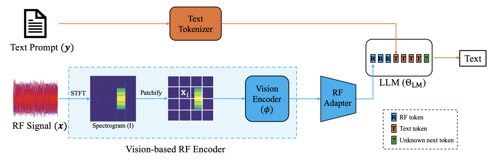

# RF-GPT: Teaching AI to See the Wireless World

> **arXiv 2026**

**作者**：Hang Zou, Yu Tian, Bohao Wang, Lina Bariah, Samson Lasaulce, Chongwen Huang, Mérouane Debbah

#### 1 问题定位

LLM 与多模态模型已统一了文本、视觉、音频，唯独**射频（RF）信号**——无线通信、雷达、ISAC 的物理层载体——没有被纳入基础模型框架。两侧各有困境：

- **传统 RF 深度学习**是任务专用的窄模型（调制识别/信道估计/波束选择/干扰识别/频谱感知），四个共性局限：① 每个任务一套架构、数据集、训练管线，难以复用；② 多样且标注良好的 RF 数据集昂贵（要专家标注）；③ 换 SNR/信道/硬件场景性能骤降；④ 只吐标签或回归值，无解释、无自然语言交互接口；
- **电信 LLM**（TelecomGPT 等 LLM4Telecom 一系）是 text-centric 的——处理工单、日志、KPI、配置表，**不碰物理层**，形成模态鸿沟；
- 已有的无线/RF 基础模型（WFM、LWM、WirelessGPT 类）仍依赖任务专属输出头 + 逐任务微调，模型偏小、benchmark 窄，难以按 scaling law 扩展。

作者的答案是把 RFLM 定义为**以 RF token 为条件的条件语言模型**：给定一段 RF 录波，能用自然语言回答「这个频段里有哪些调制和技术？」「有没有重叠传输、时频关系如何？」「该行为是否符合相关无线标准？」，并输出结构化 JSON 供下游控制器使用。RF 恰好特别适合合成数据：标准波形生成器可以产生**精确的 ground truth**（调制类型、SNR、带宽、资源分配全是仿真器内部变量），从而摆脱专家标注。

#### 2 方法

**（a）RFLM 形式化**：RF 编码器把复基带 IQ 序列映射为 M 个 d 维 RF token：

\[ \varphi_{\mathrm{RF}}: \mathbb{C}^T \to \mathbb{R}^{M \times d}, \qquad \mathcal{P}_\Theta(\mathbf{y} \mid \varphi_{\mathrm{RF}}(\mathbf{x})) = \prod_{t=1}^{N} \mathcal{P}_\Theta\big(y_t \mid \mathbf{y}_{<t}, \varphi_{\mathrm{RF}}(\mathbf{x})\big) \]

RF token 作为前缀条件驱动自回归解码。实现上完整编码器是「频谱图管线 ∘ 视觉管线」的复合：

\[ \varphi_{\mathrm{RF}}(\mathbf{x}) = \mathcal{E}_v\big(\mathrm{Spec}(\mathbf{x})\big) \]

**（b）频谱图前端——为什么不直接吃原始 IQ**：原始 IQ 采样率极高，直接进 Transformer 计算不可行，且丢掉时频结构的强归纳偏置。于是先做 STFT（窗 w、FFT 点数 F、hop H_hop），再对复谱做 dB 幅值压缩：

\[ A_{\mathrm{dB}}[k,t] = 10 \log_{10}\big(|S[k,t]|^2 + \varepsilon\big) \]

归一化后映射为灰度图（C=1）或固定 colormap（viridis）伪 RGB 图（C=3），交给**预训练视觉编码器**。选这个路线的两个动机：① RF 信号跨技术的载频/带宽/采样率差异巨大，单一 raw-IQ tokenizer 很难同时高效适配窄带、宽带、多标准场景；② STFT 本身就是有效的 RF 特征提取器，而图像预训练的视觉编码器能从任何图像（包括谱图）中提取通用语义结构。谱图切 P×P patch 后线性投影 + 可学习位置 embedding，过 Transformer 编码器层；**不设 [CLS] token**，全部 M 个 patch token 都作为 RF token 交给语言模型。

关于**幅值谱丢相位**：作者明确区分两个范畴——真正的相位重构（从幅值恢复整个波形，PhaseLift 一类）不在此列；RF-GPT 只推任务相关属性（调制族、技术、SNR 档位、重叠结构），这些是波形的**多对一映射**，主要取决于时频能量模式而非逐样本相位，因此幅值谱作为「丰富但有损」的前端足够。

**（c）RF adapter 与 LLM**：视觉编码器输出的 M 个 token 经一个线性投影（LLaVA 式模态 adapter）映射到 LLM 嵌入维度，与文本 token 查表 embedding 拼接成单一序列：RF token 在前、文本在后。解码器骨干是 Qwen 系现代设计——pre-norm **RMSNorm** + **GQA** 因果注意力 + **SwiGLU 门控 MLP** + RoPE。输出只取文本位置的 logits。

**（d）RF-grounded SFT**：在合成三元组 (x, q, y) 上做监督指令微调，(q, y) 按角色标记拼成单序列、RF token 注入为前缀，**梯度只算答案 token**，标准自回归交叉熵：

\[ \mathcal{L}(\Theta) = -\sum_{(\mathbf{x},\,q,\,\mathbf{y}) \in \mathcal{D}_{\mathrm{RF}}} \sum_{t=1}^{|\mathbf{y}|} \log \mathcal{P}_\Theta\big(y_t \mid \mathbf{y}_{<t},\, q,\, \varphi_{\mathrm{RF}}(\mathbf{x})\big) \]

关键性质：**所有监督都是 RF-grounded 的**——答案里的每个 token 都由构造保证与底层 RF 场景一致，迫使模型把谱图中的 RF 模式与语言中的 RF 概念对齐。

#### 3 数据流水线：零人工标注的三段式（本文最大贡献）

**第一段 · 标准合规波形生成**：用 MATLAB Wireless Waveform Generator 家族（5G/LTE/UMTS/WLAN/卫星通信/蓝牙 Toolbox）为 **5G NR、LTE、UMTS、WLAN、DVB-S2、Bluetooth** 六种技术生成宽带场景。流程是统一模板：随机采样技术配置 → 过 MATLAB API 生成 → **拒绝采样**保证合规（PRB/RU 分配非法、带宽-numerology 不兼容、导频模式不一致即拒绝重采）→ 可选信道与损伤（衰落、频率选择性信道、目标 SNR）→ 全部配置与信道参数逐字存入元数据。另用 **TorchSig** 补充宽带调制的多样性（WBMC 即基于其 57 类调制扩展为宽带设定）。

**第二段 · 确定性 captioning**：因为每个谱图都由已知配置对象生成，标签天然零噪声。caption 信息按**五级信息分层**——Summary（一句话概述）/ Global visual（SSB、CSI-RS/SRS burst 等全局可视模式）/ Global context（带宽、SCS 等元数据可知但视觉不显的量）/ Signal visual（每信号的相对 SNR 与时频占据）/ Signal context（视觉难推的上下文，如 DM-RS/PTRS 设置）。

**第三段 · 指令合成**：确定性的密集 caption 太长、顺序固定、不是指令格式，直接训会难优化。于是按任务模板库（信号计数、调制/技术识别、信息抽取、重叠分析、一致性检查、开放描述）采样模板，把五级信息按难度选择性拼进隐藏上下文，交给强文本 LLM（**GPT-OSS-120B**）生成格式受控的指令-答案对（纯标签/JSON/短段落）。

规模：**~12,000 个 RF 场景、0.625M 指令对，全程零人工标注**。

#### 4 创新点

1. **提出并实现 RFLM 概念**：以 RF token 为条件的语言模型——RF 感知与高层推理之间的第一座桥；
2. **零 RF 预训练**：不训任何 RF 编码器，把频谱图当图片、整个复用预训练 VLM 的视觉栈，SFT 一步到位；
3. **全自动数据飞轮**：标准合规生成器（拒绝采样保真）+ 「配置即标签」确定性 captioning + 文本 LLM 指令合成，0.625M 对零人工；
4. **系统化 benchmark 套件**：WBMC/WBOD/WTR/WNUC/NRIE 五族任务，覆盖调制、重叠推理、技术、计数、协议参数抽取，含难度分级与严格匹配准则。

## 架构图

*Figure 1 · RF-GPT 框架总览：频谱图经视觉编码器变成 RF token 前缀，LLM 在其条件下生成回答*

---

**相关阅读**

:material-arrow-left: [上一篇：TFM-Tokenizer](tfm-tokenizer.md) ｜ :material-angle-acute: [LoRA · 低秩适配](../basics/lora.md) ｜ :material-vector-link: [Tokenization 演进](../topics/tokenization.md) ｜ :material-home: [首页](../index.md)
