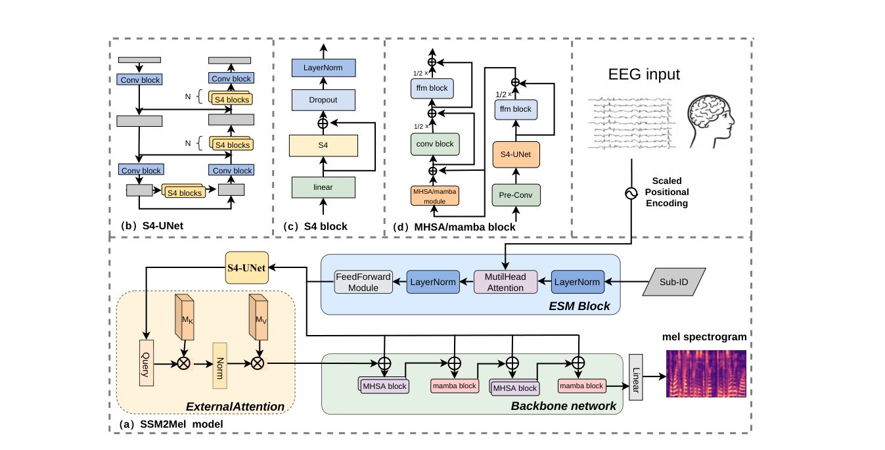

# SSM2Mel: State Space Model to Reconstruct Mel Spectrogram from the EEG

> **arXiv 2025**

**作者**：Cunhang Fan, Sheng Zhang, Jingjing Zhang, Zexu Pan, Zhao Lv（安徽大学；Zexu Pan 来自阿里巴巴新加坡；通讯作者原文标注不清，未确认）

## 1 问题定位：从词/字母分类到连续声学特征

语音解码的 EE 部分，此前站内没碰过，先把地图摆一下。论文把已有工作分三层：词/字母级的想象语音分类（语法类别、数字识别）、分钟级连续包络重建（VLAAI，2023 Scientific Reports；HappyQuokka，ICASSP 2023 赛题系统）、以及最难的连续 mel 谱重建（ConvConcatNet，2024 赛题冠军）。前一层是分类问题，后两层是连续信号回归——难度陡增的原因很直接：mel 谱比包络维度高得多，包络只是宽带幅值轨迹，mel 谱要恢复频带结构，而头皮 EEG 因颅骨低通衰减，高频语音特征本就所剩无几。

作者选的切入点是序列建模工具：包络线的 CNN 路线（VLAAI、ConvConcatNet）在长序列上效率受限，SSM 家族（S4，ICLR 2022；Mamba，2023）线性复杂度 + 长程记忆，看起来是长时 EEG 的对口工具。本文是「把 Mamba 搬进 EEG→语音回归」的一次尝试，连同两个配套模块。这个判断我先记下，第 4 节会回头检验它是否兑现。

## 2 方法

### 2.1 总体：三段式流水线

EEG 输入加 scaled positional encoding 后先进 ESM（Fig. 1a）：Sub-ID one-hot 嵌入与 EEG 特征做注意力调制，得到含被试信息的特征。ESM 输出分两路：主路进 S4-UNet 做局部预提取、再过 ExternalAttention 进骨干；旁路把未经 S4-UNet 的原始特征直接引到骨干侧，在四个骨干块前各做一次残差相加（Fig. 1a 中的四处 ⊕），作者说这是为了学到更宽的数据表征、「通过多样输入提升训练稳定性」（Section II-A）。骨干是 MHSA block 与 Mamba block 各两个、按 MHSA → Mamba → MHSA → Mamba 交替串联（Fig. 1a）；每个 block 内部是 Conformer 式的 ffm block → MHSA/mamba module → conv block → ffm block 三明治，段间带 ½× 缩放的残差相加（Fig. 1d）；最后一个线性层把特征汇成单张 mel 谱。

### 2.2 ESM：被试嵌入强度调制

被试间差异是 EEG 建模的老问题，本文的处理借自双语 TTS 的 Embedding Strength Modulator：把被试 one-hot 编码成嵌入 \( S_E \)，与加位置编码的 EEG 特征 \( P_0 \) 做一次以 EEG 为 query 的注意力调制：

\[
M_0 = \mathrm{MH}(P_0,\ \mathrm{LN}(S_E) + S_E)
\]
\[
F_0 = \mathrm{FFN}(\mathrm{LN}(M_0)) + M_0
\]

即 key/value 都来自被试嵌入（先 LayerNorm 再残差），EEG 特征按被试身份被重新缩放。机制上就是 FiLM 式条件化的注意力版本，新颖性有限，但消融里它贡献 0.006（0.069→0.063）——被试信息在这个任务上是真红利，这个结论站得住。

### 2.3 S4-UNet 与 ExternalAttention：局部预提取

S4-UNet 把 S4 block 塞进 U-Net 的下采样/上采样骨架（Fig. 1b），上采样前先经过 n 个 S4 block。S4 block 本体是 linear → S4 → 残差 → Dropout → LayerNorm 的堆叠（Fig. 1c）；Pre-Conv 不在这里，它和 S4-UNet 一起作为前置卷积段出现在骨干 block 的前端（Fig. 1d 右列）。作者的逻辑：S4 兼具 CNN 与 RNN 的长处，在 U-Net 的局部感受野里负责抓短程依赖，补 Mamba/注意力的长程视角。结构灵感来自 S4 语音处理的先例（Goel et al. 用重复 S4 block 做音频生成，SaShiMi 系 [26]），「首次用于 EEG」的说法指的是这个 U-Net 形态。

ExternalAttention 是两个线性层生成的共享 memory（\( M_K, M_V \)），query 从特征映射过去，复杂度线性（Fig. 1a 左下）。它排在 S4-UNet 之后、骨干之前，作者给它「早期捕获个体差异」的定位——与 ESM 功能高度重叠；两处各自消融掉分的总和是 0.014（去 ExternalAttention −0.008、去 ESM −0.006，Table III），论文没有做联合去除的消融。

### 2.4 SSM 家族的递进与混合骨干

论文给的三级公式值得留档，是 S4/Mamba 的最小入门：

连续 SSM：
\[
h_t = A h_{t-1} + B x_t, \qquad y_t = C h_t + D x_t
\]

S4 把 \( A, B \) 离散化（\(\bar{A}, \bar{B}\)）并做结构化约束；Mamba 再进一步让 \( A, B, C \) 依赖输入（selective）。骨干 block 的成型有两处外部依据：一是 Mamba 综述的判断——Mamba 需要额外非线性才能学到高级语义信息，适合作为 MHSA 的替代使用 [28]，于是作者直接在 Conformer 的 macaron 骨架里把 MHSA 换成 Mamba；二是 Shan et al.（ICASSP 2024）把 S4 塞进 Conformer 增强在线语音识别的先例 [29]，为「Pre-Conv + S4-UNet 前置、再接 Conformer 式骨干」提供依据。之后作者援引 Jamba、Zamba 的结论——Mamba 层与注意力层混合优于任一单独使用——据此设计骨干：两个 MHSA block、两个 Mamba block 交替，每个位置都有残差连接，ESM 旁路的原始特征也并进来。

### 2.5 损失

\[
\mathcal{L} = -R + \alpha \times \mathrm{L1}, \qquad \mathrm{L1} = \frac{1}{n} \sum_{i=1}^{n} |\hat{y}_i - y_i|
\]

\( R \) 是预测谱与真谱的 Pearson 相关。两项搭配是回归任务的常规操作：L1 管绝对尺度，Pearson 管形状（不受幅值缩放影响）。平衡系数 \( \alpha \) 的取值全文未披露。

## 架构图

*Figure 1 · (a) 总体框架——ESM block（右上，Sub-ID 经 LayerNorm 进 MultiHead Attention）→ S4-UNet + ExternalAttention（左下，\( M_K/M_V \) 共享 memory）→ MHSA/Mamba 交替骨干（ESM 原始特征经四处 ⊕ 并入每块前的残差）→ Linear 出 mel 谱；(b) S4-UNet 的 U 形下采样-上采样，上采样前每级经 n 个 S4 blocks；(c) S4 block = linear → S4 → 残差 → Dropout → LayerNorm；(d) MHSA/mamba block：右列 Pre-Conv → S4-UNet → ffm 前置段，左列 ffm → MHSA/mamba module → conv → ffm 三明治，段间 ½× 缩放残差*

## 与其他论文的关系

| 论文 / 工作 | 关系说明 |
|---|---|
| [BrainGPT](braingpt.md) | 长序列 EEG 建模的两种下注：BrainGPT 用自回归 Transformer + 大规模多数据集预训练赌 scaling；本篇用 SSM 线性复杂度 + 单数据集有监督回归。讽刺的是本篇训练/推理都在 5 s 窗上，Mamba 的长上下文优势没有被行使——「长序列」问题在这两个工作里的处理深度差一个量级 |
| [CBraMod](cbramod.md) | 「单一机制不够，交替混合」结论的两侧互证：CBraMod 交替空间/时间双路注意力（1D conv patch 编码），本篇交替注意力/SSM。都发现混合优于任一单独机制，但 CBraMod 有 12 数据集的系统验证，本篇只有单数据集三个点的对比 |
| [BIOT](biot.md) | 同追线性复杂度的两条路：BIOT 用逐通道切段 + 线性注意力，本篇用 SSM 递归。BIOT 面向跨格式预训练，本篇面向单任务回归——没有预训练，被试嵌入就是它唯一的「个性化」手段 |
| [EEGPT](eegpt.md) | 轴线对照：EEGPT 是通用特征提取器（10M 参数，linear probing 到各任务），本篇是端到端任务特化模型。一个自然的未验证想法：用 EEGPT/CBraMod 的预训练特征替换本篇的 S4-UNet 预提取，能否白捡提升——本文完全没碰这条线 |
| [Not-All-EEG](not-all-eeg.md) | 生成轴线与本篇共享「连续信号回归」的损失设计问题：Not-All-EEG 用多分辨率 STFT 频谱一致性损失对抗幂律谱偏置，本篇只有 L1+Pearson、无任何频域约束——mel 谱任务天然是频域目标，这是可以白捡的改进点 |
| VLAAI / HappyQuokka / ConvConcatNet | 直接前作与基线（2023–2024 ICASSP Auditory Challenge 系）：包络 → mel 谱的目标升级线，本篇把这条线的 SOTA 从 0.063 推到 0.069 |

---

**相关阅读**

:material-arrow-left: [Not-All-EEG（生成轴线姊妹篇：频谱一致性损失可迁移）](not-all-eeg.md) ｜ :material-creation: [CBraMod（交替混合机制的判别侧版本）](cbramod.md) ｜ :material-account-group: [BrainGPT（长序列 EEG 建模的自回归路线）](braingpt.md) ｜ :material-heart-pulse: [BIOT（线性复杂度的另一条路）](biot.md) ｜ :material-home: [首页](../index.md)
