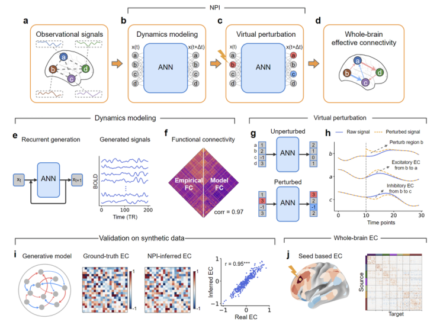
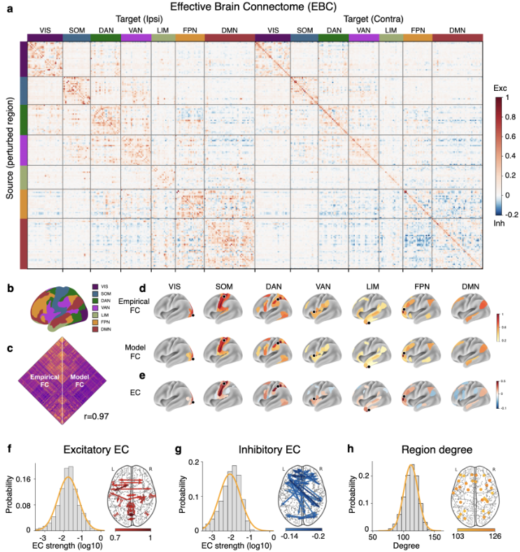

# Mapping Effective Connectivity by Virtually Perturbing a Surrogate Brain

> **Nature Methods 2025**

**作者**：Zixiang Luo, Kaining Peng, Zhichao Liang, Shengyuan Cai, Chenyu Xu, Dan Li, Yu Hu, Changsong Zhou, Quanying Liu\*（通讯，南方科技大学生物医学工程系）

## 1 问题定位：EC 的干预定义在人类身上无人能做

EC、SC、FC 三个概念里，SC 是解剖布线（扩散 MRI 示踪），FC 是统计依赖（无方向、有伪连接），EC 才是有方向的因果影响。作者开篇把 EC 的金标准钉在「扰动并记录」上：光遗传、DBS、CCEP 都是真扰动，但都有创、空间覆盖受限，不可能对全脑逐区做。

计算方法两条路各有病灶，论文的归因很清楚：

- **模型依赖的路（DCM）**：EC 定义为状态空间模型里的耦合参数，结论依赖模型假设，模型失配直接偏置结果；
- **模型无关的路（GC）**：能判方向，但强度测不准、兴奋/抑制分不开。GC 本质是预测性改进，不是干预；
- 还有一条近年路线：直接拿训练后 RNN 的权重矩阵当 EC。论文引了 Das & Fiete（Nature Neuroscience 2020）的批评——强循环网络里从活动反推连接有**系统性误差**，学到的权重没有理由等于底层 EC，区域数量一大更不可信。

NPI 的立场是：别从模型权重里读因果，把模型当**可干预的替身**，用与实验神经科学同构的「扰动-记录」协议在模型内部做实验。这一定义对齐 Pearl/Woodward 的操作主义因果观（论文明确引了 Pearl《Causality》），因此推出来的 EC 与光遗传式的实验 EC 在语义上同族——这是它区别于 GC/DCM 的关键卖点，也是后面 CCEP 验证能成立的逻辑前提。

## 2 方法

### 2.1 代理脑：三步输入 MLP

把 N 个脑区的集体活动记为 \( x_t \in \mathbb{R}^N \)，代理模型是一个纯前馈 MLP：

\[
\hat{x}_{t+1} = f(x_t,\ x_{t-1},\ x_{t-2},\ \theta)
\]

结构 3N → 2N → 0.8N → N（网格搜索定的），损失就是单步预测的 MSE，Adam lr=10⁻³，60 epoch，单卡 RTX 4080——训练成本小到不像 Nature Methods 的方法，但后面验证做得扎实。逐被试训练（HCP 每人 4×15 分钟数据），所以 EBC 是个体化的。3 步输入比 1 步输入的预测略好（Supp Fig 8）；作者还对比了 CNN/RNN/VAR 等架构做代理，MLP 在 FC 重现与 EC 推断上最好（Supp Table 1）。

代理模型合格的门槛不是预测精度本身，而是**能否重现区间关系**：把输出递归喂回去做自由生成，生成信号的 FC 与真实 FC 对比。HCP 800 人平均 r=0.97（图 1f 标注 0.97，正文 2.1 节出现 0.98，两处以 0.97 为准）。

### 2.2 虚拟扰动读 EC

训练完冻结网络，逐源区、逐时刻做冲激扰动。扰动加在**网络的输入端**：源区 i 的当前时刻分量 \( x_t \) 抬高 \( \Delta \)，历史两步输入、隐层激活、权重都不动（原文 "perturb each input node of the ANN"）：

\[
\mathrm{EC}_{i\cdot} = \mathbb{E}_t\big[\, f(x_t + \Delta e_i,\ x_{t-1},\ x_{t-2}) - f(x_t,\ x_{t-1},\ x_{t-2}) \,\big]
\]

\( e_i \) 是第 i 维单位向量，\( \Delta \) 取 0.5 倍 BOLD 标准差。读出的是 t+1 时刻（fMRI 上即 0.72 s 后）所有目标区的响应差：符号给兴奋/抑制，幅度给强度，源区固定、目标遍历即「一到全」，逐区扫完即全到全。

三点值得记：

1. **等价于期望 Jacobian**。小 Δ 下，冲激响应差 \( f(x_t+\Delta e_i) - f(x_t) \approx \Delta\,\partial f/\partial x_i \)，除以 Δ 就是 Jacobian 中「输入 i」对应的那一列（转置过来即 EC 矩阵的第 i 行）；再对所有观测到的状态取平均，得到的就是训练后网络 Jacobian 在**数据的状态分布**上的期望（Supp Note 4）。Ext Data Fig 2 把三方都对上了：数值算出的 ANN Jacobian、NPI-EC、以及 RNN 数据上真值 RNN 的 Jacobian 彼此一致。这给了方法一个干净的理论身份，也划出了它的边界：期望是对「被试实际流经的状态分布」取的，所以这份 EC 同时由网络结构与其状态统计共同决定，读出的是**局部线性化增益**，不是大扰动下的系统响应；
2. **状态依赖**。真实刺激的响应随脑状态变（论文引了颅内刺激响应随状态变化的病例证据，Scangos et al. 2021 的抑郁症病人单例报道），所以他们在每个时刻的状态各扰动一次、再平均——EC 是「典型状态下」的平均效应，不是某一时刻的效应。次数上这意味着每个源区要做 T 次扰动（单被试 4 个 session 共约 5,000 个时间点），期望就是对这批实际流经的状态取平均；
3. **扰动幅度小**。Δ=0.5σ 落在小信号区，恰好对应 Jacobian 解释；但 CCEP 的真实刺激是强扰动，两种扰动机制的口径差异是后文验证的一个隐性前提。

## 3 实验与验证

### 3.1 仿真：三套考核，两套有真值

真值 EC 的取得方式与 NPI 同构——直接在生成模型上「扰动-记录」。这个对称设计干净，但要注意它验证的是「NPI 能恢复**生成模型意义上的**扰动响应」，不是生物真值。

**① RNN 生成数据**。\( dx = [-x + W h(x)]dt + \sigma d\xi \)，\( h \) 是 tanh，权重矩阵 W（高斯 \( \mathcal{N}(0, n^{-1/2}) \)）当 SC。NPI-EC 对真值 EC **r=0.95**，GC 明显更差（Wilcoxon p<10⁻³）。两个附带结论：EC-SC 相关显著强于 FC-SC（FC 无方向且有伪连接）；EC 不与 SC 完全重合，作者归因于非线性动力学与噪声——这其实是合理现象而非缺陷。

**② Sanchez-Romero 公开合成 BOLD**（5–10 节点、9 种含环拓扑，无 EC 真值，用二值化后判别 SC 有无的 AUC 评估）：NPI 的 **AUC 接近 1**，九种拓扑全部显著优于 GC 与 DCM。DCM 在这个考核里被比下去有结构性原因——节点数一多，DCM 的参数空间爆炸，本来就不适合大规模网络。

**③ 66 节点全脑模型（WBM）**。Deco 动态平均场模型 + DSI 真实 SC，HRF 卷积出 BOLD（TR=0.72，与 HCP 一致）。HRF 有延迟，真值 EC 在 t+4·TR 读出。代理脑单步预测精度随步数衰减，但自由生成的 FC 仍与仿真 FC 相关 r=0.81；NPI-EC 与真值高度一致且胜 GC（p<10⁻³）。

**稳健性**（RNN 实验）：对扰动幅度不敏感，噪声增大只缓慢变差；数据长度与网络规模是硬约束——网络越大，可靠推断需要的数据越多。这句话在 Discussion 里被作者自己重申为方法的主要限制。

### 3.2 真实数据：HCP 上的 Human EBC

HCP S1200 的 800 人静息态 fMRI（TR 0.72 s，4×15 min，ICA-FIX 去噪，0.01–0.1 Hz 带通），MMP 1.0 图谱 360 个皮层区（19 个皮层下区也放进训练输入以减少未观测区的偏差，EC 只在 360 区上报告）。逐被训代理、逐被扰出 EBC、再群平均。

- **结构支撑**：EC（绝对值）对 Demirtaş 等 DSI 衍生的 SC，**r=0.42**。对 fMRI 推出的量来说这个数不低，但也要如实说：r²≈0.18，EC 与 SC 之间还隔着八成以上的未解释方差；
- **跨数据集**：HCP 群体 EBC 与 ABCD（2000 人）的 **r=0.87**——不同设备、不同人群、不同年龄段，群体模式的稳定性过得去；
- **个体水平**：55% 的 EC 连接在 800 人上显著非零（Bonferroni 校正）；同一被试训练两个不同初始化的 ANN，EC 一致（排除训练随机性）；数据切半的跨 session 一致性**高于**跨被试相关性——方法噪声小于个体差异，EC 才有资格谈个体化。边缘网络（LIM）可靠性最低，作者归因于该区 fMRI 信噪比低，归因诚实；
- **图谱稳定性**：Schaefer 100–1000 区上 EC 高度稳定。

**EBC 本身的发现**：EC 强度对数正态分布（AIC 四分布比选出的，与小鼠/猕猴轴突示踪的 SC 分布一致）；兴奋 EC 最强处多在网络内部，抑制 EC 最强处几乎全在网络间且全为跨半球；兴奋最大强度归一化到 1 时抑制只有 0.22；二值化后 73% 的连接是双向的，与皮层 SC 的经典结论相符。这些分布层面的结论与独立来源的解剖学知识对得上，是我认为比单点相关更可信的一类证据。

### 3.3 CCEP：唯一贴到真实刺激的验证

F-TRACT 项目聚合 613 位癫痫病人的皮层电刺激（CCEP）+ SEEG 记录，给出群体级刺激传播矩阵。NPI-EC（HCP 群体级，同图谱）对 CCEP 左半球 **r=0.33**，FC 对 CCEP 只有 **r=0.20**；dlPFC 作源的输出 EC、PCC 作靶的输入 EC 也都比 FC 更贴 CCEP。

0.33 不高。但考虑到两边差异悬殊的口径——静息态相关的推断 vs 侵入性强刺激的传播、健康人 vs 癫痫病人、个体刺激 vs 群体聚合——能稳定高出 FC 一截，本身就是「EC 沾到了因果边」的证据。FC 0.20 的基线也提醒：**结构支撑不等于因果**，r=0.42 的 EC-SC 相关里有一部分只是 SC-FC 本来就有的共变。

### 3.4 疾病生物标志探索（结果平平，作者照写）

ABIDE（自闭症）与 ADNI（阿尔茨海默）上，EC 分类病人/对照的表现**与 FC 相当**，没有超越。论文把这写成「EC 可作 FC 的可行替代」，但「相当」就是相当——方向性信息能否兑现为临床增益，这里没有给出证据。这两页值得用挑剔的眼光读。

## 架构图

*Figure 1 · NPI 全流程：(a) 观测的多脑区信号；(b) MLP 学单步动力学；(c) 逐区虚拟扰动；(d) 读出全脑 EC。(e,f) 递归生成验证 FC（r=0.97）；(g,h) 扰动响应差给兴奋（b→a 升）/抑制（b→c 降）；(i) 合成数据上 NPI-EC 对真值 r=0.95；(j) 真实 fMRI 上的 seed-based EC*

*Figure 3 · Human EBC：(a) 800 人平均的全脑 EC 矩阵（按 7 个功能网络分块，红兴奋/蓝抑制，色标 Exc/Inh）；(b) 皮层区归入七个功能网络；(c) 模型 FC 对经验 FC r=0.97；(d) 逐网络的 seed-based FC 空间模式；(e) 逐网络的 seed-based EC（红兴奋/蓝抑制）；(f,g) 兴奋/抑制 EC 强度均为对数正态分布；(h) 二值化后的节点度分布*

## 与其他论文的关系

站内三篇候选对照都查过，没有与本篇的真实对话（本篇不引它们，主题坐标系也不同），下面如实标注；本篇真正的参照系是经典 EC 方法。

| 论文 / 工作 | 关系说明 |
|---|---|
| [BrainGPT](braingpt.md) | 都把神经网络训成神经信号的代理模型，用途相反：BrainGPT 是 EEG 上的表征/解码工具（模型输出是目的），NPI 把代理模型当**被解剖的对象**（模型只是扰动实验的容器）。站内 EEG 基础模型训完后是否也能这样扰动出「区间因果」，本篇提供了模板，但 EEG 的源定位模糊与容积传导会让「区」的定义先出问题——暂无直接对话 |
| [EEGDM](eegdm.md) | 两种「模型作工具」的分工：EEGDM 用生成模型产数据训表征，模型是数据工厂；NPI 用模型做反事实实验，模型是实验室。同一个代理模型在两个框架里甚至可以复用——暂无直接对话 |
| [EEGMoE](eegmoe.md) | 被试间差异的两种处理：EEGMoE 用专家分化吸收个体差异，NPI 逐被试训代理并用「跨 session 一致性 > 跨被试相关性」证明个体信号大于方法噪声。两个证据可以互相支撑，但技术上没有交集——暂无直接对话 |
| Granger 因果 | 论文的主要对比基线，三套仿真全胜（r=0.95 那套 p<10⁻³）。GC 是预测性定义，方向判得动、强度与符号测不准；NPI 的干预主义定义与实验 EC 同族，这是它敢叫 EC 而 GC 不敢的差别 |
| DCM | 模型依赖路线的代表。EC 定义为状态空间耦合参数，节点一多参数爆炸（66 节点上 DCM 实际不可用，公开合成数据上被 NPI 以 AUC 显著压制）。但 DCM 在小规模、假设充分时有完整的统计推断框架，NPI 没有等价物 |
| Das & Fiete（2020） | 本篇动机的直接来源之一：强循环网络中从活动反推连接有系统性误差。NPI 的回答是绕开权重读出，改做行为学式的扰动实验 |
| Pearl / Woodward 的因果观 | NPI 的 EC 定义显式对齐干预主义因果（do-操作/操作主义），是全文语义合法性的地基——EC 推得对不对，取决于「代理模型的扰动响应 ≈ 真实脑的扰动响应」这个迁移假设，而这是全文唯一无法直接验证的一环（CCEP 只是间接证据） |

## 个人思考

- **方法的全部重量压在一个迁移假设上**：NPI 真正证明的是「扰动代理模型能恢复代理模型的 EC」（仿真部分，近乎循环），而「代理模型的 EC ≈ 真实脑的 EC」只有 CCEP r=0.33 这一间接证据撑着。论文对此的处理算体面——FC 基线 0.20 摆在旁边——但如果 CCEP 上只追平 FC，整个故事就塌了，所以这 0.13 的差距是全文最要命的数字，值得盯住。这层假设内部还有一个更细的错位：代理脑的合格标准是**重现 FC**（r=0.97），可 FC 是无方向的二阶统计量，FC 重现得好并不保证扰动响应（期望 Jacobian）也对——两个 FC 几乎相同的动力学系统完全可以有很不一样的局部增益结构。也就是说，被验收的指标和被使用的量不是同一个量，保真度对 EC 的传导在这道缝上没有免费保证；
- **小信号扰动 vs 强刺激的口径差是隐藏的裂缝**：Δ=0.5σ 的冲激对应期望 Jacobian，是线性化的小信号增益；CCEP 是大电流强刺激。非线性系统里两者可以不一致。CCEP 验证成立反而暗示皮层响应在这段尺度上近似线性，或者对数正态分布的强度结构在两种口径下都占主导——论文没有讨论这一点，我认为这是比数据量更深的限制；
- **fMRI 时间尺度上的「因果」要打折听**：EC 读在 t+1，即 0.72 s 后，而神经因果在毫秒级。HRF 把血流动力学卷进了方向性里（作者在 Supp Fig 13、14 里做了带 HRF 卷积、正/负双向冲激的扰动变体，算意识到了）。NPI 胜 GC 的部分原因可能是它至少对每个状态做了响应平均，比 GC 的全时段线性回归少受平稳性假设拖累——但把 0.72 s 尺度的方向叫「神经因果传播」，措辞上我认为超出了证据；
- **对本站主线的真实启发不在方法在立意**：EEG 基础模型社区（含站内读的一串）评价模型好不好的手段全是生成质量与下游判别精度，全是「预测性」指标。NPI 提供了第三种评价：训完的模型能否回答干预性问题（论文 Discussion 末尾也把「对训练后的代理模型施加更多样的干预」列为下一步工作）。一个在 EEG 上预测得准的模型未必在「扰动谁、谁会变」上给出对的结构——如果哪天有人对 BrainGPT 类模型做系统性扰动分析并与真实刺激数据对账，那会是「神经基础模型作为科学工具」的第一次真正考试。

!!! abstract "复现速查卡"
    - **代码**：https://github.com/ncclab-sustech/NPI （含自产合成数据；PyTorch，单卡 RTX 4080 级别即可）
    - **代理**：MLP 3N → 2N → 0.8N → N；输入 = 前 3 个时间步；MSE 单步损失；Adam lr=10⁻³，60 epoch，batch 100
    - **扰动**：加在输入端当前时刻分量（历史步/权重不动），逐源区逐时刻冲激 \( \Delta e_i \)，Δ = 0.5×BOLD 标准差；每源区约 T≈5×10³ 次（4×15 min ÷ 0.72 s），读 t+1 响应差、对全部状态取平均（WBM 口径下读 t+4·TR）
    - **数据口径**：HCP S1200 800 人 rs-fMRI（TR 0.72 s，4×15 min，ICA-FIX，0.01–0.1 Hz）；MMP 360 皮层区 + 19 皮下区入训练；预测评估用前 3 session + 第 4 session 前 60% 训、末 40% 测；EC 推断用全部 4 session
    - **关键数字**：模型 FC r=0.97（HCP）/ 0.81（WBM）；NPI-EC 对真值 r=0.95（RNN）；EC-SC r=0.42；HCP-ABCD r=0.87；EC-CCEP r=0.33 vs FC-CCEP 0.20
    - **统计**：相关性用 t 检验；方法对比用 Wilcoxon 符号秩（p<10⁻³）；个体显著性 Bonferroni 校正；分布拟合按 AIC 选型
    - **复现要点**：二值化 EBC 的阈值是「保留 80% 绝对强度」（绝对值 0.06）；扰动响应有状态依赖，漏掉逐状态平均会引入偏差；SC 对照用 Demirtaş et al. 的 DSI 流线矩阵（0–1 缩放后 log 变换）

---

**相关阅读**

:material-arrow-left: [BrainGPT（同样训代理模型，但作表征工具而非实验对象）](braingpt.md) ｜ :material-creation: [EEGDM（模型作生成工具 vs 本篇作科学工具）](eegdm.md) ｜ :material-chart-timeline-variant: [EEGMoE（被试间差异的另一种处理）](eegmoe.md) ｜ :material-home: [首页](../index.md)
