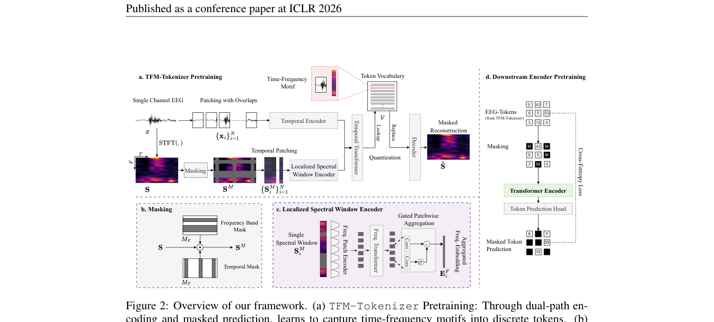

# TFM-Tokenizer: Tokenizing Single-Channel EEG with Time-Frequency Motif Learning

> **ICLR 2026**

TFM-Tokenizer (ICLR 2026)

**作者**：Jathurshan Pradeepkumar, Xihao Piao, Zheng Chen, Jimeng Sun（UIUC / 大阪大学 SANKEN）

#### 6.1 问题定位

EEG tokenization 是被忽视的关键问题。对现有方法的批评：① 多数基础模型只是把连续信号规则切段（「仅仅离散化」，没有学词表）；② LaBraM 虽学了 VQ tokenizer，但 token **只作为训练目标、推理时被丢弃**，基础模型仍然吃连续段级 embedding——没享受 tokenization 的红利。TFM-Tokenizer 要学一个**时频 motif 词表**，并把离散 token **真正作为下游模型输入**。

三大设计原则：① **单通道级**训练（channel-agnostic，跨设备泛化）；② **Token 分辨率**应捕捉 motif（短时、重复、有判别意义的时频波形模式，如振荡爆发、棘波）；③ 学习目标应**显式包含时频表示**（纯时域 motif 会被低频主导、丢失高频信息）。

#### 6.2 方法

**（a）TFM-Tokenizer（单通道 motif 学习，双路径）**

- 输入：单通道 EEG，切重叠 patch（窗长 L、hop H），每 patch 对应一个 STFT 频谱窗口 `S_i`（窗长 200 点=1s，hop 100=0.5s，Hann 窗，只取幅值）；
- **频域路径——Localized Spectral Window Encoder**（相比 BIOT「整窗过一个线性层」的改进）：
  1. **Frequency Patch Encoder**：每个频谱窗沿频率轴切成 P 个不重叠 patch（每 patch 覆盖 Δf 个频点），线性投影 + GroupNorm + GeLU；
  2. **Frequency Transformer**：沿频率轴做注意力，建模**窗内跨频段依赖**；
  3. **Gated Patchwise Aggregation**：sigmoid 门控聚合（强调重要频段、抑制无关频段，如睡眠任务只关心 <32Hz）；
- **时域路径——Temporal Encoder**：原始 EEG patch 线性投影 + GeLU + GroupNorm；
- 两路 embedding **拼接** → **Temporal Transformer** 建模 N 个 patch 间的长程依赖 → 输出量化进 VQ 词表（**codebook 8192**，与 LaBraM 对齐以便公平比较）；
- **关键设计：不加位置编码**——EEG 非平稳、motif 可出现在任意位置；消融证明去掉 PE 后 Cohen's Kappa 0.5119→0.5337，token 利用率下降、类独有 token 上升（避免同一 motif 因位置不同学成不同 token 的冗余）。

**（b）训练目标：时频掩码预测**

- **频带掩码 + 时间掩码**（消融：随机掩码最差；频带掩码最关键，Kappa +8%；加时间掩码 balanced acc 再 +5%）+ **对称掩码**（沿用 LaBraM，数据增强+稳定）；
- 损失：总损失 = 掩码重构 + codebook + commitment 三项之和（下式）；码字用 EMA 更新：

\[ \mathcal{L}_{\mathrm{token}} = \underbrace{\sum_{(f,t)} \left\| S(f,t) - \hat{S}(f,t) \right\|_2^2}_{\text{掩码重构}} \;+\; \underbrace{\alpha \sum_i \left\| \mathrm{sg}[E_i] - v_i \right\|_2^2}_{\text{codebook}} \;+\; \underbrace{\beta \sum_i \left\| E_i - \mathrm{sg}[v_i] \right\|_2^2}_{\text{commitment}} \]

**（c）下游 Transformer**

- token embedding 查表（**用 VQ codebook 初始化**）+ 通道/位置 embedding + [CLS] token → **线性注意力 Transformer**（仅 ~0.7M 参数）；
- **masked token prediction 预训练**（随机 mask 跨通道跨时间的 token，交叉熵预测）——同时增强对缺失通道/损坏时间段的鲁棒性；
- 最后微调分类。

**（d）Plug-and-play 集成**

- **BIOT-TFM**：用 TFM-Tokenizer 替换 BIOT 的 patch 线性投影层（token 直接作 BIOT 输入）；
- **LaBraM-TFM**：用 TFM-Tokenizer 替换 LaBraM 的神经 tokenizer 做 masked EEG modeling。

#### 6.3 创新点

1. **首次系统研究 EEG 的「可学习词表」问题，且 token 作为真正的输入**（与 LaBraM「一次性标签」形成对照）；
2. **时频 motif 作为离散 token**：双路径显式建模时频结构（频域路径窗内跨频段依赖 + 门控聚合），token 具有生理可解释性（如 token 4035 稳定对应 PLED 的「棘波-慢波」周期模式）；
3. **单通道、channel-agnostic**：不依赖 10-20 系统，可迁移到 ear-EEG 等非标准设备（EEGPT 的固定空间 embedding 则无法扩展到该场景）；
4. **去掉位置编码**的 tokenizer 设计（有消融和理论论证）；
5. **模型极小**：tokenizer ~1.2M + 下游 ~0.7M ≈ 1.9M，比 BIOT（3.2M）、LaBraM（5.8M+8.6M）小，性能反而更好；
6. token 质量分析体系：类-token 独有性（uniqueness）、类内一致性（检索 precision@K）、频率学习能力（token 序列谱熵）、token 利用率。

## 架构图

*Figure 2 · 框架总览：(a) 双路径 tokenizer 预训练 (b) 掩码策略 (c) 频谱窗口编码器 (d) 下游掩码 token 预测*

---

**相关阅读**

:material-arrow-left: [上一篇：NeuroLM](neurolm.md) ｜ :material-arrow-right: [下一篇：BIOT](biot.md) ｜ :material-vector-link: [Tokenization 演进](../topics/tokenization.md) ｜ :material-chart-box: [十三篇方法对比](../comparison.md)
