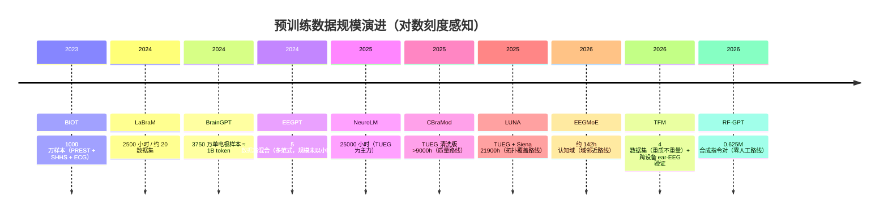

# EEG 预训练数据全景

> 十二篇论文的预训练语料从 142 小时到 25000 小时不等——规模、构成、清洗质量与域距离共同决定了模型的通用性上限。本页是[十二篇方法对比](../comparison.md)的「数据维度」深读页。

## 规模一览

## 语料构成对比

| 论文 | 主力语料 | 构成特点 | 域偏斜风险 |
|---|---|---|---|
| BIOT | PREST（静息）+ SHHS（睡眠）+ ECG | 跨模态（EEG+ECG+IMU），但 EEG 部分集中在静息/睡眠 | 中（缺任务态 EEG） |
| LaBraM | TUSZ（1138h）+ TUEP + TUEG 系 | **临床 TUEG 子集合计约 1800h（约七成，其中癫痫事件 TUSZ 约 45%）**，由 20 个数据集摊薄 | 高——BrainGPT 据此解释其 specialist 迁移偏弱 |
| EEGPT | PhysioMI + HGD + TSU + SEED + M3CV | 多范式均衡（MI/SSVEP/EMO/多任务） | 低（但总量小，~10M 参数够用） |
| BrainGPT | 12 个基准的预训练拆分 | 电极级拆分使样本量 ×E，任务覆盖最广 | 低（但单电极丢失空间信息） |
| NeuroLM | TUEG（~24000h）+ 12 个公开集 | **绝对量最大**，仍以临床 TUEG 为主 | 高（同 LaBraM，但指令微调缓解） |
| TFM | TUEV/TUAB/CHB-MIT/IIIC | 最小语料；单通道 motif 学习弥补规模 | 中；跨设备能力由单通道设计保证 |
| CBraMod | TUEG **清洗版**（>9000h） | 27,062h 原始临床 EEG 五步清洗后剩 110 万个 30s 样本（LaBraM 语料的 3.5 倍） | 低（清洗 + 防泄漏重训，最干净的临床语料） |
| LUNA | TUEG + Siena（21,900h） | 刻意覆盖 20/22 通道双极 + 29 通道单极共 **3 种拓扑**——为拓扑泛性而选数据 | 中（拓扑多样但仍是临床域） |
| EEGMoE | 6 个认知域数据集（~142h） | 情绪（DREAMER/SEED/MAHNOB）+ MI（EEGMMIDB/BCIC-IV-1）+ 负荷（EEGMat），与下游同域 | **极低（域邻近正是其卖点）** |
| JET | TUAB / TUEV / TUSZ（16 通道统一） | 生成器训练即全部数据，无「预训练→下游」转移问题 | —（生成路线） |
| EEGDM | TUEG 19 通道（30s 样本） | 沿用 CBraMod 的通道选取与统一设定 | 低 |
| RF-GPT | 全合成（~12,000 场景 / 0.625M 指令对） | 标准波形生成器 + 拒绝采样 + LLM 合成指令，「配置即标签」零噪声 | —（合成→真实域差是作者自认局限） |

## 关键观察

### 1. 规模 ≠ 通用性，构成决定迁移半径

BrainGPT 的发现最有说服力：以癫痫临床数据为主的预训练模型，在情绪/运动想象等非临床下游上**反而不如从头训练**——域差异吞掉了预训练收益。EEGPT 用小而均衡的语料 + linear probing 达到 SOTA，是「构成比规模重要」的另一佐证。

**2026 年最尖锐的证据来自 EEGMoE**：预训练仅 ~142h（六个认知域数据集），在认知任务上大胜 2500h 癫痫域语料的 LaBraM——BCIC4-2a 运动想象上 47.92 vs 复现 LaBraM 的 29.59。**域距离比数据量更决定迁移成败**。

### 2. TUEG 一条龙：同一语料池，越报越大，也越洗越净

TUEG 体系（Temple 大学）是唯一能拿到万小时级 EEG 的公开来源，被反复使用：LaBraM ~2500h → NeuroLM ~25000h → LUNA 21,900h（+Siena，为拓扑覆盖）→ CBraMod 清洗后 >9000h → EEGDM（沿用 CBraMod 设定）。两个引申：

- **清洗是被低估的变量**：CBraMod 把清洗写成流水线（<5min 记录剔除、掐头去尾 1min、选 19 个 10-20 公共通道、0.3–75Hz 带通 + 60Hz 陷波、任意点 >100µV 整段剔除），消融给出排序：**清洗版 > 脏数据版 > 不预训练**，且清洗版方差最小——脏数据不只拉低均值还放大不稳定。「同一个 TUEG」在不同论文手里的有效数据量与质量差很远；
- 这也解释了为什么**脑机接口类任务（MI/SSVEP）的 pretrain-then-finetune 收益普遍不如临床任务**——语料主力是临床域。

### 3. 防泄漏意识：只有一家把「考前见题」摆在明面上

TUEG 是 TUAB/TUEV 的父集，凡用 TUEG 系预训练再报 TUAB/TUEV 成绩，都隐含「预训练见过下游数据」。**CBraMod 是唯一做防泄漏对照的**：剔除 TUAB/TUEV 被试后重新预训练，TUAB 0.8289→0.8249、TUEV 0.6671→0.6659，降幅 <0.5pp 仍 SOTA——证明其泛化不靠背题，同时给全行业提了醒（LaBraM / NeuroLM 未做此对照，严格说成绩都含泄漏成分；EEG-FM-Compass 的 leakage-aware 复评因此更有价值）。

### 4. Scaling 的证据分裂：从「万小时叙事」到「边际递减」

- **正方**：LaBraM（数据 1→2500h 与 Base→Huge 均单调升，Huge 未饱和）、BrainGPT（模型跨 4 个数量级 + 数据 0→1B token 均正相关）、EEGPT（模型规模幂律拟合）三家报告 scaling law；
- **反方**：CBraMod 的数据消融显示 **1h→9000h 单调提升但 1000h 后边际递减**，且作者明确拒绝外推；EEG-FM-Compass 统一复测发现综合排名靠前的 EEG FM 参数全部 ≤5.8M、无 scaling law 迹象；
- 结论修正：**当前 EEG 语料的瓶颈不是量而是多样性**——CBraMod 清洗后是 19 通道临床单一分布，1000h 饱和很可能只是同质化饱和；REVE（61,415h）、SleepGPT（86,335h）这类多数据集堆量路线能否突破，是待验证问题。

### 5. 单电极拆分是"数据倍增器"

BrainGPT 把多电极信号拆成单电极样本，等效样本量 ×E（E 为电极数）——3750 万样本里含水量高，但换来了对任意电极配置的兼容性。TFM 的单通道 tokenizer 是同一思想的 tokenization 版。

### 6. 合成数据：数据获取的第三条路

RF-GPT 演示了「仿真器即数据工厂」的完整形态：标准合规波形生成器（配置精确已知）+ 拒绝采样保真 + 确定性 captioning——**训练信号零噪声，这是任何人工标注都给不了的精度**，0.625M 指令对因此才可行。局限同样明确：合成→真实的域差在生理信号域同样尖锐（EEG 没有「标准波形生成器」级别的仿真器，但睡眠纺锤波/棘波注入仿真、受控范式重放是部分替代）。JET/EEGDM 则从另一头逼近同一问题：先用真实数据训生成器，生成能力反哺下游数据增强（见[多任务专题](multi-task.md)）。

## 对新建笔记的提示

读新论文时，在笔记的「实验与结果」里记录其预训练语料的：**总时长（或样本数）、主力数据源、域构成、清洗流程**。三个加分记录项：

1. 报告了 scaling 实验（数据量 vs 性能曲线）吗？（目前 LaBraM / BrainGPT / CBraMod 三家，仍稀缺）
2. 做了防泄漏对照吗（预训练语料与下游基准的交集如何处理）？
3. 域构成与你的下游任务邻近吗——这比小时数更值得先看。

## 关联页面

[数据集索引](../datasets.md) · [十二篇方法对比](../comparison.md) · [预训练范式对比](pretraining.md)
