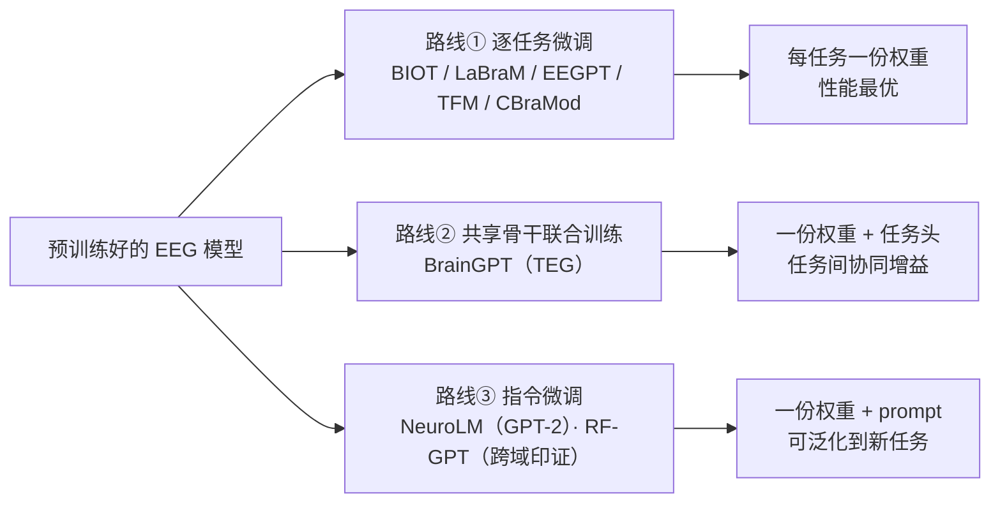

# 多任务与下游适配

> 「一个模型能不能同时干多种 EEG 任务？」——核心六篇给出三条路线；2025–2026 的扩展论文又带来路线之外的三个新变量（冻结探针之争、生成增强、组件可插拔）。本页是[十三篇方法对比](../comparison.md)的「下游适配维度」深读页。

## 路线总览

## 三条路线深度对比

| 维度 | ① 逐任务微调 | ② 共享骨干联合训练 | ③ 指令微调 |
|---|---|---|---|
| 代表 | BIOT / LaBraM / EEGPT / TFM / CBraMod | BrainGPT（TEG 图网络） | NeuroLM（GPT-2）；RF-GPT（Qwen2.5-VL，跨域） |
| 权重份数 | 每任务一份 | 一份骨干 + 每任务一个头 | **一份权重** |
| 新任务成本 | 再微调一次（全量） | 新任务头 + 图子图（轻量） | **写一个 prompt 即可尝试** |
| 任务间协同 | 无 | ✅ 有（joint 比 separate 全任务提升，小任务受益最大） | ✅ 有（混任务训练） |
| 性能天花板 | **最高**（LaBraM/CBraMod 均为此路线） | 略低于单独训练的最优，但全面高于各自 separate | 目前略逊单任务 SOTA，接近多数基线 |
| 存储成本 | 模型数 × 任务数 | 1 份骨干 + N 个小头 | 1 份 |
| 泛化到新任务 | 需要数据 + 微调 | 需要少量数据 | **零样本尝试 prompt** |

**路线③的跨域印证**：RF-GPT 在射频域用同一范式（谱图 token 前缀 + 文本指令 + 只算答案损失）做到一个模型五族任务（调制/重叠/技术/计数/参数抽取）——指令微调路线在非 EEG 域同样成立，且其阴性对照（GPT-5 精心 prompt 后仍随机猜）反过来强调：这条路线的前提是**模态接地要先做专门训练**，不是通用 LLM 天生就会。

## 关键机制细节

### BrainGPT 的 TEG：为什么联合训练能双赢

任务 A 和任务 B 的电极集重叠部分（如 C4），其**节点向量被两个任务的梯度共同更新**——相当于大任务给小任务做数据增强。论文证据：MW（仅 4K 样本）在联合训练中 +3.9%，SS（42K 样本）只 +0.9%——**小任务受益与数据量成反比**。

### NeuroLM 的指令微调：为什么要把任务变成问答

把「6 类事件分类」变成 `[SEP] Question: Which event type...? Answer: {(A)...(F)}`，任务差异就被压进了**文本 prompt** 而非模型结构。配套设计：只对答案部分算损失（稳定）、混入纯文本防遗忘、评测取 argmax 而非 beam search。消融显示模型对选项乱序鲁棒（TUEV/HMC），说明真的理解了问题语义而非背选项位置。

### 性能差距从哪来

NeuroLM 坦言多任务版本仍逊于单任务 SOTA 的 LaBraM（如 TUAB 0.7969 vs 0.8258）。三个原因：① 任务间梯度干扰；② 文本对齐是粗粒度的空间级（无 EEG-text 成对数据）；③ GPT-2 基座偏小且老。**多任务的价值在范式与效率，不在当下数字**。

## 路线之外：下游适配的三个新变量（2025–2026）

### 变量一 · 冻结探针 vs 微调：两个极端的全部证据

「预训练表示要不要微调才可用」，站内已积累四个数据点，一边倒地指向「要」：

| 模型 | 冻结/探针表现 | 微调表现 | 说明 |
|---|---|---|---|
| **EEGPT** | linear probing 即 SOTA（TUEV 0.6232） | —（探针就是其协议） | **唯一例外**：对齐目标 \( L_A \) 直接优化表示质量 |
| LaBraM | 探针崩（TUEV **0.346**） | 0.6409+ | 掩码码字预测的特征停留 in「预测码字够用」的层次 |
| CBraMod | 冻结 backbone 只训头崩（FACED Kappa 0.5041→**0.2579**） | 0.5041 | MAE 式重构表征高度任务特化（但冻结版仍好过 BIOT/LaBraM 冻结版） |
| EEGDM | 探针 0.6010（仅略高于从零训练 0.5825） | **0.6826** | 生成预训练的表示同样靠微调兑现 |

结论：**「预训练价值靠微调兑现」是普遍规律，EEGPT 是目前唯一例外**——与 EEG-FM-Compass「线性探针普遍不够」的第三方结论一致。对「预训练→冻结→解码」类项目的直接提醒：别指望冻结提取器，LoRA/微调是必选项。

### 变量二 · 生成增强：掩码范式结构性做不到的外溢

生成式预训练附赠一个掩码重构没有的资产——**生成器本身**：

- **JET**：合成数据增强 SOTA 分类器 CBraMod，ΔAcc +0.017~+0.032 全为正；而 EEG-GAN / 扩散基线的 ΔAcc ≈ 0 甚至为负（生成样本引入分布偏移）；
- **EEGDM**：扩散模块直接当增强器，CL-Drive Balanced Accuracy +5.4pp（53.57%→58.96%），对样本稀缺的 BCI 任务是独有账目；
- **Not-All-EEG**：位置难度自适应调度让增强收益再放大——TUEV 上 ΔAcc +9.58pp（EEGNet 裁判）/ +2.39pp（CBraMod 裁判），且首创**双裁判协议**（从零训练的 EEGNet + 预训练的 CBraMod 各评一遍），排除「合成数据只对弱分类器有效」的伪增益。

### 变量三 · 组件可插拔：tokenizer 当独立产品

TFM 把 tokenization 从「论文的一部分」做成**可替换组件**：替换 BIOT 的输入投影 / LaBraM 的神经 tokenizer 后，93% 的指标-设定组合提升（单数据集 CHB-MIT 上 LaBraM-TFM 的 AUC-PR +147%）；跨设备 ear-EEG 仅 ~8K 标注样本微调即超基线 14%。这是「输入表示质量独立于骨干」的最强证据。

## 与传统多任务学习的对比

EEG 领域传统 MTL（hard/soft parameter sharing、跨任务预训练）一直存在，但这批论文的差异在于：

1. **骨干来自大规模自监督预训练**（而非随机初始化的多任务网络）；
2. **输入表示天然任务无关**（channel patch / 单电极 token），这是多任务能共享骨干的前提；
3. NeuroLM 首次把 NLP 的 instruction tuning 完整范式搬进 EEG。

## 新论文入库提示

读新论文时记四问：① 它走哪条路线？联合训练报 joint vs separate 了吗？指令微调的 prompt 泛化到没见过的任务了吗？② 它报了冻结/探针/微调的对比吗——这是判断表示质量的最干净口径；③ 它有生成器吗，合成数据能给下游增强吗？④ 它的组件（tokenizer/编码器）能插进别家骨干吗？——后两问是 2026 年的新增分水岭。

## 关联页面

[BrainGPT 笔记](../papers/2026-09/0918-braingpt.md) · [NeuroLM 笔记](../papers/2026-09/0918-neurolm.md) · [通道异构的六种解法](spatial.md) · [十三篇方法对比](../comparison.md)
