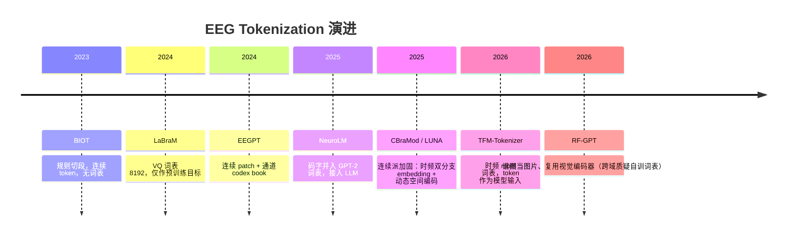

# EEG Tokenization 演进

> 一条主线：**token 从「预处理产物」→「训练靶子」→「真正的模型输入」**；2025–2026 连续派又带着新形态回归。本页是[十三篇方法对比](../comparison.md)的「Tokenization 维度」深读页，覆盖十三篇。

## 演进时间线

| 时间 | 论文 | Token 形态 | 词表 | Token 的用途 |
|---|---|---|---|---|
| 2023 | [BIOT](../papers/2026-09/0918-biot.md) | 连续向量（1s 规则切段） | 无 | 模型输入 |
| 2024 | [LaBraM](../papers/2026-09/0918-labram.md) | 离散码（VQ，8192） | 有 | **仅作预训练目标**，推理时丢弃 |
| 2024 | [EEGPT](../papers/2026-09/0918-eegpt.md) | 连续 patch embedding | 无（通道 codex book 另算） | 模型输入 |
| 2025 | [NeuroLM](../papers/2026-09/0918-neurolm.md) | 离散码（VQ） | 有（并入 GPT-2 词表） | LLM 的输入 token |
| 2026 | [TFM-Tokenizer](../papers/2026-09/0918-tfm-tokenizer.md) | 离散码（VQ 时频 motif） | 有 | **基础模型的输入** + 可插拔复用 |

## 切段之前：预处理与归一化

进模型前把异构信号拉齐的方式，各家并无共识——跨论文比较时的隐藏变量：

- **重采样**：BIOT / CBraMod / EEGDM / JET 统一 200Hz；EEGPT / LUNA 统一 256Hz。滤波细节只有两家披露：LUNA 0.1–75Hz 带通 + 50/60Hz 陷波，CBraMod 0.3–75Hz 带通 + 60Hz 陷波；
- **归一化四式**：BIOT 逐通道除以绝对幅值 **95 分位数**；LUNA 逐通道 **z-score**；CBraMod 以 **100µV 为单位**归一；JET 幅值整体 **×0.01**。

## 切段粒度谱系

- **patch 时间长度**：LUNA 最细（40 个时间戳，@256Hz 约 0.16s）→ EEGPT 250ms（64 点）→ 主流 **1s**（BIOT / LaBraM w=200 / TFM 窗 200 点 / CBraMod / EEGDM / JET P=200）——首尾差 6 倍，粒度选择与「motif 通常持续亚秒到数秒」的生理直觉大体一致；
- **重叠与否**：只有 BIOT（1s 窗 0.5s 重叠）与 TFM（hop 0.5s）重叠切，其余全部无重叠；
- **切的对象**：主流「每通道独立切」（承 BIOT 的逐通道设计）；EEGPT 在固定 58 电极网格上切；**EEGMoE 干脆不切波形**——先分 5 个频带（δ 1–4 / θ 4–8 / α 8–14 / β 14–31 / γ 31–45Hz）、按头皮位置摆成 2-D 网格再堆成 4-D 脑地图；**RF-GPT 把整个 STFT 谱图当一张 512×512 图片**切 14×14 patch（1369 个 token）。

## 三步跃迁

### 第一步：BIOT —— "tokenize 但没词表"

逐通道独立切段（1s 窗、0.5s 重叠），token embedding = FFT 能量 → FCN ⊕ 通道 embedding ⊕ 正弦位置编码。

- 解决了：异构格式统一（缺通道直接丢 token）；
- 没解决：token 是确定性切分的产物，没有数据驱动的词表，谈不上「语义单元」。

### 第二步：LaBraM —— "学词表但只当标签"

VQ-VAE 式 codebook（8192×64），重构目标用 DFT 幅值+相位（原始波形不收敛）。但 token **只在 masked EEG modeling 里当预测目标**，下游微调时 tokenizer 被丢弃，模型实际吃的仍是连续 patch embedding。

- TFM-Tokenizer 对此的批评：tokenization 的红利（压缩、归纳偏置、输入表示质量）根本没落到模型输入上。实验佐证：并入 TFM tokenizer 后（BIOT-TFM/LaBraM-TFM 合计）93% 的指标情形提升。

### 第三步：NeuroLM / TFM —— "token 真正上岗"

两条不同的上岗方式：

- **NeuroLM**：把 codebook 索引**并入 GPT-2 词表**，EEG 变成「外语句子」喂给 LLM，靠 GRL 对抗对齐文本空间 → 通向多任务指令推理；
- **TFM**：token embedding 查表（码字初始化）作为轻量 Transformer 的**输入**，且作为即插即用组件替换 BIOT/LaBraM 的输入端 → 通向通用 tokenization 层。

离散化的共同代价：量化丢幅度细节——BrainGPT 直接回归连续值绕开，JET 在生成侧用连续向量场绕开。

## 2025–2026：连续派的加固与新形态

离散词表线走到 TFM 后，2025–2026 的新工作大多回到连续域，但每一家都往 token 里塞了新东西：

- **CBraMod · 时频双分支 + 动态位置**：每 patch 时域 3 层 1D conv ⊕ rFFT 能量两路**相加**，位置编码改由 2D depthwise 卷积从邻域动态生成（ACPE，核 (19,7)）——不再查表绑定电极；
- **LUNA · 双路嵌入 + 连续空间坐标**：1D conv ⊕ FFT 幅相双路相加，空间信息用 3D 电极坐标的 NeRF 式正弦编码——任意位置都有定义，比 10-20 离散 embedding 连续；
- **EEGDM · PCA 隐空间**：encoder 侧 token 是常规 1D conv + 可学习位置嵌入；特别之处在**去噪目标**先沿时间维 PCA 到 K=20 维（零训练线性隐空间）——把「压缩」从学出来的词表换成闭式主成分；
- **JET · 保留通道身份**：patch 线性投影 + 可学习位置编码，但 token 序列是 (C·N)×D 而非 N×D——电极是物理量，展平等于把通道身份交给位置编码去猜（这是容易被复现者忽略的隐含设计）；
- **EEGMoE · 放弃波形**：token 单位不是波形段而是「时刻 × 频带 × 电极网格」的脑地图体素——用输入端的离散化换任何 montage 的统一表达；
- **RF-GPT · 谱图即图片**：STFT dB 幅值谱直接复用预训练 VLM 的视觉编码器，**不学任何信号词表**——从跨域视角质疑「自训词表」的必要性（详见遗留问题）。

## token embedding 组成对比

| 论文 | 时域 | 频域 | 空间/通道 | 时间位置 |
|---|---|---|---|---|
| BIOT | —（切段即 token） | FFT 能量 → FCN | 可学习通道表 | 正弦相对 |
| LaBraM / NeuroLM | temporal conv | （进重构目标，不进 token） | 10-20 空间表 | 可学习时间表 |
| EEGPT | patch embedding | 无显式 | 通道 codex book | （predictor 内 RoPE） |
| TFM | 线性投影 + GeLU | **频率 patch → 频率 Transformer → 门控聚合**（拼接） | 单通道，下游加通道 embedding | **tokenizer 内无** |
| CBraMod | 3 层 1D conv | rFFT 能量 → FC（相加） | 并入 ACPE 卷积 | 并入 ACPE 卷积（核短边） |
| LUNA | 1D conv | FFT 幅相 → MLP（相加） | 3D 坐标 NeRF 编码 | RoPE（时间 Transformer） |
| EEGDM | 1D conv（512 出） | 无显式 | 19 通道统一设定 | 可学习位置嵌入 |
| JET | 线性投影 | 无显式（损失间接控制） | **保留通道身份**（C·N 序列） | 可学习位置编码 |

两个规律：**频域几乎都以双分支相加/拼接的方式进入 embedding 层**（性价比最高的位置）；**空间与位置编码从「查表」走向「动态生成 / 连续坐标 / 干脆不要」**。

## 关键技术分歧

### 频域信息怎么进 token

| 方案 | 做法 | 问题 |
|---|---|---|
| BIOT | FFT 能量向量 → FCN | 丢失相位；1s 窗过粗，时域任务（P300）吃亏 |
| LaBraM | DFT 幅值+相位作重构目标 | 相位贡献小（NeuroLM 实验证实） |
| NeuroLM | 时域信号 + DFT 幅值双 decoder | — |
| TFM | 频率轴切 patch + 频率 Transformer + 门控聚合 | **显式建模窗内跨频段依赖**，最彻底 |
| CBraMod | rFFT 能量与时域 conv 相加进 embedding | 消融：时+频 > 纯时 > 纯频 |
| LUNA | FFT 幅相经 MLP 与时域 conv 相加 | 消融：**去掉后掉分最多的组件**（AUROC 至 -0.011） |

### 位置编码的争论

BIOT 用正弦相对位置编码，LaBraM 用可学习时/空 embedding，**TFM 在 tokenizer 内刻意去掉位置编码**（消融：Kappa 0.5119→0.5337，token 利用率 12.87%→9.78%[^pe]）。

理由：EEG motif 非平稳，同一模式可出现在任意位置；加 PE 会让相同 motif 在不同位置学成不同 token → 词表冗余。motif 词表需要的是**平移不变性**。

2025 年出现两个新答案，与 TFM 的「无」构成三种态度：**CBraMod ACPE**——位置编码不是查表而是从 patch 邻域卷积动态生成（换蒙太奇/换参考仍适用）；**LUNA NeRF 编码**——连续 3D 电极坐标，任意位置有定义（代价：预训练拓扑只覆盖 3 种布局时，坐标空间采样太稀疏，未见拓扑 SEED-V 上掉分）。三者共同点：拒绝「电极编号 → embedding」的绝对绑定。

（注意区分：TFM 的下游 Transformer 仍加位置/通道 embedding，去掉的只是 tokenizer 内部的 PE。）

## 遗留问题

- **固定窗长的软肋**（TFM 作者自认）：大 pattern 可能跨窗被切断，同一事件分到不同 token；
- **词表大小与利用率的权衡**：TFM 消融显示词表越大类独有 token 越多，但 token 利用率下降；
- **要不要自训词表**（RF-GPT 的跨域质疑）：谱图可以直接复用视觉编码器开箱即用，RF-GPT 以此质疑「自训时频词表」的必要性——但注意其任务是波形的多对一判别（幅值谱够用），EEG 表示学习是否同样成立未经验证；
- **与自然语言对齐**：LaBraM/NeuroLM 都展望过把神经码与语言词汇对齐，目前仍停留在空间级（粗粒度）。

## 关联论文

[BIOT](../papers/2026-09/0918-biot.md) · [LaBraM](../papers/2026-09/0918-labram.md) · [EEGPT](../papers/2026-09/0918-eegpt.md) · [NeuroLM](../papers/2026-09/0918-neurolm.md) · [TFM-Tokenizer](../papers/2026-09/0918-tfm-tokenizer.md) · [CBraMod](../papers/2026-09/0928-cbramod.md) · [LUNA](../papers/2026-09/0924-luna.md) · [EEGDM](../papers/2026-10/1017-eegdm.md) · [JET](../papers/2026-09/0923-jet.md) · [EEGMoE](../papers/2026-09/0924-eegmoe.md) · [RF-GPT](../papers/2026-09/0921-rf-gpt.md)

[^pe]: TFM-Tokenizer 附录 C.6 消融：位置编码会让同一 motif 因位置不同学成不同 token，移除后 Cohen's Kappa 0.5119→0.5337、利用率 12.87%→9.78%、类独有 token 1.94%→2.14%（此处利用率下降为正向信号：说明词表更紧凑）。
